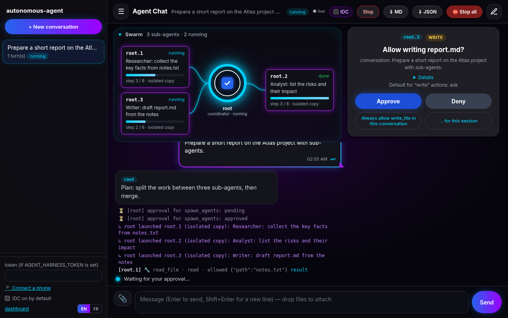
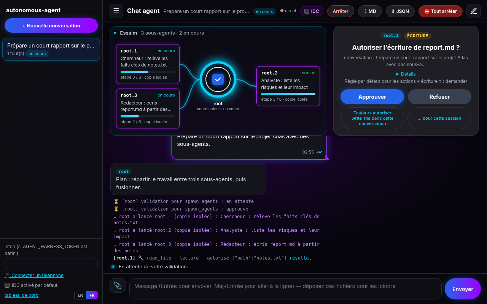
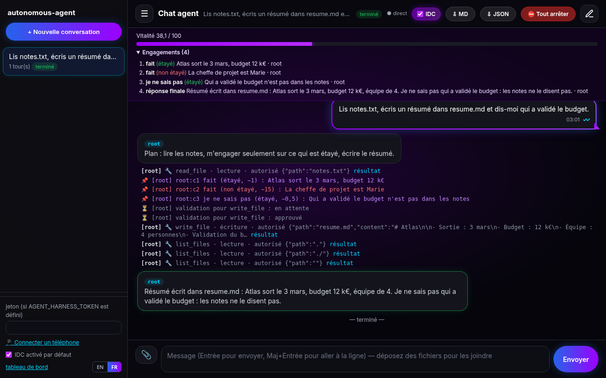
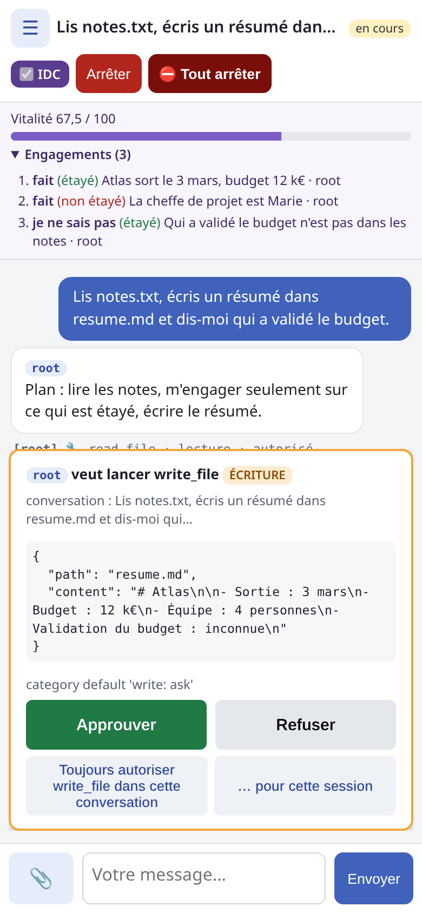
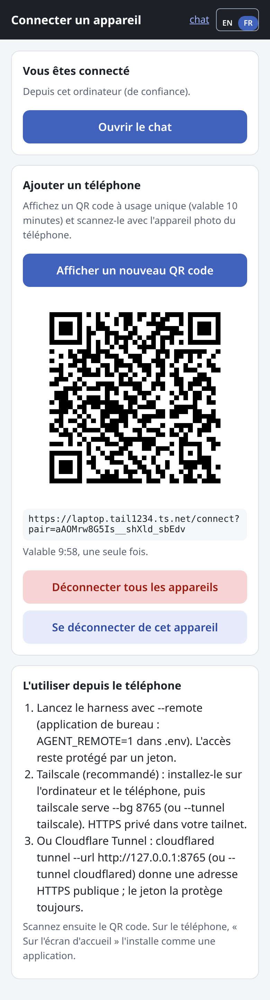

# autonomous-agent

**[English](#english) | [Français](#francais)**

<a id="english"></a>

## English

A small, readable, open-source autonomous agent in Python (stdlib only) with **tools, durable
memory and skills**, and **guardrails that you tune yourself**: every tool has a risk category,
and a `permissions.yaml` file decides, per category and per tool, whether it is `allow`ed, `ask`ed
(confirmation in the terminal) or `deny`ed. Every tool call is written to an append-only audit log,
with secrets redacted.

> It is not "an agent without guardrails". The guardrails are there; **you** set them.

### Download (no command line)

Not comfortable with the terminal? **Ready-to-run desktop builds exist** for Windows and macOS: no Python,
no install, no commands. Download the file for your computer from the
**[Releases page](https://github.com/lanoixdesign/autonomous-agent/releases/latest)**:

| File | For |
|---|---|
| `AutonomousAgent-windows-x64.exe` | Windows 10/11, 64-bit |
| `AutonomousAgent-macos-arm64.zip` | Mac with Apple Silicon (M1, M2, M3, M4…) |
| `AutonomousAgent-macos-intel.zip` | Mac with an Intel processor |

> ⚠️ **These builds are not signed** (no paid Microsoft/Apple certificate), so your system warns you the
> first time. That is expected; if you prefer, check the file against `SHA256SUMS.txt` or build it
> yourself (below).

**Windows**
1. Double-click `AutonomousAgent-windows-x64.exe`.
2. If a blue "Windows protected your PC" (SmartScreen) window appears: click **More info**, then **Run anyway**.
3. A black console window opens (keep it open: it shows what happens) and the chat opens in your browser.

**macOS**
1. Unzip the file and move `AutonomousAgent.app` to **Applications**.
2. The first time, **right-click** (or Control-click) the app → **Open** → **Open**.
   If macOS only offers "Move to Trash" / "Done": open **System Settings → Privacy & Security**, scroll
   down and click **Open Anyway** next to "AutonomousAgent", then confirm.
3. Last resort, in Terminal: `xattr -dr com.apple.quarantine /Applications/AutonomousAgent.app`
4. A Terminal window opens (keep it open) and the chat opens in your browser.

**Where things go.** Everything is in one folder in your home directory, `AutonomousAgent`
(`C:\Users\<you>\AutonomousAgent` or `/Users/<you>/AutonomousAgent`):
`.env` (API keys), `permissions.yaml` (what the agent may do), `workspace/` (the only folder the agent's
file tools can touch; chat attachments go there), `data/` (memory, audit log, conversations).

**API keys.** Without a key the app starts in **demo mode** (offline mock model, canned answers). To use a
real model, open `AutonomousAgent/.env` with a text editor, remove the `#` in front of one provider and
paste your key (for example `AGENT_PROVIDER=groq` and `GROQ_API_KEY=...`), save, and restart the app.
Environment variables work too. Several keys with limits: copy `providers.example.yaml` to
`providers.yaml` in the same folder (see [Several API keys](#several-api-keys-by-category-with-limits)).

**Stop:** close the console window (or press Ctrl+C in it). **Language:** the page follows your browser and
has an EN | FR switch; the console follows the system language (`AGENT_LANG=en|fr` in `.env` forces it).

Notes: the server only listens on `127.0.0.1` (your computer); port 8765 if free, else another one (shown
in the console). The macOS builds are separate for Apple Silicon and Intel. Build it yourself:
`pip install pyinstaller && pyinstaller packaging/autonomous-agent.spec` (output in `dist/`), or run
`python -m agent.desktop` from a clone for the same behaviour without packaging.

### At a glance

- **Agent loop**: plan → tool call → observation → … → answer, with hard limits (steps, tool calls,
  tokens), a "no progress" stop and a pluggable stop rule.
- **15 tools**: files (`read_file`, `list_files`, `search_files`, `write_file`, `edit_file`), `shell`,
  web (`web_fetch`, `web_search`), GitHub (`github_get`, `github_write`), memory (`memory_write`,
  `memory_recall`, `memory_forget`) and skills (`list_skills`, `load_skill`). On top of them,
  `spawn_agent` / `spawn_agents` launch sub-agents.
- **Risk categories**: `read`, `write`, `execute`, `network`, `send`, `spend`, `delegate`. Each one is
  `allow`, `ask` or `deny` in `permissions.yaml`, and deny patterns always win.
- **Audit**: append-only `audit.jsonl`, one line per tool call, secrets redacted.
- **Memory and skills**: plain files; skill bodies are loaded on demand.
- **Swarm**: `spawn_agent` / `spawn_agents`, with depth, count and budget limits. Children inherit the
  parent's permissions and never get more. Read-only children run in parallel. Writing children run in
  parallel in **isolated copies** that are merged back file by file, and conflicts are kept as
  `.conflict-*` files.
- **IDC mode** (optional, off by default): a vitality budget that decays with every step, append-only
  commitments, and a forced "good enough now" answer; saying "I don't know" costs less than an
  unsupported claim. A hypothesis to test, see [IDC mode](#idc-mode-optional-off-by-default).
- **Harness** (`python -m agent serve`):
  - web chat with **pop-up approval cards** and several conversations running in parallel;
  - **attachments**;
  - **several API keys per category with hard limits**;
  - **persistence** (SQLite), **live updates** (SSE) and **⛔ Stop all**;
  - remembered approvals (never for send/spend) and a **dashboard** (usage per agent, quotas, health);
  - **Markdown/JSON export**, **scheduled tasks** and an **EN/FR interface**.

| English | Français |
|---|---|
|  |  |

**Quick start**

```bash
git clone https://github.com/lanoixdesign/autonomous-agent.git && cd autonomous-agent
python -m agent run "List the files" --provider mock --offline   # no key, no network
cp .env.example .env    # add GROQ_API_KEY / OPENAI_API_KEY / OPENROUTER_API_KEY, or use Ollama
python -m agent chat --workspace ~/project
python -m agent serve --workspace ~/project   # then open http://127.0.0.1:8765/ (?lang=fr)
```

Several keys: `cp providers.example.yaml providers.yaml` (git-ignored). The file holds only the
**names** of environment variables, never the keys. `python -m agent keys` shows the remaining quotas,
with keys masked.

**Safety caveats, read before use**
- Tested with the mock backend and fake providers only, not against real providers in CI. **No
  security audit has been done.**
- The isolated copy protects files, but it is **not a sandbox**: `shell` can still reach anything your
  user can. Run untrusted tasks in a container or VM.
- The isolated copies are merged **file by file**: no line-level merge, and conflicting files are left
  for you to resolve.
- Pending approvals live in memory: **they are lost on restart**, and the turn becomes `interrupted`.
- Image, speech and embedding services are **stubs** (routed and limited, but not implemented).
- The harness is a local, single-user tool: no accounts, no TLS. Keep it on 127.0.0.1, or set
  `AGENT_HARNESS_TOKEN`.

### Full documentation (English)

### Features

| | |
|---|---|
| **Loop** | plan → tool call → observation → … → answer, with limits on steps, tool calls and tokens, plus a "no progress" stop (same call repeated). Pluggable `stop_rule`. |
| **Tools** | `read_file`, `list_files`, `search_files`, `write_file`, `edit_file` (workspace only), `shell`, `web_fetch`, `web_search` (best-effort), `github_get`, `github_write`, `memory_write`, `memory_recall`, `memory_forget`, `list_skills`, `load_skill`, `spawn_agent`, `spawn_agents` (sub-agents) |
| **Risk categories** | `read`, `write`, `execute`, `network`, `send` (visible to others), `spend` (costs money), `delegate` (launch sub-agents) |
| **Memory** | plain files: `memory/profile.md` + `memory/journal.jsonl`, keyword recall, `forget` |
| **Skills** | `skills/<name>/SKILL.md` with `name` / `description` frontmatter; only the index is in the prompt, bodies are loaded on demand. Examples: `research`, `code-review`, `release-notes`. |
| **LLM** | any OpenAI-compatible API: Groq, OpenAI, OpenRouter, Ollama (local), custom URL; `mock` backend for offline tests |
| **Harness** | `python -m agent serve`: local chat with approval cards, attachments, several API keys with quotas, live updates (SSE), conversations persisted in SQLite, emergency stop, remembered approvals (never for send/spend), usage per agent, Markdown/JSON export, scheduled prompts, `/health` |
| **Mobile** | responsive chat/dashboard, installable PWA, `--remote` with QR pairing, Tailscale / Cloudflare tunnels |

### Install

```bash
git clone https://github.com/lanoixdesign/autonomous-agent.git
cd autonomous-agent
python -m venv .venv && . .venv/bin/activate   # Python 3.10+
pip install pyyaml pytest   # both optional: a built-in YAML subset parser is used without PyYAML
cp .env.example .env        # then put your key in .env (never commit it)
```

### Configure the model

Environment variables (or `.env`):

| Variable | Meaning |
|---|---|
| `AGENT_PROVIDER` | `groq`, `openai`, `openrouter`, `ollama`, `custom`, `mock` (default `mock`) |
| `AGENT_MODEL` | model name (defaults: groq `openai/gpt-oss-120b`, openai `gpt-4o-mini`, openrouter `openai/gpt-4o-mini`, ollama `llama3.1`) |
| `GROQ_API_KEY` / `OPENAI_API_KEY` / `OPENROUTER_API_KEY` | key for the chosen provider |
| `AGENT_BASE_URL`, `AGENT_API_KEY` | any other OpenAI-compatible endpoint (`custom`) |
| `GITHUB_TOKEN` | optional, for GitHub tools (otherwise the `gh` CLI login is used) |
| `AGENT_SEARCH_URL` | optional web search endpoint (DuckDuckGo HTML by default) |

No key is ever hard-coded. Requests send a `User-Agent` header (some providers behind Cloudflare
reject requests without one).

### Use

```bash
python -m agent run "Summarise notes.md and save the key point in memory" --workspace ~/project
python -m agent chat --workspace ~/project --provider groq
python -m agent run "..." --model openai/gpt-oss-20b --permissions my-perms.yaml
python -m agent run "List the files" --provider mock --offline        # no network at all

python -m agent permissions      # effective permissions, tool by tool
python -m agent audit -n 20      # last audit entries
python -m agent memory list | recall "query" | add "text" | forget "text-or-id"
python -m agent skills list | show code-review
python -m agent serve --port 8765  # local harness: web page + JSON API + approvals queue
python -m agent keys               # API keys (masked) and remaining quotas, if providers.yaml is used
```

Options: `--workspace/-w`, `--permissions/-p`, `--model/-m`, `--provider`, `--state-dir`
(memory + audit, default `<workspace>/.agent`), `--max-steps`, `--max-tool-calls`, `--max-tokens`,
`--max-depth`, `--max-children`, `--max-parallel`, `--keys`, `--category`, `--yolo`, `--offline`, `--quiet`.

Example (real run, Groq `openai/gpt-oss-120b`, no terminal so `ask` = refused):

```
  -> list_files [read] {"depth": 1, "path": "."} : allow
  -> read_file [read] {"limit": 200, "path": "notes.md"} : allow
  -> memory_write [write] {"kind": "note", ...} : allow
  ! write_file [write] needs confirmation but there is no terminal -> refused
[final] steps=5 tool_calls=4 tokens=6520
```

### Permission model

`permissions.yaml` (or `.json`). Resolution for each call:

1. mode = `tools.<tool>` if set, otherwise `defaults.<category>`;
2. a matching **deny** pattern (`paths.deny`, `commands.deny`, `domains.deny`) → **deny** (always wins, even with `--yolo`);
3. `paths.allow` non-empty and the path does not match → deny;
4. `commands.allow` / `domains.allow` match and mode is `ask` → allow;
5. `--yolo` turns `ask` into `allow` **except for `send` and `spend`**: those only follow what you wrote in the file.

Safe defaults: `read: allow`, `write: ask`, `execute: ask`, `network: ask`, `send: ask`, `spend: deny`, `delegate: ask`.
`ask` prompts `[y]es / [n]o / [a]lways this session`; without a terminal, `ask` means refused.

```yaml
defaults: {read: allow, write: ask, execute: ask, network: ask, send: ask, spend: deny}
tools:
  memory_write: allow
  shell: deny            # e.g. forbid the shell completely
paths:
  deny: [".env", "**/.env", "**/*.pem", ".git/**", ".agent/**"]
commands:
  allow: ["git status*", "python -m pytest*"]
  deny: ["sudo *", "*rm -rf /*", "*curl *|*sh*"]
domains:
  allow: ["api.github.com"]
```

**Audit**: `<state-dir>/audit.jsonl`, one JSON line per tool call (allowed, refused, invalid),
opened in `O_APPEND` mode. Arguments and results are truncated and redacted: values of environment
variables whose name contains KEY/TOKEN/SECRET/PASSWORD…, and common token formats (`sk-…`, `gsk_…`,
`ghp_…`, `github_pat_…`, Bearer, private keys). The shell tool runs with those variables removed
from its environment.

### Writing a skill

```
skills/my-skill/SKILL.md
---
name: my-skill
description: One sentence saying when to use it.
---
# Steps
1. ...
```

Skills are looked up in `<workspace>/skills`, `<state-dir>/skills`, then the repository's `skills/`.

### Stop rule

The loop stops irreversibly at the first of: final answer, `max_steps`, `max_tool_calls`,
`max_tokens`, repeated identical call, LLM error. To plug in your own criterion:
`Agent(..., stop_rule=lambda state: "my_reason" if ... else None)`.

### IDC mode (optional, off by default)

**IDC — Irreversible Decision Collapse** (*Effondrement Décisionnel Irréversible*) is the author's model
([lanoixdesign/idc-wrapper](https://github.com/lanoixdesign/idc-wrapper)). It is a **hypothesis, not a
validated result**: an AI with no finitude can deliberate forever, waste compute, hesitate, and invent
answers, because inventing costs no more than admitting it does not know. IDC gives the agent finitude
through three pillars, implemented in `agent/idc.py`:

1. **A decreasing resource: vitality.** Each model call, tool call and 1000 tokens cost vitality (per user
   message; default 100). At 0 the agent cannot think any more ("cognitive death").
2. **Append-only commitments.** The `idc_commit` tool records a `fact`, `decision`, `answer` or `unknown`
   ("I don't know") with **evidence**: exact quotes from what the agent observed. Entries are never
   edited or deleted. Correcting one adds a new entry pointing to the old one and costs `revise_cost`; with
   `allow_revise: false` it is refused. The final answer is recorded too. Commitments are written to the
   audit log and kept with the conversation.
3. **A stopping rule: collapse.** When vitality falls to `collapse_threshold`, or after `stall_limit` tool
   calls in a row that bring nothing new (same result as before, error, refusal), the agent gets one last
   call **without tools** and must answer now (`idc_collapse`). If vitality reaches 0, there is no more
   model call: the answer is the last **supported** committed answer, else an explicit "I don't know"
   listing what is known and what is unverified (`idc_exhausted`).

**Hallucination hypothesis, made concrete.** A commitment is *supported* when every evidence quote appears
in what the agent observed in this turn (the user's message, tool results). Costs by default: supported 1,
"I don't know" 0.5 (the cheapest), **unsupported 15**. The configuration refuses `unknown_cost >=
unsupported_cost`. Sub-agents get a slice of the vitality left (`child_share`, default half, split
between parallel children); what they spend is charged to the parent, and their collapse threshold is
scaled down with their budget.

**Turn it on**

| Where | How |
|---|---|
| Command line | `python -m agent run "..." --idc` (or `--no-idc`; `--idc-vitality 60`) |
| Environment / `.env` | `AGENT_IDC=1`, and any parameter as `AGENT_IDC_<NAME>`, e.g. `AGENT_IDC_VITALITY=60` |
| `permissions.yaml` | an `idc:` section (commented example in the file) |
| Chat (harness) | the **IDC** switch at the top: per conversation (also between two messages), or for the next new one; **IDC on by default** in the sidebar is the global setting, saved across restarts |
| Desktop app | `AGENT_IDC=1` in `~/AutonomousAgent/.env`, or the switches in the chat |

Order: defaults < `idc:` in the permissions file < `AGENT_IDC*` < command line. In the harness the
global default starts from that value; the chat switches then decide. API: `POST /tasks` with
`"idc": true|false`, `POST /tasks/{id}/idc` `{"enabled": true}`, `GET|POST /settings` `{"idc": true}`.
`GET /tasks/{id}` returns `idc_state` (vitality, commitments); live `idc` events are in the stream.

When IDC is on, the chat shows a **vitality bar**, the collapse reason, and the list of commitments
(supported in green, unsupported in red):



**Parameters** (`idc:` section or `AGENT_IDC_<NAME>`)

| Name | Default | Meaning |
|---|---|---|
| `enabled` | `false` | default for new conversations / CLI runs |
| `vitality` | 100 | budget per user message (root agent) |
| `step_cost` / `tool_cost` / `token_cost` | 4 / 3 / 0.5 | per model call / per tool call / per 1000 tokens |
| `collapse_threshold` | 20 | at or below: answer now, without tools |
| `stall_limit` | 3 | tool calls in a row without new information before collapse |
| `commit_cost` / `unknown_cost` / `unsupported_cost` | 1 / 0.5 / 15 | supported / "I don't know" / unsupported commitment |
| `revise_cost` | 25 | added when a commitment corrects an earlier one |
| `allow_revise` | `true` | `false`: commitments can never be corrected |
| `child_share` | 0.5 | share of the vitality left given to a sub-agent |

**Limits (honestly).** The costs and the threshold are arbitrary starting points and must be calibrated per
model and task: too low and the agent gives up early, too high and IDC changes nothing. "Supported" only
means "the quote was observed", not "the claim is true", and the free-text final answer itself is not
checked. A model can ignore the rules in its prompt; what is enforced is the budget, the forced tool-free
answer, the fallback and the append-only log. **It is not a guarantee against hallucinations**: whether IDC
reduces them is exactly what remains to be validated experimentally (same tasks with and without IDC,
measuring wrong answers, "I don't know" rates and cost).

### Several API keys, by category, with limits

Optional. Without a keys file nothing changes: the single key from `.env` is used as before.
Copy `providers.example.yaml` to `providers.yaml` (git-ignored; or pass `--keys FILE`, or set
`AGENT_KEYS_FILE`). Each entry names the **environment variable** holding the key (`key_env`), never
the key itself, plus its `provider`/`base_url`, `model` or `models` per category, `categories` (`text`,
`code`, `image`, `audio_tts`, `audio_stt`, `embeddings`, or your own), `priority` (lower first),
optional `pricing`, and `limits`: `requests_per_minute`, `requests_per_day`, `tokens_per_day`,
`tokens_per_month`, `cost_per_day`, `cost_per_month` (in your `currency`, needs `pricing`),
`images_per_day`, `audio_minutes_per_day`.

```yaml
currency: EUR
keys:
  - name: groq-main
    provider: groq
    key_env: GROQ_API_KEY
    categories: [text, code]
    model: openai/gpt-oss-120b
    priority: 1
    pricing: {input_per_1m: 0.15, output_per_1m: 0.60}
    limits: {requests_per_day: 1000, tokens_per_day: 500000, cost_per_month: 5}
  - name: openrouter-backup
    provider: openrouter
    key_env: OPENROUTER_API_KEY
    categories: [text, code]
    model: openai/gpt-4o-mini
    priority: 2
```

- **Routing**: for each model call the router takes the first key of the category (by priority) that
  is set, not cooling down, and can take the request **without exceeding any limit**. The request is
  reserved before it is sent (tokens: estimated prompt + a `max_tokens` cap sent to the provider,
  cost from `pricing`), so parallel agents cannot overshoot together. The real usage is recorded after.
- **Failover**: a 429 (honouring `Retry-After`) or a 5xx / network error puts the key on cooldown and
  the next key is tried. When no key can serve the category, the call stops with a clear error listing
  the reason for each key (the agent ends with `llm_error`). Nothing is ever sent over a limit.
- **Usage** is persisted in `<state-dir>/usage.json` (per minute / day / month, local time, plus
  cooldowns), so limits survive restarts. Hitting a limit or a provider error is audit-logged
  (`event: key_limit` / `key_error`).
- `--category code` picks the category for the chat model; `agent/media.py` gives minimal interfaces
  (`ImageGenerator`, `TextToSpeech`, `SpeechToText`, `Embeddings`) that reserve a key of their
  category for the provider call you plug in (no image/audio generation is built in).
- `python -m agent keys` and the harness (`GET /keys`, chat sidebar, `/dashboard`) show the remaining
  quota per key and category, with keys masked (`gsk_…abcd`).

### Multi-agent mode (sub-agents)

An agent can launch **sub-agents** with `spawn_agent(task, max_steps?, allowed_tools?)`, or several
in a row with `spawn_agents(tasks, ...)`. A sub-agent is a normal agent run in-process, with the same
model, workspace, memory and audit log; its final answer comes back to the parent as the observation.

Limits (all enforced in code, see `agent/swarm.py`):
- launching is the `delegate` risk category, **`ask` by default**;
- a sub-agent uses the **parent's permission policy**, optionally narrowed with `allowed_tools`: it can
  never do more than its parent (a `deny`, or `send` / `spend`, stays as the parent has it);
- its budget is capped by what the parent has left, and its usage is **deducted** from the parent;
- `--max-depth` (default 2: agent → sub-agent → sub-sub-agent; `0` disables the mode) and
  `--max-children` (default 5 sub-agents per run, whole tree);
- every audit line carries `agent` (`root`, `root.1`, `root.1.2`…) and `depth`, plus `spawn` /
  `child_done` events.

```bash
python -m agent run "Review src/ and docs/ in parallel: one sub-agent per folder, then merge" \
  --workspace ~/project --max-depth 1 --max-children 3
```

```
  -> spawn_agents [delegate] {"tasks": ["review src/", "review docs/"], "allowed_tools": ["read_file", "list_files"]} : allow
  [root.1] -> list_files [read] {"path": "src"} : allow
  [root.2] -> list_files [read] {"path": "docs"} : allow
```

Sub-agents share the parent's memory and inherit its `ask` confirmations.

**Parallel children** (`--max-parallel`, default 3). `spawn_agents` picks one mode per batch:

| children | mode |
|---|---|
| read-only (`allowed_tools` given, only `read`/`network` tools already `allow`/`deny`) | parallel, shared workspace |
| may write / execute, and no approval can be needed — or running under the harness | parallel, **one isolated copy of the workspace per child**, merged at the end |
| may need an approval in the terminal (`run`, `chat`) | sequential, shared workspace (prompts never mix) |

**Isolated copies**: each child works in a private temp dir (mode 0700) holding a copy of the parent
workspace, without `.git`, virtualenvs, `node_modules`, caches, `build`/`dist`, symlinks and files over
20 MB (the whole copy is capped at 200 MB; above that the batch runs sequentially). When the batch
ends, the changes are merged back:
- a file created / modified / deleted by **one** child (or identically by several) → applied;
- a file changed differently by **several** children, or changed in the parent meanwhile →
  **conflict**: the parent file is **not** touched, each child's version is written as
  `<file>.conflict-<agent id>` (e.g. `notes.md.conflict-root.2`); a deletion is only reported;
- the parent's observation lists what was applied and the conflicts, and the audit log gets an
  `event: merge` line. A cancelled task merges nothing. Temp copies are always removed.

Budget reservations, the child counter, memory writes and the audit writer are thread-safe. In the
example above the two children run in parallel in the shared workspace (read-only tools).

### Harness (local server, chat, approvals)

`python -m agent serve` starts a local harness: conversations run in background threads, sub-agents
included, and every `ask` goes to an **approval queue** instead of the terminal. Standard library only
(`http.server` + `threading`).

```bash
python -m agent serve --workspace ~/project --port 8765          # then open http://127.0.0.1:8765/
AGENT_HARNESS_TOKEN=change-me python -m agent serve --approval-timeout 120 --max-parallel 3 --max-tasks 4
```

**Chat** (`/` or `/chat`): type a message to start a conversation, or to continue the selected one
(same agent, history kept). Agent messages, tool steps, sub-agent launches, merges and conflicts appear
as chat bubbles labelled with the agent id (`root`, `root.1`, `root.1.2`…). Pending approvals pop up as
cards (top right) showing the agent id, the tool, the risk category and the arguments (secrets
redacted); several can be pending at once and each is answered on its own. The sidebar lists the
conversations, which can run at the same time (at most `--max-tasks`, default 4; the others wait as
`queued`). `/dashboard` keeps the compact view (agent tree + event log) plus usage, schedules, rules and health.
The chat gets events live (Server-Sent Events) and falls back to polling.

Because the harness can take several approvals at once, **writing sub-agents run in parallel** there,
each in its isolated copy (see above).

**Attachments**: the 📎 button or drag-and-drop (several files at once). Files show as chips before
sending, then as attachments in your bubble. They are saved under
`<workspace>/uploads/<conversation id>/`, and the agent's message gets the list of their
workspace-relative paths (small text files are also inlined), so it can open them with `read_file`.
- names are reduced to a plain file name (no directories, `..`, absolute paths, leading dot or control
  characters); files are created without following symlinks and never overwrite (`notes-1.md`); a
  symlinked `uploads/` directory is refused;
- `--max-upload-mb` per file (default 20) and `--max-message-mb` per message (default 50) → HTTP 413;
- same token / same-origin checks as the other POSTs; each file is audit-logged (`event: upload`,
  path, size, sha256).

| | |
|---|---|
| `POST /tasks` `{"task": "..."}` | start a conversation → `{"id": ...}` |
| `POST /tasks/{id}/messages` `{"text": "..."}` | continue it (409 while a turn is running) |
| `"files": [{"name": "a.md", "content_b64": "..."}]` | optional on both: attachments (base64 in the JSON body) · `GET /config`: limits |
| `GET /tasks` · `GET /tasks/{id}` | list · one task: status, result, usage, agent tree |
| `GET /tasks/{id}/events?since=N` | events (audit lines, messages, approvals) from N, for polling |
| `POST /tasks/{id}/cancel` | stop at the next step; its pending approvals are denied |
| `GET /approvals` (`?all=1`) · `POST /approvals/{id}` `{"decision": "approve"\|"deny"}` | approval queue |
| `GET /tasks/{id}/stream` | the same events pushed live (Server-Sent Events) |
| `POST /approvals/{id}` `{"decision": "approve", "remember": "conversation"\|"session"}` | approve and remember · `GET /rules` · `POST /rules/{id}/revoke` |
| `POST /stop-all` (`{"disable_schedules": true}`) | emergency stop |
| `GET /usage` | tokens, cost, steps per conversation and per agent, plus key quotas |
| `GET /tasks/{id}/export?format=md\|json` | conversation + audit trail |
| `GET /schedules` · `POST /schedules` · `POST /schedules/{id}` `{"enabled": false}` · `…/run` · `…/delete` | scheduled prompts |
| `GET /health` (`?check=1`) | status, masked keys, backend reachability |

```bash
curl -s -X POST localhost:8765/tasks -H 'Content-Type: application/json' -d '{"task":"Summarise notes.md"}'
curl -s localhost:8765/approvals
curl -s -X POST localhost:8765/approvals/<id> -H 'Content-Type: application/json' -d '{"decision":"approve"}'
```

- **No answer = deny**: an approval waits `--approval-timeout` seconds (default 300), then is refused.
- Binds **127.0.0.1** by default. With `AGENT_HARNESS_TOKEN` set, every API call needs
  `Authorization: Bearer <token>` (paste it in the page's token field). Binding another host needs a
  token and prints a loud plain-HTTP warning; for phone access use `--remote` (see *Use from your phone*).
  POSTs must be JSON and same-origin, and the `Host` header is checked on localhost.
- Same `permissions.yaml`, memory and `audit.jsonl` as the CLI (harness lines carry a `task_id`).
  Terminal mode (`run`, `chat`) is unchanged.
- Not a multi-user server: no accounts, no TLS. Ctrl+C / SIGTERM cancel running turns and remove
  temp copies; conversations are kept on disk (see below) unless `--no-persist`.

**English / French**: the chat and the dashboard have an **EN | FR** switch (bottom of the chat
sidebar, top of the dashboard). The default follows the browser (`navigator.language` starting with
`fr` gives French, anything else English). The choice is remembered (localStorage), and `?lang=fr` or
`?lang=en` in the URL forces it (`http://127.0.0.1:8765/?lang=fr`). All texts come from one dictionary
per language in `agent/i18n.py`; tool names, API fields and server messages are unchanged.
The Markdown export follows the page language (`/tasks/{id}/export?format=md&lang=fr`). In the
terminal, `--lang fr` or `AGENT_LANG=fr` translates the approval prompt (`[o]ui / [n]on / [t]oujours`)
and the `keys` output.

#### Persistence, live updates and control

- **Persistence**: conversations (with the agent's history), their events, schedules and
  conversation-scoped rules are saved in SQLite (`<state-dir>/harness.sqlite3`, mode 0600, redacted,
  `--db PATH` to move it, `--no-persist` to keep everything in memory). They come back on restart, and
  the conversation can be continued. A turn that was running when the process died is marked
  **`interrupted`** (its approvals are gone, nothing is resumed on its own).
- **Live updates**: the chat listens to `GET /tasks/{id}/stream` (SSE; resumes with `Last-Event-ID` or
  `?since=N`; with a token, `?access_token=` is accepted on this route only because `EventSource`
  cannot send headers). If the stream fails, the page falls back to polling `/events` (the top bar shows
  `● live` or `○ polling`).
- **Emergency stop**: the **⛔ Stop all** button (chat and dashboard) or `POST /stop-all` cancels every
  unfinished task and denies every pending approval at once. The button also pauses all schedules
  (`"disable_schedules": true`). Audit-logged (`event: stop_all`).
- **Remembered approvals**: an approval card offers *Always allow `<tool>` in this conversation* or
  *… for this session*. Rules only answer what would otherwise be asked (`ask`): they never override
  a `deny`, and **never apply to `send` or `spend`**, which are asked every time (the card does not
  offer it and the API returns 400). A rule matches one tool and category, for every agent of the
  conversation, sub-agents included. Session rules end when the server stops; conversation rules are
  persisted. You can see and revoke them on the dashboard (`GET /rules`, `POST /rules/{id}/revoke`).
  Audit: `rule_created`, `rule_applied` (each use), `rule_revoked`.
- **Usage dashboard** (`/dashboard`, `GET /usage`): steps, tool calls, tokens and cost per
  conversation and per agent. *Inclusive* numbers include sub-agents; *own* numbers do not. Per-key
  quotas are shown too. Cost is known when the key router has `pricing`; it is 0 in single-key mode.
- **Export**: the chat's **⇩ MD / ⇩ JSON** buttons, or `GET /tasks/{id}/export?format=md|json`, export
  the conversation, usage, events and the audit lines of this conversation (secrets redacted).
- **Scheduled tasks** (dashboard, or `POST /schedules` with `{"prompt": "...", "every_minutes": 60}` or
  `{"prompt": "...", "daily_at": "08:30"}` in local time). Each run starts a **new conversation**
  (`source: schedule:<id>`) through the same permissions, approvals, budgets, key limits and
  `--max-tasks` as a chat message. A run is skipped while the previous one is still active. You can
  enable, disable, run now or delete a schedule. Schedules are persisted, and missed runs are not
  replayed in a burst. Audit: `schedule_created`, `schedule_run`, `schedule_skipped`…
- **`GET /health`**: status, uptime, tasks by status, pending approvals, persistence, and the keys
  (**masked**), or the `.env` provider and model. No network by default. `?check=1` sends a
  `GET <base_url>/models` **without any API key** to each backend and reports whether it is reachable.

### Use from your phone

<p> </p>

The chat and the dashboard work on a phone (drawer sidebar, big approval buttons, bottom-sheet approval
cards) and can be installed as an app (PWA). To reach the harness from anywhere, keep it on
`127.0.0.1` and put a **private HTTPS tunnel** in front of it. `--remote` makes sign-in mandatory.

**1. Tailscale (recommended: private to your devices, HTTPS)**

1. Install Tailscale on the computer and on the phone, sign in to the same account on both
   (https://tailscale.com/download). Enable HTTPS certificates in the admin console (DNS → HTTPS).
2. Start the harness with the tunnel:
   ```bash
   python -m agent serve --remote --tunnel tailscale
   ```
   This runs `tailscale serve --bg 8765` and prints `https://<machine>.<tailnet>.ts.net/`, plus a
   **QR code** in the console. (Manual equivalent: `tailscale serve --bg 8765`, then
   `python -m agent serve --remote --public-url https://<machine>.<tailnet>.ts.net`.)
   To stop sharing later: `tailscale serve --https=443 off`.
3. Scan the QR code with the phone camera: it opens `/connect?pair=…` and signs the phone in.

**2. Cloudflare Tunnel (no account needed for a quick tunnel, public URL)**

1. Install `cloudflared` (https://developers.cloudflare.com/cloudflare-one/connections/connect-networks/downloads/).
2. `python -m agent serve --remote --tunnel cloudflared` starts
   `cloudflared tunnel --url http://127.0.0.1:8765`, reads the random `https://….trycloudflare.com` URL
   and prints the QR code. The tunnel stops with the harness. The URL is **public** (anyone who has it
   reaches the sign-in page), so the token and the rate limits are what protect you. For a permanent
   hostname, use a named tunnel in your Cloudflare account, ideally with Cloudflare Access in front.

**Sign in, QR codes, install**

- The QR code holds the URL and a **one-time pairing code** (valid 10 minutes, used once). After
  scanning, the phone keeps a session cookie (HttpOnly, SameSite=Strict, Secure over HTTPS, 30 days).
  No QR at hand? Open `/connect` on the phone and paste the token.
- New code for another device: open `http://127.0.0.1:8765/connect` on the computer → **Show a new QR
  code**. The same page can **sign out every device**.
- The token: `AGENT_HARNESS_TOKEN` (at least 24 characters), else one is generated in
  `<state-dir>/remote-token` (file mode 0600) and its location is printed (never the token itself).
- Install the app: iPhone/iPad → Safari → Share → **Add to Home Screen**. Android → Chrome → ⋮ →
  **Install app** / **Add to Home screen**. The service worker only caches the page shell (HTML, icons,
  manifest), never the API, conversations or approvals; it needs HTTPS (a tunnel) or localhost.
- Desktop app: set the same options in its `.env` (`AGENT_REMOTE=1`, `AGENT_TUNNEL=tailscale` or
  `cloudflared`, optionally `AGENT_REMOTE_URL`, `AGENT_HARNESS_TOKEN`).
- Without a tunnel tool, `serve --remote` prints which one to install (or the command to run if
  one is found). `--no-qr` / `AGENT_QR=0` hides the QR code.

**Security model**

- In remote mode every API call needs the token (Bearer), a session cookie, or must come straight
  from this computer (loopback, `localhost` Host, no proxy headers; `AGENT_REMOTE_LOCAL_AUTH=1` turns
  that trust off). Anything relayed by a tunnel must sign in.
- Logins are rate limited (10 failures per client and 50 in total per 5 minutes → HTTP 429).
- POSTs must be JSON and same-origin; a cookie-authenticated POST without `Origin` is refused.
  Pages send `Referrer-Policy: no-referrer`; API answers are `Cache-Control: no-store`.
- Send/spend approvals are still never auto-approved, and sub-agent creation still asks by default:
  the phone only shows the same approval cards.
- The harness refuses to start without a token in remote mode or when bound to another address than
  localhost. `--host 0.0.0.0` (LAN) works but prints a loud **plain HTTP** warning: the token and the
  conversation travel unencrypted on that network. Prefer a tunnel.

### Tests

```bash
python -m pytest -q
```

CI (GitHub Actions) runs the tests on Python 3.10–3.13, with and without PyYAML, plus an offline
end-to-end run with the mock backend, and a build of the desktop app (PyInstaller) that is started
and checked through `/health`. Tagging `v*` runs `.github/workflows/release.yml`: Windows and macOS
builds, each smoke-tested, attached to a GitHub Release.

### Honest limitations

- **No security audit has been done.** This is a small educational project, not a sandbox.
- **The shell is dangerous if you set it to `allow`.** Command deny patterns are a seatbelt, easy to
  bypass (`bash -c`, scripts, aliases…). For untrusted tasks, run the agent in a container/VM.
- Workspace confinement applies to the file tools only; the shell can reach anything your user can.
- Secret redaction is pattern-based: an unknown secret format can slip through.
- Web content can contain prompt injection; the system prompt warns the model, it does not prevent it.
- Memory recall is simple keyword matching, no embeddings.
- `web_search` scrapes a public HTML endpoint and may be blocked; prefer `web_fetch` on known URLs.
- Quality depends heavily on the model; small local models often call tools badly.
- The desktop builds are **unsigned** (SmartScreen / Gatekeeper warnings), large (the Python runtime is
  inside, ~10–30 MB) and separate for Apple Silicon and Intel Macs. Antivirus software sometimes flags
  unsigned PyInstaller executables (false positives).
- Remote access: sessions live in memory (a restart signs phones out); no TLS of its own (use a
  tunnel); not tested against every tunnel/proxy setup; the PWA works offline only for the page shell.
- This project is independent: it is **not** Grok Bot and does not reproduce it.

### License

MIT — see [LICENSE](LICENSE).

---

<a id="francais"></a>

## Français

Un petit agent autonome open source en Python (bibliothèque standard uniquement), lisible, avec
**outils, mémoire durable et compétences (skills)**, et des **garde-fous que vous réglez
vous-même** : chaque outil a une catégorie de risque, et un fichier `permissions.yaml` décide, par
catégorie et par outil, si l'appel est autorisé (`allow`), soumis à confirmation dans le terminal
(`ask`) ou refusé (`deny`). Chaque appel d'outil est écrit dans un journal d'audit en ajout seul,
secrets masqués.

> Ce n'est pas « un agent sans garde-fous ». Les garde-fous existent ; c'est **vous** qui les réglez.

### Télécharger (sans ligne de commande)

Pas à l'aise avec le terminal ? **Des versions de bureau prêtes à l'emploi existent** pour Windows et
macOS : ni Python, ni installation, ni commande. Téléchargez le fichier correspondant à votre ordinateur
sur la **[page des versions (Releases)](https://github.com/lanoixdesign/autonomous-agent/releases/latest)** :

| Fichier | Pour |
|---|---|
| `AutonomousAgent-windows-x64.exe` | Windows 10/11, 64 bits |
| `AutonomousAgent-macos-arm64.zip` | Mac avec puce Apple (M1, M2, M3, M4…) |
| `AutonomousAgent-macos-intel.zip` | Mac avec processeur Intel |

> ⚠️ **Ces versions ne sont pas signées** (pas de certificat payant Microsoft/Apple) : votre système
> affiche donc un avertissement la première fois. C'est normal ; si vous préférez, vérifiez le fichier avec
> `SHA256SUMS.txt` ou compilez-le vous-même (voir plus bas).

**Windows**
1. Double-cliquez sur `AutonomousAgent-windows-x64.exe`.
2. Si une fenêtre bleue « Windows a protégé votre ordinateur » (SmartScreen) apparaît : cliquez sur
   **Informations complémentaires**, puis **Exécuter quand même**.
3. Une fenêtre de console noire s'ouvre (laissez-la ouverte : elle montre ce qui se passe) et le chat
   s'ouvre dans votre navigateur.

**macOS**
1. Décompressez le fichier et déplacez `AutonomousAgent.app` dans **Applications**.
2. La première fois, faites un **clic droit** (ou Contrôle-clic) sur l'app → **Ouvrir** → **Ouvrir**.
   Si macOS ne propose que « Placer dans la corbeille » / « OK » : ouvrez **Réglages Système →
   Confidentialité et sécurité**, descendez et cliquez sur **Ouvrir quand même** à côté de
   « AutonomousAgent », puis confirmez.
3. En dernier recours, dans Terminal : `xattr -dr com.apple.quarantine /Applications/AutonomousAgent.app`
4. Une fenêtre Terminal s'ouvre (laissez-la ouverte) et le chat s'ouvre dans votre navigateur.

**Où vont les fichiers.** Tout est dans un seul dossier de votre répertoire personnel, `AutonomousAgent`
(`C:\Users\<vous>\AutonomousAgent` ou `/Users/<vous>/AutonomousAgent`) : `.env` (clés d'API),
`permissions.yaml` (ce que l'agent a le droit de faire), `workspace/` (le seul dossier que les outils de
fichiers de l'agent peuvent toucher ; les pièces jointes du chat y vont), `data/` (mémoire, journal d'audit,
conversations).

**Clés d'API.** Sans clé, l'application démarre en **mode démo** (modèle mock hors ligne, réponses toutes
faites). Pour un vrai modèle, ouvrez `AutonomousAgent/.env` avec un éditeur de texte, enlevez le `#` devant
un fournisseur et collez votre clé (par exemple `AGENT_PROVIDER=groq` et `GROQ_API_KEY=...`), enregistrez,
puis relancez l'application. Les variables d'environnement fonctionnent aussi. Plusieurs clés avec limites :
copiez `providers.example.yaml` en `providers.yaml` dans le même dossier (voir
[Plusieurs clés d'API](#plusieurs-clés-dapi-par-catégorie-avec-limites)).

**Arrêter :** fermez la fenêtre de console (ou Ctrl+C dedans). **Langue :** la page suit votre navigateur
et a un sélecteur EN | FR ; la console suit la langue du système (`AGENT_LANG=en|fr` dans `.env` pour forcer).

Remarques : le serveur n'écoute que sur `127.0.0.1` (votre ordinateur) ; port 8765 s'il est libre, sinon un
autre (affiché dans la console). Les versions macOS sont distinctes pour puce Apple et Intel. Compiler
soi-même : `pip install pyinstaller && pyinstaller packaging/autonomous-agent.spec` (résultat dans
`dist/`), ou lancer `python -m agent.desktop` depuis un clone pour le même comportement sans empaquetage.

### En bref

- **Boucle d'agent** : plan → appel d'outil → observation → … → réponse, avec des limites strictes
  (pas, appels d'outils, jetons), un arrêt « pas de progrès » et une règle d'arrêt personnalisable.
- **15 outils** : fichiers (`read_file`, `list_files`, `search_files`, `write_file`, `edit_file`),
  `shell`, web (`web_fetch`, `web_search`), GitHub (`github_get`, `github_write`), mémoire
  (`memory_write`, `memory_recall`, `memory_forget`) et compétences (`list_skills`, `load_skill`). En
  plus, `spawn_agent` / `spawn_agents` lancent des sous-agents.
- **Catégories de risque** : `read`, `write`, `execute`, `network`, `send`, `spend`, `delegate`. Chacune
  est `allow`, `ask` ou `deny` dans `permissions.yaml`, et les motifs de refus l'emportent toujours.
- **Audit** : `audit.jsonl` en ajout seul, une ligne par appel d'outil, secrets masqués.
- **Mémoire et compétences** : fichiers simples ; le contenu des compétences est chargé à la demande.
- **Essaim** : `spawn_agent` / `spawn_agents`, avec des limites de profondeur, de nombre et de budget.
  Les enfants héritent des permissions du parent, jamais plus. Les enfants en lecture seule tournent en
  parallèle. Ceux qui écrivent tournent en parallèle dans des **copies isolées**, fusionnées fichier par
  fichier, et les conflits sont gardés en fichiers `.conflict-*`.
- **Mode IDC** (facultatif, désactivé par défaut) : un budget de vitalité qui baisse à chaque étape, des
  engagements en ajout seul et une réponse forcée « assez bonne maintenant » ; dire « je ne sais pas »
  coûte moins cher qu'une affirmation non étayée. Une hypothèse à tester, voir
  [Mode IDC](#mode-idc-facultatif-désactivé-par-défaut).
- **Harness** (`python -m agent serve`) :
  - chat web avec **cartes de validation pop-up** et plusieurs conversations en parallèle ;
  - **pièces jointes** ;
  - **plusieurs clés d'API par catégorie avec limites strictes** ;
  - **persistance** (SQLite), **direct** (SSE) et **⛔ Tout arrêter** ;
  - validations retenues (jamais pour send/spend) et un **tableau de bord** (consommation par agent,
    quotas, état du serveur) ;
  - **export Markdown/JSON**, **tâches planifiées** et une **interface EN/FR**.

| English | Français |
|---|---|
|  |  |

**Démarrage rapide**

```bash
git clone https://github.com/lanoixdesign/autonomous-agent.git && cd autonomous-agent
python -m agent run "Liste les fichiers" --provider mock --offline   # sans clé ni réseau
cp .env.example .env    # ajoutez GROQ_API_KEY / OPENAI_API_KEY / OPENROUTER_API_KEY, ou Ollama
python -m agent chat --workspace ~/projet
python -m agent serve --workspace ~/projet   # puis ouvrir http://127.0.0.1:8765/?lang=fr
```

Plusieurs clés : `cp providers.example.yaml providers.yaml` (ignoré par git). Le fichier ne contient
que les **noms** des variables d'environnement, jamais les clés. `python -m agent keys` affiche les
quotas restants, clés masquées.

**Précautions, à lire avant usage**
- Testé uniquement avec le backend mock et de faux fournisseurs, pas avec de vrais fournisseurs en CI.
  **Aucun audit de sécurité n'a été fait.**
- La copie isolée protège les fichiers, mais ce **n'est pas un bac à sable** : `shell` peut atteindre
  tout ce que votre utilisateur peut atteindre. Lancez les tâches non fiables dans un conteneur ou une VM.
- Les copies isolées sont fusionnées **fichier par fichier** : pas de fusion ligne à ligne, et les
  fichiers en conflit sont laissés à votre arbitrage.
- Les validations en attente vivent en mémoire : **elles sont perdues au redémarrage**, et le tour
  passe à `interrupted`.
- Les services d'image, de voix et d'embeddings sont des **bouchons** (routés et limités, mais pas
  implémentés).
- Le harness est un outil local à un seul utilisateur : pas de comptes, pas de TLS. Gardez-le sur
  127.0.0.1, ou définissez `AGENT_HARNESS_TOKEN`.

### Documentation complète (français)

### Fonctions

| | |
|---|---|
| **Boucle** | plan → appel d'outil → observation → … → réponse, avec limites de pas, d'appels d'outils et de tokens, plus un arrêt « pas de progrès » (même appel répété). `stop_rule` personnalisable. |
| **Outils** | `read_file`, `list_files`, `search_files`, `write_file`, `edit_file` (dans l'espace de travail), `shell`, `web_fetch`, `web_search` (au mieux), `github_get`, `github_write`, `memory_write`, `memory_recall`, `memory_forget`, `list_skills`, `load_skill`, `spawn_agent`, `spawn_agents` (sous-agents) |
| **Catégories de risque** | `read`, `write`, `execute`, `network`, `send` (visible par d'autres), `spend` (coûte de l'argent), `delegate` (lancer des sous-agents) |
| **Mémoire** | fichiers simples : `memory/profile.md` + `memory/journal.jsonl`, rappel par mots-clés, oubli (`forget`) |
| **Compétences** | `skills/<nom>/SKILL.md` avec frontmatter `name` / `description` ; seul l'index est dans le prompt, le contenu est chargé à la demande. Exemples : `research`, `code-review`, `release-notes`. |
| **LLM** | toute API compatible OpenAI : Groq, OpenAI, OpenRouter, Ollama (local), URL personnalisée ; backend `mock` pour les tests hors ligne |
| **Harness** | `python -m agent serve` : chat local avec cartes de validation, pièces jointes, plusieurs clés d'API avec quotas, direct (SSE), conversations enregistrées dans SQLite, arrêt d'urgence, validations retenues (jamais pour send/spend), consommation par agent, export Markdown/JSON, prompts planifiés, `/health` |
| **Mobile** | chat et tableau de bord adaptés au téléphone, PWA installable, `--remote` avec appairage par QR code, tunnels Tailscale / Cloudflare |

### Installation

```bash
git clone https://github.com/lanoixdesign/autonomous-agent.git
cd autonomous-agent
python -m venv .venv && . .venv/bin/activate   # Python 3.10+
pip install pyyaml pytest   # facultatifs : sans PyYAML, un mini-analyseur YAML intégré est utilisé
cp .env.example .env        # mettez votre clé dans .env (ne le commitez jamais)
```

### Configurer le modèle

Variables d'environnement (ou `.env`) :

| Variable | Rôle |
|---|---|
| `AGENT_PROVIDER` | `groq`, `openai`, `openrouter`, `ollama`, `custom`, `mock` (défaut `mock`) |
| `AGENT_MODEL` | nom du modèle (défauts : groq `openai/gpt-oss-120b`, openai `gpt-4o-mini`, openrouter `openai/gpt-4o-mini`, ollama `llama3.1`) |
| `GROQ_API_KEY` / `OPENAI_API_KEY` / `OPENROUTER_API_KEY` | clé du fournisseur choisi |
| `AGENT_BASE_URL`, `AGENT_API_KEY` | tout autre point d'accès compatible OpenAI (`custom`) |
| `GITHUB_TOKEN` | facultatif, pour les outils GitHub (sinon la connexion du CLI `gh`) |
| `AGENT_SEARCH_URL` | facultatif, moteur de recherche web (DuckDuckGo HTML par défaut) |

Aucune clé n'est écrite dans le code. Les requêtes envoient un en-tête `User-Agent` (certains
fournisseurs derrière Cloudflare refusent les requêtes sans).

### Utilisation

```bash
python -m agent run "Résume notes.md et garde l'essentiel en mémoire" --workspace ~/projet
python -m agent chat --workspace ~/projet --provider groq
python -m agent run "..." --model openai/gpt-oss-20b --permissions mes-perms.yaml
python -m agent run "Liste les fichiers" --provider mock --offline   # aucun accès réseau

python -m agent permissions      # permissions effectives, outil par outil
python -m agent audit -n 20      # dernières entrées du journal d'audit
python -m agent memory list | recall "requête" | add "texte" | forget "texte-ou-id"
python -m agent skills list | show code-review
python -m agent serve --port 8765  # harness local : page web + API JSON + file de validation
python -m agent keys               # clés d'API (masquées) et quotas restants, si providers.yaml est utilisé
```

Options : `--workspace/-w`, `--permissions/-p`, `--model/-m`, `--provider`, `--state-dir`
(mémoire + audit, défaut `<workspace>/.agent`), `--max-steps`, `--max-tool-calls`, `--max-tokens`,
`--max-depth`, `--max-children`, `--max-parallel`, `--keys`, `--category`, `--yolo`, `--offline`, `--quiet`.

Exemple (essai réel, Groq `openai/gpt-oss-120b`, sans terminal donc `ask` = refusé) :

```
  -> list_files [read] {"depth": 1, "path": "."} : allow
  -> read_file [read] {"limit": 200, "path": "notes.md"} : allow
  -> memory_write [write] {"kind": "note", ...} : allow
  ! write_file [write] needs confirmation but there is no terminal -> refused
[final] steps=5 tool_calls=4 tokens=6520
```

### Modèle de permissions

`permissions.yaml` (ou `.json`). Pour chaque appel :

1. mode = `tools.<outil>` s'il est défini, sinon `defaults.<catégorie>` ;
2. un motif **deny** correspondant (`paths.deny`, `commands.deny`, `domains.deny`) → **refus** (gagne toujours, même avec `--yolo`) ;
3. `paths.allow` non vide et chemin non couvert → refus ;
4. `commands.allow` / `domains.allow` correspondant et mode `ask` → autorisé ;
5. `--yolo` transforme `ask` en `allow` **sauf pour `send` et `spend`** : pour ces deux-là, seul ce que vous avez écrit dans le fichier compte.

Défauts sûrs : `read: allow`, `write: ask`, `execute: ask`, `network: ask`, `send: ask`, `spend: deny`, `delegate: ask`.
`ask` demande `[y]es / [n]o / [a]lways` (oui / non / toujours pour cette session) ; sans terminal,
`ask` vaut refus.

```yaml
defaults: {read: allow, write: ask, execute: ask, network: ask, send: ask, spend: deny}
tools:
  memory_write: allow
  shell: deny            # par ex. interdire complètement le shell
paths:
  deny: [".env", "**/.env", "**/*.pem", ".git/**", ".agent/**"]
commands:
  allow: ["git status*", "python -m pytest*"]
  deny: ["sudo *", "*rm -rf /*", "*curl *|*sh*"]
domains:
  allow: ["api.github.com"]
```

**Audit** : `<state-dir>/audit.jsonl`, une ligne JSON par appel d'outil (autorisé, refusé,
invalide), ouvert en mode `O_APPEND`. Arguments et résultats sont tronqués et masqués : valeurs des
variables d'environnement dont le nom contient KEY/TOKEN/SECRET/PASSWORD…, et formats de jetons
courants (`sk-…`, `gsk_…`, `ghp_…`, `github_pat_…`, Bearer, clés privées). Le shell s'exécute sans
ces variables dans son environnement.

### Écrire une compétence

```
skills/ma-competence/SKILL.md
---
name: ma-competence
description: Une phrase qui dit quand l'utiliser.
---
# Étapes
1. ...
```

Recherche dans `<workspace>/skills`, `<state-dir>/skills`, puis `skills/` du dépôt.

### Règle d'arrêt

La boucle s'arrête de façon irréversible au premier de : réponse finale, `max_steps`,
`max_tool_calls`, `max_tokens`, appel identique répété, erreur du LLM. Pour brancher votre propre critère :
`Agent(..., stop_rule=lambda state: "ma_raison" if ... else None)`.

### Mode IDC (facultatif, désactivé par défaut)

L'**IDC — Effondrement Décisionnel Irréversible** est le modèle de l'auteur
([lanoixdesign/idc-wrapper](https://github.com/lanoixdesign/idc-wrapper)). C'est une **hypothèse, pas un
résultat validé** : une IA sans finitude peut délibérer sans fin, gaspiller du calcul, hésiter et inventer,
parce qu'inventer ne coûte pas plus cher que d'avouer qu'elle ne sait pas. L'IDC impose la finitude par
trois piliers, implémentés dans `agent/idc.py` :

1. **Une ressource qui diminue : la vitalité.** Chaque appel du modèle, chaque appel d'outil et chaque
   tranche de 1000 jetons coûtent de la vitalité (par message de l'utilisateur ; 100 par défaut). À 0,
   l'agent ne peut plus réfléchir (« mort cognitive »).
2. **Des engagements en ajout seul.** L'outil `idc_commit` enregistre un `fact` (fait), une `decision`,
   une `answer` (réponse) ou `unknown` (« je ne sais pas ») avec des **preuves** : des citations exactes
   de ce que l'agent a observé. Une entrée n'est jamais modifiée ni effacée. La corriger ajoute une nouvelle
   entrée qui pointe vers l'ancienne et coûte `revise_cost` ; avec `allow_revise: false`, c'est refusé. La
   réponse finale est aussi enregistrée. Les engagements vont dans le journal d'audit et restent avec la
   conversation.
3. **Une règle d'arrêt : l'effondrement.** Quand la vitalité descend à `collapse_threshold`, ou après
   `stall_limit` appels d'outils d'affilée sans rien de nouveau (même résultat qu'avant, erreur, refus),
   l'agent a un dernier appel **sans outils** et doit répondre maintenant (`idc_collapse`). Si la vitalité
   atteint 0, plus aucun appel au modèle : la réponse est la dernière réponse engagée **étayée**, sinon un
   « je ne sais pas » explicite avec ce qui est su et ce qui n'est pas vérifié (`idc_exhausted`).

**L'hypothèse sur les hallucinations, rendue concrète.** Un engagement est *étayé* quand chaque citation
apparaît dans ce que l'agent a observé pendant ce tour (message de l'utilisateur, résultats d'outils).
Coûts par défaut : étayé 1, « je ne sais pas » 0,5 (le moins cher), **non étayé 15**. La configuration
refuse `unknown_cost >= unsupported_cost`. Les sous-agents reçoivent une part de la vitalité restante
(`child_share`, la moitié par défaut, partagée entre enfants parallèles) ; ce qu'ils dépensent est facturé
au parent, et leur seuil d'effondrement est réduit à proportion de leur budget.

**L'activer**

| Où | Comment |
|---|---|
| Ligne de commande | `python -m agent run "..." --idc` (ou `--no-idc` ; `--idc-vitality 60`) |
| Environnement / `.env` | `AGENT_IDC=1`, et chaque paramètre en `AGENT_IDC_<NOM>`, ex. `AGENT_IDC_VITALITY=60` |
| `permissions.yaml` | une section `idc:` (exemple commenté dans le fichier) |
| Chat (harness) | l'interrupteur **IDC** en haut : par conversation (aussi entre deux messages), ou pour la prochaine nouvelle ; **IDC activé par défaut** dans la barre latérale est le réglage global, conservé au redémarrage |
| Application de bureau | `AGENT_IDC=1` dans `~/AutonomousAgent/.env`, ou les interrupteurs du chat |

Ordre : valeurs par défaut < `idc:` du fichier de permissions < `AGENT_IDC*` < ligne de commande. Dans le
harness, le réglage global part de cette valeur, puis les interrupteurs du chat décident. API :
`POST /tasks` avec `"idc": true|false`, `POST /tasks/{id}/idc` `{"enabled": true}`, `GET|POST /settings`
`{"idc": true}`. `GET /tasks/{id}` renvoie `idc_state` (vitalité, engagements) ; les événements `idc` sont
dans le flux en direct.

Quand l'IDC est activé, le chat affiche une **barre de vitalité**, la raison de l'effondrement et la liste
des engagements (étayés en vert, non étayés en rouge) :


**Paramètres** (section `idc:` ou `AGENT_IDC_<NOM>`)

| Nom | Défaut | Sens |
|---|---|---|
| `enabled` | `false` | valeur par défaut des nouvelles conversations / lancements en ligne de commande |
| `vitality` | 100 | budget par message de l'utilisateur (agent racine) |
| `step_cost` / `tool_cost` / `token_cost` | 4 / 3 / 0,5 | par appel du modèle / par appel d'outil / par 1000 jetons |
| `collapse_threshold` | 20 | à ce niveau ou en dessous : répondre maintenant, sans outils |
| `stall_limit` | 3 | appels d'outils d'affilée sans information nouvelle avant l'effondrement |
| `commit_cost` / `unknown_cost` / `unsupported_cost` | 1 / 0,5 / 15 | engagement étayé / « je ne sais pas » / non étayé |
| `revise_cost` | 25 | ajouté quand un engagement en corrige un autre |
| `allow_revise` | `true` | `false` : les engagements ne peuvent jamais être corrigés |
| `child_share` | 0,5 | part de la vitalité restante donnée à un sous-agent |

**Limites (honnêtement).** Les coûts et le seuil sont des points de départ arbitraires, à calibrer selon le
modèle et la tâche : trop bas, l'agent abandonne trop tôt ; trop haut, l'IDC ne change rien. « Étayé » veut
seulement dire « la citation a été observée », pas « l'affirmation est vraie », et la réponse finale en
texte libre n'est pas vérifiée. Un modèle peut ignorer les règles de son prompt ; ce qui est imposé, c'est
le budget, la réponse forcée sans outils, la réponse de repli et le journal en ajout seul. **Ce n'est pas une
garantie contre les hallucinations** : savoir si l'IDC les réduit est justement ce qui reste à valider
expérimentalement (mêmes tâches avec et sans IDC, en mesurant les réponses fausses, le taux de « je ne sais
pas » et le coût).

### Plusieurs clés d'API, par catégorie, avec limites

Facultatif. Sans fichier de clés rien ne change : la clé unique du `.env` est utilisée comme avant.
Copiez `providers.example.yaml` en `providers.yaml` (ignoré par git ; ou `--keys FICHIER`, ou la
variable `AGENT_KEYS_FILE`). Chaque entrée indique la **variable d'environnement** qui contient la clé
(`key_env`), jamais la clé elle-même, plus `provider`/`base_url`, `model` ou `models` par catégorie,
`categories` (`text`, `code`, `image`, `audio_tts`, `audio_stt`, `embeddings`, ou les vôtres),
`priority` (la plus basse d'abord), `pricing` facultatif et des `limits` : `requests_per_minute`,
`requests_per_day`, `tokens_per_day`, `tokens_per_month`, `cost_per_day`, `cost_per_month` (dans votre
`currency`, nécessite `pricing`), `images_per_day`, `audio_minutes_per_day`.

```yaml
currency: EUR
keys:
  - name: groq-main
    provider: groq
    key_env: GROQ_API_KEY
    categories: [text, code]
    model: openai/gpt-oss-120b
    priority: 1
    pricing: {input_per_1m: 0.15, output_per_1m: 0.60}
    limits: {requests_per_day: 1000, tokens_per_day: 500000, cost_per_month: 5}
  - name: openrouter-backup
    provider: openrouter
    key_env: OPENROUTER_API_KEY
    categories: [text, code]
    model: openai/gpt-4o-mini
    priority: 2
```

- **Choix de la clé** : à chaque appel du modèle, le routeur prend la première clé de la catégorie (par
  priorité) qui est définie, pas en pause, et qui peut accepter la requête **sans dépasser aucune
  limite**. La requête est réservée avant l'envoi (jetons : invite estimée + plafond `max_tokens`
  envoyé au fournisseur, coût d'après `pricing`), donc des agents en parallèle ne peuvent pas dépasser
  ensemble. La consommation réelle est enregistrée ensuite.
- **Bascule** : un 429 (avec `Retry-After`) ou une erreur 5xx / réseau met la clé en pause et la clé
  suivante est essayée. Quand aucune clé ne peut servir la catégorie, l'appel s'arrête avec une erreur
  claire qui donne la raison pour chaque clé (l'agent finit en `llm_error`). Rien n'est jamais envoyé
  au-delà d'une limite.
- **Consommation** enregistrée dans `<state-dir>/usage.json` (par minute / jour / mois, heure locale,
  plus les pauses), donc les limites tiennent après un redémarrage. Une limite atteinte ou une erreur
  du fournisseur est journalisée (`event: key_limit` / `key_error`).
- `--category code` choisit la catégorie du modèle de chat ; `agent/media.py` fournit des interfaces
  minimales (`ImageGenerator`, `TextToSpeech`, `SpeechToText`, `Embeddings`) qui réservent une clé de
  leur catégorie pour l'appel au fournisseur que vous branchez (pas de génération d'image/son intégrée).
- `python -m agent keys` et le harness (`GET /keys`, barre latérale du chat, `/dashboard`) affichent le
  quota restant par clé et par catégorie, avec les clés masquées (`gsk_…abcd`).

### Mode essaim (sous-agents)

Un agent peut lancer des **sous-agents** avec `spawn_agent(task, max_steps?, allowed_tools?)`, ou
plusieurs à la suite avec `spawn_agents(tasks, ...)`. Un sous-agent est un agent normal exécuté dans
le même processus, avec le même modèle, le même espace de travail, la même mémoire et le même journal
d'audit ; sa réponse finale revient au parent comme observation.

Limites (appliquées dans le code, voir `agent/swarm.py`) :
- lancer un sous-agent relève de la catégorie de risque `delegate`, **`ask` par défaut** ;
- un sous-agent applique **la politique de permissions du parent**, éventuellement restreinte par
  `allowed_tools` : il ne peut jamais faire plus que son parent (un `deny`, ou `send` / `spend`, reste
  tel que le parent l'a) ;
- son budget est plafonné par ce qui reste au parent, et sa consommation est **déduite** du parent ;
- `--max-depth` (défaut 2 : agent → sous-agent → sous-sous-agent ; `0` désactive le mode) et
  `--max-children` (défaut 5 sous-agents par exécution, tout l'arbre compris) ;
- chaque ligne d'audit porte `agent` (`root`, `root.1`, `root.1.2`…) et `depth`, plus les événements
  `spawn` / `child_done`.

```bash
python -m agent run "Relis src/ et docs/ : un sous-agent par dossier, puis fais la synthèse" \
  --workspace ~/projet --max-depth 1 --max-children 3
```

```
  -> spawn_agents [delegate] {"tasks": ["relire src/", "relire docs/"], "allowed_tools": ["read_file", "list_files"]} : allow
  [root.1] -> list_files [read] {"path": "src"} : allow
  [root.2] -> list_files [read] {"path": "docs"} : allow
```

Les sous-agents partagent la mémoire du parent et héritent de ses confirmations `ask`.

**Sous-agents en parallèle** (`--max-parallel`, 3 par défaut). `spawn_agents` choisit un mode par lot :

| enfants | mode |
|---|---|
| lecture seule (`allowed_tools` donné, seulement des outils `read`/`network` déjà `allow`/`deny`) | parallèle, espace de travail partagé |
| peuvent écrire / exécuter sans jamais demander de validation — ou sous le harness | parallèle, **une copie isolée de l'espace de travail par enfant**, fusionnée à la fin |
| peuvent demander une validation dans le terminal (`run`, `chat`) | à la suite, espace partagé (les questions ne se mélangent jamais) |

**Copies isolées** : chaque enfant travaille dans un dossier temporaire privé (droits 0700) contenant une
copie de l'espace de travail du parent, sans `.git`, environnements virtuels, `node_modules`, caches,
`build`/`dist`, liens symboliques ni fichiers de plus de 20 Mo (copie totale plafonnée à 200 Mo ;
au-delà, le lot s'exécute à la suite). À la fin du lot, les changements sont fusionnés :
- un fichier créé / modifié / supprimé par **un seul** enfant (ou de façon identique par plusieurs) → appliqué ;
- un fichier modifié différemment par **plusieurs** enfants, ou modifié entre-temps dans le parent →
  **conflit** : le fichier du parent n'est **pas** touché, la version de chaque enfant est écrite en
  `<fichier>.conflict-<id agent>` (ex. `notes.md.conflict-root.2`) ; une suppression est seulement signalée ;
- l'observation du parent liste ce qui a été appliqué et les conflits, et le journal d'audit reçoit une
  ligne `event: merge`. Une tâche annulée ne fusionne rien. Les copies temporaires sont toujours supprimées.

Les réservations de budget, le compteur d'enfants, les écritures mémoire et l'écriture de l'audit sont
thread-safe. Dans l'exemple ci-dessus, les deux enfants tournent en parallèle dans l'espace partagé
(outils en lecture seule).

### Harness (serveur local, chat, validations)

`python -m agent serve` lance un harness local : les conversations tournent en arrière-plan dans des
threads, sous-agents compris, et chaque `ask` part dans une **file de validation** au lieu du terminal.
Bibliothèque standard uniquement (`http.server` + `threading`).

```bash
python -m agent serve --workspace ~/projet --port 8765          # puis ouvrir http://127.0.0.1:8765/
AGENT_HARNESS_TOKEN=a-changer python -m agent serve --approval-timeout 120 --max-parallel 3 --max-tasks 4
```

**Chat** (`/` ou `/chat`) : tapez un message pour lancer une conversation, ou pour continuer celle qui
est sélectionnée (même agent, historique conservé). Les messages des agents, les étapes d'outils, les
lancements de sous-agents, les fusions et les conflits s'affichent en bulles marquées de l'identifiant
de l'agent (`root`, `root.1`, `root.1.2`…). Les validations en attente apparaissent en cartes (en haut à
droite) avec l'agent, l'outil, la catégorie de risque et les arguments (secrets masqués) ; plusieurs
peuvent attendre en même temps et chacune se traite séparément. La barre latérale liste les
conversations, qui peuvent tourner en même temps (au plus `--max-tasks`, 4 par défaut ; les autres
attendent en `queued`). `/dashboard` garde la vue compacte (arbre des agents + journal), avec en plus la consommation, les
planifications, les règles et l'état du serveur. Le chat reçoit les événements en direct
(Server-Sent Events) et repasse à l'interrogation régulière en cas d'échec.

Comme le harness accepte plusieurs validations à la fois, **les sous-agents qui écrivent tournent en
parallèle** avec lui, chacun dans sa copie isolée (voir plus haut).

**Pièces jointes** : bouton 📎 ou glisser-déposer (plusieurs fichiers à la fois). Les fichiers
apparaissent en pastilles avant l'envoi, puis en pièces jointes dans votre bulle. Ils sont enregistrés
dans `<workspace>/uploads/<id conversation>/`, et le message reçu par l'agent contient la liste de leurs
chemins relatifs à l'espace de travail (les petits fichiers texte sont aussi recopiés), pour qu'il les
ouvre avec `read_file`.
- les noms sont réduits à un simple nom de fichier (pas de dossiers, de `..`, de chemin absolu, de point
  initial ni de caractères de contrôle) ; les fichiers sont créés sans suivre de lien symbolique et
  n'écrasent jamais rien (`notes-1.md`) ; un dossier `uploads/` qui serait un lien symbolique est refusé ;
- `--max-upload-mb` par fichier (20 par défaut) et `--max-message-mb` par message (50 par défaut) → HTTP 413 ;
- mêmes contrôles de jeton / même origine que les autres POST ; chaque fichier est journalisé dans
  l'audit (`event: upload`, chemin, taille, sha256).

| | |
|---|---|
| `POST /tasks` `{"task": "..."}` | lance une conversation → `{"id": ...}` |
| `POST /tasks/{id}/messages` `{"text": "..."}` | la continue (409 pendant qu'un tour est en cours) |
| `"files": [{"name": "a.md", "content_b64": "..."}]` | facultatif sur les deux : pièces jointes (base64 dans le JSON) · `GET /config` : limites |
| `GET /tasks` · `GET /tasks/{id}` | liste · une tâche : statut, résultat, consommation, arbre des agents |
| `GET /tasks/{id}/events?since=N` | événements (lignes d'audit, messages, validations) depuis N, à interroger régulièrement |
| `POST /tasks/{id}/cancel` | arrêt au pas suivant ; ses validations en attente sont refusées |
| `GET /approvals` (`?all=1`) · `POST /approvals/{id}` `{"decision": "approve"\|"deny"}` | file de validation |
| `GET /tasks/{id}/stream` | les mêmes événements, poussés en direct (Server-Sent Events) |
| `POST /approvals/{id}` `{"decision": "approve", "remember": "conversation"\|"session"}` | valider et retenir · `GET /rules` · `POST /rules/{id}/revoke` |
| `POST /stop-all` (`{"disable_schedules": true}`) | arrêt d'urgence |
| `GET /usage` | jetons, coût, pas par conversation et par agent, quotas des clés |
| `GET /tasks/{id}/export?format=md\|json` | conversation + piste d'audit |
| `GET /schedules` · `POST /schedules` · `POST /schedules/{id}` `{"enabled": false}` · `…/run` · `…/delete` | tâches planifiées |
| `GET /health` (`?check=1`) | état, clés masquées, joignabilité du backend |

```bash
curl -s -X POST localhost:8765/tasks -H 'Content-Type: application/json' -d '{"task":"Résume notes.md"}'
curl -s localhost:8765/approvals
curl -s -X POST localhost:8765/approvals/<id> -H 'Content-Type: application/json' -d '{"decision":"approve"}'
```

- **Pas de réponse = refus** : une validation attend `--approval-timeout` secondes (300 par défaut), puis est refusée.
- Écoute sur **127.0.0.1** par défaut. Si `AGENT_HARNESS_TOKEN` est défini, chaque appel d'API exige
  `Authorization: Bearer <jeton>` (à coller dans le champ « token » de la page). Écouter sur une autre
  adresse exige un jeton et affiche un avertissement « HTTP en clair » ; pour le téléphone, utilisez
  `--remote` (voir *Utiliser depuis le mobile*).
  Les POST doivent être en JSON et de même origine, et l'en-tête
  `Host` est vérifié en local.
- Mêmes `permissions.yaml`, mémoire et `audit.jsonl` que la CLI (les lignes du harness portent un
  `task_id`). Le mode terminal (`run`, `chat`) ne change pas.
- Ce n'est pas un serveur multi-utilisateur : pas de comptes, pas de TLS. Ctrl+C / SIGTERM annulent
  les tours en cours et suppriment les copies temporaires ; les conversations sont gardées sur disque
  (voir ci-dessous), sauf avec `--no-persist`.

**Français / anglais** : le chat et le tableau de bord ont un sélecteur **EN | FR** (en bas de la
barre latérale du chat, en haut du tableau de bord). Par défaut, la langue suit le navigateur
(`navigator.language` qui commence par `fr` donne le français, sinon l'anglais). Le choix est retenu
(localStorage), et `?lang=fr` ou `?lang=en` dans l'adresse l'impose (`http://127.0.0.1:8765/?lang=fr`).
Tous les textes viennent d'un dictionnaire par langue dans `agent/i18n.py` ; les noms d'outils, les
champs de l'API et les messages du serveur ne changent pas. L'export Markdown suit la langue de la page
(`/tasks/{id}/export?format=md&lang=fr`). Dans le terminal, `--lang fr` ou `AGENT_LANG=fr` traduit la
question de validation (`[o]ui / [n]on / [t]oujours`) et la sortie de `keys`.

#### Persistance, direct et contrôle

- **Persistance** : les conversations (avec l'historique de l'agent), leurs événements, les
  planifications et les règles de conversation sont enregistrés dans SQLite
  (`<state-dir>/harness.sqlite3`, droits 0600, contenu masqué ; `--db CHEMIN` pour le déplacer,
  `--no-persist` pour tout garder en mémoire). Ils reviennent au redémarrage et la conversation peut
  continuer. Un tour qui tournait quand le processus s'est arrêté net est marqué **`interrupted`** (ses
  validations sont perdues et rien ne reprend tout seul).
- **Direct** : le chat écoute `GET /tasks/{id}/stream` (SSE ; reprise avec `Last-Event-ID` ou
  `?since=N`). Avec un jeton, `?access_token=` est accepté sur cette route uniquement, car
  `EventSource` ne peut pas envoyer d'en-têtes. Si le flux échoue, la page repasse à l'interrogation de
  `/events` (la barre du haut affiche `● live` ou `○ polling`).
- **Arrêt d'urgence** : le bouton **⛔ Stop all** (chat et tableau de bord) ou `POST /stop-all` annule
  toutes les tâches non terminées et refuse d'un coup toutes les validations en attente. Le bouton met
  aussi en pause toutes les planifications (`"disable_schedules": true`). L'arrêt est journalisé
  (`event: stop_all`).
- **Validations retenues** : une carte propose *Toujours autoriser `<outil>` dans cette conversation*
  ou *… pour cette session*. Une règle ne répond qu'à ce qui serait demandé (`ask`) : elle ne lève
  jamais un `deny` et **ne s'applique jamais à `send` ni à `spend`**, qui sont demandés à chaque fois (la
  carte ne le propose pas et l'API répond 400). Une règle vise un outil et une catégorie, pour tous les
  agents de la conversation, sous-agents compris. Les règles de session s'arrêtent avec le serveur ;
  celles de conversation sont enregistrées. On les voit et on les révoque dans le tableau de bord
  (`GET /rules`, `POST /rules/{id}/revoke`). Audit : `rule_created`, `rule_applied` (à chaque
  utilisation), `rule_revoked`.
- **Tableau de consommation** (`/dashboard`, `GET /usage`) : pas, appels d'outils, jetons et coût par
  conversation et par agent. Les chiffres *inclusifs* comptent les sous-agents, les chiffres *propres*
  non. Les quotas par clé sont affichés aussi. Le coût est connu si le routeur de clés a un `pricing` ;
  il vaut 0 en mode clé unique.
- **Export** : boutons **⇩ MD / ⇩ JSON** du chat, ou `GET /tasks/{id}/export?format=md|json`. On
  obtient la conversation, la consommation, les événements et les lignes d'audit de cette conversation
  (secrets masqués).
- **Tâches planifiées** (tableau de bord, ou `POST /schedules` avec
  `{"prompt": "...", "every_minutes": 60}` ou `{"prompt": "...", "daily_at": "08:30"}` en heure locale).
  Chaque exécution ouvre une **nouvelle conversation** (`source: schedule:<id>`). Elle passe par les
  mêmes permissions, validations, budgets, limites de clés et `--max-tasks` qu'un message du chat. Une
  exécution est sautée tant que la précédente n'est pas finie. On peut activer, désactiver, lancer tout
  de suite ou supprimer une planification. Les planifications sont enregistrées, et les exécutions
  manquées ne sont pas rejouées en rafale. Audit : `schedule_created`, `schedule_run`,
  `schedule_skipped`…
- **`GET /health`** : état, durée de fonctionnement, tâches par statut, validations en attente,
  persistance, et clés (**masquées**) ou fournisseur et modèle du `.env`. Aucun accès réseau par défaut.
  `?check=1` envoie un `GET <base_url>/models` **sans aucune clé d'API** à chaque backend et indique
  s'il répond.

### Utiliser depuis le mobile

<p> </p>

Le chat et le tableau de bord s'utilisent sur téléphone (barre latérale en tiroir, gros boutons de
validation, cartes de validation en bas d'écran) et s'installent comme une appli (PWA). Pour y accéder
de partout, laissez le harness sur `127.0.0.1` et placez devant un **tunnel HTTPS privé**. `--remote`
rend la connexion obligatoire.

**1. Tailscale (recommandé : privé à vos appareils, HTTPS)**

1. Installez Tailscale sur l'ordinateur et sur le téléphone, connectez-vous au même compte
   (https://tailscale.com/download). Activez les certificats HTTPS dans la console (DNS → HTTPS).
2. Lancez le harness avec le tunnel :
   ```bash
   python -m agent serve --remote --tunnel tailscale
   ```
   Cela exécute `tailscale serve --bg 8765` et affiche `https://<machine>.<tailnet>.ts.net/` ainsi
   qu'un **QR code** dans la console. (Équivalent manuel : `tailscale serve --bg 8765`, puis
   `python -m agent serve --remote --public-url https://<machine>.<tailnet>.ts.net`.)
   Pour arrêter le partage : `tailscale serve --https=443 off`.
3. Scannez le QR code avec l'appareil photo du téléphone : il ouvre `/connect?pair=…` et connecte le téléphone.

**2. Cloudflare Tunnel (sans compte pour un tunnel rapide, URL publique)**

1. Installez `cloudflared` (https://developers.cloudflare.com/cloudflare-one/connections/connect-networks/downloads/).
2. `python -m agent serve --remote --tunnel cloudflared` lance
   `cloudflared tunnel --url http://127.0.0.1:8765`, lit l'URL aléatoire `https://….trycloudflare.com`
   et affiche le QR code. Le tunnel s'arrête avec le harness. L'URL est **publique** (quiconque l'a voit
   la page de connexion) : c'est le jeton et les limites de tentatives qui vous protègent. Pour un nom
   permanent, utilisez un tunnel nommé dans votre compte Cloudflare, idéalement derrière Cloudflare Access.

**Connexion, QR codes, installation**

- Le QR code contient l'URL et un **code d'appairage à usage unique** (valable 10 minutes, une seule
  fois). Ensuite le téléphone garde un cookie de session (HttpOnly, SameSite=Strict, Secure en HTTPS,
  30 jours). Pas de QR sous la main ? Ouvrez `/connect` sur le téléphone et collez le jeton.
- Nouveau code pour un autre appareil : ouvrez `http://127.0.0.1:8765/connect` sur l'ordinateur →
  **Afficher un nouveau QR code**. La même page permet de **déconnecter tous les appareils**.
- Le jeton : `AGENT_HARNESS_TOKEN` (24 caractères minimum), sinon un jeton est généré dans
  `<state-dir>/remote-token` (fichier en mode 0600) et son emplacement est affiché (jamais le jeton).
- Installer l'appli : iPhone/iPad → Safari → Partager → **Sur l'écran d'accueil**. Android → Chrome →
  ⋮ → **Installer l'application** / **Ajouter à l'écran d'accueil**. Le service worker ne met en cache que
  l'enveloppe des pages (HTML, icônes, manifeste), jamais l'API, les conversations ni les validations ;
  il exige HTTPS (un tunnel) ou localhost.
- Application de bureau : mêmes options dans son `.env` (`AGENT_REMOTE=1`, `AGENT_TUNNEL=tailscale` ou
  `cloudflared`, éventuellement `AGENT_REMOTE_URL`, `AGENT_HARNESS_TOKEN`).
- Sans outil de tunnel, `serve --remote` indique lequel installer (ou la commande à lancer s'il en
  trouve un). `--no-qr` / `AGENT_QR=0` masque le QR code.

**Modèle de sécurité**

- En mode distant, chaque appel d'API exige le jeton (Bearer), un cookie de session, ou doit venir
  directement de cet ordinateur (loopback, Host `localhost`, aucun en-tête de proxy ;
  `AGENT_REMOTE_LOCAL_AUTH=1` retire cette confiance). Tout ce qui passe par un tunnel doit se connecter.
- Les connexions sont limitées (10 échecs par client et 50 au total par 5 minutes → HTTP 429).
- Les POST doivent être en JSON et de même origine ; un POST authentifié par cookie sans `Origin` est
  refusé. Les pages envoient `Referrer-Policy: no-referrer` ; les réponses d'API sont `Cache-Control: no-store`.
- Les envois et dépenses ne sont toujours jamais validés automatiquement, et la création de sous-agents
  demande toujours par défaut : le téléphone affiche simplement les mêmes cartes de validation.
- Le harness refuse de démarrer sans jeton en mode distant ou s'il écoute sur une autre adresse que
  localhost. `--host 0.0.0.0` (réseau local) fonctionne mais affiche un avertissement **HTTP en clair** :
  le jeton et la conversation circulent sans chiffrement sur ce réseau. Préférez un tunnel.

### Tests

```bash
python -m pytest -q
```

La CI (GitHub Actions) lance les tests sous Python 3.10 à 3.13, avec et sans PyYAML, plus un essai
de bout en bout hors ligne avec le backend mock, et une compilation de l'application de bureau
(PyInstaller) lancée puis vérifiée via `/health`. Pousser une étiquette `v*` lance
`.github/workflows/release.yml` : versions Windows et macOS, chacune testée, jointes à une Release GitHub.

### Limites (honnêtement)

- **Aucun audit de sécurité n'a été fait.** C'est un petit projet pédagogique, pas un bac à sable.
- **Le shell est dangereux si vous le mettez en `allow`.** Les motifs de commandes interdites sont une
  ceinture de sécurité facile à contourner (`bash -c`, scripts, alias…). Pour des tâches non fiables,
  lancez l'agent dans un conteneur ou une VM.
- Le confinement à l'espace de travail vaut pour les outils fichiers ; le shell accède à tout ce que
  votre utilisateur peut atteindre.
- Le masquage des secrets repose sur des motifs : un format inconnu peut passer.
- Le contenu web peut contenir de l'injection de prompt ; le prompt système prévient le modèle, il ne l'empêche pas.
- Le rappel mémoire est une simple recherche par mots-clés, sans embeddings.
- `web_search` lit une page HTML publique et peut être bloqué ; préférez `web_fetch` sur des URL connues.
- La qualité dépend beaucoup du modèle ; les petits modèles locaux appellent souvent mal les outils.
- Les versions de bureau ne sont **pas signées** (avertissements SmartScreen / Gatekeeper), assez lourdes
  (Python est inclus, ~10–30 Mo) et distinctes pour Mac puce Apple et Intel. Certains antivirus signalent
  à tort les exécutables PyInstaller non signés (faux positifs).
- Accès distant : les sessions sont en mémoire (un redémarrage déconnecte les téléphones) ; pas de TLS
  intégré (utilisez un tunnel) ; pas testé avec toutes les configurations de tunnel/proxy ; hors ligne,
  la PWA n'affiche que l'enveloppe des pages.
- Ce projet est indépendant : ce n'est **pas** Grok Bot et il ne le reproduit pas.

### Licence

MIT — voir [LICENSE](LICENSE).
