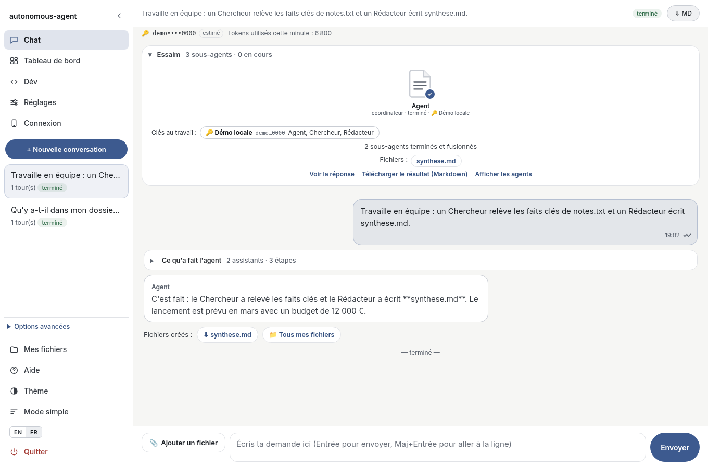

# autonomous-agent

**[English](#english) | [Français](#francais)**

## English

**A personal AI assistant that runs on your computer: it reads and writes your files, searches the web and works
in teams of helpers, and it always asks you before doing anything risky.**

### ⬇ Download

#### 🍎 [Mac with Apple Silicon (M1, M2, M3, M4…)](https://github.com/lanoixdesign/autonomous-agent/releases/latest/download/AutonomousAgent-macos-arm64.zip)
#### 🍏 [Mac with an Intel processor](https://github.com/lanoixdesign/autonomous-agent/releases/latest/download/AutonomousAgent-macos-intel.zip)
#### 🪟 [Windows 10 / 11 (64-bit)](https://github.com/lanoixdesign/autonomous-agent/releases/latest/download/AutonomousAgent-windows-x64.exe)

No Python, no install, no command line. All versions: [Releases](https://github.com/lanoixdesign/autonomous-agent/releases/latest).

### Get started in 3 steps

1. **Download** the file for your computer above and open it. The app is not signed yet: on a Mac,
   right-click the app → **Open** → **Open**; on Windows, **More info** → **Run anyway**
   ([details](docs/getting-started.md#opening-the-unsigned-app)).
2. **Add a free Groq key**: create one at [console.groq.com/keys](https://console.groq.com/keys) (free, no card),
   then paste it in the welcome screen (or ⚙ Settings → Keys). No key? Click **Try without a key**.
3. **Ask your question** in the chat, for example *"Summarise notes.txt"* or *"Find 3 ideas for a birthday
   dinner"*. When the assistant wants to change a file or send something, a card asks you first.

### Learn more

- [Getting started](docs/getting-started.md): first launch, settings, where your files and keys go
- [API keys and limits](docs/keys.md): several keys, backup keys, free-tier limits
- [Permissions and sandbox](docs/permissions.md): what the assistant may do, and how to change it
- [Swarm and IDC mode](docs/swarm.md): helpers working in parallel
- [Tools and skills](docs/tools.md) · [MCP servers](docs/mcp.md) · [Use from your phone](docs/phone.md)
- [Architecture](docs/architecture.md) · [Command line, development and tests](docs/development.md)
- [Security](docs/SECURITY.md) · [Version history](docs/changelog.md)

---

## Français

**Un assistant IA personnel qui tourne sur ton ordinateur : il lit et écrit tes fichiers, cherche sur le web et
travaille en équipe d'assistants, et il te demande toujours ton accord avant toute action risquée.**

### ⬇ Télécharger

#### 🍎 [Mac avec puce Apple (M1, M2, M3, M4…)](https://github.com/lanoixdesign/autonomous-agent/releases/latest/download/AutonomousAgent-macos-arm64.zip)
#### 🍏 [Mac avec processeur Intel](https://github.com/lanoixdesign/autonomous-agent/releases/latest/download/AutonomousAgent-macos-intel.zip)
#### 🪟 [Windows 10 / 11 (64 bits)](https://github.com/lanoixdesign/autonomous-agent/releases/latest/download/AutonomousAgent-windows-x64.exe)

Pas de Python, rien à installer, aucune ligne de commande. Toutes les versions : [Releases](https://github.com/lanoixdesign/autonomous-agent/releases/latest).

### Démarrer en 3 étapes

1. **Télécharge** le fichier pour ton ordinateur ci-dessus et ouvre-le. L'application n'est pas encore signée :
   sur Mac, clic droit sur l'application → **Ouvrir** → **Ouvrir** ; sur Windows, **Informations
   complémentaires** → **Exécuter quand même** ([détails](docs/getting-started.md#ouvrir-lapplication-non-signée)).
2. **Ajoute une clé Groq gratuite** : crée-la sur [console.groq.com/keys](https://console.groq.com/keys)
   (gratuit, sans carte), puis colle-la dans l'écran d'accueil (ou ⚙ Réglages → Clés). Pas de clé ? Clique sur
   **Essayer sans clé**.
3. **Pose ta question** dans le chat, par exemple *« Résume notes.txt »* ou *« Trouve 3 idées pour un dîner
   d'anniversaire »*. Quand l'assistant veut modifier un fichier ou envoyer quelque chose, une carte te demande
   d'abord ton accord.

### En savoir plus

- [Bien démarrer](docs/getting-started.md#francais) : premier lancement, réglages, où vont tes fichiers et tes clés
- [Clés d'API et limites](docs/keys.md#francais) : plusieurs clés, clés de secours, limites de l'offre gratuite
- [Permissions et bac à sable](docs/permissions.md#francais) : ce que l'assistant a le droit de faire, et comment le changer
- [Essaim et mode IDC](docs/swarm.md#francais) : des assistants qui travaillent en parallèle
- [Outils et compétences](docs/tools.md#francais) · [Serveurs MCP](docs/mcp.md#francais) · [Utiliser depuis ton téléphone](docs/phone.md#francais)
- [Architecture](docs/architecture.md#francais) · [Ligne de commande, développement et tests](docs/development.md#francais)
- [Sécurité](docs/SECURITY.md) · [Historique des versions](docs/changelog.md#francais)

---

MIT License — [LICENSE](LICENSE)
