# autonomous-agent

**[English](#english) | [Français](#francais)**

<a id="english"></a>

## English

A small, readable, open-source autonomous agent in Python (stdlib only) with **tools, durable
memory and skills**, and **guardrails that you tune yourself**: every tool has a risk category,
and a `permissions.yaml` file decides, per category and per tool, whether it is `allow`ed, `ask`ed
(confirmation in the terminal) or `deny`ed. Every tool call is written to an append-only audit log,
with secrets redacted.

> It is not "an agent without guardrails". The guardrails are there; **you** set them.

### Download (no command line)

**No terminal needed, at any step.** Ready-to-run desktop builds exist for Windows and macOS: no Python,
no install, no commands, no file to edit. Download the file for your computer from the
**[Releases page](https://github.com/lanoixdesign/autonomous-agent/releases/latest)**:

| File | For |
|---|---|
| `AutonomousAgent-windows-x64.exe` | Windows 10/11, 64-bit |
| `AutonomousAgent-macos-arm64.zip` | Mac with Apple Silicon (M1, M2, M3, M4…) |
| `AutonomousAgent-macos-intel.zip` | Mac with an Intel processor |

#### Opening the unsigned app

> ⚠️ **These builds are not signed yet** (no paid Microsoft/Apple certificate), so Windows and macOS warn
> you the first time you open them. That is expected for unsigned apps, and you only do this once.
> **Code signing is planned for a later release.**

**Windows (SmartScreen)**
1. Double-click `AutonomousAgent-windows-x64.exe`.
2. A blue **"Windows protected your PC"** window appears: click **More info**, then **Run anyway**.
3. The app opens in your browser. There is no console window (logs go to `AutonomousAgent\data\app.log`).

**macOS (Gatekeeper)**
1. Unzip the file and move `AutonomousAgent.app` to **Applications**.
2. The first time, **right-click** (or Control-click) the app → **Open**, then **Open** again in the dialog.
3. If macOS only offers "Move to Trash" / "Done": open **System Settings → Privacy & Security**, scroll
   down to the Security section and click **Open Anyway** next to "AutonomousAgent", then confirm
   (password or Touch ID).
4. The app opens in your browser and runs in the background (no window to keep open).

<details>
<summary><b>Advanced (optional): remove the quarantine flag on macOS</b></summary>

Only if the steps above did not work, in Terminal:

```bash
xattr -dr com.apple.quarantine /Applications/AutonomousAgent.app
```
</details>

<details>
<summary><b>Advanced (optional): verify the download with SHA256SUMS.txt</b></summary>

Each release includes `SHA256SUMS.txt`. Download it next to your file, compute the file's SHA-256 and
check that it matches the line for that file.

Windows (Command Prompt or PowerShell, in your Downloads folder):

```bat
certutil -hashfile AutonomousAgent-windows-x64.exe SHA256
```

macOS (Terminal, in your Downloads folder):

```bash
shasum -a 256 AutonomousAgent-macos-arm64.zip    # or AutonomousAgent-macos-intel.zip
shasum -a 256 -c SHA256SUMS.txt --ignore-missing  # checks every downloaded file at once
```

The hash printed must be identical to the one in `SHA256SUMS.txt` (certutil prints it in lowercase with
no spaces on recent Windows; compare the characters, not the case). If it differs, do not open the file:
download it again from the Releases page.
</details>

**First run: a 3-step wizard in the browser.** ① pick your language (English / Français) → ② click
**🎈 Try without a key** (demo answers, nothing to set up) *or* connect a real AI: pick a service (**Groq** is
recommended and free), follow the **step-by-step guide** ("Open Groq in a new tab", sign in, create a key,
copy it), paste the key (the service is **recognised from the key** itself), **Test the key**, then **Save and
continue** → ③ done, open the chat.

| Wizard (day theme) | Wizard (night theme) |
|---|---|
|  | 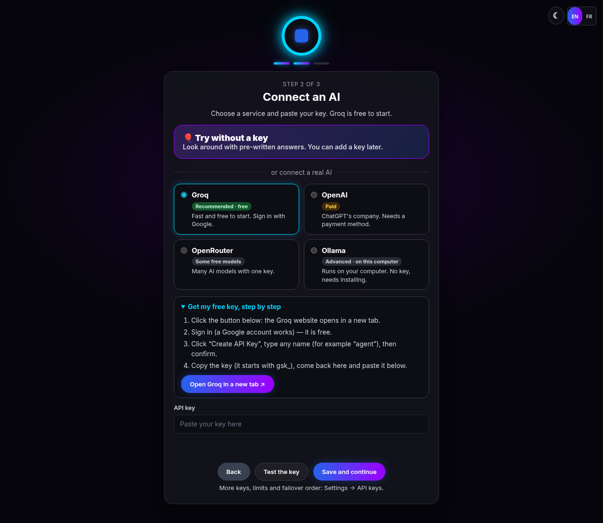 |

**Made for beginners (0.6).**
- **"What can I do for you?"**: the chat opens with six example tasks (summarize a document, write an email,
  organize notes, research a topic, make a plan, translate) and a 4-step **guided tour** (shown once; Help →
  "Show the guided tour again").
- **Questions in plain words**: before acting, the agent asks *"The agent wants to write the file report.md.
  Do you allow it?"* with big **✓ Allow** / **✕ Refuse** buttons and a one-line hint; the tool name and
  arguments are folded under "Technical details". **send** and **spend** are asked every single time.
- **"What the agent did"**: the work trace reads as sentences ("The helper "Researcher" read notes.txt"),
  folded by default; Settings → "Work details in the chat" → **Technical** shows the raw tool calls.
- **📁 My files**: list, add and download the files of your work folder; files the agent creates appear
  under its answer with a **⬇ Download** button.
- **Help** tab: how it works in 4 steps, a sample question card, FAQ, "Larger text".
- **Simple / Expert** Settings: Simple hides permissions, limits, IDC and technical options; ❓ buttons
  explain each setting; error messages are translated (EN/FR).
- **☀ Day / ☾ Night theme**: a "Theme" button at the bottom of the left sidebar (also in the ☰ phone drawer) switches
  between a calm light theme and a soft dark-grey night theme (both WCAG AA). Settings → General →
  Display → **Theme: Day / Night / Automatic** (default: Automatic = follows your computer or phone). The
  choice is remembered in this browser.

| Chat, day theme | Chat, night theme |
|---|---|
|  |  |

| A question in plain words (phone, day) | My files | Settings: theme, Simple / Expert |
|---|---|---|
| 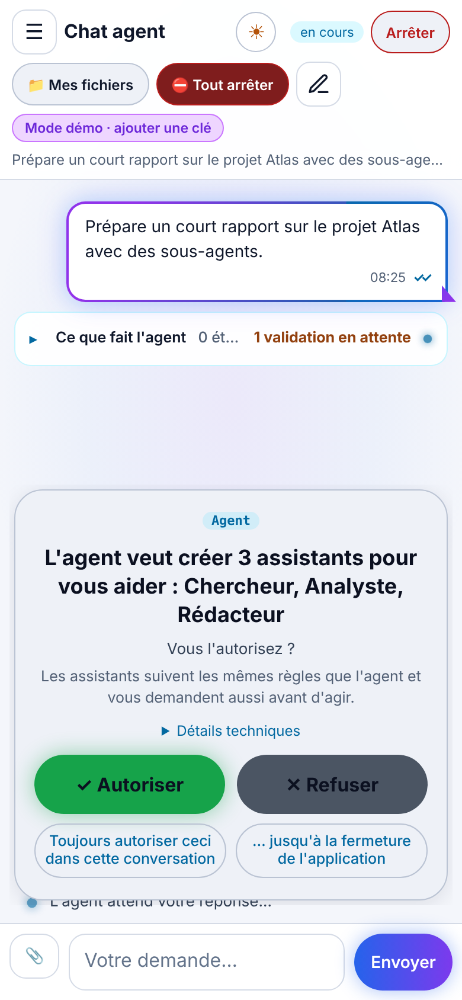 | 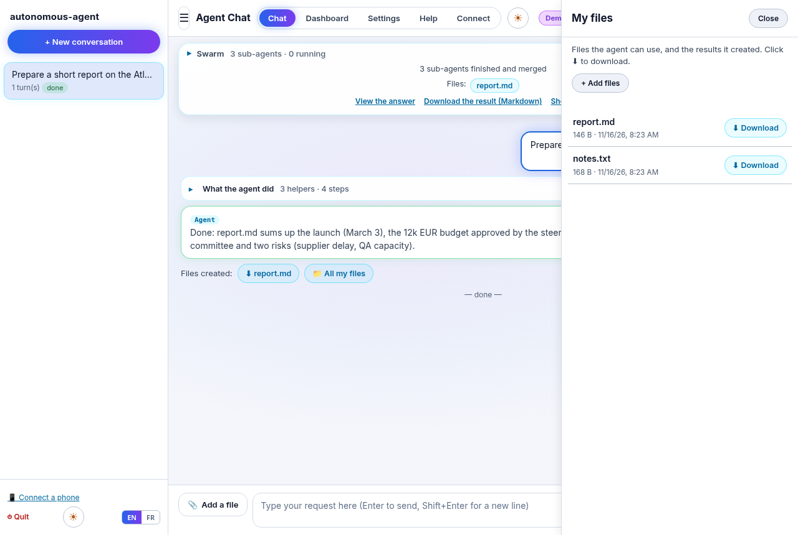 |  |

**Everything else is in ⚙ Settings** (the destinations **Chat | Dashboard | Dev | Settings | Connect | Help** are in the
left sidebar of every page, and in the ☰ drawer on a phone):
- **API keys & models**: add, edit, delete and test keys, per use (text, code, images, speech,
  transcription, embeddings), with limits (requests / tokens / cost per day or month) and a failover
  order (↑ ↓: when a key hits a limit or fails, the next one takes over). Keys are shown **masked**
  (`sk-d••••RET2`) with their usage. Changes apply to the next message, **no restart**.
- **General**: language, theme, Simple / Expert, work details, larger text, work folder, conversations at
  once, approval timeout.
- **Permissions** (Expert): allow / ask / deny per risk category. **send** and **spend** can never be set to
  "allow".
- **IDC mode** (Expert): on/off and its parameters.
- **Phone access**: turn it on, pick Tailscale or Cloudflare, show the QR code, generate a new token.
- **App**: version, **Restart** (shown when a change needs it) and **Quit** (stops the server cleanly;
  also in the chat sidebar).

**Where your keys go.** In your user folder, `AutonomousAgent/data/secrets.json`, a private file only
your account can read (mode 0600), or in the system keychain if the Python `keyring` package is
installed. Keys are never sent back to the browser after saving (only masked), never logged and never
written to the audit log. Settings and keys can only be changed **from the computer running the agent**;
a phone signed in remotely sees a 🔒 notice (see
[Use from your phone](#use-from-your-phone) for `AGENT_REMOTE_SETTINGS=1`).

**Where things go.** Everything is in one folder in your home directory, `AutonomousAgent`
(`C:\Users\<you>\AutonomousAgent` or `/Users/<you>/AutonomousAgent`): `workspace/` (the only folder the
agent's file tools can touch; "My files" and chat attachments go there), `data/` (settings, keys, memory,
audit log, conversations), and the optional `.env` / `permissions.yaml` / `providers.yaml` for advanced users.

**Stop:** click **Quit** (chat sidebar, or Settings → App). Double-clicking the app again while it runs just
reopens the browser tab. **Language:** first-run choice, Settings → General, or the EN | FR switch.

| Live helpers graph (day) | Dashboard (night) |
|---|---|
|  | 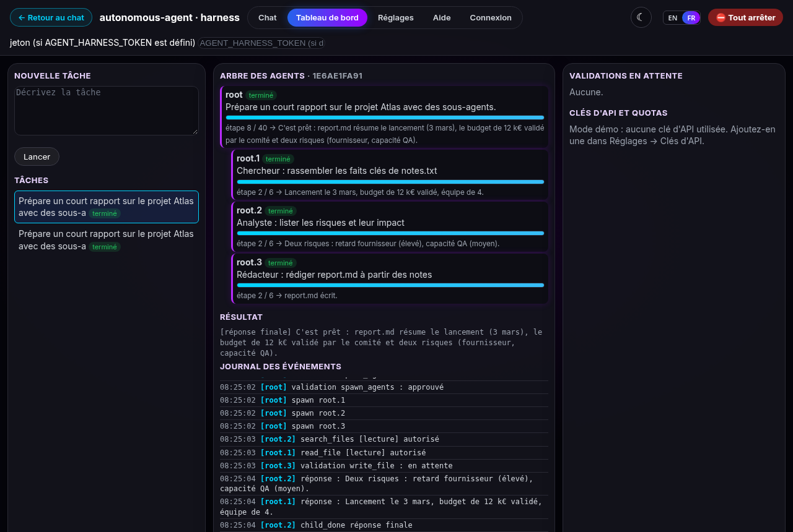 |

#### Several keys = several assistants at the same time (new in 0.7)

**The more keys you add, the more your assistants work at the same time.** In the wizard ("I have several
keys") or in ⚙ Settings → API keys → **Paste several keys**, paste all your keys at once, one per line
(optionally `name: key`), or add them one by one with **+ Add another key**. Each key's service is
recognised from its first letters, all keys are **tested at the same time**, and you get one plain line per
key (✓ "Works: saved as Groq 2" / ✗ "Groq refuses this key: it is wrong or was deleted"). Only the working
ones are saved; keys are only ever displayed masked (`gsk_••••a1b2`) and stored like before.

Then **Who does what?** proposes a job for each key, in plain words: fast / free keys for *Research &
summaries* and *Analysis*, stronger models for *Writing* and *Code* (and *Images/vision* when the model can
see images). Accept with one click or adjust with the switches (and optionally the model). When the swarm
runs, each helper gets **its own key**: first a key made for its job (a "Researcher" takes a research key),
otherwise a *General* key, otherwise any free key. Helpers work in parallel, **one per working key** by
default (Settings → *Assistants at the same time*: Automatic, or 1 to 8 if you prefer they share keys). The
live graph shows which key (masked) each helper uses and for which job.

| Wizard: who does what? | Each helper on its own key |
|---|---|
| 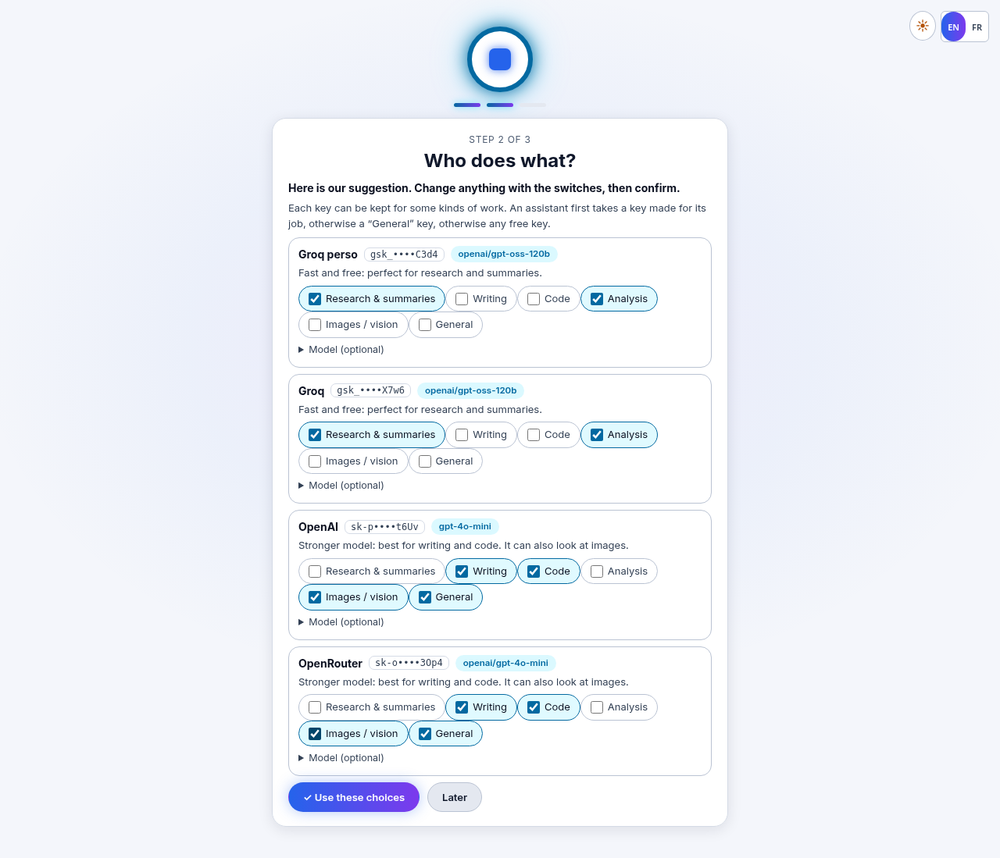 | 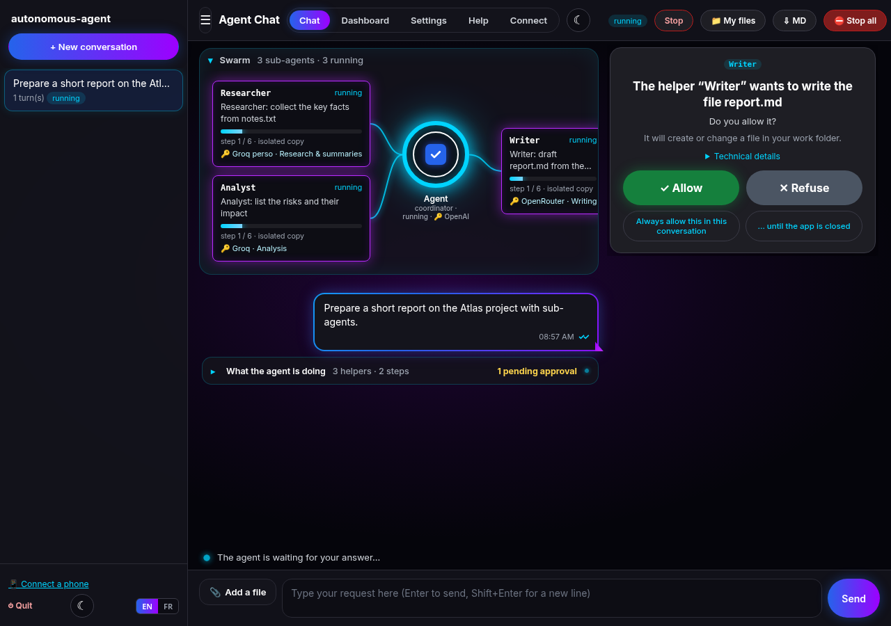 |

#### Sandbox and developer mode (new in 0.8)

🛡️ **Sandbox** — commands started by your assistants run in a protected space: only simple, safe commands
(`ls`, `cat`, `grep`, `find`, `mkdir`, `cp`, `mv`, `rm`, `python file.py`, `pytest`…), **only inside your work
folder**, never on the internet, never with your keys, with time, processor, memory and output limits. It is
**always on in Simple mode**; in Expert mode, ⚙ Settings → *Sandbox* can turn it off after a clear warning.

🧑‍💻 **Developer mode** — the new **Dev** tab: pick a name, choose **🌐 Website** or **🐍 Python program**, then
describe what you want ("A page for my bakery with the opening hours and a contact button"). A **Coder**
writes the files, a **Tester** checks them and runs the tests, and you see the result right away:
**👁 Preview** shows the website in a protected frame (computer or phone size), **▶ Run the tests** runs them
in the sandbox and answers in plain words, **⬇ Download the project (.zip)** gives you everything.

| Coder + Tester at work | Live preview |
|---|---|
| 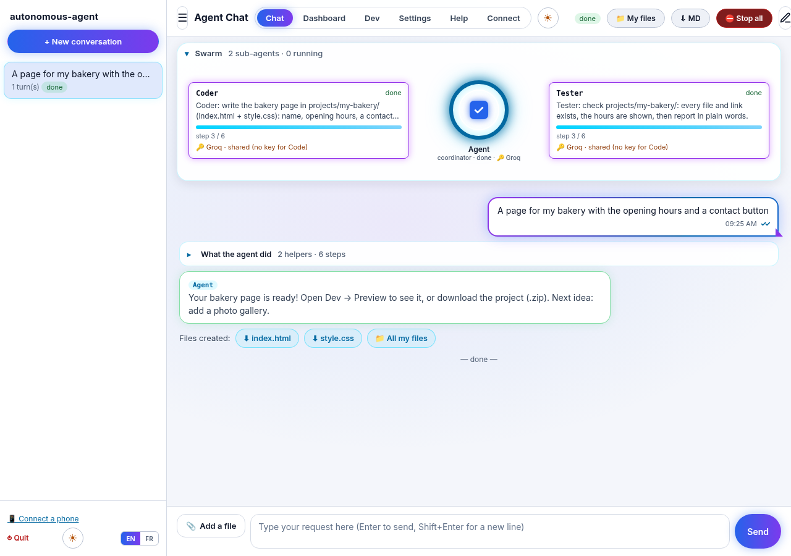 | 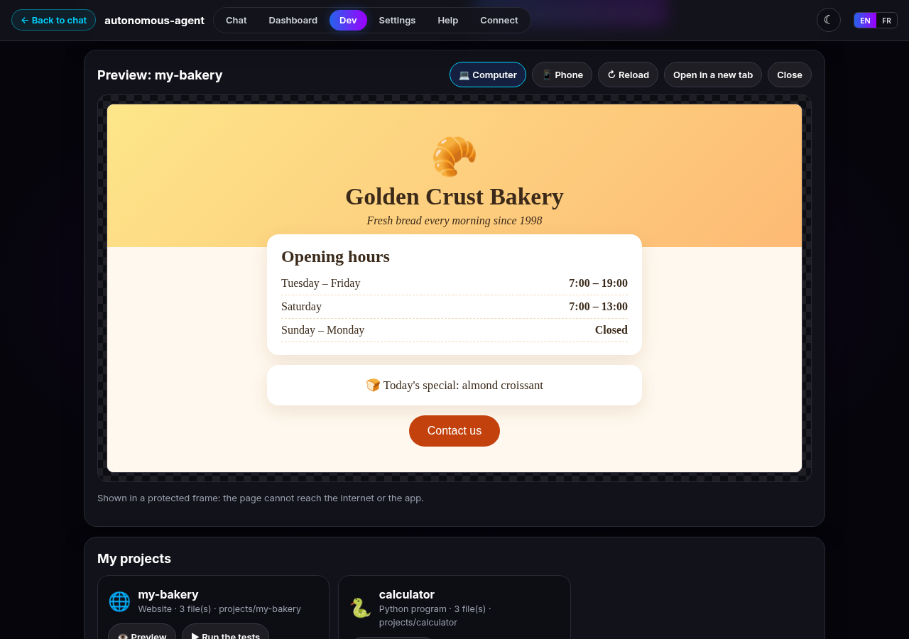 |

#### Answers in your language (new in 0.8.2)

🗣️ The assistant, every swarm helper (Researcher, Analyst, Writer…) and the developer-mode **Coder** and
**Tester** answer in the language of your request: write in French and everything comes back in French, write
in English and it comes back in English (when a message is too short to tell, the app's language is used).
In French the app now says "tu" everywhere. Other fixes:

- 🔁 When the model sends a malformed action (Groq `tool_use_failed`), the step is asked again (up to 3 times,
  with a short correction and a lower temperature) instead of ending the task; the trace says "The model sent
  a malformed action, retrying…". Helpers always get their tools, even when the model passes an empty list.
- 📁 Developer mode keeps the Coder and Tester inside `projects/<name>/`: writes anywhere else are refused, so
  no stray files appear at the top of the work folder.
- 🛡️ Sandbox: `a && b` runs simple commands one after the other (stops at the first failure); `ls -R` lists
  subfolders; the helpers are told to run one command at a time.
- 📱 On a phone, every tab (Connect included) is visible without scrolling.
- Python template greets in one language, Groq's default model is `openai/gpt-oss-20b`, the dashboard names
  keys from Settings correctly, the swarm graph shows failed helpers and keeps earlier helpers after
  "Continue", masked keys stay readable in the history after a restart, and the coordinator always keeps
  one step for its final answer (helpers get the rest).

#### Never stopped by a rate limit (new in 0.8.1)

🔁 **Automatic backup key** — when a key hits a rate limit or quota (429), times out or the service has an
error (5xx), the same request goes **at once** to another key (one made for the same job first, then any
other key, and as a last resort a key saved for another use). Helpers in a swarm do the same, mid-task,
without losing their work. With a single key (e.g. a free Groq key) the assistant **waits for the key to
come back** (it follows the provider's "retry after", at most 60 s per pause) and carries on instead of
stopping. Only keys that cannot come back end a task (every key refused / revoked, daily limit reached),
with a clear message. The chat says what happens in plain words: *"Limit reached on key gsk_••••43gO,
switching to the backup key…"*, *"All keys are paused, resuming in 4 s…"*.

📊 **Tokens left per minute** — a status bar under the chat header (also on phones) and the dashboard show,
per key (masked), *"Tokens left: 5,200 / 8,000 per minute · back in 12 s"* with a small bar, from the
provider's own figures (`x-ratelimit-*` headers) or, until the first answer, an **estimate** (clearly marked)
from the tokens used in the last 60 seconds. Tip: add a second (backup) key to avoid pauses.

| Switch to the backup key | Phone: pause and counter |
|---|---|
|  |  |

Notes: the server only listens on `127.0.0.1` (your computer); port 8765 if free, else another one. The
macOS builds are separate for Apple Silicon and Intel. Advanced: build it yourself with
`pip install pyinstaller && pyinstaller packaging/autonomous-agent.spec` (output in `dist/`), or run
`python -m agent.desktop` from a clone (`AGENT_TERMINAL=1` on macOS reopens the app in Terminal to watch
the logs).

### At a glance

- **Agent loop**: plan → tool call → observation → … → answer, with hard limits (steps, tool calls,
  tokens), a "no progress" stop and a pluggable stop rule.
- **15 tools**: files (`read_file`, `list_files`, `search_files`, `write_file`, `edit_file`), `shell`,
  web (`web_fetch`, `web_search`), GitHub (`github_get`, `github_write`), memory (`memory_write`,
  `memory_recall`, `memory_forget`) and skills (`list_skills`, `load_skill`). On top of them,
  `spawn_agent` / `spawn_agents` launch sub-agents.
- **Risk categories**: `read`, `write`, `execute`, `network`, `send`, `spend`, `delegate`. Each one is
  `allow`, `ask` or `deny` in `permissions.yaml`, and deny patterns always win.
- **Audit**: append-only `audit.jsonl`, one line per tool call, secrets redacted.
- **Memory and skills**: plain files; skill bodies are loaded on demand.
- **Swarm**: `spawn_agent` / `spawn_agents`, with depth, count and budget limits. Children inherit the
  parent's permissions and never get more. Read-only children run in parallel. Writing children run in
  parallel in **isolated copies** that are merged back file by file, and conflicts are kept as
  `.conflict-*` files.
- **IDC mode** (optional, off by default): a vitality budget that decays with every step, append-only
  commitments, and a forced "good enough now" answer; saying "I don't know" costs less than an
  unsupported claim. A hypothesis to test, see [IDC mode](#idc-mode-optional-off-by-default).
- **Harness** (`python -m agent serve`):
  - calm web chat (day / night) with **approval cards that ask a plain question** ("Allow writing report.md?"),
    a **live swarm graph** of the sub-agents, and several conversations running in parallel;
  - **attachments**;
  - **several API keys per category with hard limits**, pasted all at once, **one key per helper** matched to
    its job (research, writing, code…), so helpers work in parallel;
  - **persistence** (SQLite), **live updates** (SSE) and **⛔ Stop all**;
  - remembered approvals (never for send/spend) and a **dashboard** (usage per agent, quotas, health);
  - **Markdown/JSON export**, **scheduled tasks** and an **EN/FR interface**.

| English | Français |
|---|---|
| 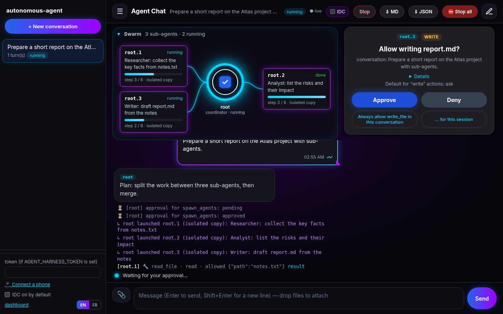 | 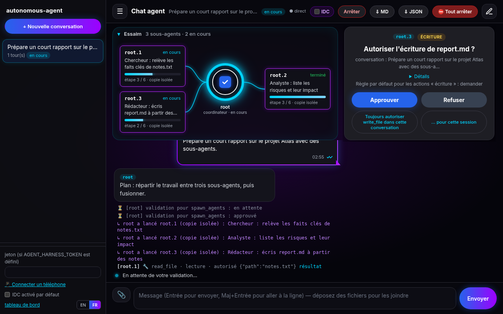 |

**Quick start (advanced: command line)**

The desktop app above needs none of this. From a clone:

```bash
git clone https://github.com/lanoixdesign/autonomous-agent.git && cd autonomous-agent
python -m agent run "List the files" --provider mock --offline   # no key, no network
cp .env.example .env    # add GROQ_API_KEY / OPENAI_API_KEY / OPENROUTER_API_KEY, or use Ollama
python -m agent chat --workspace ~/project
python -m agent serve --workspace ~/project   # then open http://127.0.0.1:8765/ : wizard + ⚙ Settings
```

Several keys: `cp providers.example.yaml providers.yaml` (git-ignored). The file holds only the
**names** of environment variables, never the keys. `python -m agent keys` shows the remaining quotas,
with keys masked.

**Safety caveats, read before use**
- Tested with the mock backend and fake providers only, not against real providers in CI. **No
  security audit has been done.**
- The isolated copy protects files, but it is **not a sandbox**: `shell` can still reach anything your
  user can. Run untrusted tasks in a container or VM.
- The isolated copies are merged **file by file**: no line-level merge, and conflicting files are left
  for you to resolve.
- Pending approvals live in memory: **they are lost on restart**, and the turn becomes `interrupted`.
- Image, speech and embedding services are **stubs** (routed and limited, but not implemented).
- The harness is a local, single-user tool: no accounts, no TLS. Keep it on 127.0.0.1, or set
  `AGENT_HARNESS_TOKEN`.

### Full documentation (English)

### Features

| | |
|---|---|
| **Loop** | plan → tool call → observation → … → answer, with limits on steps, tool calls and tokens, plus a "no progress" stop (same call repeated). Pluggable `stop_rule`. |
| **Tools** | `read_file`, `list_files`, `search_files`, `write_file`, `edit_file` (workspace only), `shell`, `web_fetch`, `web_search` (best-effort), `github_get`, `github_write`, `memory_write`, `memory_recall`, `memory_forget`, `list_skills`, `load_skill`, `spawn_agent`, `spawn_agents` (sub-agents) |
| **Risk categories** | `read`, `write`, `execute`, `network`, `send` (visible to others), `spend` (costs money), `delegate` (launch sub-agents) |
| **Memory** | plain files: `memory/profile.md` + `memory/journal.jsonl`, keyword recall, `forget` |
| **Skills** | `skills/<name>/SKILL.md` with `name` / `description` frontmatter; only the index is in the prompt, bodies are loaded on demand. Examples: `research`, `code-review`, `release-notes`. |
| **LLM** | any OpenAI-compatible API: Groq, OpenAI, OpenRouter, Ollama (local), custom URL; `mock` backend for offline tests |
| **Harness** | `python -m agent serve`: local chat with approval cards, attachments, several API keys with quotas, live updates (SSE), conversations persisted in SQLite, emergency stop, remembered approvals (never for send/spend), usage per agent, Markdown/JSON export, scheduled prompts, `/health` |
| **Mobile** | responsive chat/dashboard, installable PWA, `--remote` with QR pairing, Tailscale / Cloudflare tunnels |
| **Sandbox** | `shell` restricted to an allowlist inside the workspace: no shell operators, path + symlink checks, no network, scrubbed env, CPU/memory/time/output limits (always on in the app's Simple mode, `--sandbox` / `AGENT_SANDBOX=1` for the CLI) |
| **Developer mode** | `/dev`: website / Python templates in `projects/<name>/`, Coder + Tester helpers, sandboxed live preview, tests in the sandbox, `.zip` download |

### Install

```bash
git clone https://github.com/lanoixdesign/autonomous-agent.git
cd autonomous-agent
python -m venv .venv && . .venv/bin/activate   # Python 3.10+
pip install pyyaml pytest   # both optional: a built-in YAML subset parser is used without PyYAML
cp .env.example .env        # then put your key in .env (never commit it)
```

### Configure the model

Environment variables (or `.env`):

| Variable | Meaning |
|---|---|
| `AGENT_PROVIDER` | `groq`, `openai`, `openrouter`, `ollama`, `custom`, `mock` (default `mock`) |
| `AGENT_MODEL` | model name (defaults: groq `openai/gpt-oss-20b`, openai `gpt-4o-mini`, openrouter `openai/gpt-4o-mini`, ollama `llama3.1`) |
| `GROQ_API_KEY` / `OPENAI_API_KEY` / `OPENROUTER_API_KEY` | key for the chosen provider |
| `AGENT_BASE_URL`, `AGENT_API_KEY` | any other OpenAI-compatible endpoint (`custom`) |
| `GITHUB_TOKEN` | optional, for GitHub tools (otherwise the `gh` CLI login is used) |
| `AGENT_SEARCH_URL` | optional web search endpoint (DuckDuckGo HTML by default) |

No key is ever hard-coded. Requests send a `User-Agent` header (some providers behind Cloudflare
reject requests without one).

### Use

```bash
python -m agent run "Summarise notes.md and save the key point in memory" --workspace ~/project
python -m agent chat --workspace ~/project --provider groq
python -m agent run "..." --model openai/gpt-oss-20b --permissions my-perms.yaml
python -m agent run "List the files" --provider mock --offline        # no network at all

python -m agent permissions      # effective permissions, tool by tool
python -m agent audit -n 20      # last audit entries
python -m agent memory list | recall "query" | add "text" | forget "text-or-id"
python -m agent skills list | show code-review
python -m agent serve --port 8765  # local harness: web page + JSON API + approvals queue
python -m agent keys               # API keys (masked) and remaining quotas, if providers.yaml is used
```

Options: `--workspace/-w`, `--permissions/-p`, `--model/-m`, `--provider`, `--state-dir`
(memory + audit, default `<workspace>/.agent`), `--max-steps`, `--max-tool-calls`, `--max-tokens`,
`--max-depth`, `--max-children`, `--max-parallel`, `--keys`, `--category`, `--yolo`, `--offline`, `--quiet`.

Example (real run, Groq `openai/gpt-oss-120b`, no terminal so `ask` = refused):

```
  -> list_files [read] {"depth": 1, "path": "."} : allow
  -> read_file [read] {"limit": 200, "path": "notes.md"} : allow
  -> memory_write [write] {"kind": "note", ...} : allow
  ! write_file [write] needs confirmation but there is no terminal -> refused
[final] steps=5 tool_calls=4 tokens=6520
```

### Permission model

`permissions.yaml` (or `.json`). Resolution for each call:

1. mode = `tools.<tool>` if set, otherwise `defaults.<category>`;
2. a matching **deny** pattern (`paths.deny`, `commands.deny`, `domains.deny`) → **deny** (always wins, even with `--yolo`);
3. `paths.allow` non-empty and the path does not match → deny;
4. `commands.allow` / `domains.allow` match and mode is `ask` → allow;
5. `--yolo` turns `ask` into `allow` **except for `send` and `spend`**: those only follow what you wrote in the file.

Safe defaults: `read: allow`, `write: ask`, `execute: ask`, `network: ask`, `send: ask`, `spend: deny`, `delegate: ask`.
`ask` prompts `[y]es / [n]o / [a]lways this session`; without a terminal, `ask` means refused.

```yaml
defaults: {read: allow, write: ask, execute: ask, network: ask, send: ask, spend: deny}
tools:
  memory_write: allow
  shell: deny            # e.g. forbid the shell completely
paths:
  deny: [".env", "**/.env", "**/*.pem", ".git/**", ".agent/**"]
commands:
  allow: ["git status*", "python -m pytest*"]
  deny: ["sudo *", "*rm -rf /*", "*curl *|*sh*"]
domains:
  allow: ["api.github.com"]
```

**Audit**: `<state-dir>/audit.jsonl`, one JSON line per tool call (allowed, refused, invalid),
opened in `O_APPEND` mode. Arguments and results are truncated and redacted: values of environment
variables whose name contains KEY/TOKEN/SECRET/PASSWORD…, and common token formats (`sk-…`, `gsk_…`,
`ghp_…`, `github_pat_…`, Bearer, private keys). The shell tool runs with those variables removed
from its environment.

### Writing a skill

```
skills/my-skill/SKILL.md
---
name: my-skill
description: One sentence saying when to use it.
---
# Steps
1. ...
```

Skills are looked up in `<workspace>/skills`, `<state-dir>/skills`, then the repository's `skills/`.

### Stop rule

The loop stops irreversibly at the first of: final answer, `max_steps`, `max_tool_calls`,
`max_tokens`, repeated identical call, LLM error. To plug in your own criterion:
`Agent(..., stop_rule=lambda state: "my_reason" if ... else None)`.

### IDC mode (optional, off by default)

**IDC — Irreversible Decision Collapse** (*Effondrement Décisionnel Irréversible*) is the author's model
([lanoixdesign/idc-wrapper](https://github.com/lanoixdesign/idc-wrapper)). It is a **hypothesis, not a
validated result**: an AI with no finitude can deliberate forever, waste compute, hesitate, and invent
answers, because inventing costs no more than admitting it does not know. IDC gives the agent finitude
through three pillars, implemented in `agent/idc.py`:

1. **A decreasing resource: vitality.** Each model call, tool call and 1000 tokens cost vitality (per user
   message; default 100). At 0 the agent cannot think any more ("cognitive death").
2. **Append-only commitments.** The `idc_commit` tool records a `fact`, `decision`, `answer` or `unknown`
   ("I don't know") with **evidence**: exact quotes from what the agent observed. Entries are never
   edited or deleted. Correcting one adds a new entry pointing to the old one and costs `revise_cost`; with
   `allow_revise: false` it is refused. The final answer is recorded too. Commitments are written to the
   audit log and kept with the conversation.
3. **A stopping rule: collapse.** When vitality falls to `collapse_threshold`, or after `stall_limit` tool
   calls in a row that bring nothing new (same result as before, error, refusal), the agent gets one last
   call **without tools** and must answer now (`idc_collapse`). If vitality reaches 0, there is no more
   model call: the answer is the last **supported** committed answer, else an explicit "I don't know"
   listing what is known and what is unverified (`idc_exhausted`).

**Hallucination hypothesis, made concrete.** A commitment is *supported* when every evidence quote appears
in what the agent observed in this turn (the user's message, tool results). Costs by default: supported 1,
"I don't know" 0.5 (the cheapest), **unsupported 15**. The configuration refuses `unknown_cost >=
unsupported_cost`. Sub-agents get a slice of the vitality left (`child_share`, default half, split
between parallel children); what they spend is charged to the parent, and their collapse threshold is
scaled down with their budget.

**Turn it on**

| Where | How |
|---|---|
| Command line | `python -m agent run "..." --idc` (or `--no-idc`; `--idc-vitality 60`) |
| Environment / `.env` | `AGENT_IDC=1`, and any parameter as `AGENT_IDC_<NAME>`, e.g. `AGENT_IDC_VITALITY=60` |
| `permissions.yaml` | an `idc:` section (commented example in the file) |
| Chat (harness) | the **IDC** switch at the top: per conversation (also between two messages), or for the next new one; **IDC on by default** in the sidebar is the global setting, saved across restarts |
| Desktop app | `AGENT_IDC=1` in `~/AutonomousAgent/.env`, or the switches in the chat |

Order: defaults < `idc:` in the permissions file < `AGENT_IDC*` < command line. In the harness the
global default starts from that value; the chat switches then decide. API: `POST /tasks` with
`"idc": true|false`, `POST /tasks/{id}/idc` `{"enabled": true}`, `GET|POST /settings` `{"idc": true}`.
`GET /tasks/{id}` returns `idc_state` (vitality, commitments); live `idc` events are in the stream.

When IDC is on, the chat shows a **vitality bar**, the collapse reason, and the list of commitments
(supported in green, unsupported in red):


**Parameters** (`idc:` section or `AGENT_IDC_<NAME>`)

| Name | Default | Meaning |
|---|---|---|
| `enabled` | `false` | default for new conversations / CLI runs |
| `vitality` | 100 | budget per user message (root agent) |
| `step_cost` / `tool_cost` / `token_cost` | 4 / 3 / 0.5 | per model call / per tool call / per 1000 tokens |
| `collapse_threshold` | 20 | at or below: answer now, without tools |
| `stall_limit` | 3 | tool calls in a row without new information before collapse |
| `commit_cost` / `unknown_cost` / `unsupported_cost` | 1 / 0.5 / 15 | supported / "I don't know" / unsupported commitment |
| `revise_cost` | 25 | added when a commitment corrects an earlier one |
| `allow_revise` | `true` | `false`: commitments can never be corrected |
| `child_share` | 0.5 | share of the vitality left given to a sub-agent |

**Limits (honestly).** The costs and the threshold are arbitrary starting points and must be calibrated per
model and task: too low and the agent gives up early, too high and IDC changes nothing. "Supported" only
means "the quote was observed", not "the claim is true", and the free-text final answer itself is not
checked. A model can ignore the rules in its prompt; what is enforced is the budget, the forced tool-free
answer, the fallback and the append-only log. **It is not a guarantee against hallucinations**: whether IDC
reduces them is exactly what remains to be validated experimentally (same tasks with and without IDC,
measuring wrong answers, "I don't know" rates and cost).

### Several API keys, by category, with limits

Optional. Without a keys file nothing changes: the single key from `.env` is used as before.
Copy `providers.example.yaml` to `providers.yaml` (git-ignored; or pass `--keys FILE`, or set
`AGENT_KEYS_FILE`). Each entry names the **environment variable** holding the key (`key_env`), never
the key itself, plus its `provider`/`base_url`, `model` or `models` per category, `categories` (`text`,
`code`, `image`, `audio_tts`, `audio_stt`, `embeddings`, or your own), `priority` (lower first),
optional `pricing`, and `limits`: `requests_per_minute`, `requests_per_day`, `tokens_per_day`,
`tokens_per_month`, `cost_per_day`, `cost_per_month` (in your `currency`, needs `pricing`),
`images_per_day`, `audio_minutes_per_day`.

```yaml
currency: EUR
keys:
  - name: groq-main
    provider: groq
    key_env: GROQ_API_KEY
    categories: [text, code]
    model: openai/gpt-oss-20b
    priority: 1
    pricing: {input_per_1m: 0.15, output_per_1m: 0.60}
    limits: {requests_per_day: 1000, tokens_per_day: 500000, cost_per_month: 5}
  - name: openrouter-backup
    provider: openrouter
    key_env: OPENROUTER_API_KEY
    categories: [text, code]
    model: openai/gpt-4o-mini
    priority: 2
```

- **Routing**: for each model call the router takes the first key of the category (by priority) that
  is set, not cooling down, and can take the request **without exceeding any limit**. The request is
  reserved before it is sent (tokens: estimated prompt + a `max_tokens` cap sent to the provider,
  cost from `pricing`), so parallel agents cannot overshoot together. The real usage is recorded after.
- **Failover (0.8.1)**: a 429 (honouring `Retry-After`, or Groq's "try again in Xs"), a timeout, a
  network error or a 5xx puts the key on cooldown and the **same call** goes at once to the next key: same
  job first, then any key of the category, then (last resort) a key of the other chat category (`text` /
  `code`). When every key is only paused, the call **waits** for the first to come back (max 60 s per
  pause, 6 pauses) and resumes; the agent keeps its progress. A 401 / 402 / 403 sets the key aside (until
  the keys are edited); the call stops with `llm_error` only when no key can come back (all refused,
  missing, daily / monthly limit), with the reason for each key. Each switch / pause is a `keys` event
  (masked keys only). Nothing is ever sent over a limit.
- **Tokens per minute (0.8.1)**: `GET /keys/rate` gives, per key (masked), tokens (and requests) left,
  limit and seconds until reset, from the provider's `x-ratelimit-*` headers (`source: provider`) or
  estimated from the last 60 s (`source: estimate`; 8,000 tokens/minute assumed for Groq).
- **Usage** is persisted in `<state-dir>/usage.json` (per minute / day / month, local time, plus
  cooldowns), so limits survive restarts. Hitting a limit or a provider error is audit-logged
  (`event: key_limit` / `key_error`).
- `--category code` picks the category for the chat model; `agent/media.py` gives minimal interfaces
  (`ImageGenerator`, `TextToSpeech`, `SpeechToText`, `Embeddings`) that reserve a key of their
  category for the provider call you plug in (no image/audio generation is built in).
- `python -m agent keys` and the harness (`GET /keys`, chat sidebar, `/dashboard`) show the remaining
  quota per key and category, with keys masked (`gsk_…abcd`).
- **Key pool (0.7)**: every swarm agent (`root`, `root.1`, `root.2`…) gets its **own** key and keeps it
  while it works. Order: keys whose `tasks` match the agent's job (from its task text, EN/FR keywords:
  *Researcher / Chercheur* → `research`, *Writer / Rédacteur* → `writing`, *Coder / Développeur* → `code`,
  *Analyst / Analyste* → `analysis`, *image / screenshot* → `vision`, otherwise `general`), then keys
  tagged `general` or untagged, then any key of the category; within a group the **least busy** key wins
  (fewest agents holding it, then fewest requests in flight, then priority). Limits are still checked
  and reserved first. On a limit, a 429, a 5xx / network error or a refused key (401 / 402 / 403) the key
  cools down and the agent **fails over** to the next key; with fewer keys than agents, agents share the
  least busy keys. Parallelism = number of working keys (at most 8), or the number set in Settings
  (`parallel`); demo / single-key mode keeps `--max-parallel`. In `providers.yaml`: `tasks: [research,
  analysis]`. Each change of key is audit-logged (`event: key_assign`, key masked).
- **Bulk entry (0.7)**: `POST /app/providers/bulk {"text"}` (Settings / wizard) parses one key per line
  (`label: key`, `NAME=key`, `export NAME="key"`), detects the provider, tests all keys concurrently and
  saves the working ones; `POST /app/providers/propose` and `POST /app/providers/tasks {"assign": {id:
  [tasks] | {"tasks", "model"}}}` handle "Who does what?"; `GET /app/pool` shows the live pool. All
  responses carry masked keys only.

### Multi-agent mode (sub-agents)

An agent can launch **sub-agents** with `spawn_agent(task, max_steps?, allowed_tools?)`, or several
in a row with `spawn_agents(tasks, ...)`. A sub-agent is a normal agent run in-process, with the same
model, workspace, memory and audit log; its final answer comes back to the parent as the observation.

Limits (all enforced in code, see `agent/swarm.py`):
- launching is the `delegate` risk category, **`ask` by default**;
- a sub-agent uses the **parent's permission policy**, optionally narrowed with `allowed_tools`: it can
  never do more than its parent (a `deny`, or `send` / `spend`, stays as the parent has it);
- its budget is capped by what the parent has left, and its usage is **deducted** from the parent;
- `--max-depth` (default 2: agent → sub-agent → sub-sub-agent; `0` disables the mode) and
  `--max-children` (default 5 sub-agents per run, whole tree);
- every audit line carries `agent` (`root`, `root.1`, `root.1.2`…) and `depth`, plus `spawn` /
  `child_done` events.

```bash
python -m agent run "Review src/ and docs/ in parallel: one sub-agent per folder, then merge" \
  --workspace ~/project --max-depth 1 --max-children 3
```

```
  -> spawn_agents [delegate] {"tasks": ["review src/", "review docs/"], "allowed_tools": ["read_file", "list_files"]} : allow
  [root.1] -> list_files [read] {"path": "src"} : allow
  [root.2] -> list_files [read] {"path": "docs"} : allow
```

Sub-agents share the parent's memory and inherit its `ask` confirmations.

**Parallel children** (`--max-parallel`, default 3). `spawn_agents` picks one mode per batch:

| children | mode |
|---|---|
| read-only (`allowed_tools` given, only `read`/`network` tools already `allow`/`deny`) | parallel, shared workspace |
| may write / execute, and no approval can be needed — or running under the harness | parallel, **one isolated copy of the workspace per child**, merged at the end |
| may need an approval in the terminal (`run`, `chat`) | sequential, shared workspace (prompts never mix) |

**Isolated copies**: each child works in a private temp dir (mode 0700) holding a copy of the parent
workspace, without `.git`, virtualenvs, `node_modules`, caches, `build`/`dist`, symlinks and files over
20 MB (the whole copy is capped at 200 MB; above that the batch runs sequentially). When the batch
ends, the changes are merged back:
- a file created / modified / deleted by **one** child (or identically by several) → applied;
- a file changed differently by **several** children, or changed in the parent meanwhile →
  **conflict**: the parent file is **not** touched, each child's version is written as
  `<file>.conflict-<agent id>` (e.g. `notes.md.conflict-root.2`); a deletion is only reported;
- the parent's observation lists what was applied and the conflicts, and the audit log gets an
  `event: merge` line. A cancelled task merges nothing. Temp copies are always removed.

Budget reservations, the child counter, memory writes and the audit writer are thread-safe. In the
example above the two children run in parallel in the shared workspace (read-only tools).

**Live swarm graph (harness chat).** When an agent launches sub-agents, the chat shows them as a graph
built from real data (`GET /tasks/{id}/graph`, refreshed by the `progress` / `spawn` / `child_done` /
`merge` events): the coordinator in the centre, one card per sub-agent with its task, its status and a
progress bar = steps used / step budget. When every sub-agent is finished, the cards merge into the
centre and a document icon links to the answer, the Markdown export and the files written in this turn
(`GET /tasks/{id}/file?path=…`, read-only, only those files). The panel can be collapsed; on a phone it
becomes a vertical list; animations stop with *reduce motion*.

<p> 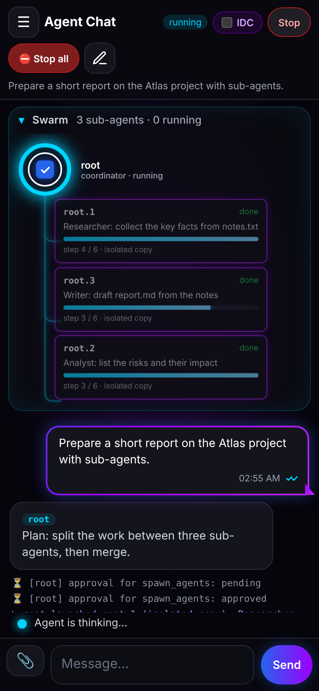</p>

### Harness (local server, chat, approvals)

`python -m agent serve` starts a local harness: conversations run in background threads, sub-agents
included, and every `ask` goes to an **approval queue** instead of the terminal. Standard library only
(`http.server` + `threading`).

```bash
python -m agent serve --workspace ~/project --port 8765          # then open http://127.0.0.1:8765/
AGENT_HARNESS_TOKEN=change-me python -m agent serve --approval-timeout 120 --max-parallel 3 --max-tasks 4
```

**Chat** (`/` or `/chat`): type a message to start a conversation, or to continue the selected one
(same agent, history kept). Agent messages, tool steps, sub-agent launches, merges and conflicts appear
as chat bubbles labelled with the agent id (`root`, `root.1`, `root.1.2`…). Pending approvals pop up as
cards (top right) showing the agent id, the tool, the risk category and the arguments (secrets
redacted); several can be pending at once and each is answered on its own. The sidebar lists the
conversations, which can run at the same time (at most `--max-tasks`, default 4; the others wait as
`queued`). `/dashboard` keeps the compact view (agent tree + event log) plus usage, schedules, rules and health.
The chat gets events live (Server-Sent Events) and falls back to polling.

Because the harness can take several approvals at once, **writing sub-agents run in parallel** there,
each in its isolated copy (see above).

**Attachments**: the 📎 button or drag-and-drop (several files at once). Files show as chips before
sending, then as attachments in your bubble. They are saved under
`<workspace>/uploads/<conversation id>/`, and the agent's message gets the list of their
workspace-relative paths (small text files are also inlined), so it can open them with `read_file`.
- names are reduced to a plain file name (no directories, `..`, absolute paths, leading dot or control
  characters); files are created without following symlinks and never overwrite (`notes-1.md`); a
  symlinked `uploads/` directory is refused;
- `--max-upload-mb` per file (default 20) and `--max-message-mb` per message (default 50) → HTTP 413;
- same token / same-origin checks as the other POSTs; each file is audit-logged (`event: upload`,
  path, size, sha256).

| | |
|---|---|
| `POST /tasks` `{"task": "..."}` | start a conversation → `{"id": ...}` |
| `POST /tasks/{id}/messages` `{"text": "..."}` | continue it (409 while a turn is running) |
| `"files": [{"name": "a.md", "content_b64": "..."}]` | optional on both: attachments (base64 in the JSON body) · `GET /config`: limits |
| `GET /tasks` · `GET /tasks/{id}` | list · one task: status, result, usage, agent tree |
| `GET /tasks/{id}/events?since=N` | events (audit lines, messages, approvals) from N, for polling |
| `POST /tasks/{id}/cancel` | stop at the next step; its pending approvals are denied |
| `GET /approvals` (`?all=1`) · `POST /approvals/{id}` `{"decision": "approve"\|"deny"}` | approval queue |
| `GET /tasks/{id}/stream` | the same events pushed live (Server-Sent Events) |
| `POST /approvals/{id}` `{"decision": "approve", "remember": "conversation"\|"session"}` | approve and remember · `GET /rules` · `POST /rules/{id}/revoke` |
| `POST /stop-all` (`{"disable_schedules": true}`) | emergency stop |
| `GET /usage` | tokens, cost, steps per conversation and per agent, plus key quotas |
| `GET /tasks/{id}/export?format=md\|json` | conversation + audit trail |
| `GET /schedules` · `POST /schedules` · `POST /schedules/{id}` `{"enabled": false}` · `…/run` · `…/delete` | scheduled prompts |
| `GET /health` (`?check=1`) | status, masked keys, backend reachability |

```bash
curl -s -X POST localhost:8765/tasks -H 'Content-Type: application/json' -d '{"task":"Summarise notes.md"}'
curl -s localhost:8765/approvals
curl -s -X POST localhost:8765/approvals/<id> -H 'Content-Type: application/json' -d '{"decision":"approve"}'
```

- **No answer = deny**: an approval waits `--approval-timeout` seconds (default 300), then is refused.
- Binds **127.0.0.1** by default. With `AGENT_HARNESS_TOKEN` set, every API call needs
  `Authorization: Bearer <token>` (paste it in the page's token field). Binding another host needs a
  token and prints a loud plain-HTTP warning; for phone access use `--remote` (see *Use from your phone*).
  POSTs must be JSON and same-origin, and the `Host` header is checked on localhost.
- Same `permissions.yaml`, memory and `audit.jsonl` as the CLI (harness lines carry a `task_id`).
  Terminal mode (`run`, `chat`) is unchanged.
- Not a multi-user server: no accounts, no TLS. Ctrl+C / SIGTERM cancel running turns and remove
  temp copies; conversations are kept on disk (see below) unless `--no-persist`.

**English / French**: the chat and the dashboard have an **EN | FR** switch (bottom of the chat
sidebar, top of the dashboard). The default follows the browser (`navigator.language` starting with
`fr` gives French, anything else English). The choice is remembered (localStorage), and `?lang=fr` or
`?lang=en` in the URL forces it (`http://127.0.0.1:8765/?lang=fr`). All texts come from one dictionary
per language in `agent/i18n.py`; tool names, API fields and server messages are unchanged.
The Markdown export follows the page language (`/tasks/{id}/export?format=md&lang=fr`). In the
terminal, `--lang fr` or `AGENT_LANG=fr` translates the approval prompt (`[o]ui / [n]on / [t]oujours`)
and the `keys` output.

#### Persistence, live updates and control

- **Persistence**: conversations (with the agent's history), their events, schedules and
  conversation-scoped rules are saved in SQLite (`<state-dir>/harness.sqlite3`, mode 0600, redacted,
  `--db PATH` to move it, `--no-persist` to keep everything in memory). They come back on restart, and
  the conversation can be continued. A turn that was running when the process died is marked
  **`interrupted`** (its approvals are gone, nothing is resumed on its own).
- **Live updates**: the chat listens to `GET /tasks/{id}/stream` (SSE; resumes with `Last-Event-ID` or
  `?since=N`; with a token, `?access_token=` is accepted on this route only because `EventSource`
  cannot send headers). If the stream fails, the page falls back to polling `/events` (the top bar shows
  `● live` or `○ polling`).
- **Emergency stop**: the **⛔ Stop all** button (chat and dashboard) or `POST /stop-all` cancels every
  unfinished task and denies every pending approval at once. The button also pauses all schedules
  (`"disable_schedules": true`). Audit-logged (`event: stop_all`).
- **Remembered approvals**: an approval card offers *Always allow `<tool>` in this conversation* or
  *… for this session*. Rules only answer what would otherwise be asked (`ask`): they never override
  a `deny`, and **never apply to `send` or `spend`**, which are asked every time (the card does not
  offer it and the API returns 400). A rule matches one tool and category, for every agent of the
  conversation, sub-agents included. Session rules end when the server stops; conversation rules are
  persisted. You can see and revoke them on the dashboard (`GET /rules`, `POST /rules/{id}/revoke`).
  Audit: `rule_created`, `rule_applied` (each use), `rule_revoked`.
- **Usage dashboard** (`/dashboard`, `GET /usage`): steps, tool calls, tokens and cost per
  conversation and per agent. *Inclusive* numbers include sub-agents; *own* numbers do not. Per-key
  quotas are shown too. Cost is known when the key router has `pricing`; it is 0 in single-key mode.
- **Export**: the chat's **⇩ MD / ⇩ JSON** buttons, or `GET /tasks/{id}/export?format=md|json`, export
  the conversation, usage, events and the audit lines of this conversation (secrets redacted).
- **Scheduled tasks** (dashboard, or `POST /schedules` with `{"prompt": "...", "every_minutes": 60}` or
  `{"prompt": "...", "daily_at": "08:30"}` in local time). Each run starts a **new conversation**
  (`source: schedule:<id>`) through the same permissions, approvals, budgets, key limits and
  `--max-tasks` as a chat message. A run is skipped while the previous one is still active. You can
  enable, disable, run now or delete a schedule. Schedules are persisted, and missed runs are not
  replayed in a burst. Audit: `schedule_created`, `schedule_run`, `schedule_skipped`…
- **`GET /health`**: status, uptime, tasks by status, pending approvals, persistence, and the keys
  (**masked**), or the `.env` provider and model. No network by default. `?check=1` sends a
  `GET <base_url>/models` **without any API key** to each backend and reports whether it is reachable.

### Use from your phone

<p>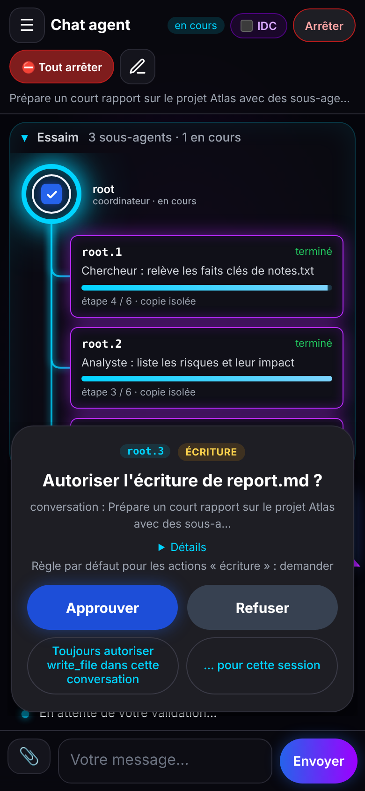 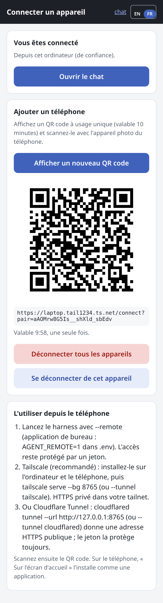</p>

The chat and the dashboard work on a phone (drawer sidebar, big approval buttons, bottom-sheet approval
cards) and can be installed as an app (PWA). To reach the harness from anywhere, keep it on
`127.0.0.1` and put a **private HTTPS tunnel** in front of it. `--remote` makes sign-in mandatory.

**1. Tailscale (recommended: private to your devices, HTTPS)**

1. Install Tailscale on the computer and on the phone, sign in to the same account on both
   (https://tailscale.com/download). Enable HTTPS certificates in the admin console (DNS → HTTPS).
2. Start the harness with the tunnel:
   ```bash
   python -m agent serve --remote --tunnel tailscale
   ```
   This runs `tailscale serve --bg 8765` and prints `https://<machine>.<tailnet>.ts.net/`, plus a
   **QR code** in the console. (Manual equivalent: `tailscale serve --bg 8765`, then
   `python -m agent serve --remote --public-url https://<machine>.<tailnet>.ts.net`.)
   To stop sharing later: `tailscale serve --https=443 off`.
3. Scan the QR code with the phone camera: it opens `/connect?pair=…` and signs the phone in.

**2. Cloudflare Tunnel (no account needed for a quick tunnel, public URL)**

1. Install `cloudflared` (https://developers.cloudflare.com/cloudflare-one/connections/connect-networks/downloads/).
2. `python -m agent serve --remote --tunnel cloudflared` starts
   `cloudflared tunnel --url http://127.0.0.1:8765`, reads the random `https://….trycloudflare.com` URL
   and prints the QR code. The tunnel stops with the harness. The URL is **public** (anyone who has it
   reaches the sign-in page), so the token and the rate limits are what protect you. For a permanent
   hostname, use a named tunnel in your Cloudflare account, ideally with Cloudflare Access in front.

**Sign in, QR codes, install**

- The QR code holds the URL and a **one-time pairing code** (valid 10 minutes, used once). After
  scanning, the phone keeps a session cookie (HttpOnly, SameSite=Strict, Secure over HTTPS, 30 days).
  No QR at hand? Open `/connect` on the phone and paste the token.
- New code for another device: open `http://127.0.0.1:8765/connect` on the computer → **Show a new QR
  code**. The same page can **sign out every device**.
- The token: `AGENT_HARNESS_TOKEN` (at least 24 characters), else one is generated in
  `<state-dir>/remote-token` (file mode 0600) and its location is printed (never the token itself).
- Install the app: iPhone/iPad → Safari → Share → **Add to Home Screen**. Android → Chrome → ⋮ →
  **Install app** / **Add to Home screen**. The service worker only caches the page shell (HTML, icons,
  manifest), never the API, conversations or approvals; it needs HTTPS (a tunnel) or localhost.
- Desktop app: set the same options in its `.env` (`AGENT_REMOTE=1`, `AGENT_TUNNEL=tailscale` or
  `cloudflared`, optionally `AGENT_REMOTE_URL`, `AGENT_HARNESS_TOKEN`).
- Without a tunnel tool, `serve --remote` prints which one to install (or the command to run if
  one is found). `--no-qr` / `AGENT_QR=0` hides the QR code.

**Security model**

- In remote mode every API call needs the token (Bearer), a session cookie, or must come straight
  from this computer (loopback, `localhost` Host, no proxy headers; `AGENT_REMOTE_LOCAL_AUTH=1` turns
  that trust off). Anything relayed by a tunnel must sign in.
- Logins are rate limited (10 failures per client and 50 in total per 5 minutes → HTTP 429).
- POSTs must be JSON and same-origin; a cookie-authenticated POST without `Origin` is refused.
  Pages send `Referrer-Policy: no-referrer`; API answers are `Cache-Control: no-store`.
- Send/spend approvals are still never auto-approved, and sub-agent creation still asks by default:
  the phone only shows the same approval cards.
- The harness refuses to start without a token in remote mode or when bound to another address than
  localhost. `--host 0.0.0.0` (LAN) works but prints a loud **plain HTTP** warning: the token and the
  conversation travel unencrypted on that network. Prefer a tunnel.

**Settings from a phone.** Phone access can be turned on from ⚙ Settings → Phone access (tunnel choice,
QR code, new token; a restart applies it). Changing settings or API keys stays **reserved to the computer
running the agent**: a remote device sees a 🔒 notice. To allow signed-in devices to change them, start the
agent with `AGENT_REMOTE_SETTINGS=1`; every change then needs the sign-in token or session **and** an
anti-CSRF token (`X-CSRF-Token`), and the page shows a warning banner.

### Sandbox mode and developer mode

**Sandbox** (`agent/sandbox.py`). When it is on, the `shell` tool never reaches a real shell:

- the command line is parsed with `shlex`; `; | & < > $ \` ( )` and newlines are refused (one command at a time);
- allowlist: `ls cat head tail wc grep find echo pwd mkdir touch rm cp mv diff sort uniq date true` are
  implemented in Python (same behaviour on Windows, macOS and Linux; `find` without `-exec`/`-delete`),
  plus `python file.py`, `python -m pytest|unittest|py_compile|compileall|json.tool|doctest` and `pytest`;
- every path is resolved (symlinks followed) and must stay inside the workspace; `~`, `..` escapes,
  absolute system paths and links pointing outside are refused; the app's private data folder is refused
  even when it is inside the workspace;
- Python runs as a child process with `shell=False`, `-I` (isolated), a **minimal environment** (no
  variables from your session: no keys or tokens; `HOME`/`TMPDIR` inside the workspace; proxies pointed at a
  dead port), and a **Python audit hook** that refuses network calls, starting other programs, `ctypes`, and
  reading or writing files outside the workspace (reads of the Python installation are allowed);
- limits: 60 s per command (the process group is killed), CPU 60 s, memory 1.5 GB and files 64 MB
  (`setrlimit`, POSIX), output capped (12,000 characters by default).

In the app, the sandbox is **always on in Simple mode**; in Expert mode, Settings → *Sandbox* turns it off
after a confirmation (audited as `sandbox_off`). From the command line: `--sandbox` or `AGENT_SANDBOX=1`.
When it is on, the approval card for a command says so, and the system prompt tells the model the rules.

**Developer mode** (`/dev`, `agent/devmode.py`). Projects live in `<workspace>/projects/<name>/`:

| Template | Files | Tests |
|---|---|---|
| 🌐 Website | `index.html`, `style.css`, `script.js` | static check: every local link, image, script and stylesheet exists; internet files are flagged |
| 🐍 Python program | `main.py`, `test_main.py` (unittest), `README.md` | `pytest` if available, else `python -m unittest` — always in the sandbox |

"Build it with a Coder and a Tester" starts a conversation (`POST /tasks` with `"dev": "<project>"`) whose
system prompt asks for a `Coder:` helper that writes the files, then a `Tester:` helper that checks them and
runs the tests (both use code keys from the key pool). **Preview** serves the project at
`/preview/<token>/<project>/` (the token is an HMAC of the name with a per-run secret, so it also works from
a phone) with `Content-Security-Policy: sandbox allow-scripts …; connect-src 'none'; form-action 'none'`, in
an `<iframe sandbox="allow-scripts allow-forms allow-modals">` (opaque origin: the page cannot call the
app or the internet). **Download the project (.zip)** = `GET /dev/zip?project=<name>` (caches and hidden
files left out). API: `GET /dev/projects`, `POST /dev/projects {name, kind}`, `POST /dev/test {project}`.

### Left sidebar (0.9.2)

The tab bar at the top is gone: every page now has one quiet left sidebar with an icon and a label per destination (Chat, Dashboard, Dev, Settings, Connect), the current page lightly marked with the accent. Help, the day / night theme, Simple / Expert, the language and Quit sit at the bottom. The « ‹ » button folds it to icons only (remembered in this browser; icons only by default on mid-size screens). On a phone it is a drawer opened with ☰, listing every destination. In the chat, the sidebar also holds your conversations and "My files", so the page is just sidebar, conversation and input box. Page headers keep only a title; long help texts became small "?" tooltips and rarely used items moved under "Advanced options".

| Before (0.9.1) | After (0.9.2) |
|---|---|
| 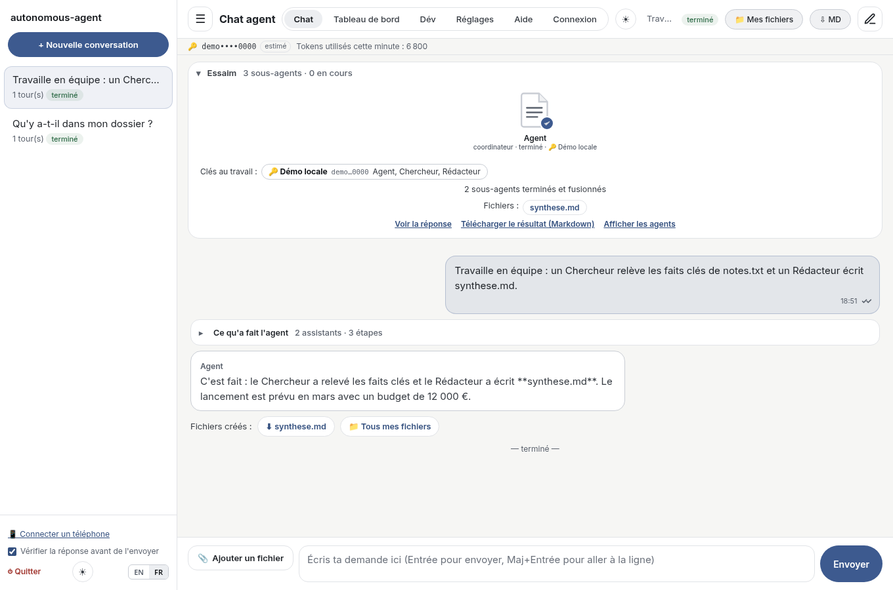 |  |
|  |  |
|  | 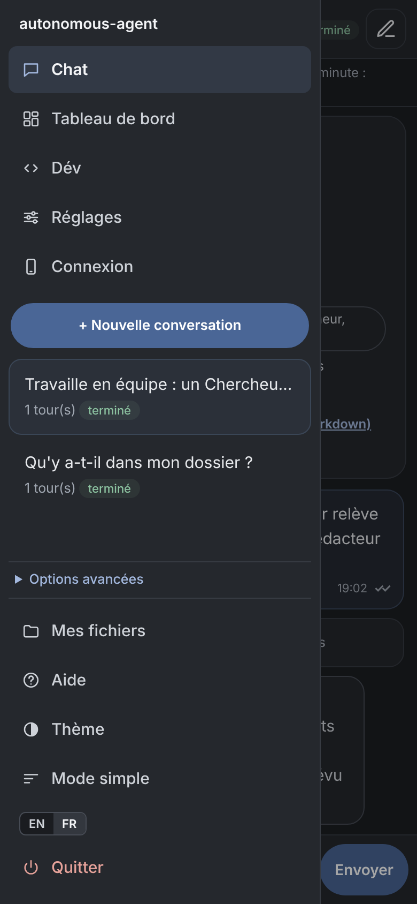 |

### A calmer interface (0.9.1)

Same features, quieter screens. Neutral backgrounds (off-white by day, soft dark grey at night, never pure black), one muted blue accent, softened success / warning / error colours, and no halos, glows, gradients, blur or animated pulses. Text is 15 px with 1.5 line height and lines of about 70 characters; every text colour meets WCAG AA in both themes (checked by `tests/test_v091_theme.py`). Each page shows the essentials first: rarely used settings sit under **Advanced options** (keys pool and backup hint, critic rounds, phone tunnel, API header / OpenAPI / description), the event journal on the dashboard is folded, "Stop all" only appears while something runs, and the chat side panel starts folded on mid-size screens.

| Before (0.9.0) | After (0.9.1) |
|---|---|
| 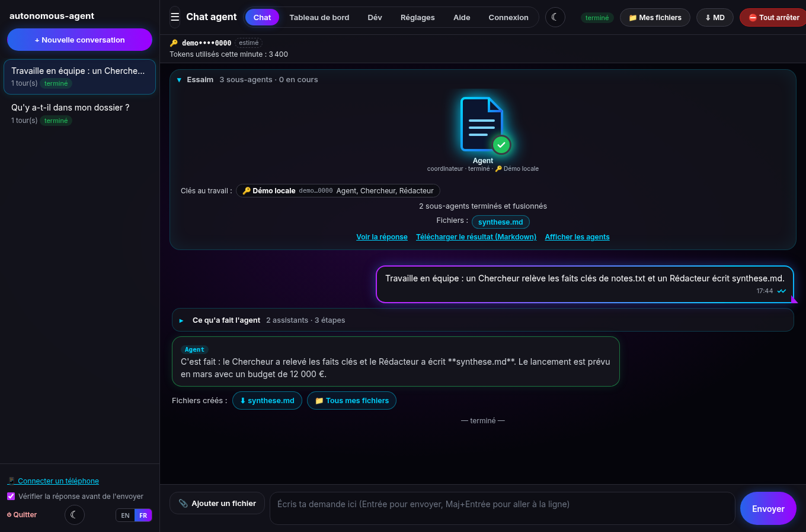 |  |
| 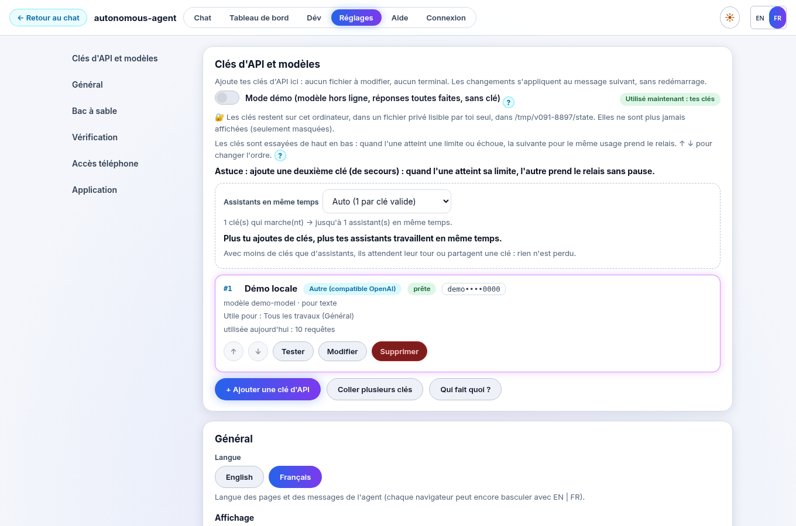 |  |

### Self-check, handoffs, memory by meaning and business APIs (0.9)

- **Check the answer before sending it** (chat side panel, or Settings → Answer check; off by default because each check is one more model call). After the draft final answer, a *Critic* (same model, no tools, short prompt) checks the criteria you asked for, the consistency with the actions really done, and the language. Verdict `ok` → the answer is sent; `revise` → the issues are given back to the agent, which fixes its answer, at most 1–3 rounds (`POST /settings {"critic": true, "critic_rounds": 2}`). An unreadable or failed review never blocks the answer. Each review is a line in the trace and a 🔎 card (with its score) in the agents graph.
- **Handoffs**: the `handoff` tool (`to`, `brief`) passes the whole task to a specialist with the request and the work done so far; the specialist answers the user directly and its answer becomes the agent's answer (also checked by the Critic when it is on). Chains like Agent → Codeur → Testeur → Critique work; max 4 hand-overs per run, an agent cannot hand over to its own role, and if the specialist does not finish, the work comes back. The graph marks these cards "handoff". Uses the `delegate` permission like sub-agents.
- **Semantic memory**: `memory_recall` mixes meaning and keywords (0.65 × cosine + 0.35 × keywords) when a key has **embeddings** ticked (Settings → API keys) (any OpenAI-compatible `POST /embeddings`). Vectors live in `memory/vectors.sqlite3` (standard library `sqlite3`, no server), are computed once per note and redone if the model changes. Without an embeddings key, or if the service fails, recall uses keywords as before. Groq has no embeddings endpoint: add e.g. an OpenAI, Mistral or local (Ollama / LM Studio) key with « embeddings » ticked. `GET /health` shows `memory.semantic`.
- **Business APIs** (Connect → 🔌 My APIs, or `GET/POST /app/apis`, `POST /app/apis/<id>`, `POST /app/apis/<id>/delete`): name, base URL, auth header name and value (stored in the secret store like keys, only shown masked, never sent to the model, removed from responses), optional OpenAPI JSON URL (endpoints listed to the agent). Tools: `api_list` (read), `api_get` (network; asks each time unless "The agent may read (GET) without asking me" is ticked for that API), `api_send` (send: POST/PUT/PATCH/DELETE, approval card), `api_pay` (spend, for APIs marked "can spend money"; never automatic, blocked while `spend` is `deny`, the default). Paths only: the agent cannot leave the base URL (no other host, no `../`).

### Tests

```bash
python -m pytest -q
```

CI (GitHub Actions) runs the tests on Python 3.10–3.13, with and without PyYAML, plus an offline
end-to-end run with the mock backend, and a build of the desktop app (PyInstaller) that is started
and checked through `/health`. Tagging `v*` runs `.github/workflows/release.yml`: Windows and macOS
builds, each smoke-tested, attached to a GitHub Release.

### Honest limitations

- **0.9**: the Critic is the same model as the agent: it catches missing items and language slips, not every factual error, and each round costs one model call (with a free Groq key, expect rate-limit pauses). Semantic memory needs a key with « embeddings » ticked (Groq has none). Business APIs: JSON / text only, one auth header, no OAuth flow, no file upload; OpenAPI is read once (JSON only, not YAML). Models sometimes do the specialist's work themselves instead of handing over.
- **Language and retries (0.8.2)**: the language of a request is guessed from common words and accents
  (French / English only); a very short or mixed message uses the previous turn's language, then the app's.
  Models may still slip into English inside tool output or code comments. A malformed action is retried 3
  times; after that the helper (or the task) stops with the provider's error. Developer-mode confinement
  covers the file tools and the sandbox commands that create, move or delete files; with the sandbox off,
  the shell is not confined, and a Python program run in the sandbox may still write anywhere in the work
  folder.
- **Rate limits (0.8.1)**: with a single key, the task waits instead of stopping (max 60 s per pause, 6
  pauses per request, nothing waited for beyond 5 min); a long pause still makes a slow task. The tokens per
  minute counter shows the provider's figures after the first answer; before that, and for providers that
  send no `x-ratelimit-*` headers, it is an estimate (Groq assumed 8,000 tokens/minute). Single `.env` key
  mode (no Settings keys) waits too but shows no counter.
- **No security audit has been done.** This is a small educational project.
- **The shell is dangerous if you set it to `allow`.** Command deny patterns are a seatbelt, easy to
  bypass (`bash -c`, scripts, aliases…). For untrusted tasks, run the agent in a container/VM.
- With the sandbox **off**, workspace confinement applies to the file tools only and the shell can reach
  anything your user can. With it **on**, the Python audit hook is a guard-rail for an assistant that makes
  mistakes, not a jail against hostile code: audit hooks can in theory be bypassed from inside Python,
  CPU/memory limits are POSIX-only (not Windows), and Python's own installation stays readable. For
  untrusted code, use a container or VM.
- Developer mode: templates are deliberately tiny (no npm, no build step, standard library only); the
  website check is static (it does not run the page's JavaScript); the desktop builds need a Python 3
  installed on the computer to run Python projects (pytest is used only if it is installed, else unittest).
- Secret redaction is pattern-based: an unknown secret format can slip through.
- Web content can contain prompt injection; the system prompt warns the model, it does not prevent it.
- Memory recall is simple keyword matching, no embeddings.
- `web_search` scrapes a public HTML endpoint and may be blocked; prefer `web_fetch` on known URLs.
- Quality depends heavily on the model; small local models often call tools badly.
- The desktop builds are **unsigned** (SmartScreen / Gatekeeper warnings), large (the Python runtime is
  inside, ~10–30 MB) and separate for Apple Silicon and Intel Macs. Antivirus software sometimes flags
  unsigned PyInstaller executables (false positives).
- Remote access: sessions live in memory (a restart signs phones out); no TLS of its own (use a
  tunnel); not tested against every tunnel/proxy setup; the PWA works offline only for the page shell.
- Settings page: on Windows the private key file relies on your user folder's permissions (0600 is a
  POSIX mode); the system keychain is used only if the Python `keyring` package is installed (it is not
  bundled in the desktop builds). **Test the key** only checks the provider's `/models` endpoint, not
  access to a given model. Restarting from Settings cancels running tasks. Validation messages from the
  server are in English.
- Day theme: checked for WCAG AA contrast on the main text colours and visually on every page, but not
  audited with a screen reader; the theme choice is stored per browser (Settings sets the default).
- Key pool: a helper's job is guessed from keywords in its task text (EN/FR), and the "fast / strong"
  proposal from the provider and model name: both are heuristics you can override in Settings. The pool
  lives in the running app (one process); a helper keeps its key while it works, and counts as busy for
  2 minutes after its last call if it did not finish cleanly. Pasted keys are hidden by intercepting the
  paste and by masking the box (`-webkit-text-security`); in browsers without that CSS (older Firefox),
  characters **typed** directly in the paste box are visible until Enter, so type keys in the
  "+ Add another key" rows (password fields) instead.
- This project is independent: it is **not** Grok Bot and does not reproduce it.

### License

MIT — see [LICENSE](LICENSE).

---

<a id="francais"></a>

## Français

Un petit agent autonome open source en Python (bibliothèque standard uniquement), lisible, avec
**outils, mémoire durable et compétences (skills)**, et des **garde-fous que tu règles
toi-même** : chaque outil a une catégorie de risque, et un fichier `permissions.yaml` décide, par
catégorie et par outil, si l'appel est autorisé (`allow`), soumis à confirmation dans le terminal
(`ask`) ou refusé (`deny`). Chaque appel d'outil est écrit dans un journal d'audit en ajout seul,
secrets masqués.

> Ce n'est pas « un agent sans garde-fous ». Les garde-fous existent ; c'est **toi** qui les règles.

### Télécharger (sans ligne de commande)

**Aucun terminal nécessaire, à aucune étape.** Des versions de bureau prêtes à l'emploi existent pour
Windows et macOS : ni Python, ni installation, ni commande, ni fichier à modifier. Télécharge le fichier
correspondant à ton ordinateur sur la
**[page des versions (Releases)](https://github.com/lanoixdesign/autonomous-agent/releases/latest)** :

| Fichier | Pour |
|---|---|
| `AutonomousAgent-windows-x64.exe` | Windows 10/11, 64 bits |
| `AutonomousAgent-macos-arm64.zip` | Mac avec puce Apple (M1, M2, M3, M4…) |
| `AutonomousAgent-macos-intel.zip` | Mac avec processeur Intel |

#### Ouvrir l'application non signée

> ⚠️ **Ces versions ne sont pas encore signées** (pas de certificat payant Microsoft/Apple) : Windows et
> macOS affichent donc un avertissement à la première ouverture. C'est normal pour une application non
> signée, et cela ne se fait qu'une fois. **La signature du code est prévue dans une version ultérieure.**

**Windows (SmartScreen)**
1. Double-clique sur `AutonomousAgent-windows-x64.exe`.
2. Une fenêtre bleue **« Windows a protégé ton ordinateur »** apparaît : clique sur
   **Informations complémentaires**, puis sur **Exécuter quand même**.
3. L'application s'ouvre dans ton navigateur. Pas de fenêtre de console (le journal va dans
   `AutonomousAgent\data\app.log`).

**macOS (Gatekeeper)**
1. Décompresse le fichier et déplace `AutonomousAgent.app` dans **Applications**.
2. La première fois, faites un **clic droit** (ou Contrôle-clic) sur l'app → **Ouvrir**, puis encore
   **Ouvrir** dans la fenêtre qui s'affiche.
3. Si macOS ne propose que « Placer dans la corbeille » / « OK » : ouvre **Réglages Système →
   Confidentialité et sécurité**, descends jusqu'à la partie Sécurité et clique sur **Ouvrir quand même**
   à côté de « AutonomousAgent », puis confirme (mot de passe ou Touch ID).
4. L'application s'ouvre dans ton navigateur et tourne en arrière-plan (aucune fenêtre à garder ouverte).

<details>
<summary><b>Avancé (facultatif) : retirer l'attribut de quarantaine sur macOS</b></summary>

Seulement si les étapes ci-dessus n'ont pas fonctionné, dans Terminal :

```bash
xattr -dr com.apple.quarantine /Applications/AutonomousAgent.app
```
</details>

<details>
<summary><b>Avancé (facultatif) : vérifier le téléchargement avec SHA256SUMS.txt</b></summary>

Chaque version contient `SHA256SUMS.txt`. Télécharge-le à côté de ton fichier, calcule l'empreinte
SHA-256 du fichier et vérifie qu'elle correspond à la ligne de ce fichier.

Windows (Invite de commandes ou PowerShell, dans ton dossier Téléchargements) :

```bat
certutil -hashfile AutonomousAgent-windows-x64.exe SHA256
```

macOS (Terminal, dans ton dossier Téléchargements) :

```bash
shasum -a 256 AutonomousAgent-macos-arm64.zip    # ou AutonomousAgent-macos-intel.zip
shasum -a 256 -c SHA256SUMS.txt --ignore-missing  # vérifie d'un coup tous les fichiers téléchargés
```

L'empreinte affichée doit être identique à celle de `SHA256SUMS.txt` (compare les caractères, pas les
majuscules/minuscules). Si elle diffère, n'ouvre pas le fichier : télécharge-le à nouveau depuis la page
des versions.
</details>

**Premier lancement : un assistant en 3 étapes dans le navigateur.** ① choisis la langue (English /
Français) → ② clique sur **🎈 Essayer sans clé** (réponses de démonstration, rien à régler) *ou* connecte
une vraie IA : choisis un service (**Groq** est recommandé et gratuit), suis le **guide pas à pas**
(« Ouvrir Groq dans un nouvel onglet », connexion, création d'une clé, copie), colle la clé (le service est
**reconnu d'après la clé**), **Tester la clé**, puis **Enregistrer et continuer** → ③ c'est prêt, ouvre le chat.

| Assistant (thème jour) | Assistant (thème nuit) |
|---|---|
|  | 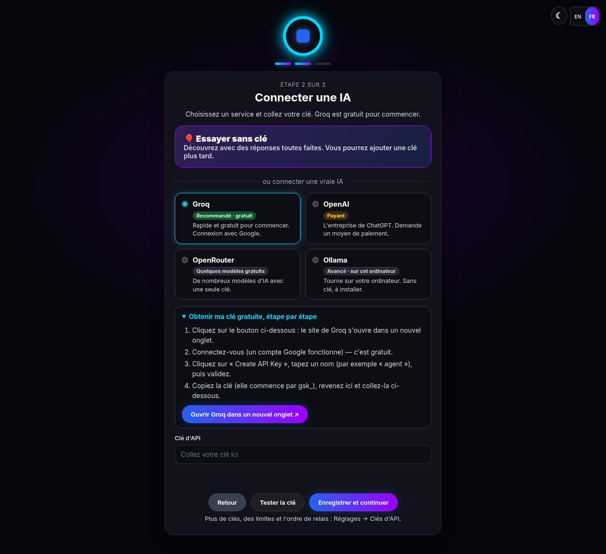 |

**Pensé pour les débutants (0.6).**
- **« Que puis-je faire pour toi ? »** : le chat s'ouvre sur six exemples (résumer un document, écrire un
  e-mail, ranger des notes, se renseigner sur un sujet, faire un plan, traduire) et une **visite guidée** en
  4 étapes (affichée une fois ; Aide → « Revoir la visite guidée »).
- **Des questions avec des mots simples** : avant d'agir, l'agent demande *« L'agent veut écrire le fichier
  report.md. Tu l'autorises ? »* avec de grands boutons **✓ Autoriser** / **✕ Refuser** et une phrase
  d'aide ; le nom de l'outil et ses arguments sont repliés sous « Détails techniques ». **Envoi** et
  **dépense** sont demandés à chaque fois.
- **« Ce qu'a fait l'agent »** : la trace se lit comme des phrases (« L'assistant « Chercheur » a lu
  notes.txt »), repliée par défaut ; Réglages → « Détails du travail dans le chat » → **Technique** montre
  les appels d'outils bruts.
- **📁 Mes fichiers** : lister, ajouter et télécharger les fichiers du dossier de travail ; les fichiers
  créés par l'agent apparaissent sous sa réponse avec un bouton **⬇ Télécharger**.
- Onglet **Aide** : le fonctionnement en 4 étapes, un exemple de question, une FAQ, « Texte plus grand ».
- Réglages **Simple / Expert** : Simple masque autorisations, limites, IDC et options techniques ; des
  boutons ❓ expliquent chaque réglage ; les messages d'erreur sont traduits (EN/FR).
- **Thème ☀ Jour / ☾ Nuit** : un bouton « Thème » en bas de la barre latérale gauche (et dans le tiroir ☰ du
  téléphone) passe d'un thème clair et calme à un thème de nuit gris foncé doux (tous deux WCAG AA). Réglages →
  Général → Affichage → **Thème : Jour / Nuit / Automatique** (par défaut : Automatique = suit ton
  ordinateur ou téléphone). Le choix est mémorisé dans ce navigateur.

| Chat, thème jour | Chat, thème nuit |
|---|---|
|  |  |

| Une question en mots simples (téléphone, jour) | Mes fichiers | Réglages : thème, Simple / Expert |
|---|---|---|
|  |  |  |

**Tout le reste est dans ⚙ Réglages** (les destinations **Chat | Tableau de bord | Dév | Réglages | Connexion | Aide**
sont dans la barre latérale gauche de chaque page, et dans le tiroir ☰ sur téléphone) :
- **Clés d'API et modèles** : ajouter, modifier, supprimer et tester des clés, par usage (texte, code,
  images, voix, transcription, embeddings), avec des limites (requêtes / jetons / coût par jour ou par
  mois) et un ordre de relais (↑ ↓ : quand une clé atteint une limite ou échoue, la suivante prend le
  relais). Les clés sont affichées **masquées** (`sk-d••••RET2`) avec leur consommation. Les changements
  s'appliquent au message suivant, **sans redémarrage**.
- **Général** : langue, thème, Simple / Expert, détails du travail, texte plus grand, dossier de travail,
  conversations simultanées, délai de validation.
- **Autorisations** (Expert) : autoriser / demander / refuser par catégorie de risque. **envoi** et
  **dépense** ne peuvent jamais être mis sur « autoriser ».
- **Mode IDC** (Expert) : activé/désactivé et ses paramètres.
- **Accès téléphone** : l'activer, choisir Tailscale ou Cloudflare, afficher le QR code, générer un nouveau jeton.
- **Application** : version, **Redémarrer** (proposé quand un changement l'exige) et **Quitter** (arrête
  proprement le serveur ; aussi dans la barre latérale du chat).

**Où vont tes clés.** Dans ton dossier utilisateur, `AutonomousAgent/data/secrets.json`, un fichier
privé lisible par ton seul compte (mode 0600), ou dans le trousseau du système si le paquet Python
`keyring` est installé. Après l'enregistrement, les clés ne sont jamais renvoyées au navigateur (seulement
masquées), jamais écrites dans les journaux ni dans l'audit. Les réglages et les clés ne se modifient
**que depuis l'ordinateur qui fait tourner l'agent** ; un téléphone connecté à distance voit un avis 🔒
(voir [Utiliser depuis le mobile](#utiliser-depuis-le-mobile) pour `AGENT_REMOTE_SETTINGS=1`).

**Où vont les fichiers.** Tout est dans un seul dossier de ton répertoire personnel, `AutonomousAgent`
(`C:\Users\<toi>\AutonomousAgent` ou `/Users/<toi>/AutonomousAgent`) : `workspace/` (le seul dossier
que les outils de fichiers de l'agent peuvent toucher ; « Mes fichiers » et les pièces jointes y vont),
`data/` (réglages, clés, mémoire, journal d'audit, conversations), et les fichiers facultatifs `.env` /
`permissions.yaml` / `providers.yaml` pour les utilisateurs avancés.

**Arrêter :** clique sur **Quitter** (barre latérale du chat, ou Réglages → Application). Un nouveau
double-clic pendant que l'app tourne rouvre simplement l'onglet du navigateur. **Langue :** choix du
premier lancement, Réglages → Général, ou le sélecteur EN | FR.

| Graphe des assistants en direct (jour) | Tableau de bord (nuit) |
|---|---|
|  |  |

#### Plusieurs clés = plusieurs assistants en même temps (nouveau en 0.7)

**Plus tu ajoutes de clés, plus tes assistants travaillent en même temps.** Dans l'assistant (« J'ai
plusieurs clés ») ou dans ⚙ Réglages → Clés d'API → **Coller plusieurs clés**, colle toutes tes clés d'un
coup, une par ligne (éventuellement `nom: clé`), ou ajoute-les une par une avec **+ Ajouter une autre
clé**. Le service de chaque clé est reconnu d'après ses premières lettres, toutes les clés sont **testées
en même temps**, avec une ligne claire par clé (✓ « Ça marche : enregistrée sous Groq 2 » / ✗ « Groq refuse
cette clé : elle est fausse ou a été supprimée »). Seules celles qui marchent sont enregistrées ; les clés
ne sont jamais affichées en clair (`gsk_••••a1b2`) et sont rangées comme avant.

Ensuite, **Qui fait quoi ?** propose un travail pour chaque clé, en mots simples : clés rapides / gratuites
pour *Recherche & résumés* et *Analyse*, modèles plus puissants pour *Rédaction* et *Code* (et
*Images/vision* si le modèle sait lire les images). Valide en un clic ou ajuste avec les interrupteurs
(et, si tu veux, le modèle). Quand l'essaim travaille, chaque assistant reçoit **sa propre clé** :
d'abord une clé faite pour son travail (un « Chercheur » prend une clé de recherche), sinon une clé
*Général*, sinon n'importe quelle clé libre. Les assistants travaillent en parallèle, **un par clé qui
marche** par défaut (Réglages → *Assistants en même temps* : Automatique, ou de 1 à 8 si tu préfères
qu'ils partagent les clés). Le graphe en direct montre quelle clé (masquée) chaque assistant utilise, et
pour quel travail.

| Assistant : qui fait quoi ? | Chaque assistant sur sa propre clé |
|---|---|
|  |  |

#### Bac à sable et mode développeur (nouveau en 0.8)

🛡️ **Bac à sable** — les commandes lancées par tes assistants s'exécutent dans un espace protégé : uniquement
des commandes simples et sûres (`ls`, `cat`, `grep`, `find`, `mkdir`, `cp`, `mv`, `rm`, `python fichier.py`,
`pytest`…), **seulement dans ton dossier de travail**, jamais sur internet, jamais avec tes clés, avec des
limites de temps, de processeur, de mémoire et de sortie. Il est **toujours activé en mode Simple** ; en mode
Expert, ⚙ Réglages → *Bac à sable* permet de le désactiver après un avertissement clair.

🧑‍💻 **Mode développeur** — le nouvel onglet **Dév** : choisis un nom, **🌐 Site web** ou **🐍 Programme
Python**, puis décris ce que tu veux (« Une page pour ma boulangerie avec les horaires et un bouton
contact »). Un **Codeur** écrit les fichiers, un **Testeur** les vérifie et lance les tests, et tu vois le
résultat tout de suite : **👁 Aperçu** affiche le site dans un cadre protégé (taille ordinateur ou téléphone),
**▶ Lancer les tests** les exécute dans le bac à sable et répond en mots simples, **⬇ Télécharger le projet
(.zip)** te donne tout.

| Codeur + Testeur au travail | Aperçu en direct |
|---|---|
|  |  |

#### Des réponses dans ta langue (nouveau en 0.8.2)

🗣️ L'assistant, chaque assistant de l'essaim (Chercheur, Analyste, Rédacteur…) et le **Codeur** et le
**Testeur** du mode développeur répondent dans la langue de ta demande : écris en français et tout revient en
français, écris en anglais et tout revient en anglais (quand un message est trop court pour le savoir, la
langue de l'application est utilisée). En français, l'application te tutoie désormais partout. Autres
corrections :

- 🔁 Quand le modèle envoie une action mal formée (Groq `tool_use_failed`), l'étape est redemandée (jusqu'à
  3 fois, avec une courte correction et une température plus basse) au lieu d'arrêter la tâche ; le
  déroulé affiche « Le modèle a mal formé une action, je réessaie… ». Les assistants ont toujours leurs
  outils, même quand le modèle passe une liste vide.
- 📁 Le mode développeur garde le Codeur et le Testeur dans `projects/<nom>/` : toute écriture ailleurs est
  refusée, donc plus de fichiers égarés à la racine du dossier de travail.
- 🛡️ Bac à sable : `a && b` lance des commandes simples l'une après l'autre (arrêt au premier échec) ;
  `ls -R` liste les sous-dossiers ; les assistants savent qu'il faut une commande à la fois.
- 📱 Sur téléphone, tous les onglets (Connexion compris) sont visibles sans faire défiler.
- Le modèle Python salue dans une seule langue, le modèle Groq par défaut est `openai/gpt-oss-20b`, le
  tableau de bord nomme correctement les clés des Réglages, le graphe de l'essaim montre les assistants en
  échec et garde ceux des tours précédents après « Continuer », et les clés masquées restent lisibles dans
  l'historique après un redémarrage, et le coordinateur garde toujours une étape pour sa réponse finale
  (les assistants se partagent le reste).

#### Plus jamais coupé par une limite (nouveau en 0.8.1)

🔁 **Clé de secours automatique** — quand une clé atteint une limite ou un quota (429), ne répond pas à temps
ou que le service a une erreur (5xx), la même demande part **aussitôt** sur une autre clé (d'abord une clé
prévue pour le même travail, puis n'importe quelle autre, et en dernier recours une clé enregistrée pour un
autre usage). Les assistants d'un essaim font pareil, en pleine tâche, sans perdre leur travail. Avec une
seule clé (par exemple une clé Groq gratuite), l'assistant **attend que la clé revienne** (il suit le
« réessaie dans » du fournisseur, 60 s maximum par pause) et continue au lieu de s'arrêter. Seules les clés
qui ne peuvent pas revenir arrêtent une tâche (toutes les clés refusées ou révoquées, limite du jour
atteinte), avec un message clair. Le chat explique en mots simples : *« Limite atteinte sur la clé
gsk_••••43gO, je passe sur la clé de secours… »*, *« Toutes les clés sont en pause, je reprends dans 4 s… »*.

📊 **Tokens restants par minute** — une barre sous l'en-tête du chat (aussi sur téléphone) et le tableau de
bord affichent, par clé (masquée), *« Tokens restants : 5 200 / 8 000 par minute · reprise dans 12 s »* avec
une petite jauge, d'après les chiffres du fournisseur (en-têtes `x-ratelimit-*`) ou, avant la première
réponse, une **estimation** (indiquée « estimé ») à partir des tokens utilisés pendant les 60 dernières
secondes. Astuce : ajoute une deuxième clé (de secours) pour éviter les pauses.

| Passage sur la clé de secours | Téléphone : pause et compteur |
|---|---|
|  |  |

Remarques : le serveur n'écoute que sur `127.0.0.1` (ton ordinateur) ; port 8765 s'il est libre, sinon
un autre. Les versions macOS sont distinctes pour puce Apple et Intel. Avancé : compiler soi-même avec
`pip install pyinstaller && pyinstaller packaging/autonomous-agent.spec` (résultat dans `dist/`), ou
lancer `python -m agent.desktop` depuis un clone (`AGENT_TERMINAL=1` sur macOS rouvre l'app dans
Terminal pour voir le journal).

### En bref

- **Boucle d'agent** : plan → appel d'outil → observation → … → réponse, avec des limites strictes
  (pas, appels d'outils, jetons), un arrêt « pas de progrès » et une règle d'arrêt personnalisable.
- **15 outils** : fichiers (`read_file`, `list_files`, `search_files`, `write_file`, `edit_file`),
  `shell`, web (`web_fetch`, `web_search`), GitHub (`github_get`, `github_write`), mémoire
  (`memory_write`, `memory_recall`, `memory_forget`) et compétences (`list_skills`, `load_skill`). En
  plus, `spawn_agent` / `spawn_agents` lancent des sous-agents.
- **Catégories de risque** : `read`, `write`, `execute`, `network`, `send`, `spend`, `delegate`. Chacune
  est `allow`, `ask` ou `deny` dans `permissions.yaml`, et les motifs de refus l'emportent toujours.
- **Audit** : `audit.jsonl` en ajout seul, une ligne par appel d'outil, secrets masqués.
- **Mémoire et compétences** : fichiers simples ; le contenu des compétences est chargé à la demande.
- **Essaim** : `spawn_agent` / `spawn_agents`, avec des limites de profondeur, de nombre et de budget.
  Les enfants héritent des permissions du parent, jamais plus. Les enfants en lecture seule tournent en
  parallèle. Ceux qui écrivent tournent en parallèle dans des **copies isolées**, fusionnées fichier par
  fichier, et les conflits sont gardés en fichiers `.conflict-*`.
- **Mode IDC** (facultatif, désactivé par défaut) : un budget de vitalité qui baisse à chaque étape, des
  engagements en ajout seul et une réponse forcée « assez bonne maintenant » ; dire « je ne sais pas »
  coûte moins cher qu'une affirmation non étayée. Une hypothèse à tester, voir
  [Mode IDC](#mode-idc-facultatif-désactivé-par-défaut).
- **Harness** (`python -m agent serve`) :
  - chat web calme (jour / nuit) avec des **cartes de validation qui posent une question claire**
    (« Autoriser l'écriture de report.md ? »), un **graphe de l'essaim en direct** et plusieurs conversations en parallèle ;
  - **pièces jointes** ;
  - **plusieurs clés d'API par catégorie avec limites strictes**, collées d'un coup, **une clé par assistant**
    selon son travail (recherche, rédaction, code…), pour que les assistants travaillent en parallèle ;
  - **persistance** (SQLite), **direct** (SSE) et **⛔ Tout arrêter** ;
  - validations retenues (jamais pour send/spend) et un **tableau de bord** (consommation par agent,
    quotas, état du serveur) ;
  - **export Markdown/JSON**, **tâches planifiées** et une **interface EN/FR**.

| English | Français |
|---|---|
|  |  |

**Démarrage rapide (avancé : ligne de commande)**

L'application de bureau ci-dessus n'en a pas besoin. Depuis un clone :

```bash
git clone https://github.com/lanoixdesign/autonomous-agent.git && cd autonomous-agent
python -m agent run "Liste les fichiers" --provider mock --offline   # sans clé ni réseau
cp .env.example .env    # ajoute GROQ_API_KEY / OPENAI_API_KEY / OPENROUTER_API_KEY, ou Ollama
python -m agent chat --workspace ~/projet
python -m agent serve --workspace ~/projet   # puis http://127.0.0.1:8765/ : assistant + ⚙ Réglages
```

Plusieurs clés : `cp providers.example.yaml providers.yaml` (ignoré par git). Le fichier ne contient
que les **noms** des variables d'environnement, jamais les clés. `python -m agent keys` affiche les
quotas restants, clés masquées.

**Précautions, à lire avant usage**
- Testé uniquement avec le backend mock et de faux fournisseurs, pas avec de vrais fournisseurs en CI.
  **Aucun audit de sécurité n'a été fait.**
- La copie isolée protège les fichiers, mais ce **n'est pas un bac à sable** : `shell` peut atteindre
  tout ce que ton utilisateur peut atteindre. Lance les tâches non fiables dans un conteneur ou une VM.
- Les copies isolées sont fusionnées **fichier par fichier** : pas de fusion ligne à ligne, et les
  fichiers en conflit sont laissés à ton arbitrage.
- Les validations en attente vivent en mémoire : **elles sont perdues au redémarrage**, et le tour
  passe à `interrupted`.
- Les services d'image, de voix et d'embeddings sont des **bouchons** (routés et limités, mais pas
  implémentés).
- Le harness est un outil local à un seul utilisateur : pas de comptes, pas de TLS. Garde-le sur
  127.0.0.1, ou définis `AGENT_HARNESS_TOKEN`.

### Documentation complète (français)

### Fonctions

| | |
|---|---|
| **Boucle** | plan → appel d'outil → observation → … → réponse, avec limites de pas, d'appels d'outils et de tokens, plus un arrêt « pas de progrès » (même appel répété). `stop_rule` personnalisable. |
| **Outils** | `read_file`, `list_files`, `search_files`, `write_file`, `edit_file` (dans l'espace de travail), `shell`, `web_fetch`, `web_search` (au mieux), `github_get`, `github_write`, `memory_write`, `memory_recall`, `memory_forget`, `list_skills`, `load_skill`, `spawn_agent`, `spawn_agents` (sous-agents) |
| **Catégories de risque** | `read`, `write`, `execute`, `network`, `send` (visible par d'autres), `spend` (coûte de l'argent), `delegate` (lancer des sous-agents) |
| **Mémoire** | fichiers simples : `memory/profile.md` + `memory/journal.jsonl`, rappel par mots-clés, oubli (`forget`) |
| **Compétences** | `skills/<nom>/SKILL.md` avec frontmatter `name` / `description` ; seul l'index est dans le prompt, le contenu est chargé à la demande. Exemples : `research`, `code-review`, `release-notes`. |
| **LLM** | toute API compatible OpenAI : Groq, OpenAI, OpenRouter, Ollama (local), URL personnalisée ; backend `mock` pour les tests hors ligne |
| **Harness** | `python -m agent serve` : chat local avec cartes de validation, pièces jointes, plusieurs clés d'API avec quotas, direct (SSE), conversations enregistrées dans SQLite, arrêt d'urgence, validations retenues (jamais pour send/spend), consommation par agent, export Markdown/JSON, prompts planifiés, `/health` |
| **Mobile** | chat et tableau de bord adaptés au téléphone, PWA installable, `--remote` avec appairage par QR code, tunnels Tailscale / Cloudflare |
| **Bac à sable** | `shell` limité à une liste de commandes dans l'espace de travail : pas d'opérateurs shell, contrôle des chemins et des liens, pas de réseau, environnement nettoyé, limites processeur/mémoire/temps/sortie (toujours actif en mode Simple, `--sandbox` / `AGENT_SANDBOX=1` en ligne de commande) |
| **Mode développeur** | `/dev` : modèles site web / Python dans `projects/<nom>/`, assistants Codeur + Testeur, aperçu en direct protégé, tests dans le bac à sable, téléchargement `.zip` |

### Installation

```bash
git clone https://github.com/lanoixdesign/autonomous-agent.git
cd autonomous-agent
python -m venv .venv && . .venv/bin/activate   # Python 3.10+
pip install pyyaml pytest   # facultatifs : sans PyYAML, un mini-analyseur YAML intégré est utilisé
cp .env.example .env        # mets ta clé dans .env (ne le commite jamais)
```

### Configurer le modèle

Variables d'environnement (ou `.env`) :

| Variable | Rôle |
|---|---|
| `AGENT_PROVIDER` | `groq`, `openai`, `openrouter`, `ollama`, `custom`, `mock` (défaut `mock`) |
| `AGENT_MODEL` | nom du modèle (défauts : groq `openai/gpt-oss-20b`, openai `gpt-4o-mini`, openrouter `openai/gpt-4o-mini`, ollama `llama3.1`) |
| `GROQ_API_KEY` / `OPENAI_API_KEY` / `OPENROUTER_API_KEY` | clé du fournisseur choisi |
| `AGENT_BASE_URL`, `AGENT_API_KEY` | tout autre point d'accès compatible OpenAI (`custom`) |
| `GITHUB_TOKEN` | facultatif, pour les outils GitHub (sinon la connexion du CLI `gh`) |
| `AGENT_SEARCH_URL` | facultatif, moteur de recherche web (DuckDuckGo HTML par défaut) |

Aucune clé n'est écrite dans le code. Les requêtes envoient un en-tête `User-Agent` (certains
fournisseurs derrière Cloudflare refusent les requêtes sans).

### Utilisation

```bash
python -m agent run "Résume notes.md et garde l'essentiel en mémoire" --workspace ~/projet
python -m agent chat --workspace ~/projet --provider groq
python -m agent run "..." --model openai/gpt-oss-20b --permissions mes-perms.yaml
python -m agent run "Liste les fichiers" --provider mock --offline   # aucun accès réseau

python -m agent permissions      # permissions effectives, outil par outil
python -m agent audit -n 20      # dernières entrées du journal d'audit
python -m agent memory list | recall "requête" | add "texte" | forget "texte-ou-id"
python -m agent skills list | show code-review
python -m agent serve --port 8765  # harness local : page web + API JSON + file de validation
python -m agent keys               # clés d'API (masquées) et quotas restants, si providers.yaml est utilisé
```

Options : `--workspace/-w`, `--permissions/-p`, `--model/-m`, `--provider`, `--state-dir`
(mémoire + audit, défaut `<workspace>/.agent`), `--max-steps`, `--max-tool-calls`, `--max-tokens`,
`--max-depth`, `--max-children`, `--max-parallel`, `--keys`, `--category`, `--yolo`, `--offline`, `--quiet`.

Exemple (essai réel, Groq `openai/gpt-oss-120b`, sans terminal donc `ask` = refusé) :

```
  -> list_files [read] {"depth": 1, "path": "."} : allow
  -> read_file [read] {"limit": 200, "path": "notes.md"} : allow
  -> memory_write [write] {"kind": "note", ...} : allow
  ! write_file [write] needs confirmation but there is no terminal -> refused
[final] steps=5 tool_calls=4 tokens=6520
```

### Modèle de permissions

`permissions.yaml` (ou `.json`). Pour chaque appel :

1. mode = `tools.<outil>` s'il est défini, sinon `defaults.<catégorie>` ;
2. un motif **deny** correspondant (`paths.deny`, `commands.deny`, `domains.deny`) → **refus** (gagne toujours, même avec `--yolo`) ;
3. `paths.allow` non vide et chemin non couvert → refus ;
4. `commands.allow` / `domains.allow` correspondant et mode `ask` → autorisé ;
5. `--yolo` transforme `ask` en `allow` **sauf pour `send` et `spend`** : pour ces deux-là, seul ce que tu as écrit dans le fichier compte.

Défauts sûrs : `read: allow`, `write: ask`, `execute: ask`, `network: ask`, `send: ask`, `spend: deny`, `delegate: ask`.
`ask` demande `[y]es / [n]o / [a]lways` (oui / non / toujours pour cette session) ; sans terminal,
`ask` vaut refus.

```yaml
defaults: {read: allow, write: ask, execute: ask, network: ask, send: ask, spend: deny}
tools:
  memory_write: allow
  shell: deny            # par ex. interdire complètement le shell
paths:
  deny: [".env", "**/.env", "**/*.pem", ".git/**", ".agent/**"]
commands:
  allow: ["git status*", "python -m pytest*"]
  deny: ["sudo *", "*rm -rf /*", "*curl *|*sh*"]
domains:
  allow: ["api.github.com"]
```

**Audit** : `<state-dir>/audit.jsonl`, une ligne JSON par appel d'outil (autorisé, refusé,
invalide), ouvert en mode `O_APPEND`. Arguments et résultats sont tronqués et masqués : valeurs des
variables d'environnement dont le nom contient KEY/TOKEN/SECRET/PASSWORD…, et formats de jetons
courants (`sk-…`, `gsk_…`, `ghp_…`, `github_pat_…`, Bearer, clés privées). Le shell s'exécute sans
ces variables dans son environnement.

### Écrire une compétence

```
skills/ma-competence/SKILL.md
---
name: ma-competence
description: Une phrase qui dit quand l'utiliser.
---
# Étapes
1. ...
```

Recherche dans `<workspace>/skills`, `<state-dir>/skills`, puis `skills/` du dépôt.

### Règle d'arrêt

La boucle s'arrête de façon irréversible au premier de : réponse finale, `max_steps`,
`max_tool_calls`, `max_tokens`, appel identique répété, erreur du LLM. Pour brancher ton propre critère :
`Agent(..., stop_rule=lambda state: "ma_raison" if ... else None)`.

### Mode IDC (facultatif, désactivé par défaut)

L'**IDC — Effondrement Décisionnel Irréversible** est le modèle de l'auteur
([lanoixdesign/idc-wrapper](https://github.com/lanoixdesign/idc-wrapper)). C'est une **hypothèse, pas un
résultat validé** : une IA sans finitude peut délibérer sans fin, gaspiller du calcul, hésiter et inventer,
parce qu'inventer ne coûte pas plus cher que d'avouer qu'elle ne sait pas. L'IDC impose la finitude par
trois piliers, implémentés dans `agent/idc.py` :

1. **Une ressource qui diminue : la vitalité.** Chaque appel du modèle, chaque appel d'outil et chaque
   tranche de 1000 jetons coûtent de la vitalité (par message de l'utilisateur ; 100 par défaut). À 0,
   l'agent ne peut plus réfléchir (« mort cognitive »).
2. **Des engagements en ajout seul.** L'outil `idc_commit` enregistre un `fact` (fait), une `decision`,
   une `answer` (réponse) ou `unknown` (« je ne sais pas ») avec des **preuves** : des citations exactes
   de ce que l'agent a observé. Une entrée n'est jamais modifiée ni effacée. La corriger ajoute une nouvelle
   entrée qui pointe vers l'ancienne et coûte `revise_cost` ; avec `allow_revise: false`, c'est refusé. La
   réponse finale est aussi enregistrée. Les engagements vont dans le journal d'audit et restent avec la
   conversation.
3. **Une règle d'arrêt : l'effondrement.** Quand la vitalité descend à `collapse_threshold`, ou après
   `stall_limit` appels d'outils d'affilée sans rien de nouveau (même résultat qu'avant, erreur, refus),
   l'agent a un dernier appel **sans outils** et doit répondre maintenant (`idc_collapse`). Si la vitalité
   atteint 0, plus aucun appel au modèle : la réponse est la dernière réponse engagée **étayée**, sinon un
   « je ne sais pas » explicite avec ce qui est su et ce qui n'est pas vérifié (`idc_exhausted`).

**L'hypothèse sur les hallucinations, rendue concrète.** Un engagement est *étayé* quand chaque citation
apparaît dans ce que l'agent a observé pendant ce tour (message de l'utilisateur, résultats d'outils).
Coûts par défaut : étayé 1, « je ne sais pas » 0,5 (le moins cher), **non étayé 15**. La configuration
refuse `unknown_cost >= unsupported_cost`. Les sous-agents reçoivent une part de la vitalité restante
(`child_share`, la moitié par défaut, partagée entre enfants parallèles) ; ce qu'ils dépensent est facturé
au parent, et leur seuil d'effondrement est réduit à proportion de leur budget.

**L'activer**

| Où | Comment |
|---|---|
| Ligne de commande | `python -m agent run "..." --idc` (ou `--no-idc` ; `--idc-vitality 60`) |
| Environnement / `.env` | `AGENT_IDC=1`, et chaque paramètre en `AGENT_IDC_<NOM>`, ex. `AGENT_IDC_VITALITY=60` |
| `permissions.yaml` | une section `idc:` (exemple commenté dans le fichier) |
| Chat (harness) | l'interrupteur **IDC** en haut : par conversation (aussi entre deux messages), ou pour la prochaine nouvelle ; **IDC activé par défaut** dans la barre latérale est le réglage global, conservé au redémarrage |
| Application de bureau | `AGENT_IDC=1` dans `~/AutonomousAgent/.env`, ou les interrupteurs du chat |

Ordre : valeurs par défaut < `idc:` du fichier de permissions < `AGENT_IDC*` < ligne de commande. Dans le
harness, le réglage global part de cette valeur, puis les interrupteurs du chat décident. API :
`POST /tasks` avec `"idc": true|false`, `POST /tasks/{id}/idc` `{"enabled": true}`, `GET|POST /settings`
`{"idc": true}`. `GET /tasks/{id}` renvoie `idc_state` (vitalité, engagements) ; les événements `idc` sont
dans le flux en direct.

Quand l'IDC est activé, le chat affiche une **barre de vitalité**, la raison de l'effondrement et la liste
des engagements (étayés en vert, non étayés en rouge) :


**Paramètres** (section `idc:` ou `AGENT_IDC_<NOM>`)

| Nom | Défaut | Sens |
|---|---|---|
| `enabled` | `false` | valeur par défaut des nouvelles conversations / lancements en ligne de commande |
| `vitality` | 100 | budget par message de l'utilisateur (agent racine) |
| `step_cost` / `tool_cost` / `token_cost` | 4 / 3 / 0,5 | par appel du modèle / par appel d'outil / par 1000 jetons |
| `collapse_threshold` | 20 | à ce niveau ou en dessous : répondre maintenant, sans outils |
| `stall_limit` | 3 | appels d'outils d'affilée sans information nouvelle avant l'effondrement |
| `commit_cost` / `unknown_cost` / `unsupported_cost` | 1 / 0,5 / 15 | engagement étayé / « je ne sais pas » / non étayé |
| `revise_cost` | 25 | ajouté quand un engagement en corrige un autre |
| `allow_revise` | `true` | `false` : les engagements ne peuvent jamais être corrigés |
| `child_share` | 0,5 | part de la vitalité restante donnée à un sous-agent |

**Limites (honnêtement).** Les coûts et le seuil sont des points de départ arbitraires, à calibrer selon le
modèle et la tâche : trop bas, l'agent abandonne trop tôt ; trop haut, l'IDC ne change rien. « Étayé » veut
seulement dire « la citation a été observée », pas « l'affirmation est vraie », et la réponse finale en
texte libre n'est pas vérifiée. Un modèle peut ignorer les règles de son prompt ; ce qui est imposé, c'est
le budget, la réponse forcée sans outils, la réponse de repli et le journal en ajout seul. **Ce n'est pas une
garantie contre les hallucinations** : savoir si l'IDC les réduit est justement ce qui reste à valider
expérimentalement (mêmes tâches avec et sans IDC, en mesurant les réponses fausses, le taux de « je ne sais
pas » et le coût).

### Plusieurs clés d'API, par catégorie, avec limites

Facultatif. Sans fichier de clés rien ne change : la clé unique du `.env` est utilisée comme avant.
Copie `providers.example.yaml` en `providers.yaml` (ignoré par git ; ou `--keys FICHIER`, ou la
variable `AGENT_KEYS_FILE`). Chaque entrée indique la **variable d'environnement** qui contient la clé
(`key_env`), jamais la clé elle-même, plus `provider`/`base_url`, `model` ou `models` par catégorie,
`categories` (`text`, `code`, `image`, `audio_tts`, `audio_stt`, `embeddings`, ou les tiennes),
`priority` (la plus basse d'abord), `pricing` facultatif et des `limits` : `requests_per_minute`,
`requests_per_day`, `tokens_per_day`, `tokens_per_month`, `cost_per_day`, `cost_per_month` (dans ta
`currency`, nécessite `pricing`), `images_per_day`, `audio_minutes_per_day`.

```yaml
currency: EUR
keys:
  - name: groq-main
    provider: groq
    key_env: GROQ_API_KEY
    categories: [text, code]
    model: openai/gpt-oss-20b
    priority: 1
    pricing: {input_per_1m: 0.15, output_per_1m: 0.60}
    limits: {requests_per_day: 1000, tokens_per_day: 500000, cost_per_month: 5}
  - name: openrouter-backup
    provider: openrouter
    key_env: OPENROUTER_API_KEY
    categories: [text, code]
    model: openai/gpt-4o-mini
    priority: 2
```

- **Choix de la clé** : à chaque appel du modèle, le routeur prend la première clé de la catégorie (par
  priorité) qui est définie, pas en pause, et qui peut accepter la requête **sans dépasser aucune
  limite**. La requête est réservée avant l'envoi (jetons : invite estimée + plafond `max_tokens`
  envoyé au fournisseur, coût d'après `pricing`), donc des agents en parallèle ne peuvent pas dépasser
  ensemble. La consommation réelle est enregistrée ensuite.
- **Bascule (0.8.1)** : un 429 (avec `Retry-After`, ou le « try again in Xs » de Groq), un délai dépassé,
  une erreur réseau ou 5xx met la clé en pause et **la même demande** part aussitôt sur la clé suivante :
  même travail d'abord, puis n'importe quelle clé de la catégorie, puis (dernier recours) une clé de l'autre
  catégorie de chat (`text` / `code`). Quand toutes les clés sont seulement en pause, la demande **attend**
  la première qui revient (60 s max par pause, 6 pauses) et reprend ; l'agent garde son travail. Un 401 /
  402 / 403 met la clé de côté (jusqu'à la modification des clés) ; l'appel s'arrête en `llm_error`
  seulement quand aucune clé ne peut revenir (toutes refusées, absentes, limite du jour / du mois), avec la
  raison pour chaque clé. Chaque bascule / pause est un évènement `keys` (clés masquées). Rien n'est jamais
  envoyé au-delà d'une limite.
- **Tokens par minute (0.8.1)** : `GET /keys/rate` donne, par clé (masquée), les tokens (et requêtes)
  restants, la limite et les secondes avant la remise à zéro, d'après les en-têtes `x-ratelimit-*` du
  fournisseur (`source: provider`) ou estimés sur les 60 dernières secondes (`source: estimate` ; 8 000
  tokens/minute supposés pour Groq).
- **Consommation** enregistrée dans `<state-dir>/usage.json` (par minute / jour / mois, heure locale,
  plus les pauses), donc les limites tiennent après un redémarrage. Une limite atteinte ou une erreur
  du fournisseur est journalisée (`event: key_limit` / `key_error`).
- `--category code` choisit la catégorie du modèle de chat ; `agent/media.py` fournit des interfaces
  minimales (`ImageGenerator`, `TextToSpeech`, `SpeechToText`, `Embeddings`) qui réservent une clé de
  leur catégorie pour l'appel au fournisseur que tu branches (pas de génération d'image/son intégrée).
- `python -m agent keys` et le harness (`GET /keys`, barre latérale du chat, `/dashboard`) affichent le
  quota restant par clé et par catégorie, avec les clés masquées (`gsk_…abcd`).


- **Réserve de clés (0.7)** : chaque agent de l'essaim (`root`, `root.1`, `root.2`…) reçoit **sa propre**
  clé et la garde pendant son travail. Ordre : les clés dont les `tasks` correspondent au travail de
  l'agent (d'après le texte de sa tâche, mots-clés EN/FR : *Chercheur / Researcher* → `research`,
  *Rédacteur / Writer* → `writing`, *Développeur / Coder* → `code`, *Analyste / Analyst* → `analysis`,
  *image / capture* → `vision`, sinon `general`), puis les clés `general` ou sans étiquette, puis n'importe
  quelle clé de la catégorie ; dans un groupe, la clé **la moins occupée** gagne. Les limites restent
  vérifiées et réservées d'abord. Sur une limite, un 429, une erreur 5xx / réseau ou une clé refusée
  (401 / 402 / 403), la clé se repose et l'agent **passe à la suivante** ; avec moins de clés que
  d'agents, ils partagent les moins occupées. Parallélisme = nombre de clés qui marchent (8 au plus), ou
  le nombre choisi dans Réglages (`parallel`). Dans `providers.yaml` : `tasks: [research, analysis]`.
  Chaque changement de clé est journalisé (`event: key_assign`, clé masquée).
- **Saisie groupée (0.7)** : `POST /app/providers/bulk {"text"}` lit une clé par ligne (`nom: clé`,
  `NOM=clé`, `export NOM="clé"`), reconnaît le service, teste toutes les clés en même temps et enregistre
  celles qui marchent ; `POST /app/providers/propose` et `POST /app/providers/tasks` gèrent « Qui fait
  quoi ? » ; `GET /app/pool` montre la réserve en direct. Les réponses ne contiennent que des clés masquées.
### Mode essaim (sous-agents)

Un agent peut lancer des **sous-agents** avec `spawn_agent(task, max_steps?, allowed_tools?)`, ou
plusieurs à la suite avec `spawn_agents(tasks, ...)`. Un sous-agent est un agent normal exécuté dans
le même processus, avec le même modèle, le même espace de travail, la même mémoire et le même journal
d'audit ; sa réponse finale revient au parent comme observation.

Limites (appliquées dans le code, voir `agent/swarm.py`) :
- lancer un sous-agent relève de la catégorie de risque `delegate`, **`ask` par défaut** ;
- un sous-agent applique **la politique de permissions du parent**, éventuellement restreinte par
  `allowed_tools` : il ne peut jamais faire plus que son parent (un `deny`, ou `send` / `spend`, reste
  tel que le parent l'a) ;
- son budget est plafonné par ce qui reste au parent, et sa consommation est **déduite** du parent ;
- `--max-depth` (défaut 2 : agent → sous-agent → sous-sous-agent ; `0` désactive le mode) et
  `--max-children` (défaut 5 sous-agents par exécution, tout l'arbre compris) ;
- chaque ligne d'audit porte `agent` (`root`, `root.1`, `root.1.2`…) et `depth`, plus les événements
  `spawn` / `child_done`.

```bash
python -m agent run "Relis src/ et docs/ : un sous-agent par dossier, puis fais la synthèse" \
  --workspace ~/projet --max-depth 1 --max-children 3
```

```
  -> spawn_agents [delegate] {"tasks": ["relire src/", "relire docs/"], "allowed_tools": ["read_file", "list_files"]} : allow
  [root.1] -> list_files [read] {"path": "src"} : allow
  [root.2] -> list_files [read] {"path": "docs"} : allow
```

Les sous-agents partagent la mémoire du parent et héritent de ses confirmations `ask`.

**Sous-agents en parallèle** (`--max-parallel`, 3 par défaut). `spawn_agents` choisit un mode par lot :

| enfants | mode |
|---|---|
| lecture seule (`allowed_tools` donné, seulement des outils `read`/`network` déjà `allow`/`deny`) | parallèle, espace de travail partagé |
| peuvent écrire / exécuter sans jamais demander de validation — ou sous le harness | parallèle, **une copie isolée de l'espace de travail par enfant**, fusionnée à la fin |
| peuvent demander une validation dans le terminal (`run`, `chat`) | à la suite, espace partagé (les questions ne se mélangent jamais) |

**Copies isolées** : chaque enfant travaille dans un dossier temporaire privé (droits 0700) contenant une
copie de l'espace de travail du parent, sans `.git`, environnements virtuels, `node_modules`, caches,
`build`/`dist`, liens symboliques ni fichiers de plus de 20 Mo (copie totale plafonnée à 200 Mo ;
au-delà, le lot s'exécute à la suite). À la fin du lot, les changements sont fusionnés :
- un fichier créé / modifié / supprimé par **un seul** enfant (ou de façon identique par plusieurs) → appliqué ;
- un fichier modifié différemment par **plusieurs** enfants, ou modifié entre-temps dans le parent →
  **conflit** : le fichier du parent n'est **pas** touché, la version de chaque enfant est écrite en
  `<fichier>.conflict-<id agent>` (ex. `notes.md.conflict-root.2`) ; une suppression est seulement signalée ;
- l'observation du parent liste ce qui a été appliqué et les conflits, et le journal d'audit reçoit une
  ligne `event: merge`. Une tâche annulée ne fusionne rien. Les copies temporaires sont toujours supprimées.

Les réservations de budget, le compteur d'enfants, les écritures mémoire et l'écriture de l'audit sont
thread-safe. Dans l'exemple ci-dessus, les deux enfants tournent en parallèle dans l'espace partagé
(outils en lecture seule).

**Graphe de l'essaim en direct (chat du harness).** Quand un agent lance des sous-agents, le chat les
affiche en graphe à partir des vraies données (`GET /tasks/{id}/graph`, rafraîchi par les événements
`progress` / `spawn` / `child_done` / `merge`) : le coordinateur au centre, une carte par sous-agent avec
sa tâche, son statut et une barre de progression = étapes utilisées / budget d'étapes. Quand tous les
sous-agents ont fini, les cartes fusionnent vers le centre et une icône de document mène à la réponse, à
l'export Markdown et aux fichiers écrits pendant ce tour (`GET /tasks/{id}/file?path=…`, lecture seule,
uniquement ces fichiers). Le panneau se replie ; sur téléphone il devient une liste verticale ; les
animations s'arrêtent avec « réduire les animations ».

<p> </p>

### Harness (serveur local, chat, validations)

`python -m agent serve` lance un harness local : les conversations tournent en arrière-plan dans des
threads, sous-agents compris, et chaque `ask` part dans une **file de validation** au lieu du terminal.
Bibliothèque standard uniquement (`http.server` + `threading`).

```bash
python -m agent serve --workspace ~/projet --port 8765          # puis ouvrir http://127.0.0.1:8765/
AGENT_HARNESS_TOKEN=a-changer python -m agent serve --approval-timeout 120 --max-parallel 3 --max-tasks 4
```

**Chat** (`/` ou `/chat`) : tape un message pour lancer une conversation, ou pour continuer celle qui
est sélectionnée (même agent, historique conservé). Les messages des agents, les étapes d'outils, les
lancements de sous-agents, les fusions et les conflits s'affichent en bulles marquées de l'identifiant
de l'agent (`root`, `root.1`, `root.1.2`…). Les validations en attente apparaissent en cartes (en haut à
droite) avec l'agent, l'outil, la catégorie de risque et les arguments (secrets masqués) ; plusieurs
peuvent attendre en même temps et chacune se traite séparément. La barre latérale liste les
conversations, qui peuvent tourner en même temps (au plus `--max-tasks`, 4 par défaut ; les autres
attendent en `queued`). `/dashboard` garde la vue compacte (arbre des agents + journal), avec en plus la consommation, les
planifications, les règles et l'état du serveur. Le chat reçoit les événements en direct
(Server-Sent Events) et repasse à l'interrogation régulière en cas d'échec.

Comme le harness accepte plusieurs validations à la fois, **les sous-agents qui écrivent tournent en
parallèle** avec lui, chacun dans sa copie isolée (voir plus haut).

**Pièces jointes** : bouton 📎 ou glisser-déposer (plusieurs fichiers à la fois). Les fichiers
apparaissent en pastilles avant l'envoi, puis en pièces jointes dans ta bulle. Ils sont enregistrés
dans `<workspace>/uploads/<id conversation>/`, et le message reçu par l'agent contient la liste de leurs
chemins relatifs à l'espace de travail (les petits fichiers texte sont aussi recopiés), pour qu'il les
ouvre avec `read_file`.
- les noms sont réduits à un simple nom de fichier (pas de dossiers, de `..`, de chemin absolu, de point
  initial ni de caractères de contrôle) ; les fichiers sont créés sans suivre de lien symbolique et
  n'écrasent jamais rien (`notes-1.md`) ; un dossier `uploads/` qui serait un lien symbolique est refusé ;
- `--max-upload-mb` par fichier (20 par défaut) et `--max-message-mb` par message (50 par défaut) → HTTP 413 ;
- mêmes contrôles de jeton / même origine que les autres POST ; chaque fichier est journalisé dans
  l'audit (`event: upload`, chemin, taille, sha256).

| | |
|---|---|
| `POST /tasks` `{"task": "..."}` | lance une conversation → `{"id": ...}` |
| `POST /tasks/{id}/messages` `{"text": "..."}` | la continue (409 pendant qu'un tour est en cours) |
| `"files": [{"name": "a.md", "content_b64": "..."}]` | facultatif sur les deux : pièces jointes (base64 dans le JSON) · `GET /config` : limites |
| `GET /tasks` · `GET /tasks/{id}` | liste · une tâche : statut, résultat, consommation, arbre des agents |
| `GET /tasks/{id}/events?since=N` | événements (lignes d'audit, messages, validations) depuis N, à interroger régulièrement |
| `POST /tasks/{id}/cancel` | arrêt au pas suivant ; ses validations en attente sont refusées |
| `GET /approvals` (`?all=1`) · `POST /approvals/{id}` `{"decision": "approve"\|"deny"}` | file de validation |
| `GET /tasks/{id}/stream` | les mêmes événements, poussés en direct (Server-Sent Events) |
| `POST /approvals/{id}` `{"decision": "approve", "remember": "conversation"\|"session"}` | valider et retenir · `GET /rules` · `POST /rules/{id}/revoke` |
| `POST /stop-all` (`{"disable_schedules": true}`) | arrêt d'urgence |
| `GET /usage` | jetons, coût, pas par conversation et par agent, quotas des clés |
| `GET /tasks/{id}/export?format=md\|json` | conversation + piste d'audit |
| `GET /schedules` · `POST /schedules` · `POST /schedules/{id}` `{"enabled": false}` · `…/run` · `…/delete` | tâches planifiées |
| `GET /health` (`?check=1`) | état, clés masquées, joignabilité du backend |

```bash
curl -s -X POST localhost:8765/tasks -H 'Content-Type: application/json' -d '{"task":"Résume notes.md"}'
curl -s localhost:8765/approvals
curl -s -X POST localhost:8765/approvals/<id> -H 'Content-Type: application/json' -d '{"decision":"approve"}'
```

- **Pas de réponse = refus** : une validation attend `--approval-timeout` secondes (300 par défaut), puis est refusée.
- Écoute sur **127.0.0.1** par défaut. Si `AGENT_HARNESS_TOKEN` est défini, chaque appel d'API exige
  `Authorization: Bearer <jeton>` (à coller dans le champ « token » de la page). Écouter sur une autre
  adresse exige un jeton et affiche un avertissement « HTTP en clair » ; pour le téléphone, utilise
  `--remote` (voir *Utiliser depuis le mobile*).
  Les POST doivent être en JSON et de même origine, et l'en-tête
  `Host` est vérifié en local.
- Mêmes `permissions.yaml`, mémoire et `audit.jsonl` que la CLI (les lignes du harness portent un
  `task_id`). Le mode terminal (`run`, `chat`) ne change pas.
- Ce n'est pas un serveur multi-utilisateur : pas de comptes, pas de TLS. Ctrl+C / SIGTERM annulent
  les tours en cours et suppriment les copies temporaires ; les conversations sont gardées sur disque
  (voir ci-dessous), sauf avec `--no-persist`.

**Français / anglais** : le chat et le tableau de bord ont un sélecteur **EN | FR** (en bas de la
barre latérale du chat, en haut du tableau de bord). Par défaut, la langue suit le navigateur
(`navigator.language` qui commence par `fr` donne le français, sinon l'anglais). Le choix est retenu
(localStorage), et `?lang=fr` ou `?lang=en` dans l'adresse l'impose (`http://127.0.0.1:8765/?lang=fr`).
Tous les textes viennent d'un dictionnaire par langue dans `agent/i18n.py` ; les noms d'outils, les
champs de l'API et les messages du serveur ne changent pas. L'export Markdown suit la langue de la page
(`/tasks/{id}/export?format=md&lang=fr`). Dans le terminal, `--lang fr` ou `AGENT_LANG=fr` traduit la
question de validation (`[o]ui / [n]on / [t]oujours`) et la sortie de `keys`.

#### Persistance, direct et contrôle

- **Persistance** : les conversations (avec l'historique de l'agent), leurs événements, les
  planifications et les règles de conversation sont enregistrés dans SQLite
  (`<state-dir>/harness.sqlite3`, droits 0600, contenu masqué ; `--db CHEMIN` pour le déplacer,
  `--no-persist` pour tout garder en mémoire). Ils reviennent au redémarrage et la conversation peut
  continuer. Un tour qui tournait quand le processus s'est arrêté net est marqué **`interrupted`** (ses
  validations sont perdues et rien ne reprend tout seul).
- **Direct** : le chat écoute `GET /tasks/{id}/stream` (SSE ; reprise avec `Last-Event-ID` ou
  `?since=N`). Avec un jeton, `?access_token=` est accepté sur cette route uniquement, car
  `EventSource` ne peut pas envoyer d'en-têtes. Si le flux échoue, la page repasse à l'interrogation de
  `/events` (la barre du haut affiche `● live` ou `○ polling`).
- **Arrêt d'urgence** : le bouton **⛔ Stop all** (chat et tableau de bord) ou `POST /stop-all` annule
  toutes les tâches non terminées et refuse d'un coup toutes les validations en attente. Le bouton met
  aussi en pause toutes les planifications (`"disable_schedules": true`). L'arrêt est journalisé
  (`event: stop_all`).
- **Validations retenues** : une carte propose *Toujours autoriser `<outil>` dans cette conversation*
  ou *… pour cette session*. Une règle ne répond qu'à ce qui serait demandé (`ask`) : elle ne lève
  jamais un `deny` et **ne s'applique jamais à `send` ni à `spend`**, qui sont demandés à chaque fois (la
  carte ne le propose pas et l'API répond 400). Une règle vise un outil et une catégorie, pour tous les
  agents de la conversation, sous-agents compris. Les règles de session s'arrêtent avec le serveur ;
  celles de conversation sont enregistrées. On les voit et on les révoque dans le tableau de bord
  (`GET /rules`, `POST /rules/{id}/revoke`). Audit : `rule_created`, `rule_applied` (à chaque
  utilisation), `rule_revoked`.
- **Tableau de consommation** (`/dashboard`, `GET /usage`) : pas, appels d'outils, jetons et coût par
  conversation et par agent. Les chiffres *inclusifs* comptent les sous-agents, les chiffres *propres*
  non. Les quotas par clé sont affichés aussi. Le coût est connu si le routeur de clés a un `pricing` ;
  il vaut 0 en mode clé unique.
- **Export** : boutons **⇩ MD / ⇩ JSON** du chat, ou `GET /tasks/{id}/export?format=md|json`. On
  obtient la conversation, la consommation, les événements et les lignes d'audit de cette conversation
  (secrets masqués).
- **Tâches planifiées** (tableau de bord, ou `POST /schedules` avec
  `{"prompt": "...", "every_minutes": 60}` ou `{"prompt": "...", "daily_at": "08:30"}` en heure locale).
  Chaque exécution ouvre une **nouvelle conversation** (`source: schedule:<id>`). Elle passe par les
  mêmes permissions, validations, budgets, limites de clés et `--max-tasks` qu'un message du chat. Une
  exécution est sautée tant que la précédente n'est pas finie. On peut activer, désactiver, lancer tout
  de suite ou supprimer une planification. Les planifications sont enregistrées, et les exécutions
  manquées ne sont pas rejouées en rafale. Audit : `schedule_created`, `schedule_run`,
  `schedule_skipped`…
- **`GET /health`** : état, durée de fonctionnement, tâches par statut, validations en attente,
  persistance, et clés (**masquées**) ou fournisseur et modèle du `.env`. Aucun accès réseau par défaut.
  `?check=1` envoie un `GET <base_url>/models` **sans aucune clé d'API** à chaque backend et indique
  s'il répond.

### Utiliser depuis le mobile

<p> </p>

Le chat et le tableau de bord s'utilisent sur téléphone (barre latérale en tiroir, gros boutons de
validation, cartes de validation en bas d'écran) et s'installent comme une appli (PWA). Pour y accéder
de partout, laisse le harness sur `127.0.0.1` et place devant un **tunnel HTTPS privé**. `--remote`
rend la connexion obligatoire.

**1. Tailscale (recommandé : privé à tes appareils, HTTPS)**

1. Installe Tailscale sur l'ordinateur et sur le téléphone, connecte-toi au même compte
   (https://tailscale.com/download). Active les certificats HTTPS dans la console (DNS → HTTPS).
2. Lance le harness avec le tunnel :
   ```bash
   python -m agent serve --remote --tunnel tailscale
   ```
   Cela exécute `tailscale serve --bg 8765` et affiche `https://<machine>.<tailnet>.ts.net/` ainsi
   qu'un **QR code** dans la console. (Équivalent manuel : `tailscale serve --bg 8765`, puis
   `python -m agent serve --remote --public-url https://<machine>.<tailnet>.ts.net`.)
   Pour arrêter le partage : `tailscale serve --https=443 off`.
3. Scanne le QR code avec l'appareil photo du téléphone : il ouvre `/connect?pair=…` et connecte le téléphone.

**2. Cloudflare Tunnel (sans compte pour un tunnel rapide, URL publique)**

1. Installe `cloudflared` (https://developers.cloudflare.com/cloudflare-one/connections/connect-networks/downloads/).
2. `python -m agent serve --remote --tunnel cloudflared` lance
   `cloudflared tunnel --url http://127.0.0.1:8765`, lit l'URL aléatoire `https://….trycloudflare.com`
   et affiche le QR code. Le tunnel s'arrête avec le harness. L'URL est **publique** (quiconque l'a voit
   la page de connexion) : c'est le jeton et les limites de tentatives qui te protègent. Pour un nom
   permanent, utilise un tunnel nommé dans ton compte Cloudflare, idéalement derrière Cloudflare Access.

**Connexion, QR codes, installation**

- Le QR code contient l'URL et un **code d'appairage à usage unique** (valable 10 minutes, une seule
  fois). Ensuite le téléphone garde un cookie de session (HttpOnly, SameSite=Strict, Secure en HTTPS,
  30 jours). Pas de QR sous la main ? Ouvre `/connect` sur le téléphone et colle le jeton.
- Nouveau code pour un autre appareil : ouvre `http://127.0.0.1:8765/connect` sur l'ordinateur →
  **Afficher un nouveau QR code**. La même page permet de **déconnecter tous les appareils**.
- Le jeton : `AGENT_HARNESS_TOKEN` (24 caractères minimum), sinon un jeton est généré dans
  `<state-dir>/remote-token` (fichier en mode 0600) et son emplacement est affiché (jamais le jeton).
- Installer l'appli : iPhone/iPad → Safari → Partager → **Sur l'écran d'accueil**. Android → Chrome →
  ⋮ → **Installer l'application** / **Ajouter à l'écran d'accueil**. Le service worker ne met en cache que
  l'enveloppe des pages (HTML, icônes, manifeste), jamais l'API, les conversations ni les validations ;
  il exige HTTPS (un tunnel) ou localhost.
- Application de bureau : mêmes options dans son `.env` (`AGENT_REMOTE=1`, `AGENT_TUNNEL=tailscale` ou
  `cloudflared`, éventuellement `AGENT_REMOTE_URL`, `AGENT_HARNESS_TOKEN`).
- Sans outil de tunnel, `serve --remote` indique lequel installer (ou la commande à lancer s'il en
  trouve un). `--no-qr` / `AGENT_QR=0` masque le QR code.

**Modèle de sécurité**

- En mode distant, chaque appel d'API exige le jeton (Bearer), un cookie de session, ou doit venir
  directement de cet ordinateur (loopback, Host `localhost`, aucun en-tête de proxy ;
  `AGENT_REMOTE_LOCAL_AUTH=1` retire cette confiance). Tout ce qui passe par un tunnel doit se connecter.
- Les connexions sont limitées (10 échecs par client et 50 au total par 5 minutes → HTTP 429).
- Les POST doivent être en JSON et de même origine ; un POST authentifié par cookie sans `Origin` est
  refusé. Les pages envoient `Referrer-Policy: no-referrer` ; les réponses d'API sont `Cache-Control: no-store`.
- Les envois et dépenses ne sont toujours jamais validés automatiquement, et la création de sous-agents
  demande toujours par défaut : le téléphone affiche simplement les mêmes cartes de validation.
- Le harness refuse de démarrer sans jeton en mode distant ou s'il écoute sur une autre adresse que
  localhost. `--host 0.0.0.0` (réseau local) fonctionne mais affiche un avertissement **HTTP en clair** :
  le jeton et la conversation circulent sans chiffrement sur ce réseau. Préfère un tunnel.

**Réglages depuis un téléphone.** L'accès téléphone s'active dans ⚙ Réglages → Accès téléphone (choix du
tunnel, QR code, nouveau jeton ; un redémarrage l'applique). Modifier les réglages ou les clés d'API reste
**réservé à l'ordinateur qui fait tourner l'agent** : un appareil distant voit un avis 🔒. Pour autoriser
les appareils connectés à les modifier, lance l'agent avec `AGENT_REMOTE_SETTINGS=1` ; chaque changement
exige alors le jeton ou la session **et** un jeton anti-CSRF (`X-CSRF-Token`), et la page affiche un
bandeau d'avertissement.

### Bac à sable et mode développeur

**Bac à sable** (`agent/sandbox.py`). Quand il est activé, l'outil `shell` n'atteint jamais un vrai shell :

- la ligne est découpée avec `shlex` ; `; | & < > $ \` ( )` et les retours à la ligne sont refusés (une commande à la fois) ;
- liste autorisée : `ls cat head tail wc grep find echo pwd mkdir touch rm cp mv diff sort uniq date true`
  sont réécrites en Python (même comportement sous Windows, macOS et Linux ; `find` sans `-exec`/`-delete`),
  plus `python fichier.py`, `python -m pytest|unittest|py_compile|compileall|json.tool|doctest` et `pytest` ;
- chaque chemin est résolu (liens suivis) et doit rester dans l'espace de travail ; `~`, les sorties par `..`,
  les chemins système absolus et les liens qui pointent dehors sont refusés ; le dossier de données privées
  de l'app est refusé même s'il est dans l'espace de travail ;
- Python tourne dans un processus enfant avec `shell=False`, `-I` (isolé), un **environnement minimal**
  (aucune variable de ta session : ni clés ni jetons ; `HOME`/`TMPDIR` dans l'espace de travail ; proxys
  vers un port mort) et un **hook d'audit Python** qui refuse le réseau, le lancement d'autres programmes,
  `ctypes`, et la lecture ou l'écriture hors de l'espace de travail (lecture de l'installation Python permise) ;
- limites : 60 s par commande (le groupe de processus est tué), processeur 60 s, mémoire 1,5 Go et fichiers
  64 Mo (`setrlimit`, POSIX), sortie plafonnée (12 000 caractères par défaut).

Dans l'app, le bac à sable est **toujours activé en mode Simple** ; en mode Expert, Réglages → *Bac à sable*
le désactive après confirmation (audité `sandbox_off`). En ligne de commande : `--sandbox` ou `AGENT_SANDBOX=1`.
Quand il est activé, la carte de validation d'une commande le dit, et le prompt système donne les règles au modèle.

**Mode développeur** (`/dev`, `agent/devmode.py`). Les projets sont dans `<espace>/projects/<nom>/` :

| Modèle | Fichiers | Tests |
|---|---|---|
| 🌐 Site web | `index.html`, `style.css`, `script.js` | contrôle statique : chaque lien, image, script et feuille de style locale existe ; les fichiers internet sont signalés |
| 🐍 Programme Python | `main.py`, `test_main.py` (unittest), `README.md` | `pytest` s'il est disponible, sinon `python -m unittest` — toujours dans le bac à sable |

« Le construire avec un Codeur et un Testeur » lance une conversation (`POST /tasks` avec `"dev": "<projet>"`)
dont le prompt système demande un assistant `Coder:` qui écrit les fichiers, puis un assistant `Tester:` qui
les vérifie et lance les tests (tous deux prennent des clés « Code » de la réserve). **Aperçu** sert le projet
sur `/preview/<jeton>/<projet>/` (jeton = HMAC du nom avec un secret par lancement, donc utilisable depuis un
téléphone) avec `Content-Security-Policy: sandbox allow-scripts …; connect-src 'none'; form-action 'none'`, dans
une `<iframe sandbox="allow-scripts allow-forms allow-modals">` (origine opaque : la page ne peut appeler ni
l'app ni internet). **Télécharger le projet (.zip)** = `GET /dev/zip?project=<nom>` (caches et fichiers
cachés exclus). API : `GET /dev/projects`, `POST /dev/projects {name, kind}`, `POST /dev/test {project}`.

### Barre latérale à gauche (0.9.2)

Fini la barre d'onglets en haut : chaque page a maintenant une seule barre latérale discrète à gauche, avec une icône et un libellé par destination (Chat, Tableau de bord, Dév, Réglages, Connexion), la page en cours légèrement marquée par l'accent. Aide, le thème jour / nuit, Simple / Expert, la langue et Quitter sont regroupés en bas. Le bouton « ‹ » la replie en icônes seules (mémorisé dans ce navigateur ; icônes seules par défaut sur les écrans moyens). Sur téléphone, c'est un tiroir qui s'ouvre avec ☰ et liste toutes les destinations. Dans le chat, la barre contient aussi tes conversations et « Mes fichiers » : la page se résume à la barre, la conversation et la zone de saisie. Les en-têtes de page ne gardent qu'un titre ; les longs textes d'aide sont devenus de petites bulles « ? » et les éléments rares sont passés sous « Options avancées ».

| Avant (0.9.1) | Après (0.9.2) |
|---|---|
|  |  |
|  |  |
|  |  |

### Une interface plus calme (0.9.1)

Les mêmes fonctions, des écrans plus reposants. Fonds neutres (blanc cassé le jour, gris foncé doux la nuit, jamais noir pur), un seul accent bleu sourd, des couleurs succès / attention / erreur adoucies, et plus aucun halo, lueur, dégradé, flou ni pulsation animée. Le texte fait 15 px, interligne 1,5, lignes d'environ 70 caractères ; chaque couleur de texte respecte le WCAG AA dans les deux thèmes (vérifié par `tests/test_v091_theme.py`). Chaque page montre d'abord l'essentiel : les réglages rares sont rangés sous **Options avancées** (groupe de clés et astuce de secours, tours du Critique, tunnel du téléphone, en-tête / OpenAPI / description des API), le journal des événements du tableau de bord est replié, « Tout arrêter » n'apparaît que pendant un travail, et le panneau latéral du chat démarre replié sur les écrans moyens.

| Avant (0.9.0) | Après (0.9.1) |
|---|---|
|  |  |
|  |  |
| 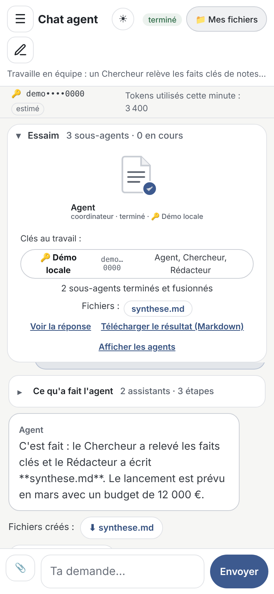 |  |

### Auto-vérification, relais, mémoire par le sens et API métier (0.9)

- **Vérifier la réponse avant de l'envoyer** (panneau du chat, ou Réglages → Vérification ; désactivé par défaut car chaque vérification coûte un appel au modèle). Après le brouillon de réponse finale, un *Critique* (même modèle, sans outils, consigne courte) vérifie les critères que tu as demandés, la cohérence avec les actions vraiment faites et la langue. Verdict `ok` → la réponse part ; `revise` → les problèmes sont rendus à l'agent, qui corrige sa réponse, 1 à 3 tours au plus (`POST /settings {"critic": true, "critic_rounds": 2}`). Une vérification illisible ou en échec ne bloque jamais la réponse. Chaque vérification est une ligne dans le déroulé et une carte 🔎 (avec sa note) dans le graphe des agents.
- **Relais** : l'outil `handoff` (`to`, `brief`) passe toute la tâche à un spécialiste avec la demande et le travail déjà fait ; le spécialiste répond directement et sa réponse devient celle de l'agent (vérifiée aussi par le Critique s'il est activé). Les chaînes comme Agent → Codeur → Testeur → Critique marchent ; 4 relais au plus par tâche, un agent ne peut pas passer la main à son propre rôle, et si le spécialiste ne finit pas, le travail revient. Le graphe marque ces cartes « relais ». Utilise la permission `delegate` comme les sous-agents.
- **Mémoire par le sens** : `memory_recall` mélange le sens et les mots-clés (0,65 × cosinus + 0,35 × mots-clés) quand une clé a **embeddings** coché (Réglages → Clés d'API) (n'importe quel `POST /embeddings` compatible OpenAI). Les vecteurs sont dans `memory/vectors.sqlite3` (`sqlite3` de la bibliothèque standard, sans serveur), calculés une fois par note et refaits si le modèle change. Sans clé d'embeddings, ou si le service échoue, la recherche se fait par mots-clés comme avant. Groq n'a pas d'embeddings : ajoute par exemple une clé OpenAI, Mistral ou locale (Ollama / LM Studio) avec « embeddings » coché. `GET /health` affiche `memory.semantic`.
- **API métier** (Connexion → 🔌 Mes API, ou `GET/POST /app/apis`, `POST /app/apis/<id>`, `POST /app/apis/<id>/delete`) : nom, URL de base, nom et valeur de l'en-tête d'authentification (rangée dans le coffre comme les clés, affichée seulement masquée, jamais envoyée au modèle, retirée des réponses), URL OpenAPI JSON facultative (les points d'accès sont listés à l'agent). Outils : `api_list` (lecture), `api_get` (réseau ; demande à chaque fois sauf si « L'agent peut lire (GET) sans me demander » est coché pour cette API), `api_send` (envoi : POST/PUT/PATCH/DELETE, carte d'accord), `api_pay` (dépense, pour les API marquées « peut dépenser de l'argent » ; jamais automatique, bloqué tant que `spend` vaut `deny`, la valeur par défaut). Chemins seulement : l'agent ne peut pas sortir de l'URL de base (pas d'autre hôte, pas de `../`).

### Tests

```bash
python -m pytest -q
```

La CI (GitHub Actions) lance les tests sous Python 3.10 à 3.13, avec et sans PyYAML, plus un essai
de bout en bout hors ligne avec le backend mock, et une compilation de l'application de bureau
(PyInstaller) lancée puis vérifiée via `/health`. Pousser une étiquette `v*` lance
`.github/workflows/release.yml` : versions Windows et macOS, chacune testée, jointes à une Release GitHub.

### Limites (honnêtement)

- **0.9** : le Critique est le même modèle que l'agent : il repère les oublis et les erreurs de langue, pas toutes les erreurs de fond, et chaque tour coûte un appel au modèle (avec une clé Groq gratuite, attends-toi à des pauses de limite). La mémoire par le sens demande une clé avec « embeddings » coché (Groq n'en a pas). API métier : JSON / texte seulement, un seul en-tête d'authentification, pas de flux OAuth, pas d'envoi de fichiers ; OpenAPI lu une fois (JSON seulement, pas YAML). Les modèles font parfois eux-mêmes le travail du spécialiste au lieu de passer la main.
- **Langue et nouvelles tentatives (0.8.2)** : la langue d'une demande est devinée d'après des mots courants
  et les accents (français / anglais seulement) ; un message très court ou mélangé garde la langue du tour
  précédent, sinon celle de l'application. Le modèle peut encore glisser de l'anglais dans les sorties
  d'outils ou les commentaires de code. Une action mal formée est redemandée 3 fois ; ensuite l'assistant (ou
  la tâche) s'arrête avec l'erreur du fournisseur. Le confinement du mode développeur couvre les outils
  fichiers et les commandes du bac à sable qui créent, déplacent ou suppriment des fichiers ; bac à sable
  désactivé, le shell n'est pas confiné, et un programme Python lancé dans le bac à sable peut encore écrire
  ailleurs dans le dossier de travail.
- **Limites de débit (0.8.1)** : avec une seule clé, la tâche attend au lieu de s'arrêter (60 s max par
  pause, 6 pauses par demande, rien au-delà de 5 min d'attente) ; une longue pause rend quand même la tâche
  plus lente. Le compteur de tokens par minute affiche les chiffres du fournisseur après la première réponse ;
  avant, et pour les fournisseurs sans en-têtes `x-ratelimit-*`, c'est une estimation (Groq : 8 000
  tokens/minute supposés). Le mode clé unique `.env` (sans clé dans Réglages) attend aussi mais sans compteur.
- **Aucun audit de sécurité n'a été fait.** C'est un petit projet pédagogique.
- **Le shell est dangereux si tu le mets en `allow`.** Les motifs de commandes interdites sont une
  ceinture de sécurité facile à contourner (`bash -c`, scripts, alias…). Pour des tâches non fiables,
  lance l'agent dans un conteneur ou une VM.
- Bac à sable **désactivé** : le confinement vaut pour les outils fichiers seulement, et le shell accède à
  tout ce que ton utilisateur peut atteindre. **Activé** : le hook d'audit Python est un garde-fou pour un
  assistant qui se trompe, pas une prison contre du code hostile : un hook d'audit peut en théorie être
  contourné depuis Python, les limites processeur/mémoire n'existent que sous POSIX (pas Windows), et
  l'installation de Python reste lisible. Pour du code non fiable, utilise un conteneur ou une VM.
- Mode développeur : modèles volontairement minimes (pas de npm, pas de compilation, bibliothèque standard
  seulement) ; le contrôle du site est statique (il n'exécute pas le JavaScript de la page) ; les versions
  de bureau ont besoin d'un Python 3 installé sur l'ordinateur pour lancer les projets Python (pytest
  seulement s'il est installé, sinon unittest).
- Le masquage des secrets repose sur des motifs : un format inconnu peut passer.
- Le contenu web peut contenir de l'injection de prompt ; le prompt système prévient le modèle, il ne l'empêche pas.
- Le rappel mémoire est une simple recherche par mots-clés, sans embeddings.
- `web_search` lit une page HTML publique et peut être bloqué ; préfère `web_fetch` sur des URL connues.
- La qualité dépend beaucoup du modèle ; les petits modèles locaux appellent souvent mal les outils.
- Les versions de bureau ne sont **pas signées** (avertissements SmartScreen / Gatekeeper), assez lourdes
  (Python est inclus, ~10–30 Mo) et distinctes pour Mac puce Apple et Intel. Certains antivirus signalent
  à tort les exécutables PyInstaller non signés (faux positifs).
- Accès distant : les sessions sont en mémoire (un redémarrage déconnecte les téléphones) ; pas de TLS
  intégré (utilise un tunnel) ; pas testé avec toutes les configurations de tunnel/proxy ; hors ligne,
  la PWA n'affiche que l'enveloppe des pages.
- Page Réglages : sous Windows, le fichier privé des clés repose sur les droits de ton dossier
  utilisateur (0600 est un mode POSIX) ; le trousseau du système n'est utilisé que si le paquet Python
  `keyring` est installé (il n'est pas inclus dans les versions de bureau). **Tester la clé** ne vérifie
  que le point `/models` du fournisseur, pas l'accès à un modèle précis. Redémarrer depuis Réglages
  annule les tâches en cours. Les messages de validation du serveur sont en anglais.
- Thème jour : contraste WCAG AA vérifié sur les couleurs de texte principales et visuellement sur chaque
  page, mais pas audité avec un lecteur d'écran ; le choix du thème est gardé par navigateur (Réglages fixe
  la valeur par défaut).
- Ce projet est indépendant : ce n'est **pas** Grok Bot et il ne le reproduit pas.
- Réserve de clés : le travail d'un assistant est deviné d'après des mots-clés de sa tâche (EN/FR), et la
  proposition « rapide / puissant » d'après le service et le nom du modèle : ce sont des heuristiques,
  modifiables dans Réglages. La réserve vit dans l'application en cours (un seul processus) ; un
  assistant garde sa clé pendant son travail. Les clés collées sont masquées (interception du collage et
  `-webkit-text-security`) ; dans un navigateur sans ce CSS (ancien Firefox), les caractères **tapés**
  directement dans la zone de collage restent visibles jusqu'à Entrée : tape plutôt dans les lignes
  « + Ajouter une autre clé » (champs mot de passe).

### Licence

MIT — voir [LICENSE](LICENSE).
