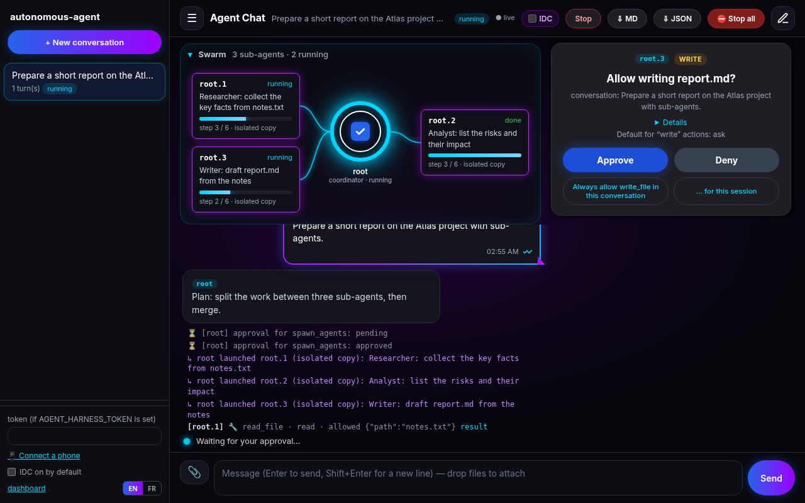
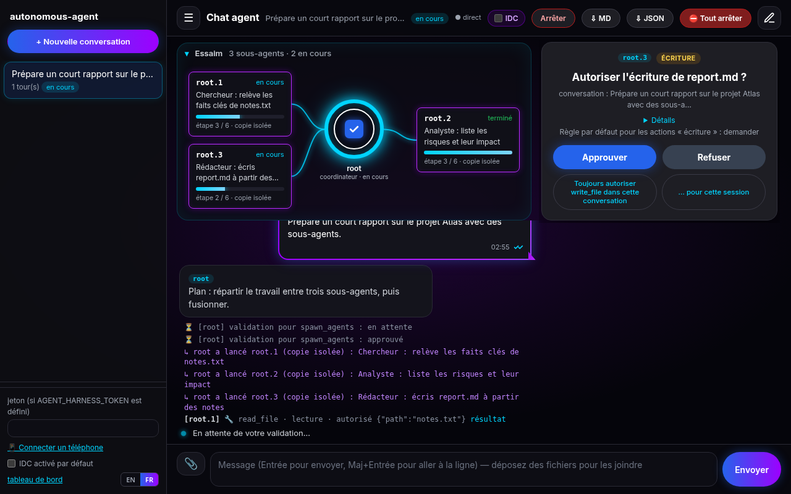

# Architecture / Architecture

**[English](#english) | [Français](#francais)** · [← README](../README.md) · [Docs](README.md)

<a id="english"></a>

## English

### At a glance

- **Agent loop**: plan → tool call → observation → … → answer, with hard limits (steps, tool calls,
  tokens), a "no progress" stop and a pluggable stop rule.
- **15 tools**: files (`read_file`, `list_files`, `search_files`, `write_file`, `edit_file`), `shell`,
  web (`web_fetch`, `web_search`), GitHub (`github_get`, `github_write`), memory (`memory_write`,
  `memory_recall`, `memory_forget`) and skills (`list_skills`, `load_skill`). On top of them,
  `spawn_agent` / `spawn_agents` launch sub-agents.
- **Risk categories**: `read`, `write`, `execute`, `network`, `send`, `spend`, `delegate`. Each one is
  `allow`, `ask` or `deny` in `permissions.yaml`, and deny patterns always win.
- **Audit**: append-only `audit.jsonl`, one line per tool call, secrets redacted.
- **Memory and skills**: plain files; skill bodies are loaded on demand.
- **Swarm**: `spawn_agent` / `spawn_agents`, with depth, count and budget limits. Children inherit the
  parent's permissions and never get more. Read-only children run in parallel. Writing children run in
  parallel in **isolated copies** that are merged back file by file, and conflicts are kept as
  `.conflict-*` files.
- **IDC mode** (optional, off by default): a vitality budget that decays with every step, append-only
  commitments, and a forced "good enough now" answer; saying "I don't know" costs less than an
  unsupported claim. A hypothesis to test, see [IDC mode](swarm.md#idc-mode-optional-off-by-default).
- **Harness** (`python -m agent serve`):
  - calm web chat (day / night) with **approval cards that ask a plain question** ("Allow writing report.md?"),
    a **live swarm graph** of the sub-agents, and several conversations running in parallel;
  - **attachments**;
  - **several API keys per category with hard limits**, pasted all at once, **one key per helper** matched to
    its job (research, writing, code…), so helpers work in parallel;
  - **persistence** (SQLite), **live updates** (SSE) and **⛔ Stop all**;
  - remembered approvals (never for send/spend) and a **dashboard** (usage per agent, quotas, health);
  - **Markdown/JSON export**, **scheduled tasks** and an **EN/FR interface**.

| English | Français |
|---|---|
|  |  |

**Quick start (advanced: command line)**

The desktop app above needs none of this. From a clone:

```bash
git clone https://github.com/lanoixdesign/autonomous-agent.git && cd autonomous-agent
python -m agent run "List the files" --provider mock --offline   # no key, no network
cp docs/examples/.env.example .env    # add GROQ_API_KEY / OPENAI_API_KEY / OPENROUTER_API_KEY, or use Ollama
python -m agent chat --workspace ~/project
python -m agent serve --workspace ~/project   # then open http://127.0.0.1:8765/ : wizard + ⚙ Settings
```

Several keys: `cp docs/examples/providers.example.yaml providers.yaml` (git-ignored). The file holds only the
**names** of environment variables, never the keys. `python -m agent keys` shows the remaining quotas,
with keys masked.

**Safety caveats, read before use**
- Tested with the mock backend and fake providers only, not against real providers in CI. A security audit was done in 0.9.3: see [SECURITY.md](SECURITY.md).
- The isolated copy protects files, but it is **not a sandbox**: `shell` can still reach anything your
  user can. Run untrusted tasks in a container or VM.
- The isolated copies are merged **file by file**: no line-level merge, and conflicting files are left
  for you to resolve.
- Pending approvals live in memory: **they are lost on restart**, and the turn becomes `interrupted`.
- Image, speech and embedding services are **stubs** (routed and limited, but not implemented).
- The harness is a local, single-user tool: no accounts, no TLS. Keep it on 127.0.0.1, or set
  `AGENT_HARNESS_TOKEN`.

### Harness (local server, chat, approvals)

`python -m agent serve` starts a local harness: conversations run in background threads, sub-agents
included, and every `ask` goes to an **approval queue** instead of the terminal. Standard library only
(`http.server` + `threading`).

```bash
python -m agent serve --workspace ~/project --port 8765          # then open http://127.0.0.1:8765/
AGENT_HARNESS_TOKEN=change-me python -m agent serve --approval-timeout 120 --max-parallel 3 --max-tasks 4
```

**Chat** (`/` or `/chat`): type a message to start a conversation, or to continue the selected one
(same agent, history kept). Agent messages, tool steps, sub-agent launches, merges and conflicts appear
as chat bubbles labelled with the agent id (`root`, `root.1`, `root.1.2`…). Pending approvals pop up as
cards (top right) showing the agent id, the tool, the risk category and the arguments (secrets
redacted); several can be pending at once and each is answered on its own. The sidebar lists the
conversations, which can run at the same time (at most `--max-tasks`, default 4; the others wait as
`queued`). `/dashboard` keeps the compact view (agent tree + event log) plus usage, schedules, rules and health.
The chat gets events live (Server-Sent Events) and falls back to polling.

Because the harness can take several approvals at once, **writing sub-agents run in parallel** there,
each in its isolated copy (see above).

**Attachments**: the 📎 button or drag-and-drop (several files at once). Files show as chips before
sending, then as attachments in your bubble. They are saved under
`<workspace>/uploads/<conversation id>/`, and the agent's message gets the list of their
workspace-relative paths (small text files are also inlined), so it can open them with `read_file`.
- names are reduced to a plain file name (no directories, `..`, absolute paths, leading dot or control
  characters); files are created without following symlinks and never overwrite (`notes-1.md`); a
  symlinked `uploads/` directory is refused;
- `--max-upload-mb` per file (default 20) and `--max-message-mb` per message (default 50) → HTTP 413;
- same token / same-origin checks as the other POSTs; each file is audit-logged (`event: upload`,
  path, size, sha256).

| | |
|---|---|
| `POST /tasks` `{"task": "..."}` | start a conversation → `{"id": ...}` |
| `POST /tasks/{id}/messages` `{"text": "..."}` | continue it (409 while a turn is running) |
| `"files": [{"name": "a.md", "content_b64": "..."}]` | optional on both: attachments (base64 in the JSON body) · `GET /config`: limits |
| `GET /tasks` · `GET /tasks/{id}` | list · one task: status, result, usage, agent tree |
| `GET /tasks/{id}/events?since=N` | events (audit lines, messages, approvals) from N, for polling |
| `POST /tasks/{id}/cancel` | stop at the next step; its pending approvals are denied |
| `GET /approvals` (`?all=1`) · `POST /approvals/{id}` `{"decision": "approve"\|"deny"}` | approval queue |
| `GET /tasks/{id}/stream` | the same events pushed live (Server-Sent Events) |
| `POST /approvals/{id}` `{"decision": "approve", "remember": "conversation"\|"session"}` | approve and remember · `GET /rules` · `POST /rules/{id}/revoke` |
| `POST /stop-all` (`{"disable_schedules": true}`) | emergency stop |
| `GET /usage` | tokens, cost, steps per conversation and per agent, plus key quotas |
| `GET /tasks/{id}/export?format=md\|json` | conversation + audit trail |
| `GET /schedules` · `POST /schedules` · `POST /schedules/{id}` `{"enabled": false}` · `…/run` · `…/delete` | scheduled prompts |
| `GET /health` (`?check=1`) | status, masked keys, backend reachability |

```bash
curl -s -X POST localhost:8765/tasks -H 'Content-Type: application/json' -d '{"task":"Summarise notes.md"}'
curl -s localhost:8765/approvals
curl -s -X POST localhost:8765/approvals/<id> -H 'Content-Type: application/json' -d '{"decision":"approve"}'
```

- **No answer = deny**: an approval waits `--approval-timeout` seconds (default 300), then is refused.
- Binds **127.0.0.1** by default. With `AGENT_HARNESS_TOKEN` set, every API call needs
  `Authorization: Bearer <token>` (paste it in the page's token field). Binding another host needs a
  token and prints a loud plain-HTTP warning; for phone access use `--remote` (see *Use from your phone*).
  POSTs must be JSON and same-origin, and the `Host` header is checked on localhost.
- Same `permissions.yaml`, memory and `audit.jsonl` as the CLI (harness lines carry a `task_id`).
  Terminal mode (`run`, `chat`) is unchanged.
- Not a multi-user server: no accounts, no TLS. Ctrl+C / SIGTERM cancel running turns and remove
  temp copies; conversations are kept on disk (see below) unless `--no-persist`.

**English / French**: the chat and the dashboard have an **EN | FR** switch (bottom of the chat
sidebar, top of the dashboard). The default follows the browser (`navigator.language` starting with
`fr` gives French, anything else English). The choice is remembered (localStorage), and `?lang=fr` or
`?lang=en` in the URL forces it (`http://127.0.0.1:8765/?lang=fr`). All texts come from one dictionary
per language in `agent/i18n.py`; tool names, API fields and server messages are unchanged.
The Markdown export follows the page language (`/tasks/{id}/export?format=md&lang=fr`). In the
terminal, `--lang fr` or `AGENT_LANG=fr` translates the approval prompt (`[o]ui / [n]on / [t]oujours`)
and the `keys` output.

#### Persistence, live updates and control

- **Persistence**: conversations (with the agent's history), their events, schedules and
  conversation-scoped rules are saved in SQLite (`<state-dir>/harness.sqlite3`, mode 0600, redacted,
  `--db PATH` to move it, `--no-persist` to keep everything in memory). They come back on restart, and
  the conversation can be continued. A turn that was running when the process died is marked
  **`interrupted`** (its approvals are gone, nothing is resumed on its own).
- **Live updates**: the chat listens to `GET /tasks/{id}/stream` (SSE; resumes with `Last-Event-ID` or
  `?since=N`; with a token, `?access_token=` is accepted on this route only because `EventSource`
  cannot send headers). If the stream fails, the page falls back to polling `/events` (the top bar shows
  `● live` or `○ polling`).
- **Emergency stop**: the **⛔ Stop all** button (chat and dashboard) or `POST /stop-all` cancels every
  unfinished task and denies every pending approval at once. The button also pauses all schedules
  (`"disable_schedules": true`). Audit-logged (`event: stop_all`).
- **Remembered approvals**: an approval card offers *Always allow `<tool>` in this conversation* or
  *… for this session*. Rules only answer what would otherwise be asked (`ask`): they never override
  a `deny`, and **never apply to `send` or `spend`**, which are asked every time (the card does not
  offer it and the API returns 400). A rule matches one tool and category, for every agent of the
  conversation, sub-agents included. Session rules end when the server stops; conversation rules are
  persisted. You can see and revoke them on the dashboard (`GET /rules`, `POST /rules/{id}/revoke`).
  Audit: `rule_created`, `rule_applied` (each use), `rule_revoked`.
- **Usage dashboard** (`/dashboard`, `GET /usage`): steps, tool calls, tokens and cost per
  conversation and per agent. *Inclusive* numbers include sub-agents; *own* numbers do not. Per-key
  quotas are shown too. Cost is known when the key router has `pricing`; it is 0 in single-key mode.
- **Export**: the chat's **⇩ MD / ⇩ JSON** buttons, or `GET /tasks/{id}/export?format=md|json`, export
  the conversation, usage, events and the audit lines of this conversation (secrets redacted).
- **Scheduled tasks** (dashboard, or `POST /schedules` with `{"prompt": "...", "every_minutes": 60}` or
  `{"prompt": "...", "daily_at": "08:30"}` in local time). Each run starts a **new conversation**
  (`source: schedule:<id>`) through the same permissions, approvals, budgets, key limits and
  `--max-tasks` as a chat message. A run is skipped while the previous one is still active. You can
  enable, disable, run now or delete a schedule. Schedules are persisted, and missed runs are not
  replayed in a burst. Audit: `schedule_created`, `schedule_run`, `schedule_skipped`…
- **`GET /health`**: status, uptime, tasks by status, pending approvals, persistence, and the keys
  (**masked**), or the `.env` provider and model. No network by default. `?check=1` sends a
  `GET <base_url>/models` **without any API key** to each backend and reports whether it is reachable.

---

<a id="francais"></a>

## Français

### En bref

- **Boucle d'agent** : plan → appel d'outil → observation → … → réponse, avec des limites strictes
  (pas, appels d'outils, jetons), un arrêt « pas de progrès » et une règle d'arrêt personnalisable.
- **15 outils** : fichiers (`read_file`, `list_files`, `search_files`, `write_file`, `edit_file`),
  `shell`, web (`web_fetch`, `web_search`), GitHub (`github_get`, `github_write`), mémoire
  (`memory_write`, `memory_recall`, `memory_forget`) et compétences (`list_skills`, `load_skill`). En
  plus, `spawn_agent` / `spawn_agents` lancent des sous-agents.
- **Catégories de risque** : `read`, `write`, `execute`, `network`, `send`, `spend`, `delegate`. Chacune
  est `allow`, `ask` ou `deny` dans `permissions.yaml`, et les motifs de refus l'emportent toujours.
- **Audit** : `audit.jsonl` en ajout seul, une ligne par appel d'outil, secrets masqués.
- **Mémoire et compétences** : fichiers simples ; le contenu des compétences est chargé à la demande.
- **Essaim** : `spawn_agent` / `spawn_agents`, avec des limites de profondeur, de nombre et de budget.
  Les enfants héritent des permissions du parent, jamais plus. Les enfants en lecture seule tournent en
  parallèle. Ceux qui écrivent tournent en parallèle dans des **copies isolées**, fusionnées fichier par
  fichier, et les conflits sont gardés en fichiers `.conflict-*`.
- **Mode IDC** (facultatif, désactivé par défaut) : un budget de vitalité qui baisse à chaque étape, des
  engagements en ajout seul et une réponse forcée « assez bonne maintenant » ; dire « je ne sais pas »
  coûte moins cher qu'une affirmation non étayée. Une hypothèse à tester, voir
  [Mode IDC](swarm.md#mode-idc-facultatif-désactivé-par-défaut).
- **Harness** (`python -m agent serve`) :
  - chat web calme (jour / nuit) avec des **cartes de validation qui posent une question claire**
    (« Autoriser l'écriture de report.md ? »), un **graphe de l'essaim en direct** et plusieurs conversations en parallèle ;
  - **pièces jointes** ;
  - **plusieurs clés d'API par catégorie avec limites strictes**, collées d'un coup, **une clé par assistant**
    selon son travail (recherche, rédaction, code…), pour que les assistants travaillent en parallèle ;
  - **persistance** (SQLite), **direct** (SSE) et **⛔ Tout arrêter** ;
  - validations retenues (jamais pour send/spend) et un **tableau de bord** (consommation par agent,
    quotas, état du serveur) ;
  - **export Markdown/JSON**, **tâches planifiées** et une **interface EN/FR**.

| English | Français |
|---|---|
|  |  |

**Démarrage rapide (avancé : ligne de commande)**

L'application de bureau ci-dessus n'en a pas besoin. Depuis un clone :

```bash
git clone https://github.com/lanoixdesign/autonomous-agent.git && cd autonomous-agent
python -m agent run "Liste les fichiers" --provider mock --offline   # sans clé ni réseau
cp docs/examples/.env.example .env    # ajoute GROQ_API_KEY / OPENAI_API_KEY / OPENROUTER_API_KEY, ou Ollama
python -m agent chat --workspace ~/projet
python -m agent serve --workspace ~/projet   # puis http://127.0.0.1:8765/ : assistant + ⚙ Réglages
```

Plusieurs clés : `cp docs/examples/providers.example.yaml providers.yaml` (ignoré par git). Le fichier ne contient
que les **noms** des variables d'environnement, jamais les clés. `python -m agent keys` affiche les
quotas restants, clés masquées.

**Précautions, à lire avant usage**
- Testé uniquement avec le backend mock et de faux fournisseurs, pas avec de vrais fournisseurs en CI.
  **Aucun audit de sécurité n'a été fait.**
- La copie isolée protège les fichiers, mais ce **n'est pas un bac à sable** : `shell` peut atteindre
  tout ce que ton utilisateur peut atteindre. Lance les tâches non fiables dans un conteneur ou une VM.
- Les copies isolées sont fusionnées **fichier par fichier** : pas de fusion ligne à ligne, et les
  fichiers en conflit sont laissés à ton arbitrage.
- Les validations en attente vivent en mémoire : **elles sont perdues au redémarrage**, et le tour
  passe à `interrupted`.
- Les services d'image, de voix et d'embeddings sont des **bouchons** (routés et limités, mais pas
  implémentés).
- Le harness est un outil local à un seul utilisateur : pas de comptes, pas de TLS. Garde-le sur
  127.0.0.1, ou définis `AGENT_HARNESS_TOKEN`.

### Harness (serveur local, chat, validations)

`python -m agent serve` lance un harness local : les conversations tournent en arrière-plan dans des
threads, sous-agents compris, et chaque `ask` part dans une **file de validation** au lieu du terminal.
Bibliothèque standard uniquement (`http.server` + `threading`).

```bash
python -m agent serve --workspace ~/projet --port 8765          # puis ouvrir http://127.0.0.1:8765/
AGENT_HARNESS_TOKEN=a-changer python -m agent serve --approval-timeout 120 --max-parallel 3 --max-tasks 4
```

**Chat** (`/` ou `/chat`) : tape un message pour lancer une conversation, ou pour continuer celle qui
est sélectionnée (même agent, historique conservé). Les messages des agents, les étapes d'outils, les
lancements de sous-agents, les fusions et les conflits s'affichent en bulles marquées de l'identifiant
de l'agent (`root`, `root.1`, `root.1.2`…). Les validations en attente apparaissent en cartes (en haut à
droite) avec l'agent, l'outil, la catégorie de risque et les arguments (secrets masqués) ; plusieurs
peuvent attendre en même temps et chacune se traite séparément. La barre latérale liste les
conversations, qui peuvent tourner en même temps (au plus `--max-tasks`, 4 par défaut ; les autres
attendent en `queued`). `/dashboard` garde la vue compacte (arbre des agents + journal), avec en plus la consommation, les
planifications, les règles et l'état du serveur. Le chat reçoit les événements en direct
(Server-Sent Events) et repasse à l'interrogation régulière en cas d'échec.

Comme le harness accepte plusieurs validations à la fois, **les sous-agents qui écrivent tournent en
parallèle** avec lui, chacun dans sa copie isolée (voir plus haut).

**Pièces jointes** : bouton 📎 ou glisser-déposer (plusieurs fichiers à la fois). Les fichiers
apparaissent en pastilles avant l'envoi, puis en pièces jointes dans ta bulle. Ils sont enregistrés
dans `<workspace>/uploads/<id conversation>/`, et le message reçu par l'agent contient la liste de leurs
chemins relatifs à l'espace de travail (les petits fichiers texte sont aussi recopiés), pour qu'il les
ouvre avec `read_file`.
- les noms sont réduits à un simple nom de fichier (pas de dossiers, de `..`, de chemin absolu, de point
  initial ni de caractères de contrôle) ; les fichiers sont créés sans suivre de lien symbolique et
  n'écrasent jamais rien (`notes-1.md`) ; un dossier `uploads/` qui serait un lien symbolique est refusé ;
- `--max-upload-mb` par fichier (20 par défaut) et `--max-message-mb` par message (50 par défaut) → HTTP 413 ;
- mêmes contrôles de jeton / même origine que les autres POST ; chaque fichier est journalisé dans
  l'audit (`event: upload`, chemin, taille, sha256).

| | |
|---|---|
| `POST /tasks` `{"task": "..."}` | lance une conversation → `{"id": ...}` |
| `POST /tasks/{id}/messages` `{"text": "..."}` | la continue (409 pendant qu'un tour est en cours) |
| `"files": [{"name": "a.md", "content_b64": "..."}]` | facultatif sur les deux : pièces jointes (base64 dans le JSON) · `GET /config` : limites |
| `GET /tasks` · `GET /tasks/{id}` | liste · une tâche : statut, résultat, consommation, arbre des agents |
| `GET /tasks/{id}/events?since=N` | événements (lignes d'audit, messages, validations) depuis N, à interroger régulièrement |
| `POST /tasks/{id}/cancel` | arrêt au pas suivant ; ses validations en attente sont refusées |
| `GET /approvals` (`?all=1`) · `POST /approvals/{id}` `{"decision": "approve"\|"deny"}` | file de validation |
| `GET /tasks/{id}/stream` | les mêmes événements, poussés en direct (Server-Sent Events) |
| `POST /approvals/{id}` `{"decision": "approve", "remember": "conversation"\|"session"}` | valider et retenir · `GET /rules` · `POST /rules/{id}/revoke` |
| `POST /stop-all` (`{"disable_schedules": true}`) | arrêt d'urgence |
| `GET /usage` | jetons, coût, pas par conversation et par agent, quotas des clés |
| `GET /tasks/{id}/export?format=md\|json` | conversation + piste d'audit |
| `GET /schedules` · `POST /schedules` · `POST /schedules/{id}` `{"enabled": false}` · `…/run` · `…/delete` | tâches planifiées |
| `GET /health` (`?check=1`) | état, clés masquées, joignabilité du backend |

```bash
curl -s -X POST localhost:8765/tasks -H 'Content-Type: application/json' -d '{"task":"Résume notes.md"}'
curl -s localhost:8765/approvals
curl -s -X POST localhost:8765/approvals/<id> -H 'Content-Type: application/json' -d '{"decision":"approve"}'
```

- **Pas de réponse = refus** : une validation attend `--approval-timeout` secondes (300 par défaut), puis est refusée.
- Écoute sur **127.0.0.1** par défaut. Si `AGENT_HARNESS_TOKEN` est défini, chaque appel d'API exige
  `Authorization: Bearer <jeton>` (à coller dans le champ « token » de la page). Écouter sur une autre
  adresse exige un jeton et affiche un avertissement « HTTP en clair » ; pour le téléphone, utilise
  `--remote` (voir *Utiliser depuis le mobile*).
  Les POST doivent être en JSON et de même origine, et l'en-tête
  `Host` est vérifié en local.
- Mêmes `permissions.yaml`, mémoire et `audit.jsonl` que la CLI (les lignes du harness portent un
  `task_id`). Le mode terminal (`run`, `chat`) ne change pas.
- Ce n'est pas un serveur multi-utilisateur : pas de comptes, pas de TLS. Ctrl+C / SIGTERM annulent
  les tours en cours et suppriment les copies temporaires ; les conversations sont gardées sur disque
  (voir ci-dessous), sauf avec `--no-persist`.

**Français / anglais** : le chat et le tableau de bord ont un sélecteur **EN | FR** (en bas de la
barre latérale du chat, en haut du tableau de bord). Par défaut, la langue suit le navigateur
(`navigator.language` qui commence par `fr` donne le français, sinon l'anglais). Le choix est retenu
(localStorage), et `?lang=fr` ou `?lang=en` dans l'adresse l'impose (`http://127.0.0.1:8765/?lang=fr`).
Tous les textes viennent d'un dictionnaire par langue dans `agent/i18n.py` ; les noms d'outils, les
champs de l'API et les messages du serveur ne changent pas. L'export Markdown suit la langue de la page
(`/tasks/{id}/export?format=md&lang=fr`). Dans le terminal, `--lang fr` ou `AGENT_LANG=fr` traduit la
question de validation (`[o]ui / [n]on / [t]oujours`) et la sortie de `keys`.

#### Persistance, direct et contrôle

- **Persistance** : les conversations (avec l'historique de l'agent), leurs événements, les
  planifications et les règles de conversation sont enregistrés dans SQLite
  (`<state-dir>/harness.sqlite3`, droits 0600, contenu masqué ; `--db CHEMIN` pour le déplacer,
  `--no-persist` pour tout garder en mémoire). Ils reviennent au redémarrage et la conversation peut
  continuer. Un tour qui tournait quand le processus s'est arrêté net est marqué **`interrupted`** (ses
  validations sont perdues et rien ne reprend tout seul).
- **Direct** : le chat écoute `GET /tasks/{id}/stream` (SSE ; reprise avec `Last-Event-ID` ou
  `?since=N`). Avec un jeton, `?access_token=` est accepté sur cette route uniquement, car
  `EventSource` ne peut pas envoyer d'en-têtes. Si le flux échoue, la page repasse à l'interrogation de
  `/events` (la barre du haut affiche `● live` ou `○ polling`).
- **Arrêt d'urgence** : le bouton **⛔ Stop all** (chat et tableau de bord) ou `POST /stop-all` annule
  toutes les tâches non terminées et refuse d'un coup toutes les validations en attente. Le bouton met
  aussi en pause toutes les planifications (`"disable_schedules": true`). L'arrêt est journalisé
  (`event: stop_all`).
- **Validations retenues** : une carte propose *Toujours autoriser `<outil>` dans cette conversation*
  ou *… pour cette session*. Une règle ne répond qu'à ce qui serait demandé (`ask`) : elle ne lève
  jamais un `deny` et **ne s'applique jamais à `send` ni à `spend`**, qui sont demandés à chaque fois (la
  carte ne le propose pas et l'API répond 400). Une règle vise un outil et une catégorie, pour tous les
  agents de la conversation, sous-agents compris. Les règles de session s'arrêtent avec le serveur ;
  celles de conversation sont enregistrées. On les voit et on les révoque dans le tableau de bord
  (`GET /rules`, `POST /rules/{id}/revoke`). Audit : `rule_created`, `rule_applied` (à chaque
  utilisation), `rule_revoked`.
- **Tableau de consommation** (`/dashboard`, `GET /usage`) : pas, appels d'outils, jetons et coût par
  conversation et par agent. Les chiffres *inclusifs* comptent les sous-agents, les chiffres *propres*
  non. Les quotas par clé sont affichés aussi. Le coût est connu si le routeur de clés a un `pricing` ;
  il vaut 0 en mode clé unique.
- **Export** : boutons **⇩ MD / ⇩ JSON** du chat, ou `GET /tasks/{id}/export?format=md|json`. On
  obtient la conversation, la consommation, les événements et les lignes d'audit de cette conversation
  (secrets masqués).
- **Tâches planifiées** (tableau de bord, ou `POST /schedules` avec
  `{"prompt": "...", "every_minutes": 60}` ou `{"prompt": "...", "daily_at": "08:30"}` en heure locale).
  Chaque exécution ouvre une **nouvelle conversation** (`source: schedule:<id>`). Elle passe par les
  mêmes permissions, validations, budgets, limites de clés et `--max-tasks` qu'un message du chat. Une
  exécution est sautée tant que la précédente n'est pas finie. On peut activer, désactiver, lancer tout
  de suite ou supprimer une planification. Les planifications sont enregistrées, et les exécutions
  manquées ne sont pas rejouées en rafale. Audit : `schedule_created`, `schedule_run`,
  `schedule_skipped`…
- **`GET /health`** : état, durée de fonctionnement, tâches par statut, validations en attente,
  persistance, et clés (**masquées**) ou fournisseur et modèle du `.env`. Aucun accès réseau par défaut.
  `?check=1` envoie un `GET <base_url>/models` **sans aucune clé d'API** à chaque backend et indique
  s'il répond.
