# Version history / Historique des versions

**[English](#english) | [Français](#francais)** · [← README](../README.md) · [Docs](README.md)

## English

Every release with its files and notes: [GitHub Releases](https://github.com/lanoixdesign/autonomous-agent/releases). Latest notes: [packaging/RELEASE_NOTES.md](../packaging/RELEASE_NOTES.md).

#### UI Bricks, todo.md and GitHub Community Hub (new in 0.9.22)

🧩 **Self-extending UI with Bricks & Skills**: The agent can code interactive widgets (`brick_create`) mounted live in the chat dock, or register reusable skills (`skill_create`).
📋 **Backlog with todo.md**: Missing capabilities or requests the assistant doesn't yet know how to perform are recorded in `todo.md` (`todo_add`), and can be automatically handed off to builder sub-agents.
🌐 **Daily GitHub Community Sync**: Daily checks of shared skills and UI bricks, allowing 1-click integration into the user's interface.
🚀 **GitHub Release & Sharing**: Local bricks and skills can be published to GitHub with explicit user confirmation (`github_publish`).

#### Friendly mascots (new in 0.9.17)

😊 Each assistant in the grid is now a little character in the shape of the app's logo (a ring around a rounded
square), with two simple eyes. They blink while they work, look aside while they wait, smile when they are done,
and look sad if something failed. A small mascot also greets you on the welcome screen and on an empty chat.

#### A grid of assistants (new in 0.9.16)

🟦 During a team of assistants, each one is a **small square**. The square **fills from the bottom** as the work
advances; a check appears when it is done, a muted red border if it failed. Hover (or tap) to see what it is
doing; click to open its history.

#### Gemini, a free key for code and images (new in 0.9.15)

✨ The welcome screen offers a third choice: **Free Gemini key (recommended for code and images)**. A free key from
[Google AI Studio](https://aistudio.google.com/apikey). Default model: **gemini-3.8-flash** (free tier), used for
multi-step tasks, code, and looking at pictures you attach. Creating a new image is not offered: it needs a paid
Google plan. See [Gemini](gemini.md).

#### The app in its own window (new in 0.9.14)

🪟 The desktop app opens in its own **AutonomousAgent** window instead of a browser tab (WKWebView on Mac, Edge
WebView2 on Windows). Closing the window stops the app. Links to other sites still open in your browser. If the
window cannot open, the browser opens as before; `--browser` (or `AGENT_BROWSER=1`) forces the browser.
Phone access is unchanged.

#### A new version always starts (new in 0.9.13)

🔁 Opening a new version while an old one still runs in the background now closes the old one and starts the new
one (before, the browser silently reopened the OLD version). Same version: it just opens. Port taken by another
program: another port is used. Damaged or old settings and history files are kept aside (`*.broken-<date>`)
instead of stopping the start, and any start error opens a plain page with what to do and the log file
(`AutonomousAgent/data/app.log`, now written on Mac too). See [Updating to a new version](getting-started.md#updating-to-a-new-version).

#### A real app icon (new in 0.9.12)

The Mac app and the Windows program show the app's logo (a ring around a rounded square, on the app's muted blue)
instead of the default Python icon, and so do the browser tab and the download page.

#### My own AI with Ollama (new in 0.9.11)

🦙 The welcome screen offers two choices: **Free Groq key** or **My AI on my computer (Ollama)**. The Ollama choice
checks the address (**Check**), lists your installed models, recommends qwen2.5:7b, and warns you when a model
cannot use tools. No key is needed. See [My own AI with Ollama](ollama.md), including Shadow PC and Tailscale.

#### A cleaner approval card (new in 0.9.10)

✅ The card shows only the sentence (“The agent wants to write a file in My files”), **Allow** / **Refuse** and
the small “Don't ask me again” box. One folded **Details** link holds the plain explanation, then the tool and its
arguments. Same card for every tool, in Simple and Advanced mode.

#### Really simple (new in 0.9.9)

🧸 **Simple mode by default**: a shorter sidebar (Chat, Services, Settings, Help), a quiet top bar with one **Stop**
button while the agent works, a kind banner while no key is set, one gentle sentence instead of step counts,
approval cards in plain words (“The agent wants to write a file in My files”) with only **Allow** / **Refuse**, a
paperclip to add files, and a Services screen with only your services. Everything else is in Advanced mode. See
[Simple and Advanced mode](simple-mode.md).

#### Connected services that really work (new in 0.9.8)

🔌 Services added in **Connect > Connected services** (MCP) are now used by the assistant and its helpers:
one-click presets (My files, GitHub, any web address), a plain status with the reason when it does not work,
a Test button listing what each service can do, an On switch, approvals for anything that is not a read, and
the chat names the service used. See [Connected services](mcp.md).

#### Answers in your language (new in 0.8.2)

🗣️ The assistant, every swarm helper (Researcher, Analyst, Writer…) and the developer-mode **Coder** and
**Tester** answer in the language of your request: write in French and everything comes back in French, write
in English and it comes back in English (when a message is too short to tell, the app's language is used).
In French the app now says "tu" everywhere. Other fixes:

- 🔁 When the model sends a malformed action (Groq `tool_use_failed`), the step is asked again (up to 3 times,
  with a short correction and a lower temperature) instead of ending the task; the trace says "The model sent
  a malformed action, retrying…". Helpers always get their tools, even when the model passes an empty list.
- 📁 Developer mode keeps the Coder and Tester inside `projects/<name>/`: writes anywhere else are refused, so
  no stray files appear at the top of the work folder.
- 🛡️ Sandbox: `a && b` runs simple commands one after the other (stops at the first failure); `ls -R` lists
  subfolders; the helpers are told to run one command at a time.
- 📱 On a phone, every tab (Connect included) is visible without scrolling.
- Python template greets in one language, Groq's default model is `openai/gpt-oss-20b`, the dashboard names
  keys from Settings correctly, the swarm graph shows failed helpers and keeps earlier helpers after
  "Continue", masked keys stay readable in the history after a restart, and the coordinator always keeps
  one step for its final answer (helpers get the rest).

### Left sidebar (0.9.2)

The tab bar at the top is gone: every page now has one quiet left sidebar with an icon and a label per destination (Chat, Dashboard, Dev, Settings, Connect), the current page lightly marked with the accent. Help, the day / night theme, Simple / Expert, the language and Quit sit at the bottom. The « ‹ » button folds it to icons only (remembered in this browser; icons only by default on mid-size screens). On a phone it is a drawer opened with ☰, listing every destination. In the chat, the sidebar also holds your conversations and "My files", so the page is just sidebar, conversation and input box. Page headers keep only a title; long help texts became small "?" tooltips and rarely used items moved under "Advanced options".

| Before (0.9.1) | After (0.9.2) |
|---|---|
| 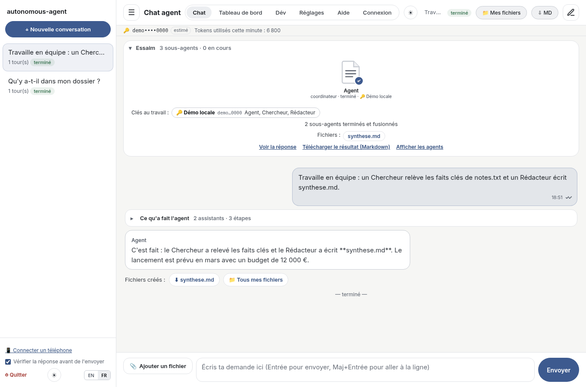 | 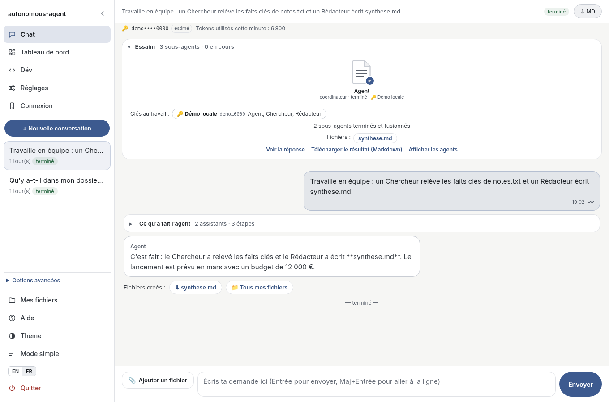 |
| 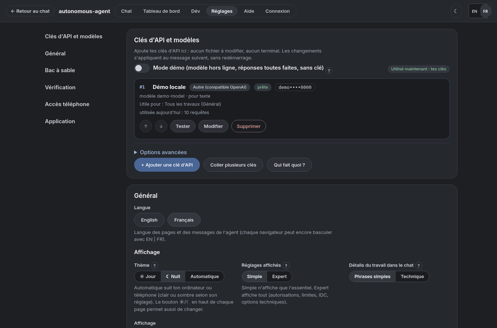 | 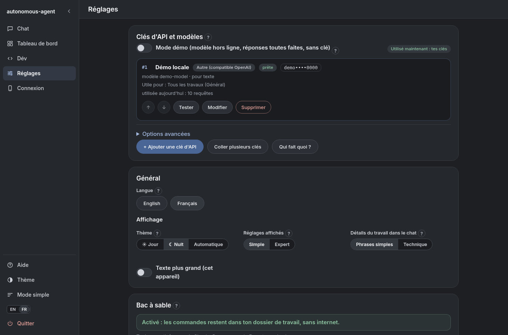 |
| 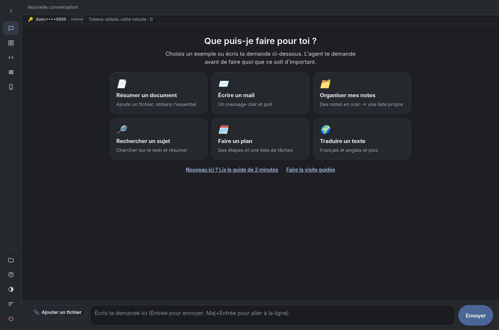 | 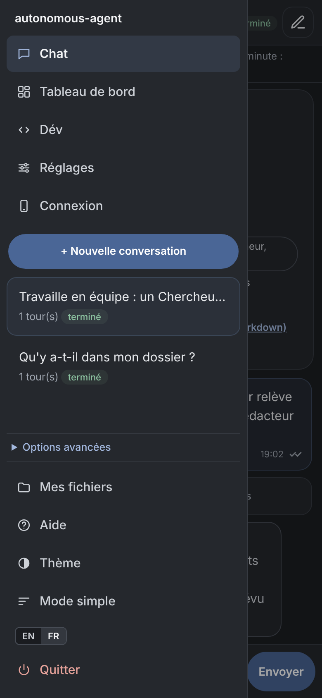 |

### A calmer interface (0.9.1)

Same features, quieter screens. Neutral backgrounds (off-white by day, soft dark grey at night, never pure black), one muted blue accent, softened success / warning / error colours, and no halos, glows, gradients, blur or animated pulses. Text is 15 px with 1.5 line height and lines of about 70 characters; every text colour meets WCAG AA in both themes (checked by `tests/test_v091_theme.py`). Each page shows the essentials first: rarely used settings sit under **Advanced options** (keys pool and backup hint, critic rounds, phone tunnel, API header / OpenAPI / description), the event journal on the dashboard is folded, "Stop all" only appears while something runs, and the chat side panel starts folded on mid-size screens.

| Before (0.9.0) | After (0.9.1) |
|---|---|
| 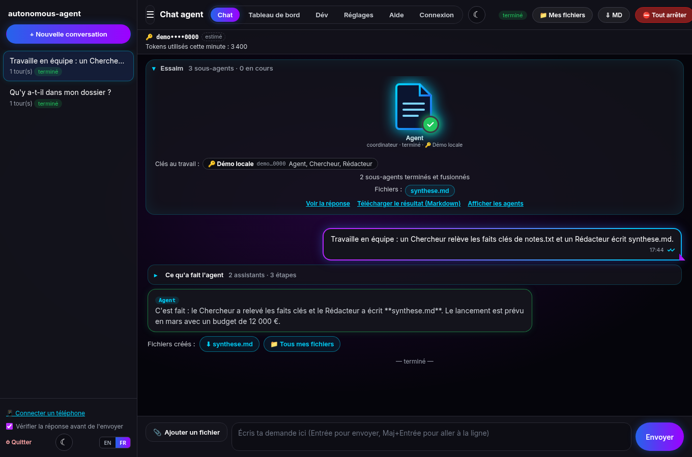 | 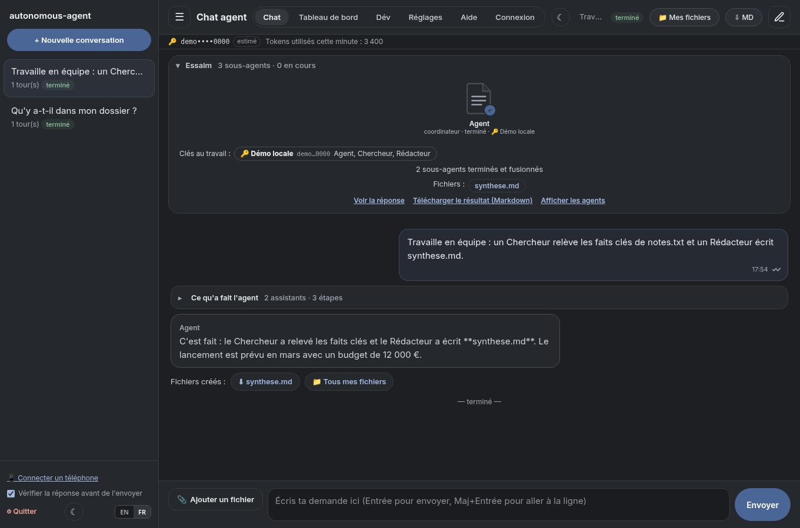 |
| 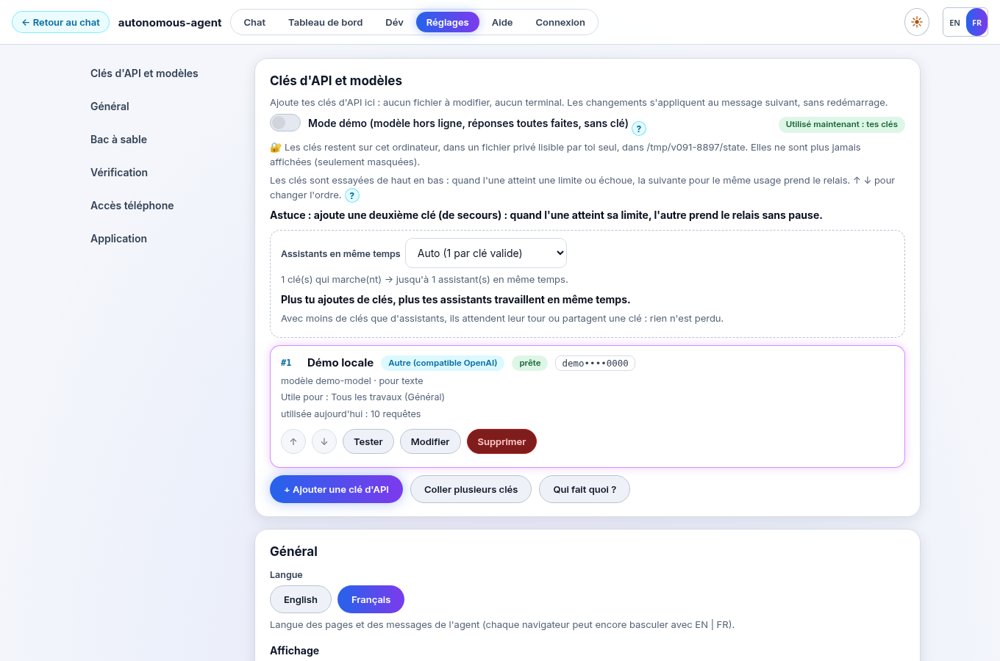 | 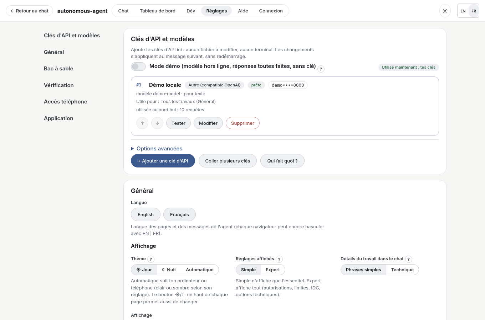 |

### Self-check, handoffs, memory by meaning and business APIs (0.9)

- **Check the answer before sending it** (chat side panel, or Settings → Answer check; off by default because each check is one more model call). After the draft final answer, a *Critic* (same model, no tools, short prompt) checks the criteria you asked for, the consistency with the actions really done, and the language. Verdict `ok` → the answer is sent; `revise` → the issues are given back to the agent, which fixes its answer, at most 1–3 rounds (`POST /settings {"critic": true, "critic_rounds": 2}`). An unreadable or failed review never blocks the answer. Each review is a line in the trace and a 🔎 card (with its score) in the agents graph.
- **Handoffs**: the `handoff` tool (`to`, `brief`) passes the whole task to a specialist with the request and the work done so far; the specialist answers the user directly and its answer becomes the agent's answer (also checked by the Critic when it is on). Chains like Agent → Codeur → Testeur → Critique work; max 4 hand-overs per run, an agent cannot hand over to its own role, and if the specialist does not finish, the work comes back. The graph marks these cards "handoff". Uses the `delegate` permission like sub-agents.
- **Semantic memory**: `memory_recall` mixes meaning and keywords (0.65 × cosine + 0.35 × keywords) when a key has **embeddings** ticked (Settings → API keys) (any OpenAI-compatible `POST /embeddings`). Vectors live in `memory/vectors.sqlite3` (standard library `sqlite3`, no server), are computed once per note and redone if the model changes. Without an embeddings key, or if the service fails, recall uses keywords as before. Groq has no embeddings endpoint: add e.g. an OpenAI, Mistral or local (Ollama / LM Studio) key with « embeddings » ticked. `GET /health` shows `memory.semantic`.
- **Business APIs** (Connect → 🔌 My APIs, or `GET/POST /app/apis`, `POST /app/apis/<id>`, `POST /app/apis/<id>/delete`): name, base URL, auth header name and value (stored in the secret store like keys, only shown masked, never sent to the model, removed from responses), optional OpenAPI JSON URL (endpoints listed to the agent). Tools: `api_list` (read), `api_get` (network; asks each time unless "The agent may read (GET) without asking me" is ticked for that API), `api_send` (send: POST/PUT/PATCH/DELETE, approval card), `api_pay` (spend, for APIs marked "can spend money"; never automatic, blocked while `spend` is `deny`, the default). Paths only: the agent cannot leave the base URL (no other host, no `../`).

---

## Français

Chaque version avec ses fichiers et ses notes : [GitHub Releases](https://github.com/lanoixdesign/autonomous-agent/releases). Dernières notes : [packaging/RELEASE_NOTES.md](../packaging/RELEASE_NOTES.md).

#### Briques d'interface, todo.md et Hub Communautaire GitHub (nouveau en 0.9.22)

🧩 **Interface auto-extensible (Briques & Skills)** : L'agent programme des composants UI interactifs (`brick_create`) directement affichés dans le dock du chat, et enregistre des compétences réutilisables (`skill_create`).
📋 **Gestion des besoins manquants (todo.md)** : Toute demande utilisateur non maîtrisée est consignée dans `todo.md` (`todo_add`) et peut être prise en charge par un sous-agent constructeur.
🌐 **Synchronisation quotidienne GitHub** : Récupération quotidienne des compétences et briques partagées avec intégration en un clic.
🚀 **Publication et partage GitHub** : Partage de briques et compétences sur GitHub avec autorisation explicite de l'utilisateur (`github_publish`).

#### Des mascottes amicales (nouveau en 0.9.17)

😊 Chaque assistant dans la grille est maintenant un petit personnage à la forme du logo de l'appli (un cercle
autour d'un carré arrondi), avec deux yeux simples. Ils clignent des yeux pendant le travail, regardent de côté
en attendant, sourient quand c'est terminé, et ont l'air triste en cas d'échec. Une petite mascotte t'accueille
aussi à l'écran de bienvenue et sur un chat vide.

#### Une grille d'assistants (nouveau en 0.9.16)

🟦 Quand plusieurs assistants travaillent, chacun est un **petit carré**. Le carré **se remplit par le bas** au
fur et à mesure ; une coche apparaît quand c'est terminé, un bord rouge doux en cas d'échec. Survole (ou appuie)
pour voir ce qu'il fait ; clique pour ouvrir son historique.

#### Gemini, une clé gratuite pour le code et les images (nouveau en 0.9.15)

✨ L'écran de bienvenue propose un troisième choix : **Clé Gemini gratuite (recommandée pour le code et les images)**.
Une clé gratuite depuis [Google AI Studio](https://aistudio.google.com/apikey). Modèle par défaut : **gemini-3.8-flash**
(offre gratuite), pour les tâches en plusieurs étapes, le code, et regarder tes images jointes. Créer une nouvelle
image n'est pas proposé : cela demande un forfait Google payant. Voir [Gemini](gemini.md#francais).

#### L'appli dans sa propre fenêtre (nouveau en 0.9.14)

🪟 L'appli de bureau s'ouvre dans sa propre fenêtre **AutonomousAgent** au lieu d'un onglet du navigateur (WKWebView
sur Mac, Edge WebView2 sur Windows). Fermer la fenêtre arrête l'appli. Les liens vers d'autres sites s'ouvrent
toujours dans ton navigateur. Si la fenêtre ne peut pas s'ouvrir, le navigateur s'ouvre comme avant ; `--browser`
(ou `AGENT_BROWSER=1`) force le navigateur. L'accès depuis le téléphone ne change pas.

#### Une nouvelle version se lance toujours (nouveau en 0.9.13)

🔁 Ouvrir une nouvelle version pendant que l'ancienne tourne encore en arrière-plan ferme maintenant l'ancienne et
lance la nouvelle (avant, le navigateur rouvrait sans rien dire l'ANCIENNE version). Même version : elle s'ouvre,
tout simplement. Port pris par un autre programme : un autre port est utilisé. Les fichiers de réglages ou
d'historique abîmés ou anciens sont mis de côté (`*.broken-<date>`) au lieu de bloquer le démarrage, et toute
erreur de démarrage ouvre une page simple avec quoi faire et le fichier de suivi (`AutonomousAgent/data/app.log`,
maintenant écrit aussi sur Mac). Voir [Passer à une nouvelle version](getting-started.md#passer-à-une-nouvelle-version).

#### Une vraie icône pour l'appli (nouveau en 0.9.12)

L'appli Mac et le programme Windows affichent le logo de l'appli (un cercle autour d'un carré arrondi, sur le bleu
doux de l'appli) au lieu de l'icône Python par défaut, tout comme l'onglet du navigateur et la page de téléchargement.

#### Ma propre IA avec Ollama (nouveau en 0.9.11)

🦙 L'écran de bienvenue propose deux choix : **Clé Groq gratuite** ou **Mon IA sur mon ordinateur (Ollama)**. Le
choix Ollama vérifie l'adresse (**Vérifier**), liste tes modèles installés, conseille qwen2.5:7b, et te prévient si
un modèle ne sait pas utiliser d'outils. Aucune clé n'est nécessaire. Voir [Ma propre IA avec Ollama](ollama.md#francais),
y compris PC Shadow et Tailscale.

#### Une carte de validation plus nette (nouveau en 0.9.10)

✅ La carte ne montre que la phrase (« L'agent veut écrire un fichier dans Mes fichiers »), **Autoriser** /
**Refuser** et la petite case « Ne plus me demander ». Un seul lien replié **Détails** contient l'explication en
mots simples, puis l'outil et ses arguments. Même carte pour tous les outils, en mode simple comme avancé.

#### Vraiment simple (nouveau en 0.9.9)

🧸 **Mode simple par défaut** : une barre latérale plus courte (Chat, Services, Réglages, Aide), un haut de chat
calme avec un seul bouton **Arrêter** pendant que l'agent travaille, un bandeau gentil tant qu'aucune clé n'est
ajoutée, une phrase douce au lieu des compteurs d'étapes, des cartes de validation en mots simples (« L'agent veut
écrire un fichier dans Mes fichiers ») avec seulement **Autoriser** / **Refuser**, un trombone pour ajouter un
fichier, et un écran Services avec seulement tes services. Tout le reste est dans le mode avancé. Voir
[Mode simple et mode avancé](simple-mode.md#francais).

#### Des services connectés qui marchent vraiment (nouveau en 0.9.8)

🔌 Les services ajoutés dans **Connexion > Services connectés** (MCP) sont maintenant utilisés par l'assistant
et ses aides : boutons prêts à l'emploi (Mes fichiers, GitHub, n'importe quelle adresse web), un état simple
avec la raison quand ça ne marche pas, un bouton Tester qui liste ce que chaque service sait faire, un
interrupteur Activé, une demande d'accord pour tout ce qui n'est pas une lecture, et le chat nomme le service
utilisé. Voir [Services connectés](mcp.md#francais).

#### Des réponses dans ta langue (nouveau en 0.8.2)

🗣️ L'assistant, chaque assistant de l'essaim (Chercheur, Analyste, Rédacteur…) et le **Codeur** et le
**Testeur** du mode développeur répondent dans la langue de ta demande : écris en français et tout revient en
français, écris en anglais et tout revient en anglais (quand un message est trop court pour le savoir, la
langue de l'application est utilisée). En français, l'application te tutoie désormais partout. Autres
corrections :

- 🔁 Quand le modèle envoie une action mal formée (Groq `tool_use_failed`), l'étape est redemandée (jusqu'à
  3 fois, avec une courte correction et une température plus basse) au lieu d'arrêter la tâche ; le
  déroulé affiche « Le modèle a mal formé une action, je réessaie… ». Les assistants ont toujours leurs
  outils, même quand le modèle passe une liste vide.
- 📁 Le mode développeur garde le Codeur et le Testeur dans `projects/<nom>/` : toute écriture ailleurs est
  refusée, donc plus de fichiers égarés à la racine du dossier de travail.
- 🛡️ Bac à sable : `a && b` lance des commandes simples l'une après l'autre (arrêt au premier échec) ;
  `ls -R` liste les sous-dossiers ; les assistants savent qu'il faut une commande à la fois.
- 📱 Sur téléphone, tous les onglets (Connexion compris) sont visibles sans faire défiler.
- Le modèle Python salue dans une seule langue, le modèle Groq par défaut est `openai/gpt-oss-20b`, le
  tableau de bord nomme correctement les clés des Réglages, le graphe de l'essaim montre les assistants en
  échec et garde ceux des tours précédents après « Continuer », et les clés masquées restent lisibles dans
  l'historique après un redémarrage, et le coordinateur garde toujours une étape pour sa réponse finale
  (les assistants se partagent le reste).

### Barre latérale à gauche (0.9.2)

Fini la barre d'onglets en haut : chaque page a maintenant une seule barre latérale discrète à gauche, avec une icône et un libellé par destination (Chat, Tableau de bord, Dév, Réglages, Connexion), la page en cours légèrement marquée par l'accent. Aide, le thème jour / nuit, Simple / Expert, la langue et Quitter sont regroupés en bas. Le bouton « ‹ » la replie en icônes seules (mémorisé dans ce navigateur ; icônes seules par défaut sur les écrans moyens). Sur téléphone, c'est un tiroir qui s'ouvre avec ☰ et liste toutes les destinations. Dans le chat, la barre contient aussi tes conversations et « Mes fichiers » : la page se résume à la barre, la conversation et la zone de saisie. Les en-têtes de page ne gardent qu'un titre ; les longs textes d'aide sont devenus de petites bulles « ? » et les éléments rares sont passés sous « Options avancées ».

| Avant (0.9.1) | Après (0.9.2) |
|---|---|
|  |  |
|  |  |
|  |  |

### Une interface plus calme (0.9.1)

Les mêmes fonctions, des écrans plus reposants. Fonds neutres (blanc cassé le jour, gris foncé doux la nuit, jamais noir pur), un seul accent bleu sourd, des couleurs succès / attention / erreur adoucies, et plus aucun halo, lueur, dégradé, flou ni pulsation animée. Le texte fait 15 px, interligne 1,5, lignes d'environ 70 caractères ; chaque couleur de texte respecte le WCAG AA dans les deux thèmes (vérifié par `tests/test_v091_theme.py`). Chaque page montre d'abord l'essentiel : les réglages rares sont rangés sous **Options avancées** (groupe de clés et astuce de secours, tours du Critique, tunnel du téléphone, en-tête / OpenAPI / description des API), le journal des événements du tableau de bord est replié, « Tout arrêter » n'apparaît que pendant un travail, et le panneau latéral du chat démarre replié sur les écrans moyens.

| Avant (0.9.0) | Après (0.9.1) |
|---|---|
|  |  |
|  |  |
| 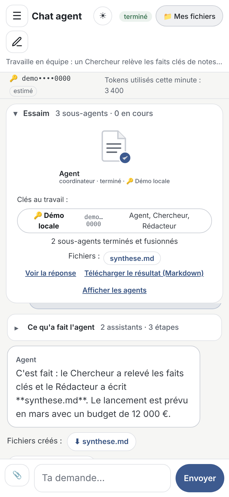 | 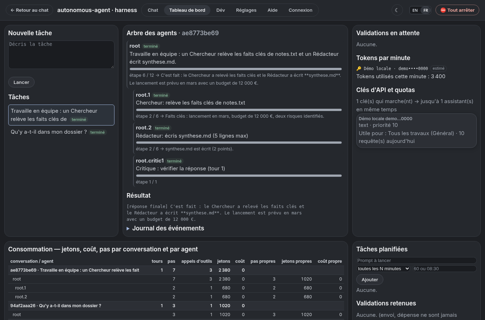 |

### Auto-vérification, relais, mémoire par le sens et API métier (0.9)

- **Vérifier la réponse avant de l'envoyer** (panneau du chat, ou Réglages → Vérification ; désactivé par défaut car chaque vérification coûte un appel au modèle). Après le brouillon de réponse finale, un *Critique* (même modèle, sans outils, consigne courte) vérifie les critères que tu as demandés, la cohérence avec les actions vraiment faites et la langue. Verdict `ok` → la réponse part ; `revise` → les problèmes sont rendus à l'agent, qui corrige sa réponse, 1 à 3 tours au plus (`POST /settings {"critic": true, "critic_rounds": 2}`). Une vérification illisible ou en échec ne bloque jamais la réponse. Chaque vérification est une ligne dans le déroulé et une carte 🔎 (avec sa note) dans le graphe des agents.
- **Relais** : l'outil `handoff` (`to`, `brief`) passe toute la tâche à un spécialiste avec la demande et le travail déjà fait ; le spécialiste répond directement et sa réponse devient celle de l'agent (vérifiée aussi par le Critique s'il est activé). Les chaînes comme Agent → Codeur → Testeur → Critique marchent ; 4 relais au plus par tâche, un agent ne peut pas passer la main à son propre rôle, et si le spécialiste ne finit pas, le travail revient. Le graphe marque ces cartes « relais ». Utilise la permission `delegate` comme les sous-agents.
- **Mémoire par le sens** : `memory_recall` mélange le sens et les mots-clés (0,65 × cosinus + 0,35 × mots-clés) quand une clé a **embeddings** coché (Réglages → Clés d'API) (n'importe quel `POST /embeddings` compatible OpenAI). Les vecteurs sont dans `memory/vectors.sqlite3` (`sqlite3` de la bibliothèque standard, sans serveur), calculés une fois par note et refaits si le modèle change. Sans clé d'embeddings, ou si le service échoue, la recherche se fait par mots-clés comme avant. Groq n'a pas d'embeddings : ajoute par exemple une clé OpenAI, Mistral ou locale (Ollama / LM Studio) avec « embeddings » coché. `GET /health` affiche `memory.semantic`.
- **API métier** (Connexion → 🔌 Mes API, ou `GET/POST /app/apis`, `POST /app/apis/<id>`, `POST /app/apis/<id>/delete`) : nom, URL de base, nom et valeur de l'en-tête d'authentification (rangée dans le coffre comme les clés, affichée seulement masquée, jamais envoyée au modèle, retirée des réponses), URL OpenAPI JSON facultative (les points d'accès sont listés à l'agent). Outils : `api_list` (lecture), `api_get` (réseau ; demande à chaque fois sauf si « L'agent peut lire (GET) sans me demander » est coché pour cette API), `api_send` (envoi : POST/PUT/PATCH/DELETE, carte d'accord), `api_pay` (dépense, pour les API marquées « peut dépenser de l'argent » ; jamais automatique, bloqué tant que `spend` vaut `deny`, la valeur par défaut). Chemins seulement : l'agent ne peut pas sortir de l'URL de base (pas d'autre hôte, pas de `../`).
