# Getting started (desktop app) / Bien démarrer (application de bureau)

**[English](#english) | [Français](#francais)** · [← README](../README.md) · [Docs](README.md)

<a id="english"></a>

## English

### Download (no command line)

**No terminal needed, at any step.** Ready-to-run desktop builds exist for Windows and macOS: no Python,
no install, no commands, no file to edit. Download the file for your computer from the
**[Releases page](https://github.com/lanoixdesign/autonomous-agent/releases/latest)**:

| File | For |
|---|---|
| `AutonomousAgent-windows-x64.exe` | Windows 10/11, 64-bit |
| `AutonomousAgent-macos-arm64.zip` | Mac with Apple Silicon (M1, M2, M3, M4…) |
| `AutonomousAgent-macos-intel.zip` | Mac with an Intel processor |

#### Opening the unsigned app

> ⚠️ **These builds are not signed yet** (no paid Microsoft/Apple certificate), so Windows and macOS warn
> you the first time you open them. That is expected for unsigned apps, and you only do this once.
> **Code signing is planned for a later release.**

**Windows (SmartScreen)**
1. Double-click `AutonomousAgent-windows-x64.exe`.
2. A blue **"Windows protected your PC"** window appears: click **More info**, then **Run anyway**.
3. The app opens in your browser. There is no console window (logs go to `AutonomousAgent\data\app.log`).

**macOS (Gatekeeper)**
1. Unzip the file and move `AutonomousAgent.app` to **Applications**.
2. The first time, **right-click** (or Control-click) the app → **Open**, then **Open** again in the dialog.
3. If macOS only offers "Move to Trash" / "Done": open **System Settings → Privacy & Security**, scroll
   down to the Security section and click **Open Anyway** next to "AutonomousAgent", then confirm
   (password or Touch ID).
4. The app opens in your browser and runs in the background (no window to keep open).

<details>
<summary><b>Advanced (optional): remove the quarantine flag on macOS</b></summary>

Only if the steps above did not work, in Terminal:

```bash
xattr -dr com.apple.quarantine /Applications/AutonomousAgent.app
```
</details>

<details>
<summary><b>Advanced (optional): verify the download with SHA256SUMS.txt</b></summary>

Each release includes `SHA256SUMS.txt`. Download it next to your file, compute the file's SHA-256 and
check that it matches the line for that file.

Windows (Command Prompt or PowerShell, in your Downloads folder):

```bat
certutil -hashfile AutonomousAgent-windows-x64.exe SHA256
```

macOS (Terminal, in your Downloads folder):

```bash
shasum -a 256 AutonomousAgent-macos-arm64.zip    # or AutonomousAgent-macos-intel.zip
shasum -a 256 -c SHA256SUMS.txt --ignore-missing  # checks every downloaded file at once
```

The hash printed must be identical to the one in `SHA256SUMS.txt` (certutil prints it in lowercase with
no spaces on recent Windows; compare the characters, not the case). If it differs, do not open the file:
download it again from the Releases page.
</details>

**First run: a 3-step wizard in the browser.** ① pick your language (English / Français) → ② click
**🎈 Try without a key** (demo answers, nothing to set up) *or* connect a real AI: pick a service (**Groq** is
recommended and free), follow the **step-by-step guide** ("Open Groq in a new tab", sign in, create a key,
copy it), paste the key (the service is **recognised from the key** itself), **Test the key**, then **Save and
continue** → ③ done, open the chat.

| Wizard (day theme) | Wizard (night theme) |
|---|---|
| 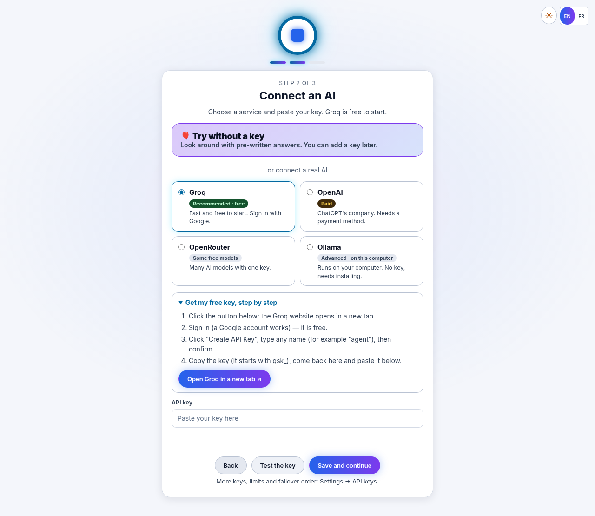 | 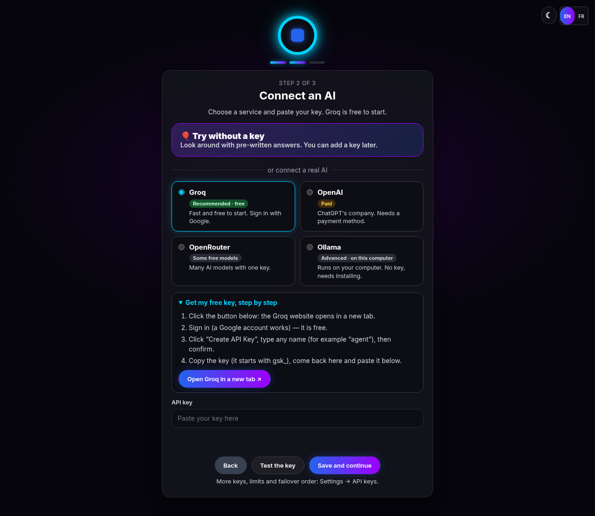 |

**Made for beginners (0.6).**
- **"What can I do for you?"**: the chat opens with six example tasks (summarize a document, write an email,
  organize notes, research a topic, make a plan, translate) and a 4-step **guided tour** (shown once; Help →
  "Show the guided tour again").
- **Questions in plain words**: before acting, the agent asks *"The agent wants to write the file report.md.
  Do you allow it?"* with big **✓ Allow** / **✕ Refuse** buttons and a one-line hint; the tool name and
  arguments are folded under "Technical details". **send** and **spend** are asked every single time.
- **"What the agent did"**: the work trace reads as sentences ("The helper "Researcher" read notes.txt"),
  folded by default; Settings → "Work details in the chat" → **Technical** shows the raw tool calls.
- **📁 My files**: list, add and download the files of your work folder; files the agent creates appear
  under its answer with a **⬇ Download** button.
- **Help** tab: how it works in 4 steps, a sample question card, FAQ, "Larger text".
- **Simple / Expert** Settings: Simple hides permissions, limits, IDC and technical options; ❓ buttons
  explain each setting; error messages are translated (EN/FR).
- **☀ Day / ☾ Night theme**: a "Theme" button at the bottom of the left sidebar (also in the ☰ phone drawer) switches
  between a calm light theme and a soft dark-grey night theme (both WCAG AA). Settings → General →
  Display → **Theme: Day / Night / Automatic** (default: Automatic = follows your computer or phone). The
  choice is remembered in this browser.

| Chat, day theme | Chat, night theme |
|---|---|
| 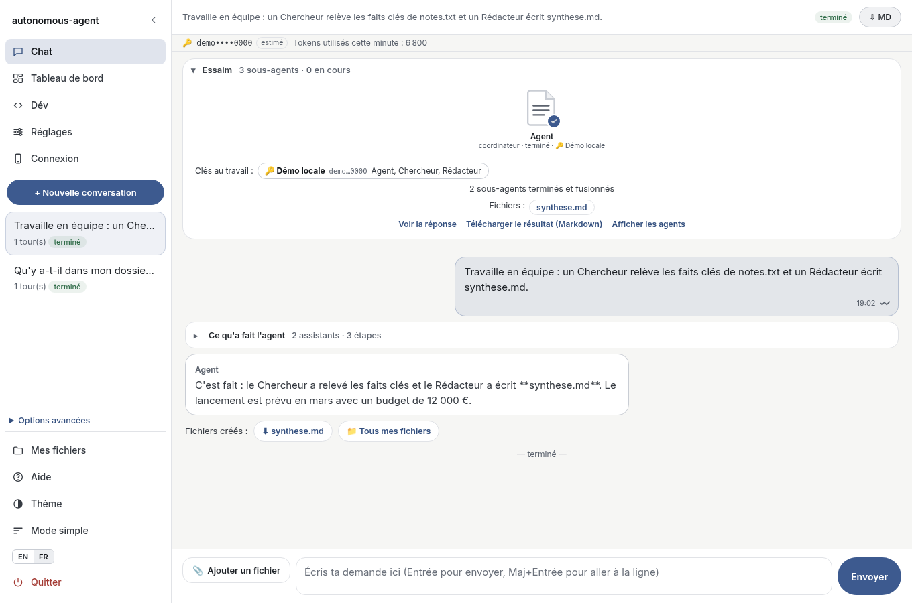 | 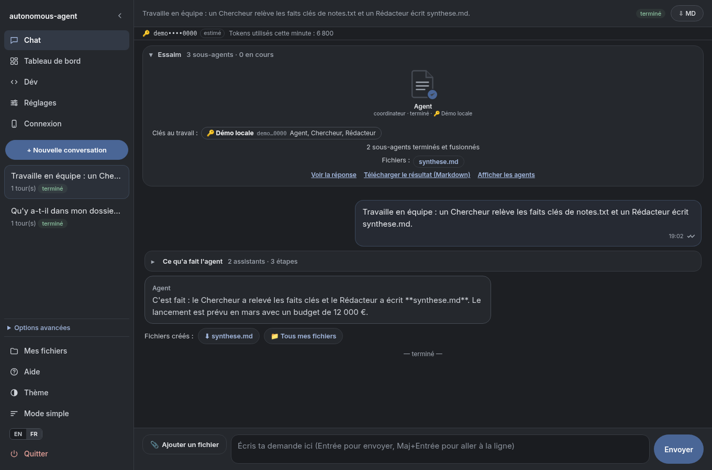 |

| A question in plain words (phone, day) | My files | Settings: theme, Simple / Expert |
|---|---|---|
| 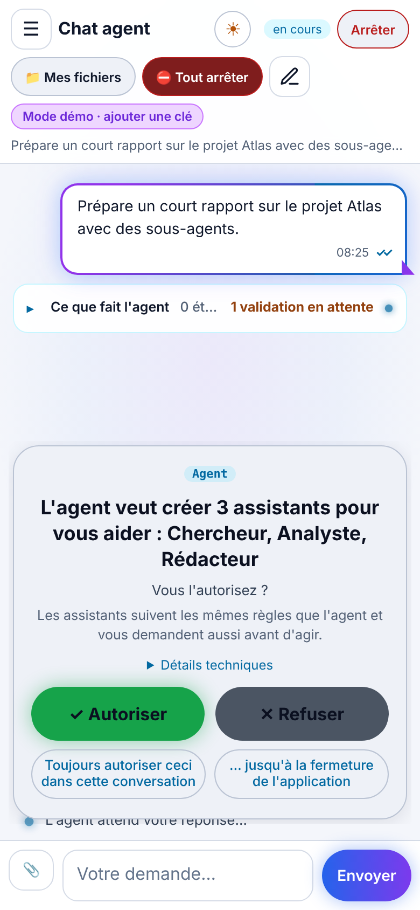 | 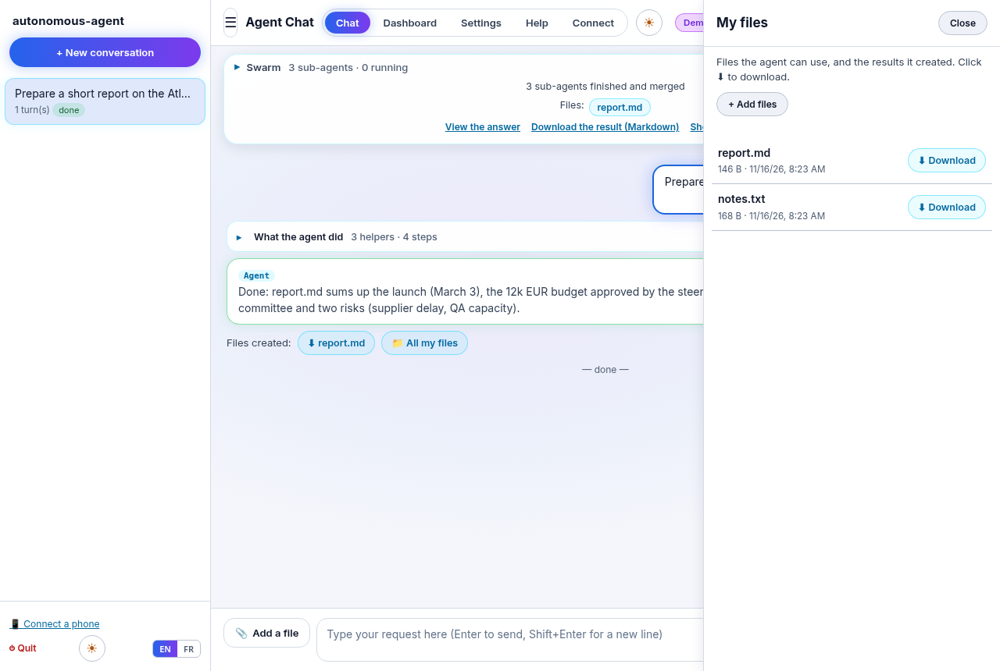 | 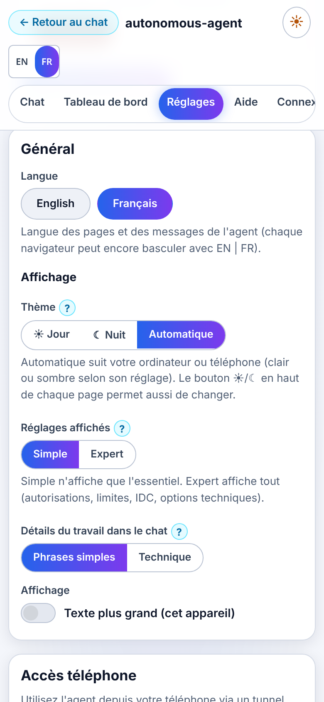 |

**Everything else is in ⚙ Settings** (the destinations **Chat | Services | Settings | Help** are in the
left sidebar of every page, and in the ☰ drawer on a phone; **Dashboard**, **Dev** and **My files** appear in
Advanced mode, see [Simple and Advanced mode](simple-mode.md)):
- **API keys & models**: add, edit, delete and test keys, per use (text, code, images, speech,
  transcription, embeddings), with limits (requests / tokens / cost per day or month) and a failover
  order (↑ ↓: when a key hits a limit or fails, the next one takes over). Keys are shown **masked**
  (`sk-d••••RET2`) with their usage. Changes apply to the next message, **no restart**.
- **General**: language, theme, Simple / Expert, work details, larger text, work folder, conversations at
  once, approval timeout.
- **Permissions** (Expert): allow / ask / deny per risk category. **send** and **spend** can never be set to
  "allow".
- **IDC mode** (Expert): on/off and its parameters.
- **Phone access**: turn it on, pick Tailscale or Cloudflare, show the QR code, generate a new token.
- **App**: version, **Restart** (shown when a change needs it) and **Quit** (stops the server cleanly;
  also in the chat sidebar).

**Where your keys go.** In your user folder, `AutonomousAgent/data/secrets.json`, a private file only
your account can read (mode 0600), or in the system keychain if the Python `keyring` package is
installed. Keys are never sent back to the browser after saving (only masked), never logged and never
written to the audit log. Settings and keys can only be changed **from the computer running the agent**;
a phone signed in remotely sees a 🔒 notice (see
[Use from your phone](phone.md#use-from-your-phone) for `AGENT_REMOTE_SETTINGS=1`).

**Where things go.** Everything is in one folder in your home directory, `AutonomousAgent`
(`C:\Users\<you>\AutonomousAgent` or `/Users/<you>/AutonomousAgent`): `workspace/` (the only folder the
agent's file tools can touch; "My files" and chat attachments go there), `data/` (settings, keys, memory,
audit log, conversations), and the optional `.env` / `permissions.yaml` / `providers.yaml` for advanced users.

**Stop:** click **Quit** (chat sidebar, or Settings → App). Double-clicking the app again while it runs just
reopens the browser tab. **Language:** first-run choice, Settings → General, or the EN | FR switch.

| Live helpers graph (day) | Dashboard (night) |
|---|---|
| 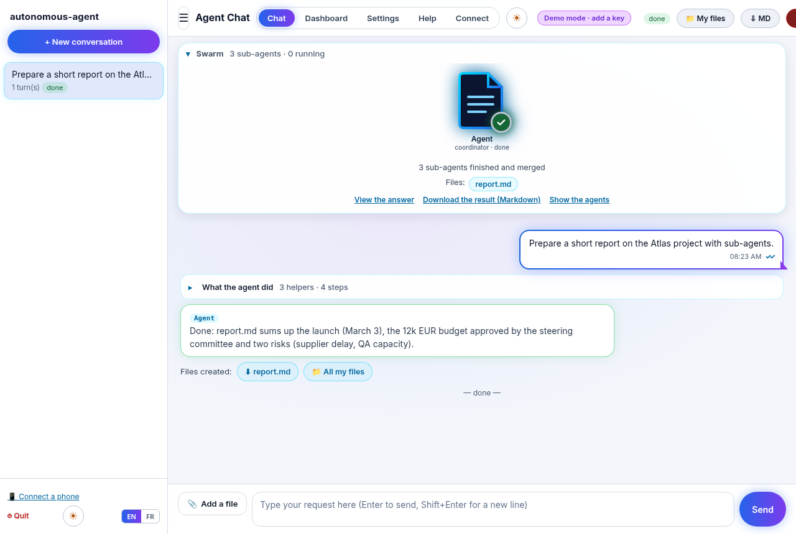 | 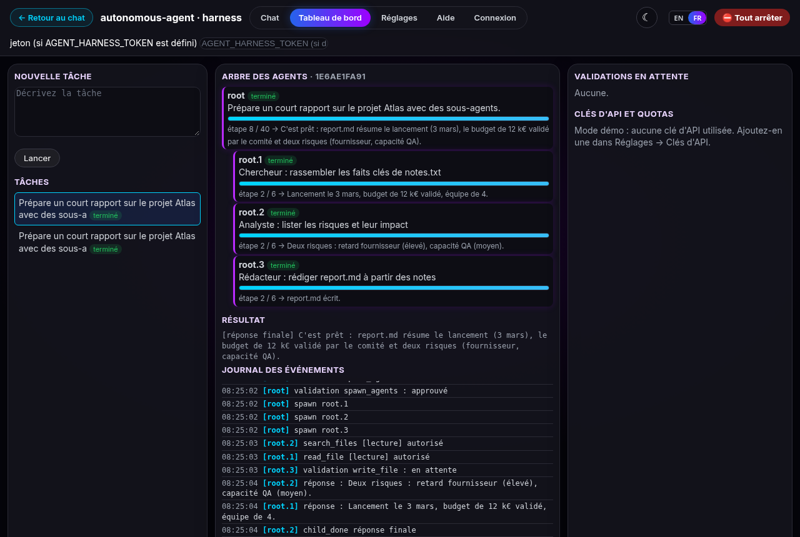 |

---

<a id="francais"></a>

## Français

### Télécharger (sans ligne de commande)

**Aucun terminal nécessaire, à aucune étape.** Des versions de bureau prêtes à l'emploi existent pour
Windows et macOS : ni Python, ni installation, ni commande, ni fichier à modifier. Télécharge le fichier
correspondant à ton ordinateur sur la
**[page des versions (Releases)](https://github.com/lanoixdesign/autonomous-agent/releases/latest)** :

| Fichier | Pour |
|---|---|
| `AutonomousAgent-windows-x64.exe` | Windows 10/11, 64 bits |
| `AutonomousAgent-macos-arm64.zip` | Mac avec puce Apple (M1, M2, M3, M4…) |
| `AutonomousAgent-macos-intel.zip` | Mac avec processeur Intel |

#### Ouvrir l'application non signée

> ⚠️ **Ces versions ne sont pas encore signées** (pas de certificat payant Microsoft/Apple) : Windows et
> macOS affichent donc un avertissement à la première ouverture. C'est normal pour une application non
> signée, et cela ne se fait qu'une fois. **La signature du code est prévue dans une version ultérieure.**

**Windows (SmartScreen)**
1. Double-clique sur `AutonomousAgent-windows-x64.exe`.
2. Une fenêtre bleue **« Windows a protégé ton ordinateur »** apparaît : clique sur
   **Informations complémentaires**, puis sur **Exécuter quand même**.
3. L'application s'ouvre dans ton navigateur. Pas de fenêtre de console (le journal va dans
   `AutonomousAgent\data\app.log`).

**macOS (Gatekeeper)**
1. Décompresse le fichier et déplace `AutonomousAgent.app` dans **Applications**.
2. La première fois, faites un **clic droit** (ou Contrôle-clic) sur l'app → **Ouvrir**, puis encore
   **Ouvrir** dans la fenêtre qui s'affiche.
3. Si macOS ne propose que « Placer dans la corbeille » / « OK » : ouvre **Réglages Système →
   Confidentialité et sécurité**, descends jusqu'à la partie Sécurité et clique sur **Ouvrir quand même**
   à côté de « AutonomousAgent », puis confirme (mot de passe ou Touch ID).
4. L'application s'ouvre dans ton navigateur et tourne en arrière-plan (aucune fenêtre à garder ouverte).

<details>
<summary><b>Avancé (facultatif) : retirer l'attribut de quarantaine sur macOS</b></summary>

Seulement si les étapes ci-dessus n'ont pas fonctionné, dans Terminal :

```bash
xattr -dr com.apple.quarantine /Applications/AutonomousAgent.app
```
</details>

<details>
<summary><b>Avancé (facultatif) : vérifier le téléchargement avec SHA256SUMS.txt</b></summary>

Chaque version contient `SHA256SUMS.txt`. Télécharge-le à côté de ton fichier, calcule l'empreinte
SHA-256 du fichier et vérifie qu'elle correspond à la ligne de ce fichier.

Windows (Invite de commandes ou PowerShell, dans ton dossier Téléchargements) :

```bat
certutil -hashfile AutonomousAgent-windows-x64.exe SHA256
```

macOS (Terminal, dans ton dossier Téléchargements) :

```bash
shasum -a 256 AutonomousAgent-macos-arm64.zip    # ou AutonomousAgent-macos-intel.zip
shasum -a 256 -c SHA256SUMS.txt --ignore-missing  # vérifie d'un coup tous les fichiers téléchargés
```

L'empreinte affichée doit être identique à celle de `SHA256SUMS.txt` (compare les caractères, pas les
majuscules/minuscules). Si elle diffère, n'ouvre pas le fichier : télécharge-le à nouveau depuis la page
des versions.
</details>

**Premier lancement : un assistant en 3 étapes dans le navigateur.** ① choisis la langue (English /
Français) → ② clique sur **🎈 Essayer sans clé** (réponses de démonstration, rien à régler) *ou* connecte
une vraie IA : choisis un service (**Groq** est recommandé et gratuit), suis le **guide pas à pas**
(« Ouvrir Groq dans un nouvel onglet », connexion, création d'une clé, copie), colle la clé (le service est
**reconnu d'après la clé**), **Tester la clé**, puis **Enregistrer et continuer** → ③ c'est prêt, ouvre le chat.

| Assistant (thème jour) | Assistant (thème nuit) |
|---|---|
| 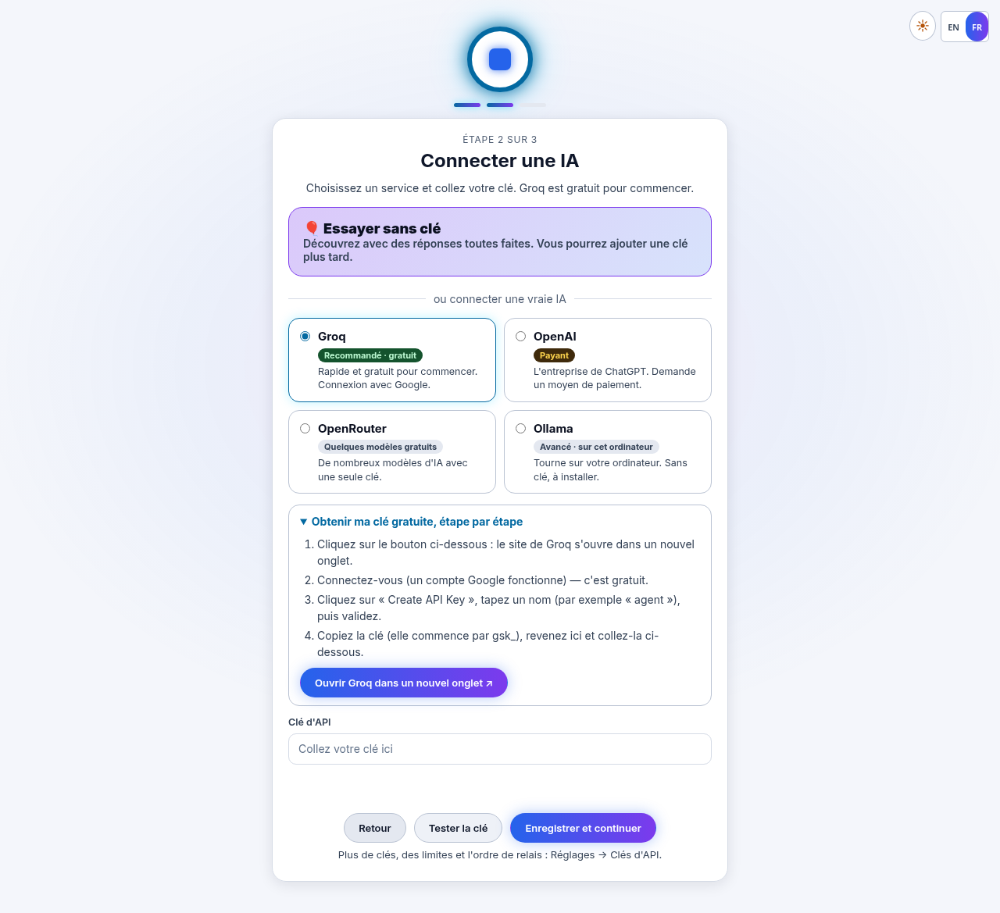 | 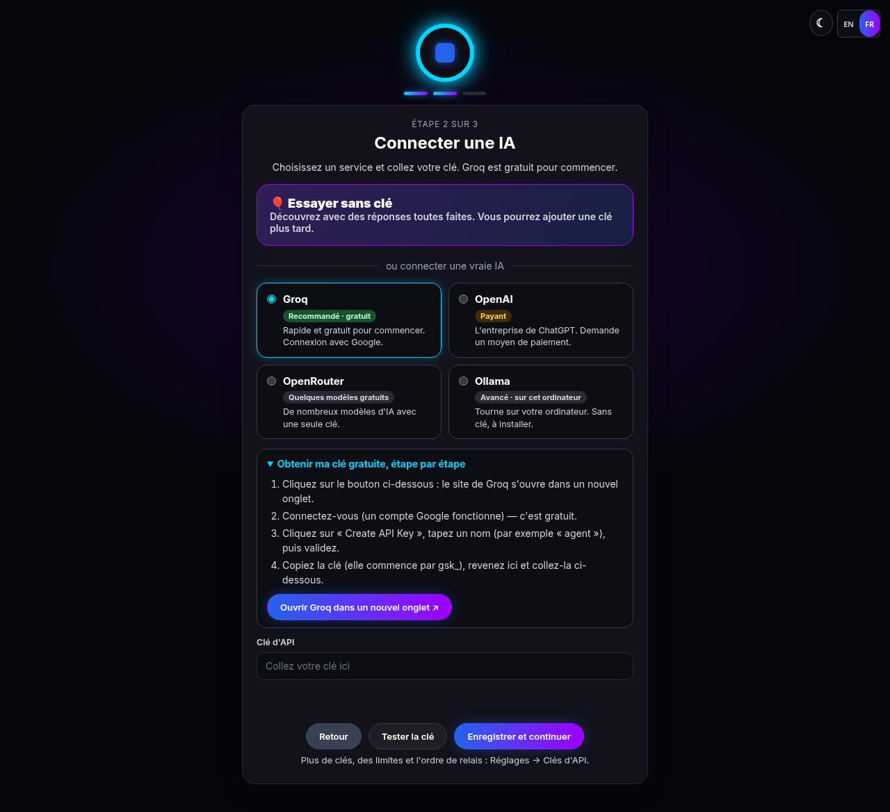 |

**Pensé pour les débutants (0.6).**
- **« Que puis-je faire pour toi ? »** : le chat s'ouvre sur six exemples (résumer un document, écrire un
  e-mail, ranger des notes, se renseigner sur un sujet, faire un plan, traduire) et une **visite guidée** en
  4 étapes (affichée une fois ; Aide → « Revoir la visite guidée »).
- **Des questions avec des mots simples** : avant d'agir, l'agent demande *« L'agent veut écrire le fichier
  report.md. Tu l'autorises ? »* avec de grands boutons **✓ Autoriser** / **✕ Refuser** et une phrase
  d'aide ; le nom de l'outil et ses arguments sont repliés sous « Détails techniques ». **Envoi** et
  **dépense** sont demandés à chaque fois.
- **« Ce qu'a fait l'agent »** : la trace se lit comme des phrases (« L'assistant « Chercheur » a lu
  notes.txt »), repliée par défaut ; Réglages → « Détails du travail dans le chat » → **Technique** montre
  les appels d'outils bruts.
- **📁 Mes fichiers** : lister, ajouter et télécharger les fichiers du dossier de travail ; les fichiers
  créés par l'agent apparaissent sous sa réponse avec un bouton **⬇ Télécharger**.
- Onglet **Aide** : le fonctionnement en 4 étapes, un exemple de question, une FAQ, « Texte plus grand ».
- Réglages **Simple / Expert** : Simple masque autorisations, limites, IDC et options techniques ; des
  boutons ❓ expliquent chaque réglage ; les messages d'erreur sont traduits (EN/FR).
- **Thème ☀ Jour / ☾ Nuit** : un bouton « Thème » en bas de la barre latérale gauche (et dans le tiroir ☰ du
  téléphone) passe d'un thème clair et calme à un thème de nuit gris foncé doux (tous deux WCAG AA). Réglages →
  Général → Affichage → **Thème : Jour / Nuit / Automatique** (par défaut : Automatique = suit ton
  ordinateur ou téléphone). Le choix est mémorisé dans ce navigateur.

| Chat, thème jour | Chat, thème nuit |
|---|---|
|  |  |

| Une question en mots simples (téléphone, jour) | Mes fichiers | Réglages : thème, Simple / Expert |
|---|---|---|
|  | 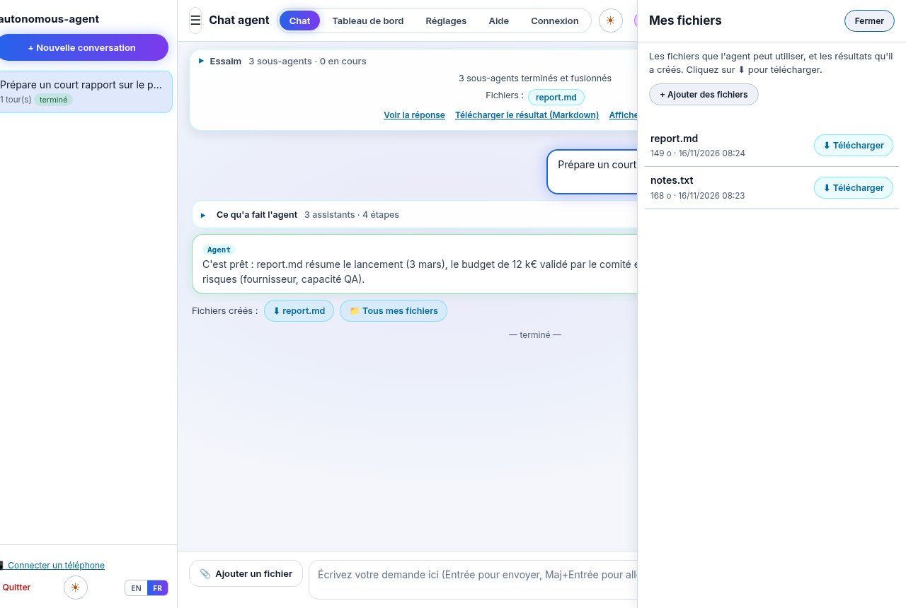 |  |

**Tout le reste est dans ⚙ Réglages** (les destinations **Chat | Services | Réglages | Aide**
sont dans la barre latérale gauche de chaque page, et dans le tiroir ☰ sur téléphone ; **Tableau de bord**, **Dév**
et **Mes fichiers** apparaissent en mode avancé, voir [Mode simple et mode avancé](simple-mode.md#francais)) :
- **Clés d'API et modèles** : ajouter, modifier, supprimer et tester des clés, par usage (texte, code,
  images, voix, transcription, embeddings), avec des limites (requêtes / jetons / coût par jour ou par
  mois) et un ordre de relais (↑ ↓ : quand une clé atteint une limite ou échoue, la suivante prend le
  relais). Les clés sont affichées **masquées** (`sk-d••••RET2`) avec leur consommation. Les changements
  s'appliquent au message suivant, **sans redémarrage**.
- **Général** : langue, thème, Simple / Expert, détails du travail, texte plus grand, dossier de travail,
  conversations simultanées, délai de validation.
- **Autorisations** (Expert) : autoriser / demander / refuser par catégorie de risque. **envoi** et
  **dépense** ne peuvent jamais être mis sur « autoriser ».
- **Mode IDC** (Expert) : activé/désactivé et ses paramètres.
- **Accès téléphone** : l'activer, choisir Tailscale ou Cloudflare, afficher le QR code, générer un nouveau jeton.
- **Application** : version, **Redémarrer** (proposé quand un changement l'exige) et **Quitter** (arrête
  proprement le serveur ; aussi dans la barre latérale du chat).

**Où vont tes clés.** Dans ton dossier utilisateur, `AutonomousAgent/data/secrets.json`, un fichier
privé lisible par ton seul compte (mode 0600), ou dans le trousseau du système si le paquet Python
`keyring` est installé. Après l'enregistrement, les clés ne sont jamais renvoyées au navigateur (seulement
masquées), jamais écrites dans les journaux ni dans l'audit. Les réglages et les clés ne se modifient
**que depuis l'ordinateur qui fait tourner l'agent** ; un téléphone connecté à distance voit un avis 🔒
(voir [Utiliser depuis le mobile](phone.md#utiliser-depuis-le-mobile) pour `AGENT_REMOTE_SETTINGS=1`).

**Où vont les fichiers.** Tout est dans un seul dossier de ton répertoire personnel, `AutonomousAgent`
(`C:\Users\<toi>\AutonomousAgent` ou `/Users/<toi>/AutonomousAgent`) : `workspace/` (le seul dossier
que les outils de fichiers de l'agent peuvent toucher ; « Mes fichiers » et les pièces jointes y vont),
`data/` (réglages, clés, mémoire, journal d'audit, conversations), et les fichiers facultatifs `.env` /
`permissions.yaml` / `providers.yaml` pour les utilisateurs avancés.

**Arrêter :** clique sur **Quitter** (barre latérale du chat, ou Réglages → Application). Un nouveau
double-clic pendant que l'app tourne rouvre simplement l'onglet du navigateur. **Langue :** choix du
premier lancement, Réglages → Général, ou le sélecteur EN | FR.

| Graphe des assistants en direct (jour) | Tableau de bord (nuit) |
|---|---|
| 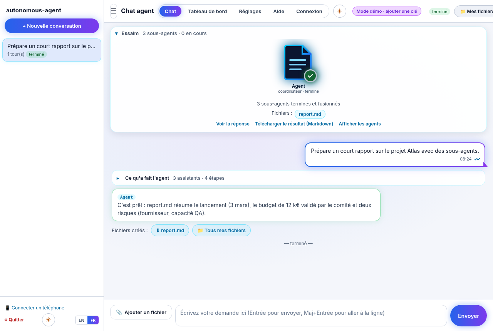 |  |
