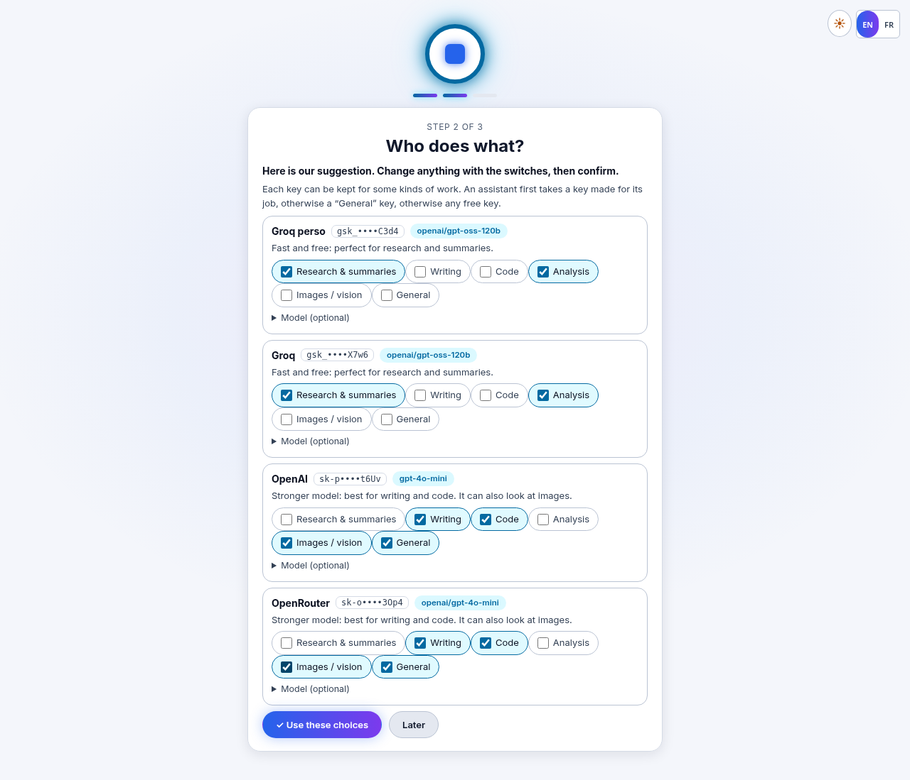
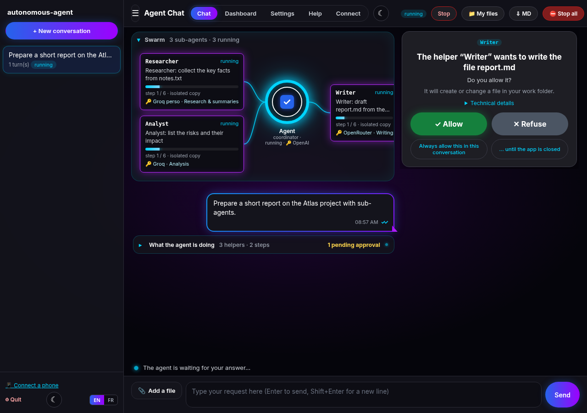
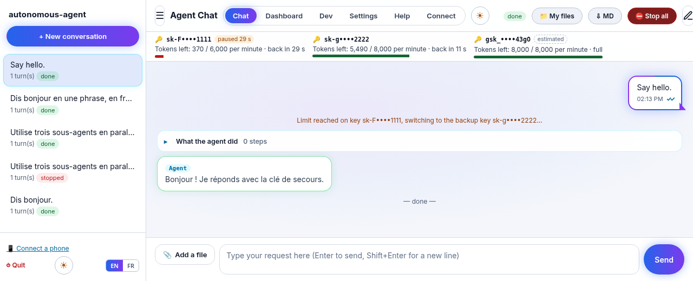
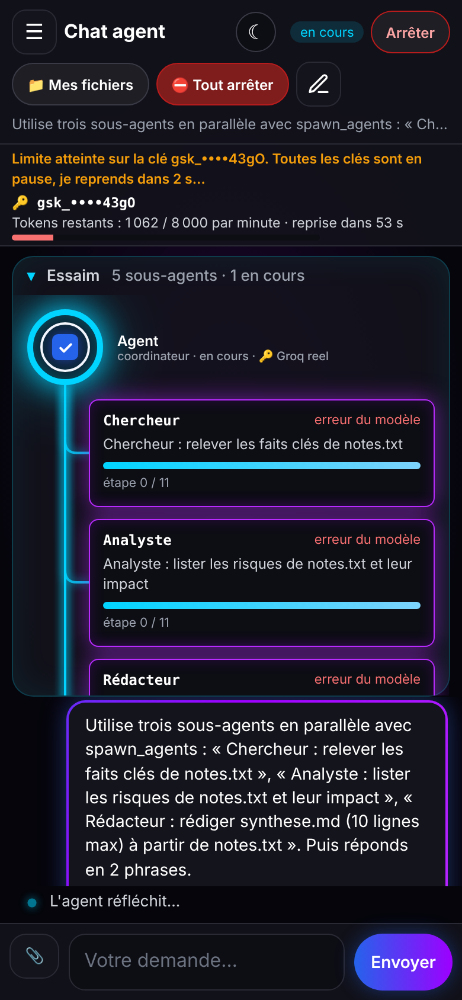
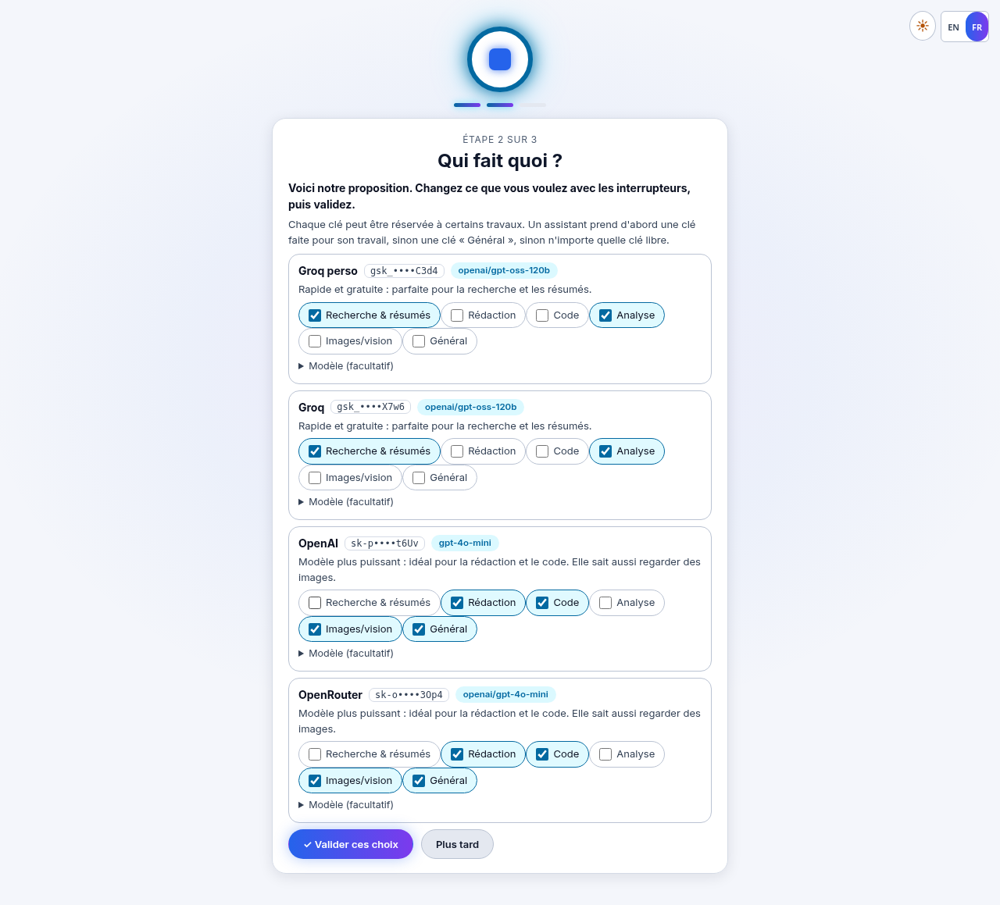
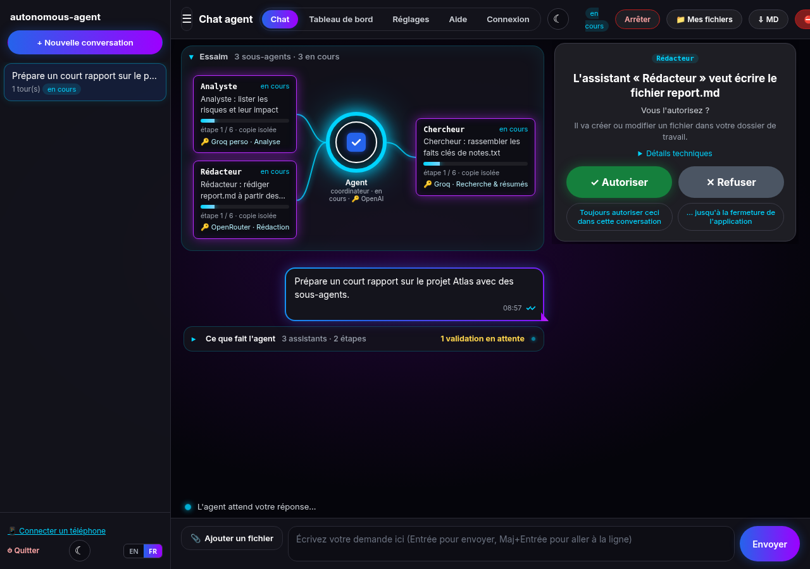
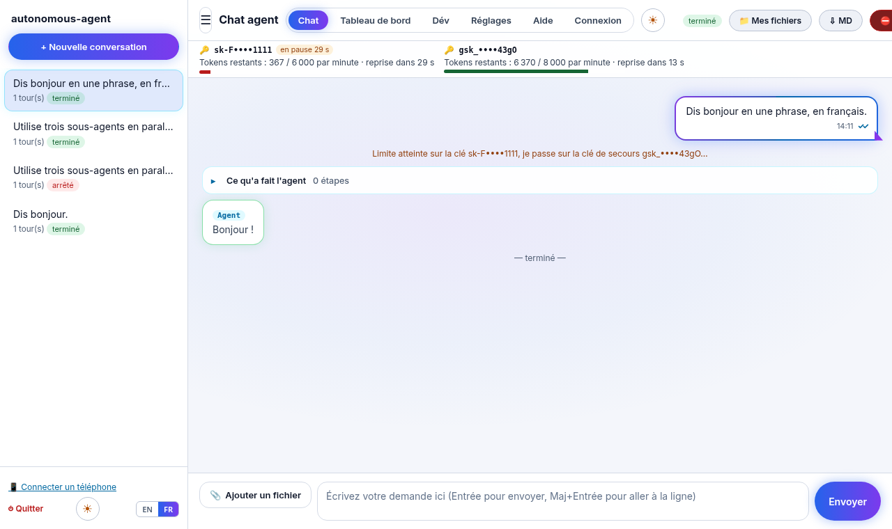

# API keys, limits and backup keys / Clés d'API, limites et clés de secours

**[English](#english) | [Français](#francais)** · [← README](../README.md) · [Docs](README.md)

<a id="english"></a>

## English

#### Several keys = several assistants at the same time (new in 0.7)

**The more keys you add, the more your assistants work at the same time.** In the wizard ("I have several
keys") or in ⚙ Settings → API keys → **Paste several keys**, paste all your keys at once, one per line
(optionally `name: key`), or add them one by one with **+ Add another key**. Each key's service is
recognised from its first letters, all keys are **tested at the same time**, and you get one plain line per
key (✓ "Works: saved as Groq 2" / ✗ "Groq refuses this key: it is wrong or was deleted"). Only the working
ones are saved; keys are only ever displayed masked (`gsk_••••a1b2`) and stored like before.

Then **Who does what?** proposes a job for each key, in plain words: fast / free keys for *Research &
summaries* and *Analysis*, stronger models for *Writing* and *Code* (and *Images/vision* when the model can
see images). Accept with one click or adjust with the switches (and optionally the model). When the swarm
runs, each helper gets **its own key**: first a key made for its job (a "Researcher" takes a research key),
otherwise a *General* key, otherwise any free key. Helpers work in parallel, **one per working key** by
default (Settings → *Assistants at the same time*: Automatic, or 1 to 8 if you prefer they share keys). The
live graph shows which key (masked) each helper uses and for which job.

| Wizard: who does what? | Each helper on its own key |
|---|---|
|  |  |

#### Never stopped by a rate limit (new in 0.8.1)

🔁 **Automatic backup key** — when a key hits a rate limit or quota (429), times out or the service has an
error (5xx), the same request goes **at once** to another key (one made for the same job first, then any
other key, and as a last resort a key saved for another use). Helpers in a swarm do the same, mid-task,
without losing their work. With a single key (e.g. a free Groq key) the assistant **waits for the key to
come back** (it follows the provider's "retry after", at most 60 s per pause) and carries on instead of
stopping. Only keys that cannot come back end a task (every key refused / revoked, daily limit reached),
with a clear message. The chat says what happens in plain words: *"Limit reached on key gsk_••••43gO,
switching to the backup key…"*, *"All keys are paused, resuming in 4 s…"*.

📊 **Tokens left per minute** — a status bar under the chat header (also on phones) and the dashboard show,
per key (masked), *"Tokens left: 5,200 / 8,000 per minute · back in 12 s"* with a small bar, from the
provider's own figures (`x-ratelimit-*` headers) or, until the first answer, an **estimate** (clearly marked)
from the tokens used in the last 60 seconds. Tip: add a second (backup) key to avoid pauses.

| Switch to the backup key | Phone: pause and counter |
|---|---|
|  |  |

Notes: the server only listens on `127.0.0.1` (your computer); port 8765 if free, else another one. The
macOS builds are separate for Apple Silicon and Intel. Advanced: build it yourself with
`pip install pyinstaller && pyinstaller packaging/autonomous-agent.spec` (output in `dist/`), or run
`python -m agent.desktop` from a clone (`AGENT_TERMINAL=1` on macOS reopens the app in Terminal to watch
the logs).

### Several API keys, by category, with limits

Optional. Without a keys file nothing changes: the single key from `.env` is used as before.
Copy `providers.example.yaml` to `providers.yaml` (git-ignored; or pass `--keys FILE`, or set
`AGENT_KEYS_FILE`). Each entry names the **environment variable** holding the key (`key_env`), never
the key itself, plus its `provider`/`base_url`, `model` or `models` per category, `categories` (`text`,
`code`, `image`, `audio_tts`, `audio_stt`, `embeddings`, or your own), `priority` (lower first),
optional `pricing`, and `limits`: `requests_per_minute`, `requests_per_day`, `tokens_per_day`,
`tokens_per_month`, `cost_per_day`, `cost_per_month` (in your `currency`, needs `pricing`),
`images_per_day`, `audio_minutes_per_day`.

```yaml
currency: EUR
keys:
  - name: groq-main
    provider: groq
    key_env: GROQ_API_KEY
    categories: [text, code]
    model: openai/gpt-oss-20b
    priority: 1
    pricing: {input_per_1m: 0.15, output_per_1m: 0.60}
    limits: {requests_per_day: 1000, tokens_per_day: 500000, cost_per_month: 5}
  - name: openrouter-backup
    provider: openrouter
    key_env: OPENROUTER_API_KEY
    categories: [text, code]
    model: openai/gpt-4o-mini
    priority: 2
```

- **Routing**: for each model call the router takes the first key of the category (by priority) that
  is set, not cooling down, and can take the request **without exceeding any limit**. The request is
  reserved before it is sent (tokens: estimated prompt + a `max_tokens` cap sent to the provider,
  cost from `pricing`), so parallel agents cannot overshoot together. The real usage is recorded after.
- **Failover (0.8.1)**: a 429 (honouring `Retry-After`, or Groq's "try again in Xs"), a timeout, a
  network error or a 5xx puts the key on cooldown and the **same call** goes at once to the next key: same
  job first, then any key of the category, then (last resort) a key of the other chat category (`text` /
  `code`). When every key is only paused, the call **waits** for the first to come back (max 60 s per
  pause, 6 pauses) and resumes; the agent keeps its progress. A 401 / 402 / 403 sets the key aside (until
  the keys are edited); the call stops with `llm_error` only when no key can come back (all refused,
  missing, daily / monthly limit), with the reason for each key. Each switch / pause is a `keys` event
  (masked keys only). Nothing is ever sent over a limit.
- **Tokens per minute (0.8.1)**: `GET /keys/rate` gives, per key (masked), tokens (and requests) left,
  limit and seconds until reset, from the provider's `x-ratelimit-*` headers (`source: provider`) or
  estimated from the last 60 s (`source: estimate`; 8,000 tokens/minute assumed for Groq).
- **Usage** is persisted in `<state-dir>/usage.json` (per minute / day / month, local time, plus
  cooldowns), so limits survive restarts. Hitting a limit or a provider error is audit-logged
  (`event: key_limit` / `key_error`).
- `--category code` picks the category for the chat model; `agent/media.py` gives minimal interfaces
  (`ImageGenerator`, `TextToSpeech`, `SpeechToText`, `Embeddings`) that reserve a key of their
  category for the provider call you plug in (no image/audio generation is built in).
- `python -m agent keys` and the harness (`GET /keys`, chat sidebar, `/dashboard`) show the remaining
  quota per key and category, with keys masked (`gsk_…abcd`).
- **Key pool (0.7)**: every swarm agent (`root`, `root.1`, `root.2`…) gets its **own** key and keeps it
  while it works. Order: keys whose `tasks` match the agent's job (from its task text, EN/FR keywords:
  *Researcher / Chercheur* → `research`, *Writer / Rédacteur* → `writing`, *Coder / Développeur* → `code`,
  *Analyst / Analyste* → `analysis`, *image / screenshot* → `vision`, otherwise `general`), then keys
  tagged `general` or untagged, then any key of the category; within a group the **least busy** key wins
  (fewest agents holding it, then fewest requests in flight, then priority). Limits are still checked
  and reserved first. On a limit, a 429, a 5xx / network error or a refused key (401 / 402 / 403) the key
  cools down and the agent **fails over** to the next key; with fewer keys than agents, agents share the
  least busy keys. Parallelism = number of working keys (at most 8), or the number set in Settings
  (`parallel`); demo / single-key mode keeps `--max-parallel`. In `providers.yaml`: `tasks: [research,
  analysis]`. Each change of key is audit-logged (`event: key_assign`, key masked).
- **Bulk entry (0.7)**: `POST /app/providers/bulk {"text"}` (Settings / wizard) parses one key per line
  (`label: key`, `NAME=key`, `export NAME="key"`), detects the provider, tests all keys concurrently and
  saves the working ones; `POST /app/providers/propose` and `POST /app/providers/tasks {"assign": {id:
  [tasks] | {"tasks", "model"}}}` handle "Who does what?"; `GET /app/pool` shows the live pool. All
  responses carry masked keys only.

---

<a id="francais"></a>

## Français

#### Plusieurs clés = plusieurs assistants en même temps (nouveau en 0.7)

**Plus tu ajoutes de clés, plus tes assistants travaillent en même temps.** Dans l'assistant (« J'ai
plusieurs clés ») ou dans ⚙ Réglages → Clés d'API → **Coller plusieurs clés**, colle toutes tes clés d'un
coup, une par ligne (éventuellement `nom: clé`), ou ajoute-les une par une avec **+ Ajouter une autre
clé**. Le service de chaque clé est reconnu d'après ses premières lettres, toutes les clés sont **testées
en même temps**, avec une ligne claire par clé (✓ « Ça marche : enregistrée sous Groq 2 » / ✗ « Groq refuse
cette clé : elle est fausse ou a été supprimée »). Seules celles qui marchent sont enregistrées ; les clés
ne sont jamais affichées en clair (`gsk_••••a1b2`) et sont rangées comme avant.

Ensuite, **Qui fait quoi ?** propose un travail pour chaque clé, en mots simples : clés rapides / gratuites
pour *Recherche & résumés* et *Analyse*, modèles plus puissants pour *Rédaction* et *Code* (et
*Images/vision* si le modèle sait lire les images). Valide en un clic ou ajuste avec les interrupteurs
(et, si tu veux, le modèle). Quand l'essaim travaille, chaque assistant reçoit **sa propre clé** :
d'abord une clé faite pour son travail (un « Chercheur » prend une clé de recherche), sinon une clé
*Général*, sinon n'importe quelle clé libre. Les assistants travaillent en parallèle, **un par clé qui
marche** par défaut (Réglages → *Assistants en même temps* : Automatique, ou de 1 à 8 si tu préfères
qu'ils partagent les clés). Le graphe en direct montre quelle clé (masquée) chaque assistant utilise, et
pour quel travail.

| Assistant : qui fait quoi ? | Chaque assistant sur sa propre clé |
|---|---|
|  |  |

#### Plus jamais coupé par une limite (nouveau en 0.8.1)

🔁 **Clé de secours automatique** — quand une clé atteint une limite ou un quota (429), ne répond pas à temps
ou que le service a une erreur (5xx), la même demande part **aussitôt** sur une autre clé (d'abord une clé
prévue pour le même travail, puis n'importe quelle autre, et en dernier recours une clé enregistrée pour un
autre usage). Les assistants d'un essaim font pareil, en pleine tâche, sans perdre leur travail. Avec une
seule clé (par exemple une clé Groq gratuite), l'assistant **attend que la clé revienne** (il suit le
« réessaie dans » du fournisseur, 60 s maximum par pause) et continue au lieu de s'arrêter. Seules les clés
qui ne peuvent pas revenir arrêtent une tâche (toutes les clés refusées ou révoquées, limite du jour
atteinte), avec un message clair. Le chat explique en mots simples : *« Limite atteinte sur la clé
gsk_••••43gO, je passe sur la clé de secours… »*, *« Toutes les clés sont en pause, je reprends dans 4 s… »*.

📊 **Tokens restants par minute** — une barre sous l'en-tête du chat (aussi sur téléphone) et le tableau de
bord affichent, par clé (masquée), *« Tokens restants : 5 200 / 8 000 par minute · reprise dans 12 s »* avec
une petite jauge, d'après les chiffres du fournisseur (en-têtes `x-ratelimit-*`) ou, avant la première
réponse, une **estimation** (indiquée « estimé ») à partir des tokens utilisés pendant les 60 dernières
secondes. Astuce : ajoute une deuxième clé (de secours) pour éviter les pauses.

| Passage sur la clé de secours | Téléphone : pause et compteur |
|---|---|
|  |  |

Remarques : le serveur n'écoute que sur `127.0.0.1` (ton ordinateur) ; port 8765 s'il est libre, sinon
un autre. Les versions macOS sont distinctes pour puce Apple et Intel. Avancé : compiler soi-même avec
`pip install pyinstaller && pyinstaller packaging/autonomous-agent.spec` (résultat dans `dist/`), ou
lancer `python -m agent.desktop` depuis un clone (`AGENT_TERMINAL=1` sur macOS rouvre l'app dans
Terminal pour voir le journal).

### Plusieurs clés d'API, par catégorie, avec limites

Facultatif. Sans fichier de clés rien ne change : la clé unique du `.env` est utilisée comme avant.
Copie `providers.example.yaml` en `providers.yaml` (ignoré par git ; ou `--keys FICHIER`, ou la
variable `AGENT_KEYS_FILE`). Chaque entrée indique la **variable d'environnement** qui contient la clé
(`key_env`), jamais la clé elle-même, plus `provider`/`base_url`, `model` ou `models` par catégorie,
`categories` (`text`, `code`, `image`, `audio_tts`, `audio_stt`, `embeddings`, ou les tiennes),
`priority` (la plus basse d'abord), `pricing` facultatif et des `limits` : `requests_per_minute`,
`requests_per_day`, `tokens_per_day`, `tokens_per_month`, `cost_per_day`, `cost_per_month` (dans ta
`currency`, nécessite `pricing`), `images_per_day`, `audio_minutes_per_day`.

```yaml
currency: EUR
keys:
  - name: groq-main
    provider: groq
    key_env: GROQ_API_KEY
    categories: [text, code]
    model: openai/gpt-oss-20b
    priority: 1
    pricing: {input_per_1m: 0.15, output_per_1m: 0.60}
    limits: {requests_per_day: 1000, tokens_per_day: 500000, cost_per_month: 5}
  - name: openrouter-backup
    provider: openrouter
    key_env: OPENROUTER_API_KEY
    categories: [text, code]
    model: openai/gpt-4o-mini
    priority: 2
```

- **Choix de la clé** : à chaque appel du modèle, le routeur prend la première clé de la catégorie (par
  priorité) qui est définie, pas en pause, et qui peut accepter la requête **sans dépasser aucune
  limite**. La requête est réservée avant l'envoi (jetons : invite estimée + plafond `max_tokens`
  envoyé au fournisseur, coût d'après `pricing`), donc des agents en parallèle ne peuvent pas dépasser
  ensemble. La consommation réelle est enregistrée ensuite.
- **Bascule (0.8.1)** : un 429 (avec `Retry-After`, ou le « try again in Xs » de Groq), un délai dépassé,
  une erreur réseau ou 5xx met la clé en pause et **la même demande** part aussitôt sur la clé suivante :
  même travail d'abord, puis n'importe quelle clé de la catégorie, puis (dernier recours) une clé de l'autre
  catégorie de chat (`text` / `code`). Quand toutes les clés sont seulement en pause, la demande **attend**
  la première qui revient (60 s max par pause, 6 pauses) et reprend ; l'agent garde son travail. Un 401 /
  402 / 403 met la clé de côté (jusqu'à la modification des clés) ; l'appel s'arrête en `llm_error`
  seulement quand aucune clé ne peut revenir (toutes refusées, absentes, limite du jour / du mois), avec la
  raison pour chaque clé. Chaque bascule / pause est un évènement `keys` (clés masquées). Rien n'est jamais
  envoyé au-delà d'une limite.
- **Tokens par minute (0.8.1)** : `GET /keys/rate` donne, par clé (masquée), les tokens (et requêtes)
  restants, la limite et les secondes avant la remise à zéro, d'après les en-têtes `x-ratelimit-*` du
  fournisseur (`source: provider`) ou estimés sur les 60 dernières secondes (`source: estimate` ; 8 000
  tokens/minute supposés pour Groq).
- **Consommation** enregistrée dans `<state-dir>/usage.json` (par minute / jour / mois, heure locale,
  plus les pauses), donc les limites tiennent après un redémarrage. Une limite atteinte ou une erreur
  du fournisseur est journalisée (`event: key_limit` / `key_error`).
- `--category code` choisit la catégorie du modèle de chat ; `agent/media.py` fournit des interfaces
  minimales (`ImageGenerator`, `TextToSpeech`, `SpeechToText`, `Embeddings`) qui réservent une clé de
  leur catégorie pour l'appel au fournisseur que tu branches (pas de génération d'image/son intégrée).
- `python -m agent keys` et le harness (`GET /keys`, barre latérale du chat, `/dashboard`) affichent le
  quota restant par clé et par catégorie, avec les clés masquées (`gsk_…abcd`).


- **Réserve de clés (0.7)** : chaque agent de l'essaim (`root`, `root.1`, `root.2`…) reçoit **sa propre**
  clé et la garde pendant son travail. Ordre : les clés dont les `tasks` correspondent au travail de
  l'agent (d'après le texte de sa tâche, mots-clés EN/FR : *Chercheur / Researcher* → `research`,
  *Rédacteur / Writer* → `writing`, *Développeur / Coder* → `code`, *Analyste / Analyst* → `analysis`,
  *image / capture* → `vision`, sinon `general`), puis les clés `general` ou sans étiquette, puis n'importe
  quelle clé de la catégorie ; dans un groupe, la clé **la moins occupée** gagne. Les limites restent
  vérifiées et réservées d'abord. Sur une limite, un 429, une erreur 5xx / réseau ou une clé refusée
  (401 / 402 / 403), la clé se repose et l'agent **passe à la suivante** ; avec moins de clés que
  d'agents, ils partagent les moins occupées. Parallélisme = nombre de clés qui marchent (8 au plus), ou
  le nombre choisi dans Réglages (`parallel`). Dans `providers.yaml` : `tasks: [research, analysis]`.
  Chaque changement de clé est journalisé (`event: key_assign`, clé masquée).
- **Saisie groupée (0.7)** : `POST /app/providers/bulk {"text"}` lit une clé par ligne (`nom: clé`,
  `NOM=clé`, `export NOM="clé"`), reconnaît le service, teste toutes les clés en même temps et enregistre
  celles qui marchent ; `POST /app/providers/propose` et `POST /app/providers/tasks` gèrent « Qui fait
  quoi ? » ; `GET /app/pool` montre la réserve en direct. Les réponses ne contiennent que des clés masquées.
