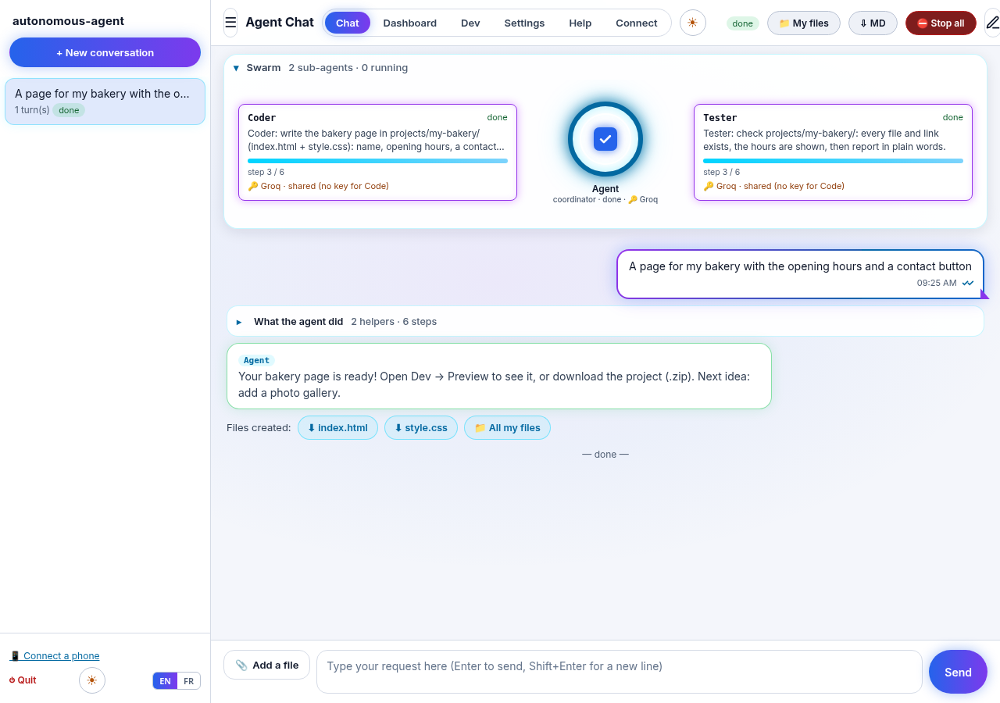
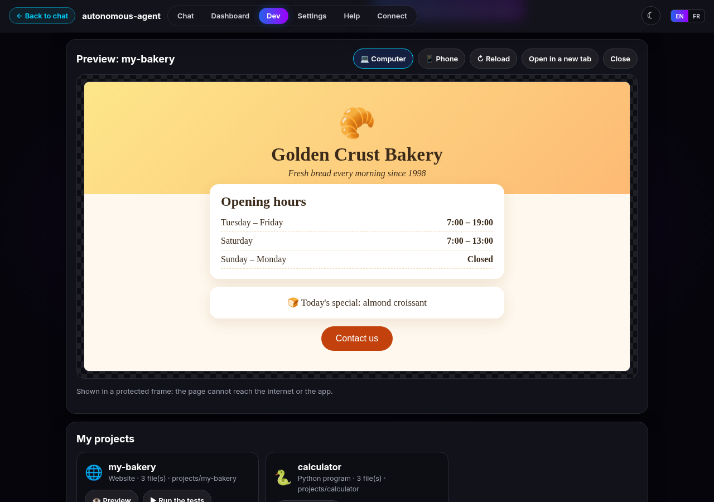
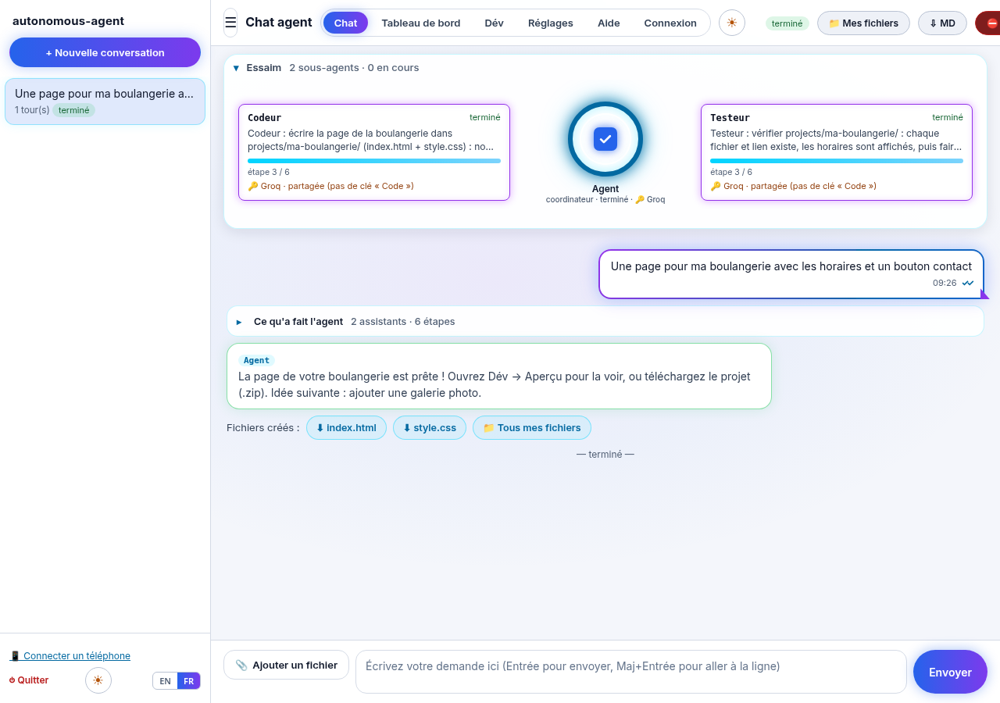
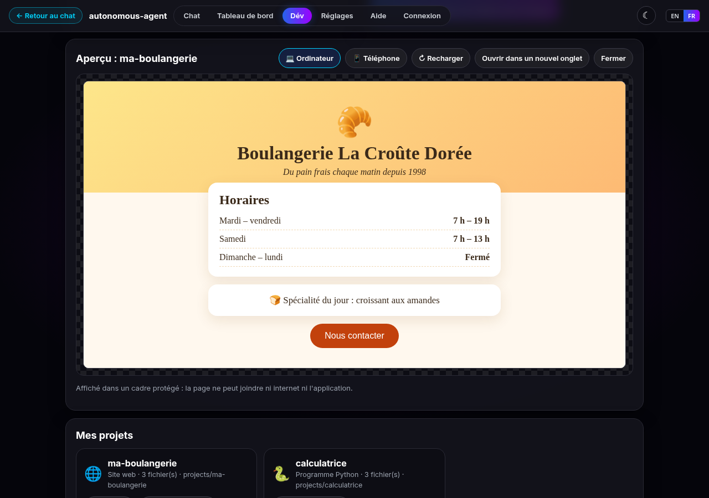

# Permissions, sandbox and developer mode / Permissions, bac à sable et mode développeur

**[English](#english) | [Français](#francais)** · [← README](../README.md) · [Docs](README.md)

<a id="english"></a>

## English

#### Sandbox and developer mode (new in 0.8)

🛡️ **Sandbox** — commands started by your assistants run in a protected space: only simple, safe commands
(`ls`, `cat`, `grep`, `find`, `mkdir`, `cp`, `mv`, `rm`, `python file.py`, `pytest`…), **only inside your work
folder**, never on the internet, never with your keys, with time, processor, memory and output limits. It is
**always on in Simple mode**; in Expert mode, ⚙ Settings → *Sandbox* can turn it off after a clear warning.

🧑‍💻 **Developer mode** — the new **Dev** tab: pick a name, choose **🌐 Website** or **🐍 Python program**, then
describe what you want ("A page for my bakery with the opening hours and a contact button"). A **Coder**
writes the files, a **Tester** checks them and runs the tests, and you see the result right away:
**👁 Preview** shows the website in a protected frame (computer or phone size), **▶ Run the tests** runs them
in the sandbox and answers in plain words, **⬇ Download the project (.zip)** gives you everything.

| Coder + Tester at work | Live preview |
|---|---|
|  |  |

### Permission model

`permissions.yaml` (or `.json`). Resolution for each call:

1. mode = `tools.<tool>` if set, otherwise `defaults.<category>`;
2. a matching **deny** pattern (`paths.deny`, `commands.deny`, `domains.deny`) → **deny** (always wins, even with `--yolo`);
3. `paths.allow` non-empty and the path does not match → deny;
4. `commands.allow` / `domains.allow` match and mode is `ask` → allow;
5. `--yolo` turns `ask` into `allow` **except for `send` and `spend`**: those only follow what you wrote in the file.

Safe defaults: `read: allow`, `write: ask`, `execute: ask`, `network: ask`, `send: ask`, `spend: deny`, `delegate: ask`.
`ask` prompts `[y]es / [n]o / [a]lways this session`; without a terminal, `ask` means refused.

```yaml
defaults: {read: allow, write: ask, execute: ask, network: ask, send: ask, spend: deny}
tools:
  memory_write: allow
  shell: deny            # e.g. forbid the shell completely
paths:
  deny: [".env", "**/.env", "**/*.pem", ".git/**", ".agent/**"]
commands:
  allow: ["git status*", "python -m pytest*"]
  deny: ["sudo *", "*rm -rf /*", "*curl *|*sh*"]
domains:
  allow: ["api.github.com"]
```

**Audit**: `<state-dir>/audit.jsonl`, one JSON line per tool call (allowed, refused, invalid),
opened in `O_APPEND` mode. Arguments and results are truncated and redacted: values of environment
variables whose name contains KEY/TOKEN/SECRET/PASSWORD…, and common token formats (`sk-…`, `gsk_…`,
`ghp_…`, `github_pat_…`, Bearer, private keys). The shell tool runs with those variables removed
from its environment.

### Sandbox mode and developer mode

**Sandbox** (`agent/sandbox.py`). When it is on, the `shell` tool never reaches a real shell:

- the command line is parsed with `shlex`; `; | & < > $ \` ( )` and newlines are refused (one command at a time);
- allowlist: `ls cat head tail wc grep find echo pwd mkdir touch rm cp mv diff sort uniq date true` are
  implemented in Python (same behaviour on Windows, macOS and Linux; `find` without `-exec`/`-delete`),
  plus `python file.py`, `python -m pytest|unittest|py_compile|compileall|json.tool|doctest` and `pytest`;
- every path is resolved (symlinks followed) and must stay inside the workspace; `~`, `..` escapes,
  absolute system paths and links pointing outside are refused; the app's private data folder is refused
  even when it is inside the workspace;
- Python runs as a child process with `shell=False`, `-I` (isolated), a **minimal environment** (no
  variables from your session: no keys or tokens; `HOME`/`TMPDIR` inside the workspace; proxies pointed at a
  dead port), and a **Python audit hook** that refuses network calls, starting other programs, `ctypes`, and
  reading or writing files outside the workspace (reads of the Python installation are allowed);
- limits: 60 s per command (the process group is killed), CPU 60 s, memory 1.5 GB and files 64 MB
  (`setrlimit`, POSIX), output capped (12,000 characters by default).

In the app, the sandbox is **always on in Simple mode**; in Expert mode, Settings → *Sandbox* turns it off
after a confirmation (audited as `sandbox_off`). From the command line: `--sandbox` or `AGENT_SANDBOX=1`.
When it is on, the approval card for a command says so, and the system prompt tells the model the rules.

**Developer mode** (`/dev`, `agent/devmode.py`). Projects live in `<workspace>/projects/<name>/`:

| Template | Files | Tests |
|---|---|---|
| 🌐 Website | `index.html`, `style.css`, `script.js` | static check: every local link, image, script and stylesheet exists; internet files are flagged |
| 🐍 Python program | `main.py`, `test_main.py` (unittest), `README.md` | `pytest` if available, else `python -m unittest` — always in the sandbox |

"Build it with a Coder and a Tester" starts a conversation (`POST /tasks` with `"dev": "<project>"`) whose
system prompt asks for a `Coder:` helper that writes the files, then a `Tester:` helper that checks them and
runs the tests (both use code keys from the key pool). **Preview** serves the project at
`/preview/<token>/<project>/` (the token is an HMAC of the name with a per-run secret, so it also works from
a phone) with `Content-Security-Policy: sandbox allow-scripts …; connect-src 'none'; form-action 'none'`, in
an `<iframe sandbox="allow-scripts allow-forms allow-modals">` (opaque origin: the page cannot call the
app or the internet). **Download the project (.zip)** = `GET /dev/zip?project=<name>` (caches and hidden
files left out). API: `GET /dev/projects`, `POST /dev/projects {name, kind}`, `POST /dev/test {project}`.

---

<a id="francais"></a>

## Français

#### Bac à sable et mode développeur (nouveau en 0.8)

🛡️ **Bac à sable** — les commandes lancées par tes assistants s'exécutent dans un espace protégé : uniquement
des commandes simples et sûres (`ls`, `cat`, `grep`, `find`, `mkdir`, `cp`, `mv`, `rm`, `python fichier.py`,
`pytest`…), **seulement dans ton dossier de travail**, jamais sur internet, jamais avec tes clés, avec des
limites de temps, de processeur, de mémoire et de sortie. Il est **toujours activé en mode Simple** ; en mode
Expert, ⚙ Réglages → *Bac à sable* permet de le désactiver après un avertissement clair.

🧑‍💻 **Mode développeur** — le nouvel onglet **Dév** : choisis un nom, **🌐 Site web** ou **🐍 Programme
Python**, puis décris ce que tu veux (« Une page pour ma boulangerie avec les horaires et un bouton
contact »). Un **Codeur** écrit les fichiers, un **Testeur** les vérifie et lance les tests, et tu vois le
résultat tout de suite : **👁 Aperçu** affiche le site dans un cadre protégé (taille ordinateur ou téléphone),
**▶ Lancer les tests** les exécute dans le bac à sable et répond en mots simples, **⬇ Télécharger le projet
(.zip)** te donne tout.

| Codeur + Testeur au travail | Aperçu en direct |
|---|---|
|  |  |

### Modèle de permissions

`permissions.yaml` (ou `.json`). Pour chaque appel :

1. mode = `tools.<outil>` s'il est défini, sinon `defaults.<catégorie>` ;
2. un motif **deny** correspondant (`paths.deny`, `commands.deny`, `domains.deny`) → **refus** (gagne toujours, même avec `--yolo`) ;
3. `paths.allow` non vide et chemin non couvert → refus ;
4. `commands.allow` / `domains.allow` correspondant et mode `ask` → autorisé ;
5. `--yolo` transforme `ask` en `allow` **sauf pour `send` et `spend`** : pour ces deux-là, seul ce que tu as écrit dans le fichier compte.

Défauts sûrs : `read: allow`, `write: ask`, `execute: ask`, `network: ask`, `send: ask`, `spend: deny`, `delegate: ask`.
`ask` demande `[y]es / [n]o / [a]lways` (oui / non / toujours pour cette session) ; sans terminal,
`ask` vaut refus.

```yaml
defaults: {read: allow, write: ask, execute: ask, network: ask, send: ask, spend: deny}
tools:
  memory_write: allow
  shell: deny            # par ex. interdire complètement le shell
paths:
  deny: [".env", "**/.env", "**/*.pem", ".git/**", ".agent/**"]
commands:
  allow: ["git status*", "python -m pytest*"]
  deny: ["sudo *", "*rm -rf /*", "*curl *|*sh*"]
domains:
  allow: ["api.github.com"]
```

**Audit** : `<state-dir>/audit.jsonl`, une ligne JSON par appel d'outil (autorisé, refusé,
invalide), ouvert en mode `O_APPEND`. Arguments et résultats sont tronqués et masqués : valeurs des
variables d'environnement dont le nom contient KEY/TOKEN/SECRET/PASSWORD…, et formats de jetons
courants (`sk-…`, `gsk_…`, `ghp_…`, `github_pat_…`, Bearer, clés privées). Le shell s'exécute sans
ces variables dans son environnement.

### Bac à sable et mode développeur

**Bac à sable** (`agent/sandbox.py`). Quand il est activé, l'outil `shell` n'atteint jamais un vrai shell :

- la ligne est découpée avec `shlex` ; `; | & < > $ \` ( )` et les retours à la ligne sont refusés (une commande à la fois) ;
- liste autorisée : `ls cat head tail wc grep find echo pwd mkdir touch rm cp mv diff sort uniq date true`
  sont réécrites en Python (même comportement sous Windows, macOS et Linux ; `find` sans `-exec`/`-delete`),
  plus `python fichier.py`, `python -m pytest|unittest|py_compile|compileall|json.tool|doctest` et `pytest` ;
- chaque chemin est résolu (liens suivis) et doit rester dans l'espace de travail ; `~`, les sorties par `..`,
  les chemins système absolus et les liens qui pointent dehors sont refusés ; le dossier de données privées
  de l'app est refusé même s'il est dans l'espace de travail ;
- Python tourne dans un processus enfant avec `shell=False`, `-I` (isolé), un **environnement minimal**
  (aucune variable de ta session : ni clés ni jetons ; `HOME`/`TMPDIR` dans l'espace de travail ; proxys
  vers un port mort) et un **hook d'audit Python** qui refuse le réseau, le lancement d'autres programmes,
  `ctypes`, et la lecture ou l'écriture hors de l'espace de travail (lecture de l'installation Python permise) ;
- limites : 60 s par commande (le groupe de processus est tué), processeur 60 s, mémoire 1,5 Go et fichiers
  64 Mo (`setrlimit`, POSIX), sortie plafonnée (12 000 caractères par défaut).

Dans l'app, le bac à sable est **toujours activé en mode Simple** ; en mode Expert, Réglages → *Bac à sable*
le désactive après confirmation (audité `sandbox_off`). En ligne de commande : `--sandbox` ou `AGENT_SANDBOX=1`.
Quand il est activé, la carte de validation d'une commande le dit, et le prompt système donne les règles au modèle.

**Mode développeur** (`/dev`, `agent/devmode.py`). Les projets sont dans `<espace>/projects/<nom>/` :

| Modèle | Fichiers | Tests |
|---|---|---|
| 🌐 Site web | `index.html`, `style.css`, `script.js` | contrôle statique : chaque lien, image, script et feuille de style locale existe ; les fichiers internet sont signalés |
| 🐍 Programme Python | `main.py`, `test_main.py` (unittest), `README.md` | `pytest` s'il est disponible, sinon `python -m unittest` — toujours dans le bac à sable |

« Le construire avec un Codeur et un Testeur » lance une conversation (`POST /tasks` avec `"dev": "<projet>"`)
dont le prompt système demande un assistant `Coder:` qui écrit les fichiers, puis un assistant `Tester:` qui
les vérifie et lance les tests (tous deux prennent des clés « Code » de la réserve). **Aperçu** sert le projet
sur `/preview/<jeton>/<projet>/` (jeton = HMAC du nom avec un secret par lancement, donc utilisable depuis un
téléphone) avec `Content-Security-Policy: sandbox allow-scripts …; connect-src 'none'; form-action 'none'`, dans
une `<iframe sandbox="allow-scripts allow-forms allow-modals">` (origine opaque : la page ne peut appeler ni
l'app ni internet). **Télécharger le projet (.zip)** = `GET /dev/zip?project=<nom>` (caches et fichiers
cachés exclus). API : `GET /dev/projects`, `POST /dev/projects {name, kind}`, `POST /dev/test {project}`.
