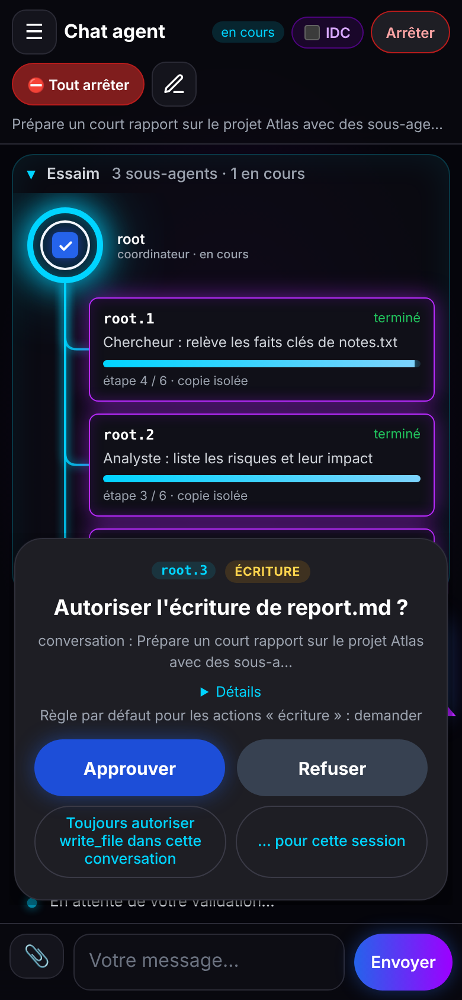
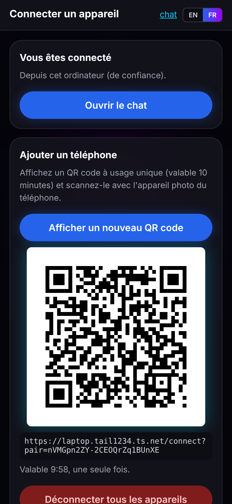

# Use from your phone / Utiliser depuis le téléphone

**[English](#english) | [Français](#francais)** · [← README](../README.md) · [Docs](README.md)

<a id="english"></a>

## English

### Use from your phone

<p> </p>

The chat and the dashboard work on a phone (drawer sidebar, big approval buttons, bottom-sheet approval
cards) and can be installed as an app (PWA). To reach the harness from anywhere, keep it on
`127.0.0.1` and put a **private HTTPS tunnel** in front of it. `--remote` makes sign-in mandatory.

**1. Tailscale (recommended: private to your devices, HTTPS)**

1. Install Tailscale on the computer and on the phone, sign in to the same account on both
   (https://tailscale.com/download). Enable HTTPS certificates in the admin console (DNS → HTTPS).
2. Start the harness with the tunnel:
   ```bash
   python -m agent serve --remote --tunnel tailscale
   ```
   This runs `tailscale serve --bg 8765` and prints `https://<machine>.<tailnet>.ts.net/`, plus a
   **QR code** in the console. (Manual equivalent: `tailscale serve --bg 8765`, then
   `python -m agent serve --remote --public-url https://<machine>.<tailnet>.ts.net`.)
   To stop sharing later: `tailscale serve --https=443 off`.
3. Scan the QR code with the phone camera: it opens `/connect?pair=…` and signs the phone in.

**2. Cloudflare Tunnel (no account needed for a quick tunnel, public URL)**

1. Install `cloudflared` (https://developers.cloudflare.com/cloudflare-one/connections/connect-networks/downloads/).
2. `python -m agent serve --remote --tunnel cloudflared` starts
   `cloudflared tunnel --url http://127.0.0.1:8765`, reads the random `https://….trycloudflare.com` URL
   and prints the QR code. The tunnel stops with the harness. The URL is **public** (anyone who has it
   reaches the sign-in page), so the token and the rate limits are what protect you. For a permanent
   hostname, use a named tunnel in your Cloudflare account, ideally with Cloudflare Access in front.

**Sign in, QR codes, install**

- The QR code holds the URL and a **one-time pairing code** (valid 10 minutes, used once). After
  scanning, the phone keeps a session cookie (HttpOnly, SameSite=Strict, Secure over HTTPS, 30 days).
  No QR at hand? Open `/connect` on the phone and paste the token.
- New code for another device: open `http://127.0.0.1:8765/connect` on the computer → **Show a new QR
  code**. The same page can **sign out every device**.
- The token: `AGENT_HARNESS_TOKEN` (at least 24 characters), else one is generated in
  `<state-dir>/remote-token` (file mode 0600) and its location is printed (never the token itself).
- Install the app: iPhone/iPad → Safari → Share → **Add to Home Screen**. Android → Chrome → ⋮ →
  **Install app** / **Add to Home screen**. The service worker only caches the page shell (HTML, icons,
  manifest), never the API, conversations or approvals; it needs HTTPS (a tunnel) or localhost.
- Desktop app: set the same options in its `.env` (`AGENT_REMOTE=1`, `AGENT_TUNNEL=tailscale` or
  `cloudflared`, optionally `AGENT_REMOTE_URL`, `AGENT_HARNESS_TOKEN`).
- Without a tunnel tool, `serve --remote` prints which one to install (or the command to run if
  one is found). `--no-qr` / `AGENT_QR=0` hides the QR code.

**Security model**

- In remote mode every API call needs the token (Bearer), a session cookie, or must come straight
  from this computer (loopback, `localhost` Host, no proxy headers; `AGENT_REMOTE_LOCAL_AUTH=1` turns
  that trust off). Anything relayed by a tunnel must sign in.
- Logins are rate limited (10 failures per client and 50 in total per 5 minutes → HTTP 429).
- POSTs must be JSON and same-origin; a cookie-authenticated POST without `Origin` is refused.
  Pages send `Referrer-Policy: no-referrer`; API answers are `Cache-Control: no-store`.
- Send/spend approvals are still never auto-approved, and sub-agent creation still asks by default:
  the phone only shows the same approval cards.
- The harness refuses to start without a token in remote mode or when bound to another address than
  localhost. `--host 0.0.0.0` (LAN) works but prints a loud **plain HTTP** warning: the token and the
  conversation travel unencrypted on that network. Prefer a tunnel.

**Settings from a phone.** Phone access can be turned on from ⚙ Settings → Phone access (tunnel choice,
QR code, new token; a restart applies it). Changing settings or API keys stays **reserved to the computer
running the agent**: a remote device sees a 🔒 notice. To allow signed-in devices to change them, start the
agent with `AGENT_REMOTE_SETTINGS=1`; every change then needs the sign-in token or session **and** an
anti-CSRF token (`X-CSRF-Token`), and the page shows a warning banner.

---

<a id="francais"></a>

## Français

### Utiliser depuis le mobile

<p> </p>

Le chat et le tableau de bord s'utilisent sur téléphone (barre latérale en tiroir, gros boutons de
validation, cartes de validation en bas d'écran) et s'installent comme une appli (PWA). Pour y accéder
de partout, laisse le harness sur `127.0.0.1` et place devant un **tunnel HTTPS privé**. `--remote`
rend la connexion obligatoire.

**1. Tailscale (recommandé : privé à tes appareils, HTTPS)**

1. Installe Tailscale sur l'ordinateur et sur le téléphone, connecte-toi au même compte
   (https://tailscale.com/download). Active les certificats HTTPS dans la console (DNS → HTTPS).
2. Lance le harness avec le tunnel :
   ```bash
   python -m agent serve --remote --tunnel tailscale
   ```
   Cela exécute `tailscale serve --bg 8765` et affiche `https://<machine>.<tailnet>.ts.net/` ainsi
   qu'un **QR code** dans la console. (Équivalent manuel : `tailscale serve --bg 8765`, puis
   `python -m agent serve --remote --public-url https://<machine>.<tailnet>.ts.net`.)
   Pour arrêter le partage : `tailscale serve --https=443 off`.
3. Scanne le QR code avec l'appareil photo du téléphone : il ouvre `/connect?pair=…` et connecte le téléphone.

**2. Cloudflare Tunnel (sans compte pour un tunnel rapide, URL publique)**

1. Installe `cloudflared` (https://developers.cloudflare.com/cloudflare-one/connections/connect-networks/downloads/).
2. `python -m agent serve --remote --tunnel cloudflared` lance
   `cloudflared tunnel --url http://127.0.0.1:8765`, lit l'URL aléatoire `https://….trycloudflare.com`
   et affiche le QR code. Le tunnel s'arrête avec le harness. L'URL est **publique** (quiconque l'a voit
   la page de connexion) : c'est le jeton et les limites de tentatives qui te protègent. Pour un nom
   permanent, utilise un tunnel nommé dans ton compte Cloudflare, idéalement derrière Cloudflare Access.

**Connexion, QR codes, installation**

- Le QR code contient l'URL et un **code d'appairage à usage unique** (valable 10 minutes, une seule
  fois). Ensuite le téléphone garde un cookie de session (HttpOnly, SameSite=Strict, Secure en HTTPS,
  30 jours). Pas de QR sous la main ? Ouvre `/connect` sur le téléphone et colle le jeton.
- Nouveau code pour un autre appareil : ouvre `http://127.0.0.1:8765/connect` sur l'ordinateur →
  **Afficher un nouveau QR code**. La même page permet de **déconnecter tous les appareils**.
- Le jeton : `AGENT_HARNESS_TOKEN` (24 caractères minimum), sinon un jeton est généré dans
  `<state-dir>/remote-token` (fichier en mode 0600) et son emplacement est affiché (jamais le jeton).
- Installer l'appli : iPhone/iPad → Safari → Partager → **Sur l'écran d'accueil**. Android → Chrome →
  ⋮ → **Installer l'application** / **Ajouter à l'écran d'accueil**. Le service worker ne met en cache que
  l'enveloppe des pages (HTML, icônes, manifeste), jamais l'API, les conversations ni les validations ;
  il exige HTTPS (un tunnel) ou localhost.
- Application de bureau : mêmes options dans son `.env` (`AGENT_REMOTE=1`, `AGENT_TUNNEL=tailscale` ou
  `cloudflared`, éventuellement `AGENT_REMOTE_URL`, `AGENT_HARNESS_TOKEN`).
- Sans outil de tunnel, `serve --remote` indique lequel installer (ou la commande à lancer s'il en
  trouve un). `--no-qr` / `AGENT_QR=0` masque le QR code.

**Modèle de sécurité**

- En mode distant, chaque appel d'API exige le jeton (Bearer), un cookie de session, ou doit venir
  directement de cet ordinateur (loopback, Host `localhost`, aucun en-tête de proxy ;
  `AGENT_REMOTE_LOCAL_AUTH=1` retire cette confiance). Tout ce qui passe par un tunnel doit se connecter.
- Les connexions sont limitées (10 échecs par client et 50 au total par 5 minutes → HTTP 429).
- Les POST doivent être en JSON et de même origine ; un POST authentifié par cookie sans `Origin` est
  refusé. Les pages envoient `Referrer-Policy: no-referrer` ; les réponses d'API sont `Cache-Control: no-store`.
- Les envois et dépenses ne sont toujours jamais validés automatiquement, et la création de sous-agents
  demande toujours par défaut : le téléphone affiche simplement les mêmes cartes de validation.
- Le harness refuse de démarrer sans jeton en mode distant ou s'il écoute sur une autre adresse que
  localhost. `--host 0.0.0.0` (réseau local) fonctionne mais affiche un avertissement **HTTP en clair** :
  le jeton et la conversation circulent sans chiffrement sur ce réseau. Préfère un tunnel.

**Réglages depuis un téléphone.** L'accès téléphone s'active dans ⚙ Réglages → Accès téléphone (choix du
tunnel, QR code, nouveau jeton ; un redémarrage l'applique). Modifier les réglages ou les clés d'API reste
**réservé à l'ordinateur qui fait tourner l'agent** : un appareil distant voit un avis 🔒. Pour autoriser
les appareils connectés à les modifier, lance l'agent avec `AGENT_REMOTE_SETTINGS=1` ; chaque changement
exige alors le jeton ou la session **et** un jeton anti-CSRF (`X-CSRF-Token`), et la page affiche un
bandeau d'avertissement.
