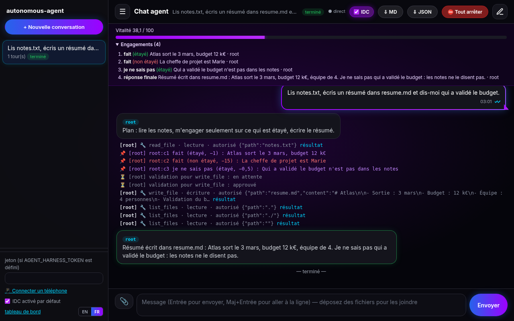
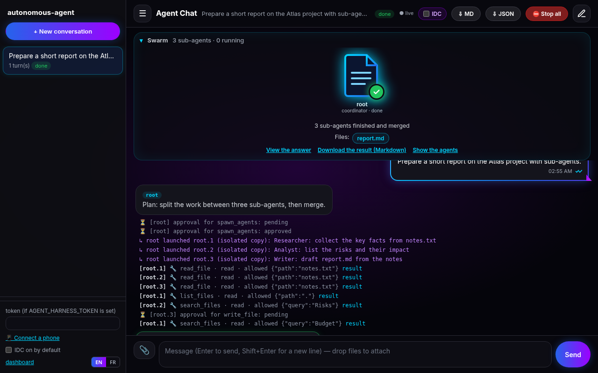
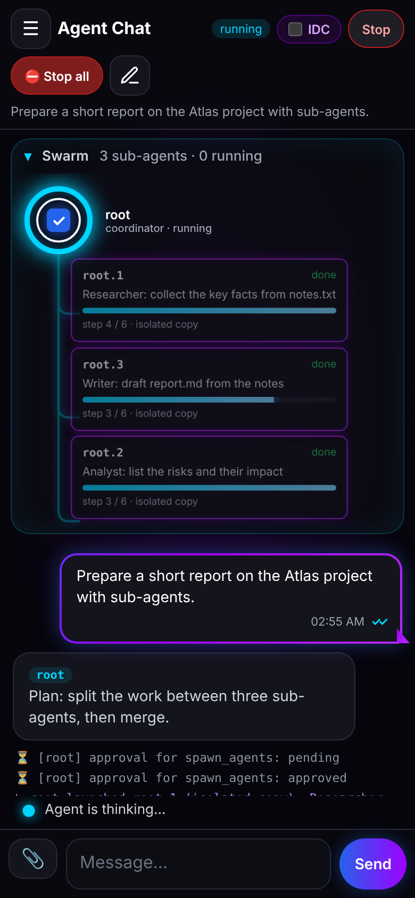

# Swarm (sub-agents) and IDC mode / Essaim (sous-agents) et mode IDC

**[English](#english) | [Français](#francais)** · [← README](../README.md) · [Docs](README.md)

<a id="english"></a>

## English

### Stop rule

The loop stops irreversibly at the first of: final answer, `max_steps`, `max_tool_calls`,
`max_tokens`, repeated identical call, LLM error. To plug in your own criterion:
`Agent(..., stop_rule=lambda state: "my_reason" if ... else None)`.

### IDC mode (optional, off by default)

**IDC — Irreversible Decision Collapse** (*Effondrement Décisionnel Irréversible*) is the author's model
([lanoixdesign/idc-wrapper](https://github.com/lanoixdesign/idc-wrapper)). It is a **hypothesis, not a
validated result**: an AI with no finitude can deliberate forever, waste compute, hesitate, and invent
answers, because inventing costs no more than admitting it does not know. IDC gives the agent finitude
through three pillars, implemented in `agent/idc.py`:

1. **A decreasing resource: vitality.** Each model call, tool call and 1000 tokens cost vitality (per user
   message; default 100). At 0 the agent cannot think any more ("cognitive death").
2. **Append-only commitments.** The `idc_commit` tool records a `fact`, `decision`, `answer` or `unknown`
   ("I don't know") with **evidence**: exact quotes from what the agent observed. Entries are never
   edited or deleted. Correcting one adds a new entry pointing to the old one and costs `revise_cost`; with
   `allow_revise: false` it is refused. The final answer is recorded too. Commitments are written to the
   audit log and kept with the conversation.
3. **A stopping rule: collapse.** When vitality falls to `collapse_threshold`, or after `stall_limit` tool
   calls in a row that bring nothing new (same result as before, error, refusal), the agent gets one last
   call **without tools** and must answer now (`idc_collapse`). If vitality reaches 0, there is no more
   model call: the answer is the last **supported** committed answer, else an explicit "I don't know"
   listing what is known and what is unverified (`idc_exhausted`).

**Hallucination hypothesis, made concrete.** A commitment is *supported* when every evidence quote appears
in what the agent observed in this turn (the user's message, tool results). Costs by default: supported 1,
"I don't know" 0.5 (the cheapest), **unsupported 15**. The configuration refuses `unknown_cost >=
unsupported_cost`. Sub-agents get a slice of the vitality left (`child_share`, default half, split
between parallel children); what they spend is charged to the parent, and their collapse threshold is
scaled down with their budget.

**Turn it on**

| Where | How |
|---|---|
| Command line | `python -m agent run "..." --idc` (or `--no-idc`; `--idc-vitality 60`) |
| Environment / `.env` | `AGENT_IDC=1`, and any parameter as `AGENT_IDC_<NAME>`, e.g. `AGENT_IDC_VITALITY=60` |
| `permissions.yaml` | an `idc:` section (commented example in the file) |
| Chat (harness) | the **IDC** switch at the top: per conversation (also between two messages), or for the next new one; **IDC on by default** in the sidebar is the global setting, saved across restarts |
| Desktop app | `AGENT_IDC=1` in `~/AutonomousAgent/.env`, or the switches in the chat |

Order: defaults < `idc:` in the permissions file < `AGENT_IDC*` < command line. In the harness the
global default starts from that value; the chat switches then decide. API: `POST /tasks` with
`"idc": true|false`, `POST /tasks/{id}/idc` `{"enabled": true}`, `GET|POST /settings` `{"idc": true}`.
`GET /tasks/{id}` returns `idc_state` (vitality, commitments); live `idc` events are in the stream.

When IDC is on, the chat shows a **vitality bar**, the collapse reason, and the list of commitments
(supported in green, unsupported in red):



**Parameters** (`idc:` section or `AGENT_IDC_<NAME>`)

| Name | Default | Meaning |
|---|---|---|
| `enabled` | `false` | default for new conversations / CLI runs |
| `vitality` | 100 | budget per user message (root agent) |
| `step_cost` / `tool_cost` / `token_cost` | 4 / 3 / 0.5 | per model call / per tool call / per 1000 tokens |
| `collapse_threshold` | 20 | at or below: answer now, without tools |
| `stall_limit` | 3 | tool calls in a row without new information before collapse |
| `commit_cost` / `unknown_cost` / `unsupported_cost` | 1 / 0.5 / 15 | supported / "I don't know" / unsupported commitment |
| `revise_cost` | 25 | added when a commitment corrects an earlier one |
| `allow_revise` | `true` | `false`: commitments can never be corrected |
| `child_share` | 0.5 | share of the vitality left given to a sub-agent |

**Limits (honestly).** The costs and the threshold are arbitrary starting points and must be calibrated per
model and task: too low and the agent gives up early, too high and IDC changes nothing. "Supported" only
means "the quote was observed", not "the claim is true", and the free-text final answer itself is not
checked. A model can ignore the rules in its prompt; what is enforced is the budget, the forced tool-free
answer, the fallback and the append-only log. **It is not a guarantee against hallucinations**: whether IDC
reduces them is exactly what remains to be validated experimentally (same tasks with and without IDC,
measuring wrong answers, "I don't know" rates and cost).

### Multi-agent mode (sub-agents)

An agent can launch **sub-agents** with `spawn_agent(task, max_steps?, allowed_tools?)`, or several
in a row with `spawn_agents(tasks, ...)`. A sub-agent is a normal agent run in-process, with the same
model, workspace, memory and audit log; its final answer comes back to the parent as the observation.

Limits (all enforced in code, see `agent/swarm.py`):
- launching is the `delegate` risk category, **`ask` by default**;
- a sub-agent uses the **parent's permission policy**, optionally narrowed with `allowed_tools`: it can
  never do more than its parent (a `deny`, or `send` / `spend`, stays as the parent has it);
- its budget is capped by what the parent has left, and its usage is **deducted** from the parent;
- `--max-depth` (default 2: agent → sub-agent → sub-sub-agent; `0` disables the mode) and
  `--max-children` (default 5 sub-agents per run, whole tree);
- every audit line carries `agent` (`root`, `root.1`, `root.1.2`…) and `depth`, plus `spawn` /
  `child_done` events.

```bash
python -m agent run "Review src/ and docs/ in parallel: one sub-agent per folder, then merge" \
  --workspace ~/project --max-depth 1 --max-children 3
```

```
  -> spawn_agents [delegate] {"tasks": ["review src/", "review docs/"], "allowed_tools": ["read_file", "list_files"]} : allow
  [root.1] -> list_files [read] {"path": "src"} : allow
  [root.2] -> list_files [read] {"path": "docs"} : allow
```

Sub-agents share the parent's memory and inherit its `ask` confirmations.

**Parallel children** (`--max-parallel`, default 3). `spawn_agents` picks one mode per batch:

| children | mode |
|---|---|
| read-only (`allowed_tools` given, only `read`/`network` tools already `allow`/`deny`) | parallel, shared workspace |
| may write / execute, and no approval can be needed — or running under the harness | parallel, **one isolated copy of the workspace per child**, merged at the end |
| may need an approval in the terminal (`run`, `chat`) | sequential, shared workspace (prompts never mix) |

**Isolated copies**: each child works in a private temp dir (mode 0700) holding a copy of the parent
workspace, without `.git`, virtualenvs, `node_modules`, caches, `build`/`dist`, symlinks and files over
20 MB (the whole copy is capped at 200 MB; above that the batch runs sequentially). When the batch
ends, the changes are merged back:
- a file created / modified / deleted by **one** child (or identically by several) → applied;
- a file changed differently by **several** children, or changed in the parent meanwhile →
  **conflict**: the parent file is **not** touched, each child's version is written as
  `<file>.conflict-<agent id>` (e.g. `notes.md.conflict-root.2`); a deletion is only reported;
- the parent's observation lists what was applied and the conflicts, and the audit log gets an
  `event: merge` line. A cancelled task merges nothing. Temp copies are always removed.

Budget reservations, the child counter, memory writes and the audit writer are thread-safe. In the
example above the two children run in parallel in the shared workspace (read-only tools).

**Live swarm graph (harness chat).** When an agent launches sub-agents, the chat shows them as a graph
built from real data (`GET /tasks/{id}/graph`, refreshed by the `progress` / `spawn` / `child_done` /
`merge` events): the coordinator in the centre, one card per sub-agent with its task, its status and a
progress bar = steps used / step budget. When every sub-agent is finished, the cards merge into the
centre and a document icon links to the answer, the Markdown export and the files written in this turn
(`GET /tasks/{id}/file?path=…`, read-only, only those files). The panel can be collapsed; on a phone it
becomes a vertical list; animations stop with *reduce motion*.

<p> </p>

---

<a id="francais"></a>

## Français

### Règle d'arrêt

La boucle s'arrête de façon irréversible au premier de : réponse finale, `max_steps`,
`max_tool_calls`, `max_tokens`, appel identique répété, erreur du LLM. Pour brancher ton propre critère :
`Agent(..., stop_rule=lambda state: "ma_raison" if ... else None)`.

### Mode IDC (facultatif, désactivé par défaut)

L'**IDC — Effondrement Décisionnel Irréversible** est le modèle de l'auteur
([lanoixdesign/idc-wrapper](https://github.com/lanoixdesign/idc-wrapper)). C'est une **hypothèse, pas un
résultat validé** : une IA sans finitude peut délibérer sans fin, gaspiller du calcul, hésiter et inventer,
parce qu'inventer ne coûte pas plus cher que d'avouer qu'elle ne sait pas. L'IDC impose la finitude par
trois piliers, implémentés dans `agent/idc.py` :

1. **Une ressource qui diminue : la vitalité.** Chaque appel du modèle, chaque appel d'outil et chaque
   tranche de 1000 jetons coûtent de la vitalité (par message de l'utilisateur ; 100 par défaut). À 0,
   l'agent ne peut plus réfléchir (« mort cognitive »).
2. **Des engagements en ajout seul.** L'outil `idc_commit` enregistre un `fact` (fait), une `decision`,
   une `answer` (réponse) ou `unknown` (« je ne sais pas ») avec des **preuves** : des citations exactes
   de ce que l'agent a observé. Une entrée n'est jamais modifiée ni effacée. La corriger ajoute une nouvelle
   entrée qui pointe vers l'ancienne et coûte `revise_cost` ; avec `allow_revise: false`, c'est refusé. La
   réponse finale est aussi enregistrée. Les engagements vont dans le journal d'audit et restent avec la
   conversation.
3. **Une règle d'arrêt : l'effondrement.** Quand la vitalité descend à `collapse_threshold`, ou après
   `stall_limit` appels d'outils d'affilée sans rien de nouveau (même résultat qu'avant, erreur, refus),
   l'agent a un dernier appel **sans outils** et doit répondre maintenant (`idc_collapse`). Si la vitalité
   atteint 0, plus aucun appel au modèle : la réponse est la dernière réponse engagée **étayée**, sinon un
   « je ne sais pas » explicite avec ce qui est su et ce qui n'est pas vérifié (`idc_exhausted`).

**L'hypothèse sur les hallucinations, rendue concrète.** Un engagement est *étayé* quand chaque citation
apparaît dans ce que l'agent a observé pendant ce tour (message de l'utilisateur, résultats d'outils).
Coûts par défaut : étayé 1, « je ne sais pas » 0,5 (le moins cher), **non étayé 15**. La configuration
refuse `unknown_cost >= unsupported_cost`. Les sous-agents reçoivent une part de la vitalité restante
(`child_share`, la moitié par défaut, partagée entre enfants parallèles) ; ce qu'ils dépensent est facturé
au parent, et leur seuil d'effondrement est réduit à proportion de leur budget.

**L'activer**

| Où | Comment |
|---|---|
| Ligne de commande | `python -m agent run "..." --idc` (ou `--no-idc` ; `--idc-vitality 60`) |
| Environnement / `.env` | `AGENT_IDC=1`, et chaque paramètre en `AGENT_IDC_<NOM>`, ex. `AGENT_IDC_VITALITY=60` |
| `permissions.yaml` | une section `idc:` (exemple commenté dans le fichier) |
| Chat (harness) | l'interrupteur **IDC** en haut : par conversation (aussi entre deux messages), ou pour la prochaine nouvelle ; **IDC activé par défaut** dans la barre latérale est le réglage global, conservé au redémarrage |
| Application de bureau | `AGENT_IDC=1` dans `~/AutonomousAgent/.env`, ou les interrupteurs du chat |

Ordre : valeurs par défaut < `idc:` du fichier de permissions < `AGENT_IDC*` < ligne de commande. Dans le
harness, le réglage global part de cette valeur, puis les interrupteurs du chat décident. API :
`POST /tasks` avec `"idc": true|false`, `POST /tasks/{id}/idc` `{"enabled": true}`, `GET|POST /settings`
`{"idc": true}`. `GET /tasks/{id}` renvoie `idc_state` (vitalité, engagements) ; les événements `idc` sont
dans le flux en direct.

Quand l'IDC est activé, le chat affiche une **barre de vitalité**, la raison de l'effondrement et la liste
des engagements (étayés en vert, non étayés en rouge) :


**Paramètres** (section `idc:` ou `AGENT_IDC_<NOM>`)

| Nom | Défaut | Sens |
|---|---|---|
| `enabled` | `false` | valeur par défaut des nouvelles conversations / lancements en ligne de commande |
| `vitality` | 100 | budget par message de l'utilisateur (agent racine) |
| `step_cost` / `tool_cost` / `token_cost` | 4 / 3 / 0,5 | par appel du modèle / par appel d'outil / par 1000 jetons |
| `collapse_threshold` | 20 | à ce niveau ou en dessous : répondre maintenant, sans outils |
| `stall_limit` | 3 | appels d'outils d'affilée sans information nouvelle avant l'effondrement |
| `commit_cost` / `unknown_cost` / `unsupported_cost` | 1 / 0,5 / 15 | engagement étayé / « je ne sais pas » / non étayé |
| `revise_cost` | 25 | ajouté quand un engagement en corrige un autre |
| `allow_revise` | `true` | `false` : les engagements ne peuvent jamais être corrigés |
| `child_share` | 0,5 | part de la vitalité restante donnée à un sous-agent |

**Limites (honnêtement).** Les coûts et le seuil sont des points de départ arbitraires, à calibrer selon le
modèle et la tâche : trop bas, l'agent abandonne trop tôt ; trop haut, l'IDC ne change rien. « Étayé » veut
seulement dire « la citation a été observée », pas « l'affirmation est vraie », et la réponse finale en
texte libre n'est pas vérifiée. Un modèle peut ignorer les règles de son prompt ; ce qui est imposé, c'est
le budget, la réponse forcée sans outils, la réponse de repli et le journal en ajout seul. **Ce n'est pas une
garantie contre les hallucinations** : savoir si l'IDC les réduit est justement ce qui reste à valider
expérimentalement (mêmes tâches avec et sans IDC, en mesurant les réponses fausses, le taux de « je ne sais
pas » et le coût).

### Mode essaim (sous-agents)

Un agent peut lancer des **sous-agents** avec `spawn_agent(task, max_steps?, allowed_tools?)`, ou
plusieurs à la suite avec `spawn_agents(tasks, ...)`. Un sous-agent est un agent normal exécuté dans
le même processus, avec le même modèle, le même espace de travail, la même mémoire et le même journal
d'audit ; sa réponse finale revient au parent comme observation.

Limites (appliquées dans le code, voir `agent/swarm.py`) :
- lancer un sous-agent relève de la catégorie de risque `delegate`, **`ask` par défaut** ;
- un sous-agent applique **la politique de permissions du parent**, éventuellement restreinte par
  `allowed_tools` : il ne peut jamais faire plus que son parent (un `deny`, ou `send` / `spend`, reste
  tel que le parent l'a) ;
- son budget est plafonné par ce qui reste au parent, et sa consommation est **déduite** du parent ;
- `--max-depth` (défaut 2 : agent → sous-agent → sous-sous-agent ; `0` désactive le mode) et
  `--max-children` (défaut 5 sous-agents par exécution, tout l'arbre compris) ;
- chaque ligne d'audit porte `agent` (`root`, `root.1`, `root.1.2`…) et `depth`, plus les événements
  `spawn` / `child_done`.

```bash
python -m agent run "Relis src/ et docs/ : un sous-agent par dossier, puis fais la synthèse" \
  --workspace ~/projet --max-depth 1 --max-children 3
```

```
  -> spawn_agents [delegate] {"tasks": ["relire src/", "relire docs/"], "allowed_tools": ["read_file", "list_files"]} : allow
  [root.1] -> list_files [read] {"path": "src"} : allow
  [root.2] -> list_files [read] {"path": "docs"} : allow
```

Les sous-agents partagent la mémoire du parent et héritent de ses confirmations `ask`.

**Sous-agents en parallèle** (`--max-parallel`, 3 par défaut). `spawn_agents` choisit un mode par lot :

| enfants | mode |
|---|---|
| lecture seule (`allowed_tools` donné, seulement des outils `read`/`network` déjà `allow`/`deny`) | parallèle, espace de travail partagé |
| peuvent écrire / exécuter sans jamais demander de validation — ou sous le harness | parallèle, **une copie isolée de l'espace de travail par enfant**, fusionnée à la fin |
| peuvent demander une validation dans le terminal (`run`, `chat`) | à la suite, espace partagé (les questions ne se mélangent jamais) |

**Copies isolées** : chaque enfant travaille dans un dossier temporaire privé (droits 0700) contenant une
copie de l'espace de travail du parent, sans `.git`, environnements virtuels, `node_modules`, caches,
`build`/`dist`, liens symboliques ni fichiers de plus de 20 Mo (copie totale plafonnée à 200 Mo ;
au-delà, le lot s'exécute à la suite). À la fin du lot, les changements sont fusionnés :
- un fichier créé / modifié / supprimé par **un seul** enfant (ou de façon identique par plusieurs) → appliqué ;
- un fichier modifié différemment par **plusieurs** enfants, ou modifié entre-temps dans le parent →
  **conflit** : le fichier du parent n'est **pas** touché, la version de chaque enfant est écrite en
  `<fichier>.conflict-<id agent>` (ex. `notes.md.conflict-root.2`) ; une suppression est seulement signalée ;
- l'observation du parent liste ce qui a été appliqué et les conflits, et le journal d'audit reçoit une
  ligne `event: merge`. Une tâche annulée ne fusionne rien. Les copies temporaires sont toujours supprimées.

Les réservations de budget, le compteur d'enfants, les écritures mémoire et l'écriture de l'audit sont
thread-safe. Dans l'exemple ci-dessus, les deux enfants tournent en parallèle dans l'espace partagé
(outils en lecture seule).

**Graphe de l'essaim en direct (chat du harness).** Quand un agent lance des sous-agents, le chat les
affiche en graphe à partir des vraies données (`GET /tasks/{id}/graph`, rafraîchi par les événements
`progress` / `spawn` / `child_done` / `merge`) : le coordinateur au centre, une carte par sous-agent avec
sa tâche, son statut et une barre de progression = étapes utilisées / budget d'étapes. Quand tous les
sous-agents ont fini, les cartes fusionnent vers le centre et une icône de document mène à la réponse, à
l'export Markdown et aux fichiers écrits pendant ce tour (`GET /tasks/{id}/file?path=…`, lecture seule,
uniquement ces fichiers). Le panneau se replie ; sur téléphone il devient une liste verticale ; les
animations s'arrêtent avec « réduire les animations ».

<p> </p>
